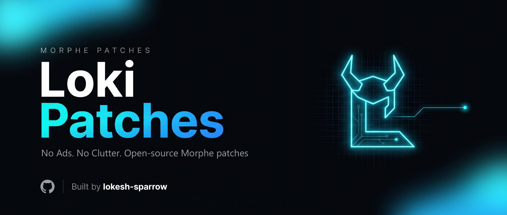

  

 

[**Features**](#features) · [**Install**](#install) · [**Settings**](#settings) · [**FAQ**](#faq) · [**Report a bug**](https://github.com/lokesh-sparrow/loki-patches/issues/new/choose)

 

Stable releases. Made for LinkedIn <b>4.1.1270</b>. Turn off auto-update for LinkedIn in Play Store, or it replaces the patched app.

> [!NOTE]
> Built and maintained by **Lokesh Sparrow**. You patch the LinkedIn app on your own phone with Morphe
> Manager; nothing is sent anywhere. Not affiliated with LinkedIn or the Morphe project.

---

## Features

| | |
|---|---|
| ✂️ **Copy text** | Long press any post, comment or profile text to select and copy it, right where it is |
| 🚫 **No ads** | Promoted posts, promoted jobs, Premium and AI upsells, sponsored messages |
| ⬇️ **Downloads** | Photos and videos in full screen (one or **all** of a post), profile photos and banners, in the best quality |
| 📄 **Documents as PDF** | Save a post's document or carousel as one PDF file |
| 🧹 **Feed filters** | Focus mode, and hide suggested posts, celebrations, job cards, network activity, videos, AI suggestions and more |
| 🕵️ **Anonymous profile viewing** | Visit profiles without showing up in their "Who viewed your profile" (experimental) |
| 👻 **Ghost mode** | Chat without the typing indicator or automatic read receipts |
| 🔗 **Clean links** | Open outside links directly, strip tracking from links you share |
| 🛡️ **Block tracking** | Stop most of LinkedIn's analytics |
| 🎨 **Material You** | Your wallpaper's colors, and an optional flat feed without gaps |
| ⚫ **AMOLED black bars** | Pure black top bar, bottom bar and side menu in dark mode (needs Material You) |
| 🖤 **Dark app icon** | Black launcher icon with the white "in", instead of LinkedIn's blue (optional) |
| 👆 **Swipe between feeds** | Swipe left or right to switch For you and Network, and Grow and Catch up |
| 🖼️ **Tap to hide in viewers** | Tap a document or video in full screen to hide its caption and buttons |
| ⋯ **Post menu items** | Copy text, Download media and Save as PDF in a post's menu |
| 🧭 **Hide bottom tabs** | Take My Network and Jobs out of the bottom bar |
| 🔑 **Google sign-in** | "Continue with Google" through microG RE |

### Anonymous profile viewing

Visit a profile without it appearing in that member's "Who viewed your profile", or in company page visitor lists.

1. Turn on **Anonymous profile viewing** in the Loki Patches settings, under **Privacy**. It is off by default and
   marked experimental.
2. Open profiles as usual. The app leaves out the analytics events that profile pages send, so the visit is not counted.

It works by not sending those events, not by hiding the visit on the server. LinkedIn can change what a profile page
sends in any update; if a visit still appears, please report it with the diagnostic log.

### Copy text

LinkedIn doesn't let you copy what people write. With Loki Patches you can:

1. **Long press** any text: a post, a comment, a profile's About, a job description.
2. The word under your finger is selected **right where it is**, with Android's selection handles and
   the **Copy · Select all · Share** bar, the same as in any other app.
3. Drag the handles to select more. On posts cut off by "…more", the bar also has **Copy full text**.
4. Tap anywhere to go back.

Long presses that already do something in LinkedIn, like the reaction button, keep working as before.
A tap or a scroll works as usual.

## Install

You need an Android phone and [Morphe Manager](https://morphe.software).

1. In Morphe Manager, **[add the Loki Patches source](https://morphe.software/add-source?github=lokesh-sparrow/loki-patches&name=Loki%20Patches)**
   (or add `https://github.com/lokesh-sparrow/loki-patches` by hand). It gets stable releases only.
2. Choose **LinkedIn**, and download the version Morphe Manager recommends from APKMirror. Take the
   *Android 10+* download, which is a plain APK; the bundle variants cannot be patched.
3. Patch it and install it.

If you used another LinkedIn patch source before, patch with Loki Patches only, not both: picking the
same patches from two sources applies them twice.

## Settings

All the options sit on one screen called **Loki Patches**. Reach it from the **Me** panel (tap your profile
photo) or by long pressing the LinkedIn icon on your home screen, then the **Loki Patches** entry. The same
screen has a search box, settings backup and restore, the update check, and the language picker.

> [!IMPORTANT]
> Please don't share patched APKs. Share this source instead, so everyone gets the latest fixes.

## Patches

<!-- PATCHES_START EXPANDED -->
> **[v2.1.2](https://github.com/lokesh-sparrow/loki-patches/releases/tag/v2.1.2)**&nbsp;&nbsp;•&nbsp;&nbsp;`main`&nbsp;&nbsp;•&nbsp;&nbsp;23 patches total

 LinkedIn&nbsp;&nbsp;•&nbsp;&nbsp;23 patches

 

**🎯 Supported versions:**

| 4.1.1267 | 4.1.1269 | 4.1.1270 |
| :---: | :---: | :---: |

| 💊&nbsp;Patch | 📜&nbsp;Description | ⚙️&nbsp;Options |
|----------|----------------|-----------|
| [AMOLED black bars](#amoled-black-bars) | Turns the dark top bar, bottom bar, side menu and the other screens the app draws pure black, matching the feed that the AMOLED black setting already covers. Needs Material You. |  |
| [Anonymous profile viewing](#anonymous-profile-viewing) | Adds an option (off by default, experimental) to visit profiles without being listed in "Who viewed your profile": the analytics events of profile pages are not sent. |  |
| [Block tracking](#block-tracking) | Adds a switch (off by default) that stops most of LinkedIn's analytics events from being sent. |  |
| [Copy text](#copy-text) | Long press a post, comment or any other text to select and copy it in place, like on Reddit. |  |
| [Dark app icon](#dark-app-icon) | Black launcher icon with the white "in", instead of LinkedIn's blue. Chosen when patching: a launcher icon cannot switch with dark mode on its own. |  |
| [Disable double-tap like](#disable-double-tap-like) | A double tap on a post or a photo no longer likes it. |  |
| [Download media](#download-media) | Puts a download button in the full screen photo, video and document viewer; documents (PDFs and carousels) are saved as a single PDF. |  |
| [Feed filters](#feed-filters) | Adds a set of filters that are off until turned on in Loki Patches: focus mode, celebrations, job cards, reposts, posts from other people's activity, "Recommended for you", video posts, games, the "New posts" pill and "See translation". |  |
| [GmsCore support](#gmscore-support) | Routes "Continue with Google" through microG RE (GmsCore) instead of Google Play services, so signing in works in patched LinkedIn. microG RE has to be installed and signed in to a Google account. |  |
| [Hide Premium upsells](#hide-premium-upsells) | Drops the Premium and AI upsell cards and banners, on profiles and in the Me panel too. |  |
| [Hide ads](#hide-ads) | Removes sponsored (promoted) posts from the feed. |  |
| [Hide bottom tabs](#hide-bottom-tabs) | Adds switches to take My Network and Jobs out of the bottom bar. |  |
| [Hide promoted jobs](#hide-promoted-jobs) | Drops promoted job listings from the Jobs tab and from job searches. |  |
| [Hide suggested posts](#hide-suggested-posts) | Drops the "Suggested" posts from people outside your network. |  |
| [Keep feed on reopen](#keep-feed-on-reopen) | Keeps your place in the feed when you come back to LinkedIn, instead of reloading it. Pull down or tap the "New posts" button to load new posts. |  |
| [Material You](#material-you) | Takes the colors from your wallpaper (Android 12+): the accent replaces LinkedIn blue and the green of the selected filters, and the backgrounds, cards, bars and borders become Material 3 surfaces. Some screens LinkedIn draws from its servers may keep their own colors. |  |
| [Messaging](#messaging) | Drops sponsored messages from the inbox, and adds an optional ghost mode that sends no typing indicators and no read receipts. |  |
| [Open links directly](#open-links-directly) | Skips LinkedIn's safety/go warning page and opens external links straight away. |  |
| [Post menu items](#post-menu-items) | Adds Copy text, Download photos and videos, and Save document as PDF to the ⋯ menu of posts. |  |
| [Remove gaps and dividers](#remove-gaps-and-dividers) | Removes the gray gaps between posts and the dividers between list items, so the feed and the lists read as one flat surface. |  |
| [Sanitize share links](#sanitize-share-links) | Strips the tracking parameters from LinkedIn links that get copied or shared. |  |
| [Swipe between feeds](#swipe-between-feeds) | Swipe left and right on the home feed to switch between For you and Network, like on X. |  |
| [Tap to hide in viewers](#tap-to-hide-in-viewers) | Tap a video or document in full screen to hide the caption and buttons, like photos. |  |

<!-- PATCHES_END -->

## FAQ

**How do I stop videos playing on their own, or hide that I'm online?**
LinkedIn has its own settings for both, and Loki Patches leaves them to LinkedIn: **Settings → Account preferences →
Autoplay videos → Never**, and **Settings → Visibility → Manage active status → No one**.

**Is anonymous profile viewing reliable?**
It's experimental. It stops the app from sending the analytics events of profile pages, which is how LinkedIn
counted visits in our tests on 4.1.1270. LinkedIn could change that in an update. If someone still sees you, please
report it.

**I can't find the Loki Patches settings.**
The home screen shortcut only appears once LinkedIn has been opened at least once, and some launchers hide
shortcuts entirely, so use the Me panel instead. If the entry is missing there as well, confirm on the
[patches list](#patches) that your LinkedIn version is supported, and attach a diagnostic report.

**I can't sign in with Google.**
Google checks the app's signature, so signing in with Google needs the **GmsCore support** patch and
[microG RE](https://github.com/MorpheApp/microg-RE) installed and signed in to your Google account. Signing
in with your e-mail and password always works. If you signed up with Google and have no password, set one
on [linkedin.com](https://www.linkedin.com/checkpoint/rp/request-password-reset) first.

**Material You or AMOLED black doesn't change some screens.**
The colors are read when the app is patched, and a few older screens in LinkedIn keep the ones they were
built with. Restarting LinkedIn after a change is still worth it, but those screens stay as they are.

## Reporting a bug

Switch on **Other → Diagnostic logging** in the Loki Patches settings, reproduce the problem, then use
**Copy diagnostic report** and paste the text into a [bug report](https://github.com/lokesh-sparrow/loki-patches/issues/new/choose).
Anything that could identify you (links, IDs, e-mail addresses) is filtered out of the report before it is copied.

## Building from source

You need JDK 17 or newer, the Android SDK, and a GitHub token with `read:packages` in `GITHUB_ACTOR` and
`GITHUB_TOKEN` (Morphe's build tools are on GitHub Packages).

1. Run `./gradlew buildAndroid`.
2. The patch bundle is `patches/build/libs/patches-*.mpp`.
3. Patch with [Morphe Desktop](https://github.com/MorpheApp/morphe-desktop) or Morphe Manager.

## Disclaimer

Loki Patches is an independent project. Neither LinkedIn nor the Morphe project made it, endorses it or is
involved in it. It removes ads and clutter and adds features; it does not unlock paid features or paid content.
Modifying an app can conflict with that app's terms of service, and you install the result at your own risk.

## License

Loki Patches © 2026 Lokesh Sparrow. Free and open-source software under [GPLv3](LICENSE), with additional project terms and third-party attributions in [NOTICE](NOTICE).

---

  Built and maintained by <b>Lokesh Sparrow</b> —
  questions or issues? <a href="https://github.com/lokesh-sparrow/loki-patches/issues">Open an issue</a>.

