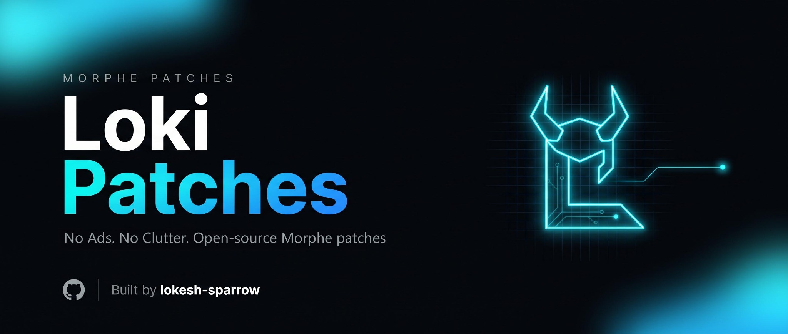

  

### Your apps. Your rules. One Loki experience.

A growing collection of open-source Android patches for Morphe. Remove clutter, take control of your privacy and
make everyday apps work the way you want.

**Every patched app gets the same Loki Patches menu.**

 

<!-- BADGES_START -->
 
<!-- BADGES_END -->

 

[**Apps**](#apps) · [**Install**](#install) · [**Loki Patches menu**](#loki-patches-menu) · [**FAQ**](#faq) · [**Report a bug**](https://github.com/lokesh-sparrow/loki-patches/issues/new/choose)

 

Stable releases. Turn off Play Store auto-update for every app you patch, or it replaces the patched one.

> [!NOTE]
> Built and maintained by **Lokesh Sparrow**. You patch the apps on your own phone with Morphe Manager; nothing is
> sent anywhere. Not affiliated with the developers of the apps listed here, or with the Morphe project.

---

## Apps

Every app with its highlights, the version it is built for, and which file to download from APKMirror. Open an app
for its features, patches and FAQ.

<!-- APPS_START -->
> **[v3.3.0](https://github.com/lokesh-sparrow/loki-patches/releases/tag/v3.3.0)**&nbsp;&nbsp;•&nbsp;&nbsp;`main`&nbsp;&nbsp;•&nbsp;&nbsp;**5** apps&nbsp;&nbsp;•&nbsp;&nbsp;**41** patches

### Featured

<table>
<tr>
<td align="center" width="170"><a href="docs/apps/linkedin.md"> <b>LinkedIn</b></a> 23 patches Copy text, downloads, ad-free feed, ghost chat</td>
<td align="center" width="170"><a href="docs/apps/splitwise.md"> <b>Splitwise</b></a> 5 patches Pro features, no upsells, AMOLED black</td>
<td align="center" width="170"><a href="docs/apps/truecaller.md"> <b>Truecaller</b></a> 3 patches Premium features, no after-call screen</td>
<td align="center" width="170"><a href="docs/apps/doc-scanner.md"> <b>Doc Scanner</b></a> 5 patches Full version, no clutter, clone</td>
<td align="center" width="170"><a href="docs/apps/mx-player-pro.md"> <b>MX Player Pro</b></a> 3 patches Pro unlocked, every audio codec built in</td>
</tr>
</table>

### All apps

💎&nbsp;premium&nbsp;&nbsp;🚫&nbsp;ads&nbsp;&nbsp;🛡️&nbsp;tracking&nbsp;&nbsp;🎨&nbsp;look&nbsp;&nbsp;⬇️&nbsp;downloads&nbsp;&nbsp;🧹&nbsp;clutter&nbsp;&nbsp;📵&nbsp;call screens&nbsp;&nbsp;👯&nbsp;clone&nbsp;&nbsp;🔑&nbsp;Google sign-in&nbsp;&nbsp;🎞️&nbsp;codecs

| App | Highlights | Patches | Version | File | Loki Patches menu |
|---|---|:---:|---|---|---|
|  [**Doc Scanner**](docs/apps/doc-scanner.md) | 💎 🧹 👯 🔑 | 5 | `6.9.14` | **APKM** | Side menu |
|  [**LinkedIn**](docs/apps/linkedin.md) | 🚫 🛡️ 🎨 ⬇️ 🔑 | 23 | `4.1.1272` | **APK (Android 10+)** | Me panel |
|  [**MX Player Pro**](docs/apps/mx-player-pro.md) | 💎 🎞️ | 3 | `1.93.4` | **APK** | Settings |
|  [**Splitwise**](docs/apps/splitwise.md) | 💎 🚫 🛡️ 🎨 🔑 | 5 | `26.11.1` | **APK** | Account tab |
|  [**Truecaller**](docs/apps/truecaller.md) | 💎 📵 🔑 | 3 | `26.44.6` | **APKM** | Profile menu · Settings |

### For any app

Off by default; tick them in Manager for any app.

| 💊&nbsp;Patch | 📜&nbsp;Description | ⚙️&nbsp;Options |
|---|---|---|
| **Change package name** | Changes the package name by adding a suffix (".loki" by default), so the patched app installs next to the original app instead of replacing it. Some apps check their own package name and need a small extra patch to run under the new one. | • Package suffix |
| **Remove ads and trackers** | Removes ads, analytics and crash reporting, and the advertising ID. | • Ads • Analytics and crash reporting • Advertising ID |

<!-- APPS_END -->

## Install

1. Install [Morphe Manager](https://morphe.software), then tap **[Add to Morphe](https://morphe.software/add-source?github=lokesh-sparrow/loki-patches&name=Loki%20Patches)**
   (or add `https://github.com/lokesh-sparrow/loki-patches` by hand). It gets stable releases only.
2. Pick the app. Download the version Manager recommends from APKMirror, in the format the **File** column of
   [Apps](#apps) says: **APK** = the plain APK, **APKM** = the bundle.
3. Patch it and install it.

Use one patch source per app. Two sources for the same app apply the same patches twice, and the result may not
install.

> [!NOTE]
> **Already using Loki Patches for LinkedIn?** Nothing changes for you: same source, same patches, same settings.

## Loki Patches menu

Every patched app gets the same **Loki Patches** menu. Open it from the entry shown in the [Apps](#apps) table, or
long press the app's icon on your home screen.

| Page | What it does |
|---|---|
| *The app's own pages* | Switches and information for that app's patches |
| Patch status | Which patches this install got |
| Backup & restore | Save your settings to a file and restore them, even after reinstalling |
| Diagnostics | Logging, Copy report, Share report |
| General | Show the menu as its own icon in the app drawer |
| About | Version, update check, links |

> [!IMPORTANT]
> Please don't share patched APKs. Share this source instead, so everyone gets the latest fixes.

## FAQ

**I can't find the Loki Patches menu.**
The home screen shortcut appears once the app has been opened at least once, and some launchers hide shortcuts.
Use the entry inside the app (see [Apps](#apps)), or turn on **General → Show in the app drawer**.

**I can't sign in with Google.**
Google checks the app's signature. Tick the app's **GmsCore support** patch and install
[MicroG-RE](https://github.com/MorpheApp/microg-RE), signed in to your Google account.

**The patched app was replaced by a Play Store update.**
Turn off auto-update for that app in the Play Store, then patch it again.

**A patch stopped working after an app update.**
Install the version shown in [Apps](#apps). Other versions may work, but they are not tested.

Questions about one app (LinkedIn autoplay, anonymous viewing and so on) are on that app's page.

## Reporting a bug

In the Loki Patches menu, open **Diagnostics**, switch on **Diagnostic logging**, repeat the problem, then use
**Copy report** (or **Share report**) and paste the text into a [bug report](https://github.com/lokesh-sparrow/loki-patches/issues/new/choose),
choosing the app. Links, IDs and e-mail addresses are removed from the report before it is copied.

## Building from source

You need JDK 17 or newer, the Android SDK, and a GitHub token with `read:packages` in `GITHUB_ACTOR` and
`GITHUB_TOKEN` (Morphe's build tools are on GitHub Packages).

1. Run `./gradlew buildAndroid`.
2. The patch bundle is `patches/build/libs/patches-*.mpp`.
3. Patch with [Morphe Desktop](https://github.com/MorpheApp/morphe-desktop) or Morphe Manager.

## Disclaimer

Loki Patches is an independent project. The apps it patches, their names and their trademarks belong to their
owners; neither they nor the Morphe project made, endorse or are involved in Loki Patches. Modifying an app can
conflict with that app's terms of service, and you install the result at your own risk.

## License

Loki Patches © 2026 Lokesh Sparrow. Free and open-source software under [GPLv3](LICENSE), with additional project terms and third-party attributions in [NOTICE](NOTICE).

---

  Built and maintained by <b>Lokesh Sparrow</b> —
  questions or issues? <a href="https://github.com/lokesh-sparrow/loki-patches/issues">Open an issue</a>.

