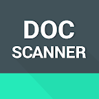

<!-- HEADER_START -->
#  Doc Scanner

   

[← All apps](../../README.md#apps)&nbsp;&nbsp;•&nbsp;&nbsp;`com.cv.docscanner`&nbsp;&nbsp;•&nbsp;&nbsp;[v3.2.1](https://github.com/lokesh-sparrow/loki-patches/releases/tag/v3.2.1)

**🎯 Supported versions:** `6.9.9`
<!-- HEADER_END -->

## Features

| Feature | What you get |
|---|---|
| ⭐ **Full version** | Unlimited scans, cloud upload, OCR, PDF passwords, compression, signatures and themes; the ads go away with it |
| 🧹 **Declutter** | The home-screen promo banner, and the cross-promotion and cloud-login cards after saving, are removed |
| 👯 **Allow clone** | Runs next to the original app when you also tick **Change package name** |
| 🔑 **Google sign-in** | Cloud sign-in and Google Drive through MicroG-RE (optional patch) |

## How-to

### Open the Loki Patches menu

Open it from the side menu, or long press the Doc Scanner icon on your home screen → **Loki Patches**.

### Install next to the original app

Tick **Change package name** (it adds `.loki` to the package name) together with **Allow clone**. Without Allow
clone, the app notices the new name and closes itself at start-up.

### Sign in with Google

1. Install [MicroG-RE](https://github.com/MorpheApp/microg-RE) and sign in to your Google account in it.
2. In Morphe Manager, tick **GmsCore support (Doc Scanner)** when you patch Doc Scanner.
3. Use **Continue with Google** in Doc Scanner as usual.

## FAQ

**Which file do I download?**
The **APKM** bundle from APKMirror, version 6.9.9.

**Text recognition (OCR) fails with "Download failed".**
Doc Scanner downloads its OCR engine from Google Play services. MicroG-RE can't provide it, so OCR needs real Play
services on the phone; scanning and everything else work without it.

## Patches

<!-- PATCHES_START -->
| 💊&nbsp;Patch | 📜&nbsp;Description | ⚙️&nbsp;Options |
|---|---|---|
| **Allow clone** | Lets the app run under a package name made by the Change package name patch: the app compares its own package name with the original at start-up and shuts itself down when they differ. |  |
| **Declutter** | Removes the promo banner on the home screen and the cross-promotion and cloud-login cards on the save-success screen. |  |
| **Enable premium features** | Turns on the app's paid features (unlimited scans, cloud upload, OCR, PDF passwords, compression, signatures, themes). The app skips its ad slots for paid users, so the ads go away with them. |  |
| **GmsCore support (Doc Scanner)** | MicroG-RE integration for Doc Scanner: routes Google sign-in and Google Drive through MicroG-RE instead of Google Play services, and keeps ML Kit's module loader on real Play services so text recognition (OCR) keeps working on phones with Play services. MicroG-RE has to be installed and signed in to a Google account. |  |
<!-- PATCHES_END -->
