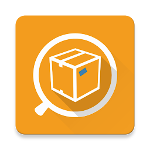

<!-- HEADER_START -->
#  TrackChecker

   

[← All apps](../../README.md#apps)&nbsp;&nbsp;•&nbsp;&nbsp;`com.metalsoft.trackchecker_mobile`&nbsp;&nbsp;•&nbsp;&nbsp;[v3.5.0](https://github.com/lokesh-sparrow/loki-patches/releases/tag/v3.5.0)

**🎯 Supported versions:** `2.30.7`
<!-- HEADER_END -->

## Features

| Feature | What you get |
|---|---|
| 🚫 **Remove ads (TrackChecker)** | Removes the banner ad, with no close button left behind |

## How-to

### Open the Loki Patches menu

- **Top-right overflow menu** (the three dots on the main screen) → **Loki Patches**.
- Long press the TrackChecker icon on your home screen → **Loki Patches**.

### Notes

- TrackChecker has no paid version; its only extra is advertising.
- Built for arm64, armv7, x86 and x86_64.

## Patches

<!-- PATCHES_START -->
| 💊&nbsp;Patch | 📜&nbsp;Description | ⚙️&nbsp;Options |
|---|---|---|
| **Remove ads (TrackChecker)** | Removes the banner ad in TrackChecker. The app has no paid version, so the ads are its only extra. |  |
<!-- PATCHES_END -->
