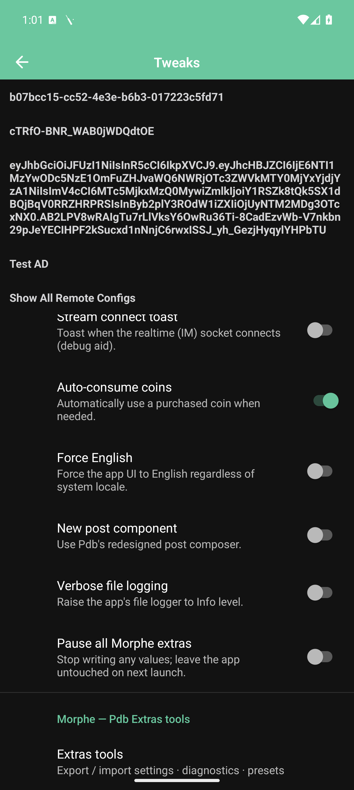
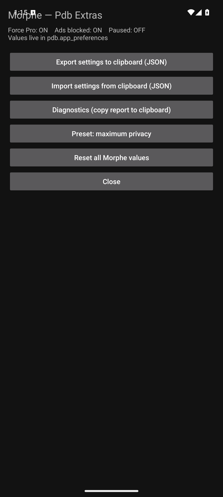
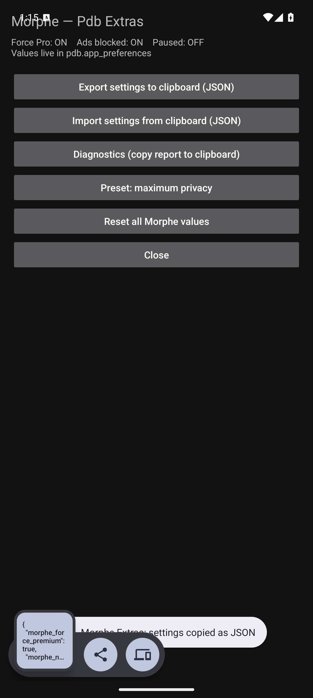

# Pdb Patches

Morphe patch bundle for **Pdb: Personality & Friends** (`pdb.app`) — the MBTI /
Enneagram pen-pal social app.

Verified target: **2.134.6** (versionCode **2694**).

### Add it to Morphe Manager

**[morphe.software/add-source?github=madushas/pdb_patch](https://morphe.software/add-source?github=madushas/pdb_patch)**

Morphe Manager resolves the repository's **latest release**, so a version only
appears here once it has been released with its `patches-<version>.mpp` asset.
Bumping `gradle.properties`, `patches-bundle.json` and `patches-list.json` alone
does not publish anything.

This repository is a slimmed fork of the Morphe patch template
([`rushiranpise/morphe-patches`](https://github.com/rushiranpise/morphe-patches))
that keeps **only** the Pdb patches plus the shared patch library, so the bundle
can be built and maintained on its own.

## Patches

| Patch | Default | What it does |
|---|---|---|
| **Unlock Pro** | ✅ | Forces `isProUser()` true and the `ProStatus` model to Pro → every entitlement. |
| **Bypass PairIP license check** | ✅ | Replaces `com.pairip.application.Application` with `pdb.app.App`, drops `LicenseActivity` / `CHECK_LICENSE`, no-ops `LicenseClient`. |
| **Remove ads** | ✅ | Disables the ad SDK init providers (GMS, AppLovin, Vungle, Yandex) and sets the app's own `isADLibDisabled`. |
| **Allow standalone install (split-less APK)** | ✅ | The upstream base APK declares `requiredSplitTypes`, which blocks a standalone install; this removes it. |
| **Pdb Extras feature menu** | ✅ | Adds a **“Pdb Extras”** row at the **top of Pdb's Settings screen** → a 5-tab screen (**Quick · Limits · Power · Data · Advanced**): everyday switches, one-tap actions, power tools (user inspector, profile/chat-by-id, hidden screens), database and storage reads, and the backend/identity overrides. Premium and ad removal are patch-time and have no switch. |
| **Show profile IDs on names** | ✅ | Appends `#id` after every profile name the app renders — Soul cards, chat headers and lists — so you can act on a profile without opening it. Hot toggle in Quick. |
| **Floating power button** | ✅ | Draggable ⚡ button on **every Pdb screen** with hot toggles, *copy my profile ID*, *copy last viewed profile* and a shortcut into Pdb Extras. Skips the splash, sign-in, story and Extras screens. |
| **No profile-visitor limit** | ✅ | Lifts Pdb's client-side cap of 3 profile-visitor views per rolling hour (the “take a break” sheet) and adds a Limits tab with a counters view and a daily-counter reset. |
| **Disable trackers** | ✅ | Disables Google Analytics measurement and Yandex AppMetrica telemetry; turns off Crashlytics/Analytics data collection via their official opt-out flags. Push notifications and sign-in keep working. |

Optional shared patches (disabled by default): *Spoof app signature*,
*Spoof install source*, *Spoof Widevine / DRM*.

Full details, the switch → preference mapping and the sign-in caveat:
**[docs/pdb.md](docs/pdb.md)**. Design notes, gotchas and the verification
checklist: **[docs/PLAN-PDB.md](docs/PLAN-PDB.md)**.

## Screenshots

| Injected menu (bottom of Pdb's Tweaks) | Extras tools | Export → clipboard |
|---|---|---|
|  |  |  |

## Build

The Morphe Gradle plugin resolves from GitHub Packages, so a token is required:

```bash
export GITHUB_ACTOR=<your-github-user>
export GITHUB_TOKEN=<token-with-read:packages>
./gradlew :patches:build
```

Output: `patches/build/libs/patches-<version>.mpp`.

## Patch an APK

```bash
java -jar morphe-desktop.jar patch \
  --patches=patches/build/libs/patches-<version>.mpp \
  --bytecode-mode FULL \
  -o pdb_patched.apk \
  pdb_original.apk
```

`tools/pdbbuild` wraps that (and `--install` also installs to a connected
device). Put the upstream base APK at `pdb_original.apk`, or point `PDB_INPUT`
at it. `tools/pdbverify` runs the static verification pass; `tools/pdbdevice`
installs and smoke-tests on a running emulator/device.

## Device notes

* Pdb is **ARM-only**: it `System.load`s an aarch64 `libmmkv.so` extracted from
  its assets, so on an x86_64 emulator it only runs when Android assigns
  `primaryCpuAbi=arm64-v8a` (ARM translation). `tools/pdbdevice` adds
  `lib/arm64-v8a/libmmkv.so` for that; real ARM devices need nothing.
* **Google sign-in cannot work on a re-signed APK** — Google validates the
  package name + signing-certificate SHA-1 inside Play services. Use
  *Continue with email verification* (behind the *More* button on the login
  screen) instead. See [docs/pdb.md](docs/pdb.md#signing-in).

## Layout

```
patches/    Kotlin patch sources (app/template/patches/pdb + shared library)
extensions/ Java code injected into the patched app (extension/pdb)
tools/      build / verify / device helper scripts
docs/       patch documentation, plan, screenshots
```

## License

GPLv3 — see [LICENSE](LICENSE) and [NOTICE](NOTICE). Built on the Morphe patch
template by the Morphe project and the contributors of
`rushiranpise/morphe-patches`; the Pdb-specific patches and extension are
maintained here.
