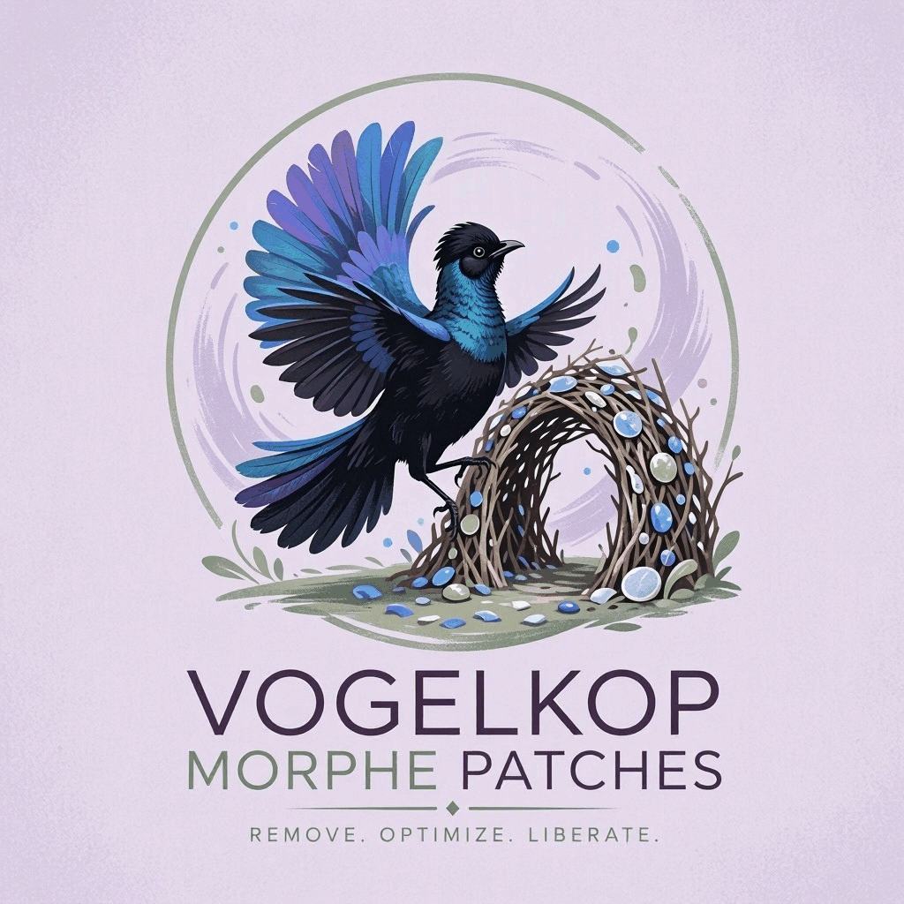

<div align="center">
  
</div>

# Vogelkop-MorphePatches

Morphe patches repository. This project is named after the Vogelkop bowerbird, a
species of bird that has its males build an elaborate fort made of shiny things
and whose mating call is able to mimic complex sounds (including car alarms,
camera shutters, and chainsaws).

De-ads the Opera browser family, for use with the
[Morphe](https://morphe.software/) patcher (ReVanced-style Android patcher):

- **Removes Opera's built-in ads** — sponsored/partner Speed Dial tiles and the
  third-party ad network modules (Pangle/ByteDance, Mintegral, Liftoff/Vungle)
  that Opera bundles for monetization.
- **Disables the "Acceptable Ads" whitelists** — Opera ships hidden filter lists
  whose only job is to *un-block* the trackers and advertisers of paying
  partners. These patches replace them with empty lists so the built-in ad
  blocker actually blocks.
- **Adds filter lists** — documents and enables the extra lists that Opera ships
  but leaves off by default (uBO, AdGuard, Peter Lowe, Fanboy, 36 regional
  lists), which are toggleable in Settings once patched.

Built from a full reverse-engineering pass over **Opera 103.3.5234.91185**,
**Opera Beta 104.0.5262.91143** and **Opera GX 3.3.18**. See
[`evidence/ANALYSIS.md`](evidence/ANALYSIS.md) for everything found inside the
APKs, including the full decompressed partner whitelists.

---

## Patches

| App | Patch | What it does |
|---|---|---|
| All three apps | **Disable analytics & tracking** | Rewrites the tracker endpoint constants embedded in the dex to a dead host: 81 constants on stable/beta (Firebase Analytics `app-measurement.com`, Google Ads/Doubleclick/IMA, `pagead2.googlesyndication.com`, and Leanplum's `Constants.API_HOST_NAME` static field) and 8 on GX. Firebase infrastructure that features depend on (push notifications, feature flags, GX's internal filter list) is deliberately untouched. |
| Opera & Opera Beta | **Disable ad modules** | Rewrites the reflective class-name lookups (`com.opera.android.ads.{pangle,mintegral,liftoff}.*ModuleImpl`) to a non-existent class so no third-party ad SDK module is ever instantiated. Safe by construction: the module availability probe (`Lk8;->a0()Z`) wraps the class lookup in try/catch and falls back to a no-op ads provider, exactly like an uninstalled Pangle split. |
| Opera & Opera Beta | **Ignore browser boot failures** | The Chromium engine ships inside the APK (an 84 MB 32-bit `libopera.so`, kept byte-identical by patching). If its load or start still fails (e.g. x86 hardware without ARM translation), Opera's MainLibraryBoot coordinator announces the failure to the welcome flow, which previously called the now-hidden *broken installation* dialog and then waited forever — the "stuck on the purple splash, black screen after restart" symptom. This patch converts those failure announcements into success notifications so startup always continues. The coordinator and its callback interface are located fully structurally (stable `"MainLibraryBoot: "` log tag). |
| Opera, Opera Beta & GX | **Spoof app signature** | Presents Opera's original "Opera Software" signing certificate to the app instead of the Morphe key, using a `PackageInfo.CREATOR` parcel proxy installed by a tiny extension (see `extensions/`, ApkSignatureKillerEx lineage). Opera's code reads its own signature in several places (preinstall partner checks, the MoMi SDK, metrics); with the spoof those reads keep their vendor-build behavior. The official certificate (SHA-256 `5d6afbf8…b8`) is bundled; an optional `signature` option accepts a custom Base64 DER. |
| Opera & Opera Beta | **Hide broken installation dialog** | Neutralizes the modal *"Your app installation appears to be broken. Try to uninstall and reinstall … again."* This dialog is Opera's **crash-recovery nag**, not a signature check — it also appears on unmodified installs after a crash, inside app-cloning tools (dual-space), or on ARM/x86 mismatches. Because a patched build cannot be "fixed" by reinstalling, the patch turns the dialog builder into a no-op and forces the `OperaApplication` broken-installation flag to `false` so startup continues normally. See [`evidence/ANALYSIS.md`](evidence/ANALYSIS.md) §"Broken installation dialog" for the full chain. |
| Opera & Opera Beta | **Remove sponsored Speed Dial** | Appends `WHERE 0` to the suggested-sites database queries (`SELECT * FROM partner_data`, `… FROM partner_tree LIMIT 1`, `… FROM domain_data`), so no sponsored/partner tiles are ever shown. Schema and regular Speed Dial are untouched. |
| Opera & Opera Beta | **Disable Acceptable Ads whitelist** | Scans `assets/abp_files/op/`, detects lists that consist *only* of allow directives (`DOCUMENT`/`WHITE.PLAIN`/`WHITE.GLOB` and no `BLACK` section) and replaces them with an empty compiled list under the same file name. Neutralizes the Google/Yandex measurement whitelist and the Taboola/gambling/affiliate whitelist — and any future pure-whitelist list Opera adds. |
| Opera GX | **Remove sponsored Speed Dial** | Strips sponsored entries (Eneba, Instant Gaming, Amazon and other affiliates routed through `operagx.gg`, or carrying a `realUrl` partner field) from `assets/preloadedTopSites/*.json`, keeping organic tiles like YouTube/Twitch. |

All bytecode patches use **structural fingerprints** (SQL text, class-name
constants, resource-literal names like `string/welcome_init_failure`, the
`MainLibraryBoot: ` log tag, framework-stable overrides like `doInBackground`)
rather than obfuscated class names, so they match across stable, beta and
different builds of the same version. Each patch fails loudly (instead of
silently doing nothing) if its targets are missing.

### About Google Play Protect

Play Protect's *"scan this app"* / lockscreen prompt appears for **every**
sideloaded APK that is not signed by a known vendor — it is a property of the
installer, not of these patches, and it cannot be patched away. Scanning or
bypassing it is safe here: the bundle is open source, and the release assets
carry an Ed25519 signature (`morphe-signing.pub`) you can verify.

## Memory usage

Morphe Manager is an Android app; patching a 147 MB Chromium base APK inside a
phone is inherently heavy, but the bundle used to make it *worse than needed*:
the string-replacement patches scanned every class with
`classDefForEach { mutableClassDefByOrNull(...) }`, which materializes a mutable
copy of **every class in the app** — the documented out-of-memory antipattern in
the Morphe patcher.

Since v1.1.0 the patches use the same pattern as the official Morphe patches
(`string(...).matchAllMethodIndicesForEach`, GmsCore-support style): only the
few classes that actually change are ever copied into mutable form, and the
scan runs on the patcher's prebuilt string index.

Measured locally (Opera Beta 104.0.5262.91143 `base.apk`, 147 MB, all patches
applied, JVM heap capped at 2 GB):

| | before (v1.0.0) | after (v1.1.0) |
|---|---|---|
| Peak patch-process RSS | 1.1–1.5 GB (reported on device) | **333 MB** |

On-device tip: in Morphe Manager's expert settings, raise the patching process
limit to the maximum (~1280 MB) for headroom and fewer mid-patch kills.

### Verifying a build yourself

The bundle can be applied to a real APK headlessly on any JVM (this is what the
release pipeline does before publishing):

```bash
./gradlew patchTestApk -PtestApk=/path/to/base.apk -PtestOut=/tmp/patched.apk
```

The driver reports per-patch success/failure and the peak RSS of the patching
process. Pass `-PtestPackage=<package>` to only run patches that declare
compatibility with that app (as Morphe Manager does). On Opera Beta
104.0.5262.91143 and Opera stable 103.3.5234.91185 `base.apk` all six
Opera/Beta patches succeed; on Opera GX 3.3.18 the two GX-compatible patches
succeed.

The runtime hook extension is compiled against the real Android framework
and mechanically audited: `tools/build_extension.sh` builds `extension.mpe`
and runs `tools/AuditExtDex.java`, which resolves **every** `android/*`
reference in the built dex against the framework through reflection and fails
the build if any of them would not exist on a device. (That guard is the
outcome of v1.2.0, whose stub-compiled extension crashed every patched app at
startup.) `tools/FindStrings.java` and `tools/VerifyApkSig.java` are the
matching inspection helpers used to verify patched output.

## What the user asked for vs. what is technically possible

> *"replace its ad blocker with a ublock origin style adblocker with configurable
> blocklists"*

Opera's ad blocker is compiled into the app (native engine + proprietary binary
list format on stable/beta; a JSON config fetched at runtime on GX), so a static
APK patch cannot embed uBlock Origin itself. What these patches do instead:

1. **Kill the partner whitelists** so the built-in engine blocks what it should
   have blocked all along (the biggest real-world win — see
   `evidence/whitelist_f66a1f2c_partner_affiliate.txt` for what was being let
   through).
2. **Expose the extra lists Opera already ships but disables**: after patching,
   open **Settings → Ad blocking → Manage lists** and enable *uBO: Filters*,
   *uBO: Privacy*, *uBO: Annoyances*, *AdGuard Base/Tracking*, *Peter Lowe's
   list*, *Fanboy's Annoyance/Cookie lists* and your regional list. These
   download through Opera's own list updater (OFA) and are fully maintained —
   a curated uBlock-style selection with zero extra code.
   The whitelists are already gone at that point, so nothing you enable gets
   silently un-blocked.
3. GX users: the same list picker exists (**Settings → Ad blocking → Manage
   lists**) with 52 lists incl. uBO/AdGuard — GX's config is downloaded at
   runtime (`adblocker_v2` JSON) and cannot be modified by a static patch.

## Which APK to patch

| App | Recommended input | Notes |
|---|---|---|
| Opera stable | Direct download from `get.opera.com/ftp/pub/opera/android/10300/` (`Opera_103_3_5234_91185_Generic_Opera_arm8_LZMA.apk`, versionCode 1910312408) | Single full APK, no splits. |
| Opera stable (Play) | `base.apk` of the Play bundle, or a merged universal APK (e.g. APKEditor `merge`) | Play builds download the Chromium core at first run; all patched code is in `base.apk`, so patching the base works. |
| Opera Beta | `base.apk` of the Play bundle (104.0.5262.91143, versionCode 1910404306) | Beta full builds are not on the public CDN. |
| Opera GX | The XAPK/APKM bundle from APKMirror (3.3.18, versionCode 199) | GX is a WebView-based app (66 MB); no core download involved. |

No version codes are pinned: there is one release per version per file type,
and every patch fails loudly (instead of silently doing nothing) if its targets
are missing.

## Importing into Morphe

**Yes — this repo is a first-class Morphe patch source.** It is built on the
official [`MorpheApp/morphe-patches-template`](https://github.com/MorpheApp/morphe-patches-template)
layout (Gradle plugin `app.morphe.patches`, patcher `app.morphe:morphe-patcher`),
and every release ships a compiled `patches-<version>.mpp` bundle that Morphe
Manager / Morphe Desktop load directly.

### Add this repo as a patch source

1. Open this link (or paste the repo URL into **Morphe Manager → Settings →
   Patch sources**):

   **https://morphe.software/add-source?github=maniesh-NR/Vogelkop-MorphePatches**

2. Morphe reads the latest GitHub release of this repo, so pick the Opera
   APK/XAPK you want to patch when prompted.
3. Enable the Opera patches (all default-on) and patch.
4. Install the patched APK. If you patch a Play split bundle, merge it to a
   universal APK first, and uninstall the original (different signature).

Alternatively, download `patches-<version>.mpp` from the
[releases page](https://github.com/maniesh-NR/Vogelkop-MorphePatches/releases)
and load it in [Morphe Desktop](https://github.com/MorpheApp/morphe-desktop)
like any other patch bundle.

### Building the bundle yourself

The Morphe patches Gradle plugin is published on GitHub Packages, so a local
build needs a GitHub token with `read:packages` access:

```bash
export GITHUB_ACTOR=<your-github-username>
export GITHUB_TOKEN=<pat-with-read-packages>   # or gpr.user/gpr.key in gradle.properties
./gradlew buildAndroid                         # → patches/build/libs/patches-*.mpp
./gradlew generatePatchesList                  # → regenerates patches-list.json
```

`patches-list.json` and `patches-bundle.json` in the repo root are generated
from the compiled bundle (they are committed by the release pipeline, matching
upstream conventions).

### Reusing the patches upstream

The source tree is laid out exactly like the official template:

```
patches/src/main/kotlin/app/template/patches/opera/…
```

Copy the `opera/` package into `patches/src/main/kotlin/app/template/patches/`
and register the four `Compatibility` blocks from `OperaCompat.kt` wherever
your bundle declares its app targets.

## Limitations & honest notes

- **Opera's first-party promo cards / news feed**: start-page promos are served
  by Opera's own `ads_mobile_sdk` (~1,770 classes) and the promo/news system.
  Surgically disabling it risks crashes and kills the news feature entirely
  (not just its ads), so it is out of scope; the sponsored *tiles* (the most
  visible built-in ads) are removed by the suggested-sites patch. If you want
  the whole feed gone, disable it in start-page settings, or block the hosts in
  `evidence/ANALYSIS.md` §4 at the DNS level.
- **List freshness**: the whitelist assets are patched at install time. If
  Opera's list updater (OFA) later pushes a *new* whitelist file under a new
  content-hash name, re-patch the new version — the detection rule
  (pure-allowlist ⇒ empty) will catch it automatically in the updated APK.
- **GX ad-block config**: downloaded at runtime; a static patch cannot rewrite
  it. The sponsored tiles (bundled in the APK) are removed.
- The patches intentionally do **not** touch Opera's VPN, Aria AI, or news
  features.

## File map

```
patches/src/main/kotlin/app/template/patches/
├── opera/
│   ├── OperaCompat.kt                  Compatibility targets (stable/beta/GX)
│   ├── analytics/DisableAnalyticsPatch.kt      all: tracker endpoints → dead host
│   ├── ads/DisableAdModulesPatch.kt    stable+beta: Pangle/Mintegral/Liftoff
│   ├── ads/RemoveSponsoredSpeedDialPatch.kt  stable+beta: partner_data SQL
│   ├── adblock/DisableAcceptableAdsPatch.kt  stable+beta: whitelist assets
│   ├── startup/HideBrokenInstallationDialogPatch.kt  stable+beta: crash-recovery nag
│   ├── startup/IgnoreBrowserBootFailuresPatch.kt     stable+beta: MainLibraryBoot deadlock
│   └── gx/GxRemoveSponsoredTilesPatch.kt     GX: preloadedTopSites JSON
└── shared/signature/SpoofAppSignaturePatch.kt  all: original-cert spoof (w/ extension)
patches/src/main/resources/extensions/extension.mpe   raw-dex extension bundled in the .mpp
extensions/extension/src/.../SignatureHookApp.kt      runtime hook source (Kotlin, no stdlib)
tools/
├── build_extension.sh                  builds+audits extension.mpe (real framework, no Android SDK)
├── AuditExtDex.java                    audits every android/* ref in the extension dex
├── FindStrings.java                    finds where strings live in an APK's dex (fields vs code)
├── VerifyApkSig.java                   apksig-based output signature check
├── .cache/                             downloaded build deps (gitignored)
└── verify_patches.py                   static fingerprint verification harness
patches/src/main/kotlin/util/
├── PatchListGenerator.kt               patches-list.json generator (from the template)
└── PatchTestDriver.kt                  local headless verification driver (dev only)
patches-bundle.png                      source icon shown by Morphe Manager (must sit
                                        next to patches-bundle.json in the repo root)
evidence/
├── ANALYSIS.md                         full reverse-engineering write-up
├── whitelist_97bda3c5_google_yandex_measurement.txt
└── whitelist_f66a1f2c_partner_affiliate.txt
```

## Attribution & acknowledgements

- **Built with AI**: this project — the reverse-engineering pass over the three
  Opera APKs, the patch code, fingerprints and the analysis in
  [`evidence/`](evidence/ANALYSIS.md) — was produced by the **Z.ai autonomous
  coding agent**, powered by the **GLM** large language model from Z.ai, working
  from a user brief (find Opera's built-in ads and paid "Acceptable Ads"
  whitelists, and write Morphe patches against them). All findings were verified
  mechanically against the real APKs; see [`tools/verify_patches.py`](tools/verify_patches.py)
  for the verification harness.
- **[Morphe](https://morphe.software/) / [MorpheApp](https://github.com/MorpheApp)** —
  the patcher framework, the patches Gradle plugin, Morphe Manager / Morphe
  Desktop, and the [`morphe-patches-template`](https://github.com/MorpheApp/morphe-patches-template)
  this repo's build layout is based on (including `util/PatchListGenerator.kt`).
- **[rushiranpise/morphe-patches](https://github.com/rushiranpise/morphe-patches)** —
  community patch collection that served as the initial structural reference,
  and whose `shared/signature` patches (GPL-3.0, from jkennethcarino/adobo,
  originally [ApkSignatureKillerEx](https://github.com/L-JINBIN/ApkSignatureKillerEx))
  were ported to Kotlin for the *Spoof app signature* extension used here.
- **Tooling**: [Apktool](https://apktool.org/) (resources/smali),
  [JADX](https://github.com/skylot/jadx) (decompilation), dexlib2/smali
  (bytecode rewriting), plus Opera's own filter-list format (OFA compiled lists).
- **Opera**, of course, for the browser being patched.

## License

[AGPL-3.0](LICENSE) — the repository license. The patch sources are laid out to
be drop-in compatible with the upstream [morphe-patches](https://github.com/rushiranpise/morphe-patches)
project.
