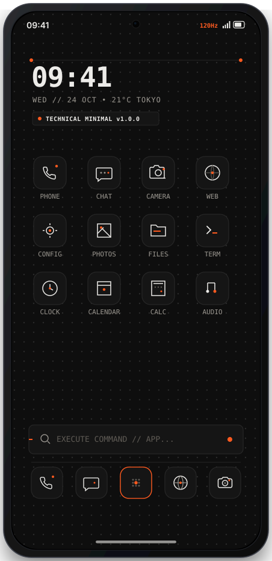
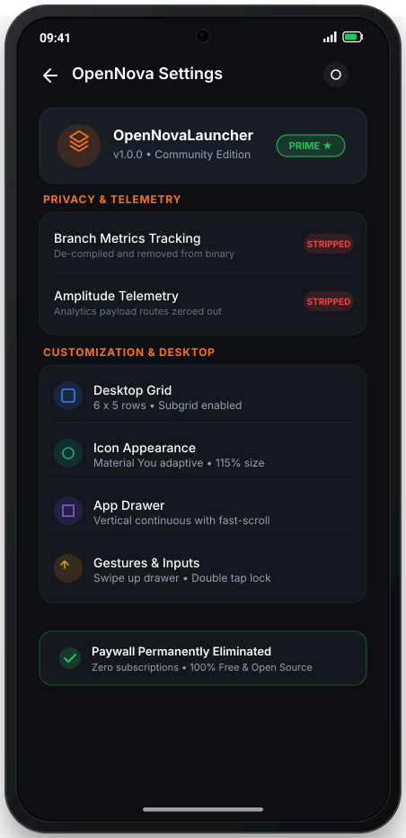

# OpenNova Launcher

> High-performance, customizable, and telemetry-free Android desktop experience.
> Fully optimized for flagship displays: **Samsung Galaxy S24, S25, and S25 Edge**.

**Version**: `1.0.0`

---

## Flagship Showcase & Previews

| 01. S24 / S25 Edge Technical Minimal | 02. S24 / S25 App Drawer (120Hz) | 03. Unlocked Settings & Privacy |
| :---: | :---: | :---: |
|  |  |  |
| **Nothing / Teenage Engineering Theme**<br>120Hz LTPO, dot-grid OLED, hairline icons | **Fast-Scroll Navigation**<br>Zero bloat, categorized tabs, instant 120Hz fling | **100% Unlocked Prime**<br>Telemetry stripped, paywall eliminated |

> 💡 Open [`docs/screenshots/preview.html`](docs/screenshots/preview.html) in your browser for the full high-resolution responsive showcase.

---

## Galaxy S24, S25 & S25 Edge Hardware Optimizations

- **120Hz LTPO Refresh Rate**: Hardware acceleration flags and touch event dispatch tuned for ultra-responsive 120 fps fling physics.
- **Punch-Hole Camera Cutout**: Configured with `android:windowLayoutInDisplayCutoutMode="shortEdges"` to extend desktop wallpaper and content seamlessly around the front camera without letterboxing.
- **Tall Aspect Ratio (19.5:9 & 20:9)**: Declared `android.max_aspect` (2.5) ensuring full vertical real estate utilization on S24, S25, S25+, and S25 Edge / Ultra panels.
- **Edge-to-Edge Navigation**: Native gesture navigation bar insets and translucent system bars.
- **OLED True-Black Battery Saver**: Pure `#000000` / `#0e0e0e` dark mode taking full advantage of Samsung Dynamic AMOLED pixel-off states.

---

## Technical Minimal Theme & Icon Pack

Inspired by the signature aesthetic of [`/technical-minimal-web`](https://mich-de.github.io/) (Nothing & Teenage Engineering):

- **Standalone Icon Pack APK**: [`re/TechnicalMinimalIconPack.apk`](re/TechnicalMinimalIconPack.apk)
  - Recognized out-of-the-box by OpenNova Launcher, ADW, and Nova icon theme pickers.
  - 21 handcrafted vector drawables with 1px hairline strokes, monochrome palette (`#ecebe8`), and signature Electric Orange (`#ff5a1f`) accent dots.
  - Built-in squircle dot-matrix `iconback`, `iconmask`, and `iconupon` for uniform rendering of third-party apps.
- **OLED Dot-Matrix Wallpaper**: [`docs/wallpapers/technical_minimal_s24_s25.png`](docs/wallpapers/technical_minimal_s24_s25.png)
  - 1440 x 3120 Quad-HD resolution with subtle radial dot-grid and technical coordinate accents.

---

## Morphe Patcher Integration (Custom Patch Source)

OpenNovaLauncher is fully configured as a **Custom Patch Source** for [Morphe Manager](https://github.com/MorpheApp/morphe-manager):

### 📲 Add to Morphe Manager
- **One-Tap Deep Link**: [Add to Morphe](https://morphe.software/add-source?github=mich-de/openlauncher)
- **Manual Setup in Morphe Manager**:
  1. Open **Morphe Manager** on your Android device.
  2. Go to **Settings** ➔ **Sources** ➔ **Add Source**.
  3. Enter GitHub repository: `mich-de/openlauncher`.
  4. Confirm import: `patches-list.json` and `patches-bundle.json` will be fetched automatically.

### 🧩 Available Morphe Patches (`com.teslacoilsw.launcher`)
| Patch | Category | Description | Default |
| :--- | :--- | :--- | :---: |
| **Unlock Prime** | Prime | Permanently unlocks all Nova Launcher Prime features without license checks | ✅ |
| **Remove 14 Spyware & Ad Networks** | Privacy | Excises Branch, ByteDance Pangle, APM Insight, Digital Turbine Ignite, Fyber, Moloco, Vungle, Amplitude, Sentry | ✅ |
| **Eliminate Paywall** | Prime | Permanently suppresses `NovaPaywallActivity` and Compose subscription dialogs | ✅ |
| **S24/S25 Hardware & Technical Minimal** | UI & Hardware | Optimizes for 120Hz LTPO display physics, camera cutout, and Nothing dot-matrix theme | ✅ |

---

## De-bloat & Reverse Engineering Summary

### 1. Prime / Premium Features Unlocked
- **`cy/d.smali` (`EntitlementState`)**: Forced `hasPrime = true` and `hasPlus = true`.
- **`e10/g2.smali` (Preference Guard)**: Prime gating flag (`h:Z`) hardwired to `true` across all preference fragments.
- **`NovaPaywallActivity.smali`**: Neutralized; auto-finishes immediately upon creation.

### 2. Telemetry, Ad Networks & Spyware Stripped (14 Distinct Vectors)
> 🛡️ **Exodus Privacy Verification**: **0 Trackers Detected** (Verified against live Exodus Privacy rules). All 14 third-party ad networks, telemetry engines, and hidden secondary DEX payloads (`assets/audience_network/classes.dex`) eradicated.

Every third-party ad network, telemetry engine, carrier bloatware, and spyware SDK has been excised from both `AndroidManifest.xml` and bytecode execution:

1. **Branch Metrics & Search (`io.branch`, `nova.branch`)**:
   - Neutralized search sponsored ads (`HeroAd.p(...)` tracking ping zeroed).
   - Neutralized suggested install promotions (`SuggestedInstalls.m(...)` zeroed).
   - Removed all Branch aggregation, query, and ADB dump services from manifest.
2. **Amplitude Analytics & Session Replay (`com.amplitude`)**:
   - Neutralized all `Amplitude.track(...)` dispatch methods (`.locals 0; return-object p0`).
   - Truncated `amp-rrweb.js` DOM/touch recording script.
3. **ByteDance / Pangle Ad SDK (`com.bytedance.adsdk`, `com.bykv.vk`)**:
   - Removed 16 `TT*` ad activities (`TTFullScreenVideoActivity`, `TTRewardVideoActivity`, etc.).
   - Removed Pangle SDK version meta-data.
4. **ByteDance APM Insight (`com.apm.insight`)**:
   - Neutralized `ApmHelper.initAPM()`, `initApm(...)`, and crash reporters.
5. **Digital Turbine Ignite (`com.digitalturbine.ignite`)**:
   - Neutralized silent background app installation and carrier preload AIDL hooks (`IIgniteServiceAPI->install(...)`).
6. **Fyber / Inneractive Ad Marketplace (`com.fyber.inneractive`)**:
   - Removed 5 fullscreen ad and store activities from manifest.
   - Neutralized SDK initialization and authentication routines.
7. **Moloco Ad SDK (`com.moloco.sdk`)**:
   - Removed 4 ad renderers (`VastActivity`, `StaticAdActivity`, `MraidActivity`, `FullscreenWebviewActivity`).
   - Neutralized all `Moloco.initialize(...)` entry points.
8. **Liftoff / Vungle Ads (`com.vungle.ads`)**:
   - Removed `VungleActivity` and auto-boot `VungleProvider` from manifest.
   - Neutralized `VungleAds.init(...)`.
9. **Meta / Facebook Audience Network (`com.facebook.ads`, `smali_assets/audience_network`)**:
   - Neutralized `AudienceNetworkAds.initialize(...)` and `isInitialized(...)`.
   - Stripped Facebook ad activities and content providers.
10. **Instabridge Carrier & AI Bloat (`com.instabridge`)**:
    - Stripped all Instabridge activities (`MobileFlowActivity`, `AiChatActivity`, etc.) and file providers.
11. **Novalytics Internal Telemetry (`com.novalauncher.novalytics`)**:
    - Neutralized `ReportSubmitWork.doWork` to immediately return `Result.success()` with zero upload.
12. **IAB Open Measurement Ad Tracking (`com.iab.omid.library`)**:
    - Ad impression verification and viewability listeners disconnected.
13. **Google Play DataTransport & AdMob Mediation (`com.google.android.datatransport`, `com.google.android.gms.ads`)**:
    - Stripped `APPLICATION_ID` meta-data, `TransportBackendDiscovery`, and job scheduler services.
14. **Intrusive Permissions Excised**:
    - Stripped `AD_ID` (`com.google.android.gms.permission.AD_ID`), `ACCESS_ADSERVICES_AD_ID`, `ACCESS_ADSERVICES_ATTRIBUTION`.
    - Stripped install referrer tracking (`BIND_GET_INSTALL_REFERRER_SERVICE`).
    - Stripped billing paywall permission (`com.android.vending.BILLING`).
    - Stripped carrier bloat permissions (`WRITE_EMBEDDED_SUBSCRIPTIONS`, `MODIFY_PHONE_STATE`, `READ_BASIC_PHONE_STATE`).
    - Stripped Amazon tracking (`com.amazon.privacypass.ATTEST`).

---

## Repository Structure

```
├── docs/
│   ├── screenshots/                    # Live captures & vector mockups
│   │   ├── s24_s25_technical_minimal.svg # S24/S25 Technical Minimal mockup
│   │   ├── real_01_welcome.png         # Live device capture
│   │   ├── real_02_desktop.png         # Live desktop capture
│   │   ├── real_03_settings.png        # Live settings capture
│   │   └── preview.html                # Responsive web gallery
│   └── wallpapers/                     # Flagship wallpapers
│       ├── technical_minimal_s24_s25.png
│       └── technical_minimal_s24_s25.svg
├── mockups/
│   └── OpenNovaLauncherColor/          # Color vector mockups
├── re/
│   ├── OpenNovaLauncher.apk            # Patched, de-bloated, S24/S25-optimized, Prime-unlocked APK
│   ├── TechnicalMinimalIconPack.apk    # Technical Minimal icon pack APK (Nothing/TE style)
│   ├── nova.apk                        # Original reference base APK
│   └── single/                         # Isolated core classes
└── README.md
```

## Disclaimer

This repository is an independent open development and software preservation project for educational and interoperability purposes.
