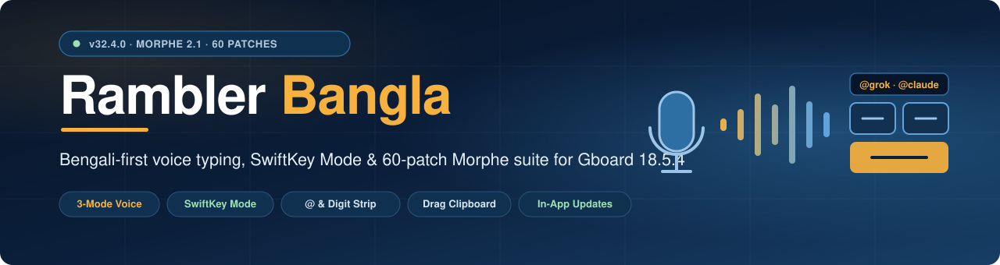
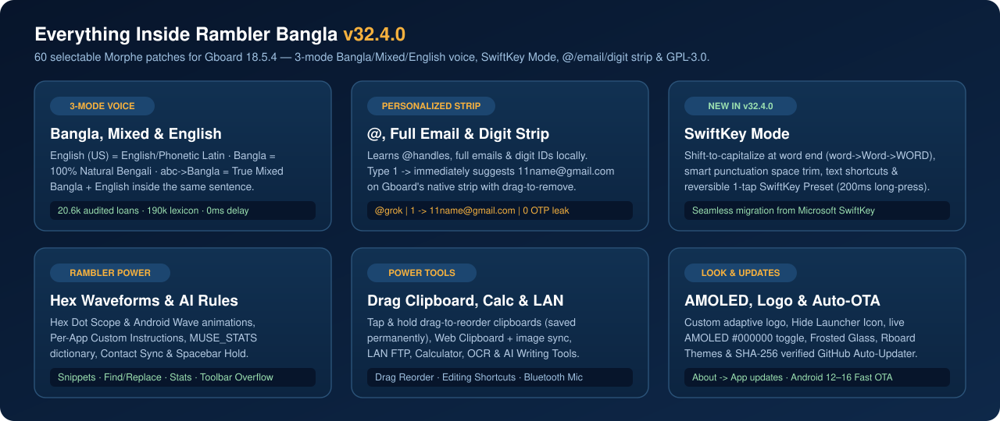
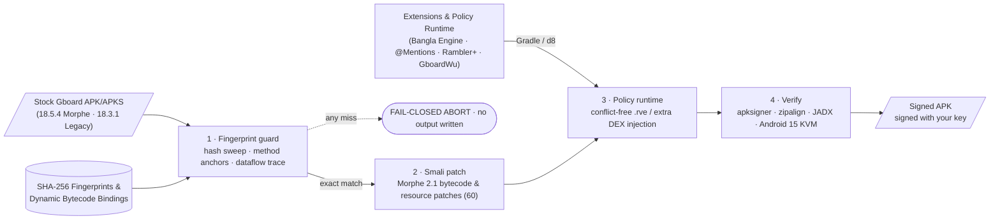
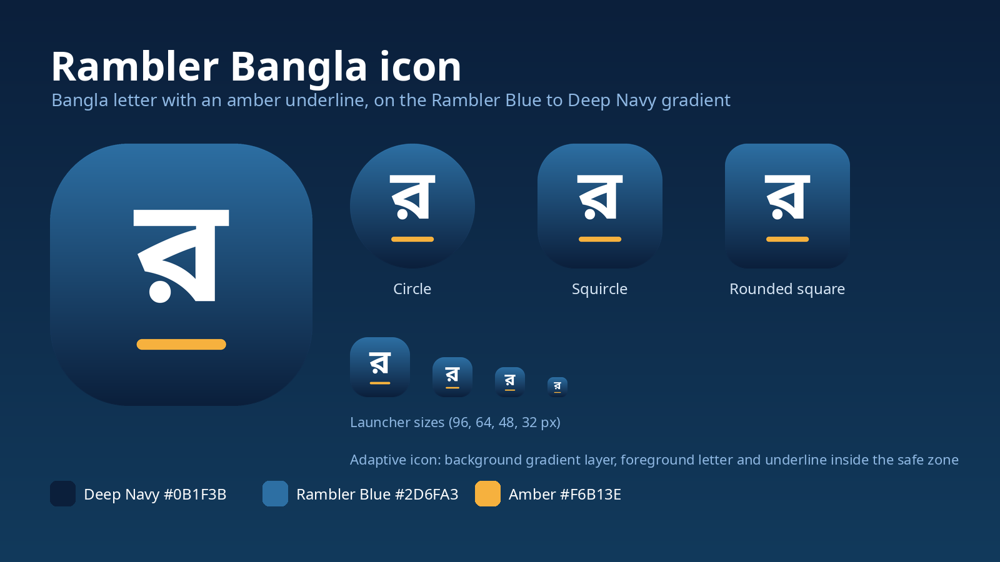

<p align="center"></p>

<h3 align="center">Dictate in Bangla. Get Bangla. A production-grade, 60-patch Morphe suite for Gboard 18.5.4.</h3>

<p align="center">
  A fail-closed, fingerprint-guarded <b>Morphe 2.1</b> patch source combining Bengali-first <b>Rambler+</b> voice typing, <b>SwiftKey Mode</b> for seamless SwiftKey-to-Gboard migration, and <b>100% personalized native Gboard <code>@mention</code>, full-email &amp; 1-digit prefix suggestions</b> with all features from
  <a href="https://github.com/abotmaker/gboard-rambler-enhancements">Gboard Rambler Enhancements</a>,
  <a href="https://github.com/jasonwu1994/Gboard-patches">Gboard Patches (GboardWu)</a>, and
  <a href="https://gitlab.com/johninnld/nl-morphe-patches">nl-morphe-patches</a>.
</p>

<p align="center">
  <a href="https://morphe.software/add-source?github=muhib-karim/Rambler-Bangla&name=Rambler%20Bangla&app=com.google.android.inputmethod.latin&appName=Gboard"></a>
  <a href="https://github.com/muhib-karim/Rambler-Bangla/releases/latest"></a>
  <a href="https://muhib-karim.github.io/Rambler-Bangla/"></a>
</p>

<p align="center">
  <a href="https://github.com/muhib-karim/Rambler-Bangla/actions/workflows/ci.yml"></a>
  <a href="https://github.com/muhib-karim/Rambler-Bangla/actions/workflows/tests.yml"></a>
  <a href="LICENSE"></a>
  
  
  
</p>

<p align="center">
  <a href="#how-to-set-up--use-rambler-bangla-2-minute-guide"><b>2-Min Setup</b></a> ·
  <a href="#swiftkey-mode-moving-from-microsoft-swiftkey"><b>SwiftKey Mode</b></a> ·
  <a href="#features"><b>Highlights</b></a> ·
  <a href="#included-patches"><b>All 60 Patches</b></a> ·
  <a href="#build-from-source"><b>Build from Source</b></a> ·
  <a href="#faq"><b>FAQ</b></a> ·
  <a href="#credits-and-licence"><b>Credits &amp; Licence</b></a>
</p>

<p align="center">
  
</p>

> **Quick Morphe Setup:** Tap **[Add Patch Source to Morphe](https://morphe.software/add-source?github=muhib-karim/Rambler-Bangla&name=Rambler%20Bangla&app=com.google.android.inputmethod.latin&appName=Gboard)** or paste `https://raw.githubusercontent.com/muhib-karim/Rambler-Bangla/main/patches-bundle.json` in Morphe Manager, then select official Gboard `18.5.4.993608717-release-arm64-v8a`.

---

## How to Set Up & Use Rambler Bangla (2-Minute Guide)

Ordinary users don't need any coding or command line. Follow these 4 quick steps:

### Step 1 — Install (Choose Either Option)
- **Option A — Direct APK (Fastest):** Download `RamblerBangla-v32.4.0-gboard-18.5.4-arm64-v8a.apk` from the **[Latest Release](https://github.com/muhib-karim/Rambler-Bangla/releases/latest)** and install it. It installs **side-by-side** alongside stock Gboard (`Rambler Bangla`) with its own `র` logo.
- **Option B — 1-Click Morphe Manager:** Install [Morphe Manager](https://morphe.software), tap **[Add Patch Source to Morphe](https://morphe.software/add-source?github=muhib-karim/Rambler-Bangla&name=Rambler%20Bangla&app=com.google.android.inputmethod.latin&appName=Gboard)**, pick official Gboard `18.5.4.993608717-release-arm64-v8a`, choose your patches, and tap **Patch**.

### Step 2 — Add Only These 3 Keyboards (No `Bangla (Latin)` Needed!)
Open **Rambler Bangla → Settings → Languages → Add keyboard** and keep **just these 3 keyboards**:
1. **`English (US)`** → `QWERTY`
2. **`বাংলা (বাংলাদেশ)`** → `বাংলা`
3. **`বাংলা (বাংলাদেশ)`** → `abc → বাংলা`

*(You do **not** need to install `Bangla (Latin)` — those 3 keyboards give you all 3 dictation modes automatically!)*

### Step 3 — Turn On Rambler+ Voice Typing
Open **Rambler Bangla → Settings → Voice typing** and enable **Rambler+**. It activates immediately on non-Pixel and Pixel Android phones without waiting for Google rollout gates.

### Step 4 — Tap the Mic & Switch Keyboards Anytime
Switch keyboards with the globe key or spacebar — **Rambler Bangla v32.4.0** automatically instructs Google's live Gemini Rambler+ engine and the 0 ms post-commit orthography net to match whichever keyboard is active:

| Active Keyboard | Dictation Mode | What You Speak → What You Get |
| --- | --- | --- |
| **`English (US)` — `QWERTY`** | **All English / Phonetic Latin** | Everything stays in English / phonetic Latin — even if you speak Bangla (`ami bhalo achi`), it never forces Bengali Unicode |
| **`বাংলা (বাংলাদেশ)` — `বাংলা`** | **100% Pure Bangla (Rambler+ Fluency)** | Everything comes out fluently in accurate Bangla Academy Unicode (`এবার তো মনে হচ্ছে আগের চেয়ে বেটার। বাংলা কিবোর্ডে পৌষ মাস, ফাল্গুন মাস, চৈত্র মাস।`) — backed by live Gemini Rambler+ prompting + 20,609 CMU-validated English loanwords + 190k-lexicon trailing-`ো`, homophone & missing-hasanta repair |
| **`বাংলা (বাংলাদেশ)` — `abc → বাংলা`** | **True Mixed Bangla + English** | Spoken Bangla words & clauses come out in **বাংলা** while English words & clauses stay in **English** inside the **same sentence** (`তাহলে এখন কি বাংলা English লেখলে সব বুঝতে পারে? So it understands everything Bangla and English exactly as well.`) |

### Step 5 — Optional: Turn On SwiftKey Mode & Personalized Strip
- **Coming from Microsoft SwiftKey?** Open **Settings → Patches → Keyboard → SwiftKey Mode** and flip the toggle ON for in-place **Shift-to-Capitalize at word end**, **smart punctuation space trim**, **custom text expansion shortcuts**, and the **reversible 1-tap SwiftKey Preset**.
- **Want instant `@handles`, emails & 1-digit suggestions?** Already ON by default under **Settings → Patches → Keyboard → @Mention, Email & Digit Strip** — type `@` for learned handles or just **`1`** to immediately suggest **`11name@gmail.com`**.

### Step 6 — Settings Navigation Map (Where Everything Lives)

| Settings Menu | What You Configure There |
| --- | --- |
| **Settings → Patches → Keyboard** | Direct 1-tap **AMOLED Dark Keyboard (#000000)** toggle, direct 1-tap **SwiftKey Mode** (Shift word-case cycling, smart punctuation trim, text shortcuts, 1-tap SwiftKey Preset), **Appearance & Theme** (Frosted Glass blur, Custom Theme, Rounded Keyboard, Spacebar Logo, Emoji Size), **Layout & Toolbar**, **Typing Tools & Gestures** (Custom Top Row, Cursor Trackpad, OCR, Calculator, Shift-Delete, Swipe-Down Dismiss, Haptics), direct 1-tap **@Mention, Email & Digit Strip** (personalized `@handles`, full emails, 1-digit prefixes, custom add), and direct 1-tap **Hide launcher icon** toggle |
| **Settings → Patches → Voice & Smart Input** | **AI & Voice Input** (AI Writing Tools, Advanced Voice Typing, Bluetooth Mic) & **Language Models** |
| **Settings → Patches → Clipboard & Sharing** | **Clipboard** (**Drag-to-reorder clips**, **Quick-paste direct clipboard chip**, retention, columns, Select All, Web Clipboard) & **LAN FTP Server** |
| **Settings → Patches → System & Preferences** | **Patch UI Language**, **Settings Style**, **Backup & Restore**, and **Developer Options** |
| **Settings → Voice typing → Rambler Enhancements** | Pure voice dictation hub: **Rambler Bangla (phonetic & script)**, **Hex Waveforms**, **Instructions & app rules**, **Dictation & reliability**, **Voice actions / snippets / replace**, **Voice dictionary & contacts**, **Dictation stats & history**, and **JSON Backup** |
| **Settings → About → App updates** | **Auto-check for updates** toggle (ON by default, 12h cooldown) + **Check for updates now** — downloads directly from GitHub Releases, verifies `SHA256SUMS.txt` fail-closed, and installs in 1 tap |

---

## SwiftKey Mode (Moving from Microsoft SwiftKey)

Switching from **Microsoft SwiftKey** to Gboard is usually frustrating because Gboard hides or lacks several everyday SwiftKey habits. **Rambler Bangla v32.4.0** adds a dedicated **SwiftKey Mode** under **Settings → Patches → Keyboard** so SwiftKey users feel right at home immediately:

| SwiftKey Habit | How Rambler Bangla Handles It |
| --- | --- |
| **Capitalize last word without highlighting** | Place cursor at the end of (or inside) any word (`hello\|` or `he\|llo`) and **Double-tap Shift** *(default — zero interference with `iPhone`/`camelCase`)* or **Single-tap Shift** *(optional)* to cycle `hello` → `Hello` → `HELLO` → `hello` directly in place — without turning on Caps Lock, while keeping Caps Lock normal after spaces and keeping Shift+Backspace forward delete intact |
| **Clean punctuation spacing** | Typing `,` `.` `?` `!` `;` `:` right after a trailing space (`hello \|`) pulls punctuation back cleanly to `hello,` — working harmoniously *with* Gboard's built-in **Auto-space after punctuation** |
| **Custom text expansion shortcuts** | Map any short trigger — including symbols or numbers like `!email`, `@@`, `addr`, or `ph` — to a full email, address, or snippet. Typing the trigger immediately surfaces the full expansion right on Gboard's **native suggestion strip** (1 tap to insert) |
| **1-Tap SwiftKey Keyboard Preset (Reversible)** | One switch turns on **Number Row**, **Long-Press Symbols**, **snappy 200 ms long-press delay** (vs Gboard's sluggish 300 ms), **Auto-space after punctuation**, **Double-space period**, **Undo auto-correct on backspace**, **Swipe-down to dismiss**, **Shift+Backspace forward delete**, and **Extended Persistent Clipboard** — and snapshots your prior settings so turning it OFF restores everything cleanly |

---

## What it is and why

Gboard's on-device **Rambler / Jetson** voice cleanup rewrites spoken Bengali into Romanized Latin letters (`"ami bhalo achi"` instead of `"আমি ভালো আছি"`), mangles mixed Bangla + English sentences, hides **Rambler+** behind rollout gates on non-Pixel devices, removed the old "Hide app icon" option, gives zero suggestion-strip completions after typing digits or `@`, and misses beloved SwiftKey ergonomics.

**Rambler Bangla v32.4.0** solves all of these in one unified, fail-closed **Morphe 2.1.0** suite for **Gboard 18.5.4** (while keeping the original fail-closed **Gboard 18.3.1** Python smali patcher and 22-check synthetic CI suite intact):

- **Live Gemini Rambler+ Bangla & Mixed Fluency + Systemic Orthography Engine:** Refreshes Gboard 18.5.4's active language + layout (`Lpev;` / `ImeDef`) on every mic tap, injects Bangla Academy Unicode script rules straight into **Gemini Rambler+'s live `<custom_instruction>`**, and pairs a **20,609-entry CMU-validated Aksharantar loanword table** (eliminating noisy Banglish homograph collisions like `these → ঠেসে` or `will → বলল`) with a zero-delay offline Bengali lexicon featuring generalized trailing-`ো`, full-lexicon homophone (`পৌশ → পৌষ`), and missing-hasanta conjunct (`ফালগুন → ফাল্গুন`) repair.
- **SwiftKey Mode + Instant `@Mention`, Full-Email & 1-Digit Personalized Strip:** Dedicated **SwiftKey Mode** under **Patches → Keyboard** plus native suggestion-strip personalization that learns `@handles`, `@domains`, full emails, and digit-starting IDs on-device — so typing **`1`** immediately suggests **`11name@gmail.com`** without typing to `11m` (strictly off in passwords, PIN/OTP fields, and incognito).
- **Custom Rambler Bangla Patches UI, About Auto-Updater & Zero Menu Clutter:** Original Deep Navy / Ocean / Amber **Patches** interface with every keyboard enhancement under **Patches → Keyboard**, clipboard reorder + quick-paste under **Patches → Clipboard**, pure voice controls under **Rambler Enhancements**, and SHA-256 verified **App auto-updates** under **Settings → About**.
- **Complete Gboard power-user ecosystem in one conflict-free `.mpp`:** Integrates all **7** patches from `abotmaker/gboard-rambler-enhancements` (v1.3.4), **3** verified Gboard 18.5.4 ports from `johninnld/nl-morphe-patches`, and all **46** patches from `jasonwu1994/Gboard-patches` (v4.5.0) — **60 selectable patches** engineered to share hooks without conflicts.

> **Source only, no APKs committed to git.** Every Morphe user patches an official Gboard APK they obtain themselves and signs with their own key (details in [Source only, no APKs](#source-only-no-apks) and [`docs/LICENSING-AUDIT.md`](docs/LICENSING-AUDIT.md)).

> **Honest evidence.** Automated CI proves 88 Python unit tests, 22 static fixture checks, 316 Gradle patch tests, Android extension tests/lint, Morphe CLI 60/60 patching + strict JADX bytecode checks, and Android 15 hardware-KVM emulator ART `dex2oat` verification + live IME smoke tests. Live microphone ASR results come from the maintainer's own phone.

---

## Contents

- [Install](#install)
- [What it is and why](#what-it-is-and-why)
- [Features](#features)
- [Included Patches](#included-patches)
- [How it works](#how-it-works)
- [Device-free CI](#device-free-ci)
- [Build from source](#build-from-source)
- [Safety: fail-closed by design](#safety-fail-closed-by-design)
- [Layouts and settings](#layouts-and-settings)
- [Source only, no APKs](#source-only-no-apks)
- [FAQ](#faq)
- [Roadmap](#roadmap)
- [Tech stack and project structure](#tech-stack-and-project-structure)
- [Brand and visuals](#brand-and-visuals)
- [Links](#links)
- [Credits and licence](#credits-and-licence)

---

## Features

| Pillar | What you get | Verification |
| --- | --- | --- |
| **3-Mode Bangla / Mixed / English Voice** | `English (US)` = English & phonetic Latin · `বাংলা` = 100% Bengali Unicode (20.6k CMU-validated Aksharantar loanwords + 190k-lexicon trailing-`ো`, homophone & missing-hasanta repair) · `abc → বাংলা` = true intra-sentence Mixed Bangla + English (with 25k Banglish dictionary) | 22 end-to-end checks, 51 policy assertions, 140+ cold-start & orthography tests, JADX-verified `fja.d` hooks |
| **SwiftKey Mode (Migration Toggle)** | Dedicated **Patches → Keyboard → SwiftKey Mode**: in-place Shift-to-Capitalize at word end (`word`→`Word`→`WORD`→`word`, Double-tap or Single-tap), smart punctuation space trim, custom text-expansion shortcuts on the native strip, and a reversible 1-tap SwiftKey Preset (Number row, Long-press symbols, 200 ms long-press, Auto-space, Double-space period, Swipe-dismiss, Shift+Delete, Extended Clipboard) | `GboardSwiftKeyRuntimeTest` + `RamblerPersonalizedStripTest` + JADX-verified `phr.dG` hook |
| **Instant `@`, Full-Email & 1-Digit Strip** | Auto-learns `@handles`, `@domains`, full emails, and digit-starting IDs on-device; typing just **`1`** immediately suggests **`11name@gmail.com`** on Gboard's native strip (matching AMOLED / Material You / Frosted Glass / Custom Themes) with drag-up-to-remove and strict password, PIN/OTP & incognito protection | `RamblerPersonalizedStripTest` + Dexlib2 bytecode tests + JADX-verified `pbh`/`pbo`/`phr` hooks |
| **Unconditional Rambler+ activation** | Selecting **Rambler+** under Voice typing activates immediately on non-Pixel and Pixel devices without cold-start rollout suppression | Unit tests (`GboardRamblerStockPolicyTest`, `RamblerBanglaRuntimeTest`) + JADX-verified |
| **Custom Brand Logo, Hide Icon & In-App Updates** | Adaptive Rambler Bangla (`র`) app logo, live **Hide launcher icon** toggle (Issue #39), and toggleable **SHA-256 verified In-App GitHub Auto-Updater** (`INSTALL_SCENARIO_FAST`, 1-tap updates under **Settings → About → App updates**) | Manifest, parser, SHA-256 & asset unit tests + Android 15 KVM smoke test |
| **Live AMOLED Dark & Hidden Flags (`nl-morphe-patches`)** | Live-toggled pure `#000000` Material 3 AMOLED dark surfaces (`Lrmt;`, default OFF so stock dark gray contrast stays normal), floating Rambler toolbar overflow, keep-rewritten-on-revert, quick-paste direct chip, and live `OVERRIDE`-store hidden flags | Patch unit tests + strict JADX-verified `rmt.java` |
| **Persistent Clipboard Drag-to-Reorder** | Tap & hold + drag clipboard cards in 4 directions to rearrange within Pinned or Recent (saved permanently to SQLite); stationary long-press still opens Pin/Delete menu, swipe still deletes with Undo, live Settings toggle | Runtime & Dexlib2 unit tests + strict JADX-verified `fqi.java` |
| **Hex Waveforms & Rambler Power Tools (`abotmaker`)** | Hex Dot Scope / Android Wave animations, Per-App Custom Instructions, `MUSE_STATS` Personal Dictionary, Contact Names sync, Cursor-Aware & Append-Only editing, Smart Search Bars, Spacebar Long-Press Rambler, Snippets, Find & Replace, Stats & History | Extension unit tests + Android Lint + CI |
| **46 Gboard Power Features (`jasonwu1994`)** | Frosted Glass blur, Custom ZIP / Rboard Themes, Rounded Panel, Key Shape, Clipboard Enhancements, Web Clipboard + image sync, LAN FTP, Inline Calculator, OCR Scan Text, AI Writing Tools, Bluetooth Mic, Editing Shortcuts, Swipeable JS Top Row, Backup & Restore | 316 `:patches:test` + extension tests + CI |
| **Side-by-side install & in-place updates** | `Package Rename` defaults to `Rambler Bangla` (`com.aidev2024.ramblerbangla`) beside stock Gboard; persistent signing preserves all settings & learned entries across upgrades | Android 15 KVM emulator ART+IME smoke test (`android-smoke.yml`) · [`docs/SIDE-BY-SIDE.md`](docs/SIDE-BY-SIDE.md) |

---

## Included Patches

Rambler Bangla v32.4.0 ships **60 selectable Morphe patches** in one unified `.mpp` bundle targeting Gboard `18.5.4.993608717-release-arm64-v8a`:

### 1. Rambler Bangla — Bengali-First Voice, Personalized `@`/Email/Digit Strip & Clipboard Reorder (4 patches)

<details>
  <summary><code>Rambler Bangla Lite Script Policy</code></summary>

  Fail-closed, SHA-256 fingerprint-guarded Bengali Unicode script policy for Gboard Rambler / Jetson Lite cleanup (`bn-BD`, `bn-IN`, `bn-Beng` stay in Bengali Unicode; explicit `bn-Latn` keeps Romanization).
</details>

<details>
  <summary><code>Rambler Bangla Phonetic &amp; Multilingual Engine</code></summary>

  Full V29.3+/V32.4 post-ASR &amp; post-LLM Bengali orthography engine with live active Gboard locale handoff (`fhv.w()`), live Gemini Rambler+ Bangla Academy script prompting, unconditional Rambler+ activation, clause-aware multilingual AUTO routing (`abc → বাংলা`), 20,609 CMU-validated AI4Bharat Aksharantar English→Bengali loanwords, 25,000 Shift-free Banglish dictionary words, 89,556-word offline OpenBangla + LibreOffice `bn_BD` lexicon (L1–L4 + trailing-`ো` + full-lexicon homophone &amp; missing-hasanta repair), protected spans (`#hashtags`, `@handles`, URLs, emails, times), Unicode NFC normalization, and fail-closed sensitive/password/incognito field bypass.
</details>

<details>
  <summary><code>At-Mention, Email &amp; Digit Strip Suggestions</code></summary>

  100% personalized `@handle`, `@domain`, full-email, and 1-digit prefix suggestions (e.g. typing `1` immediately suggests `11name@gmail.com`) plus SwiftKey Mode text-expansion shortcuts injected **directly into Gboard's native suggestion strip** (`InputBundle` / `CandidateViewBuilder` / `LatinFixedCountCandidatesHolderView` — zero floating overlay, automatically matching AMOLED Dark, Material You, Frosted Glass, and Custom Themes). Learns on-device across space/punctuation, Send/Enter, field switch, and keyboard hide; ranks by frequency + recency; supports native drag-up-to-remove and Settings add/toggle/clear; blocks bare numbers/OTPs/units; and stays strictly fail-closed in password, PIN/OTP, and incognito fields.
</details>

<details>
  <summary><code>Clipboard Drag-to-Reorder</code></summary>

  Enables 4-direction (`UP | DOWN | LEFT | RIGHT`) tap-and-hold drag-to-reorder on Gboard 18.5.4's clipboard grid/list (`ItemTouchHelper.Callback` / `fqi`). Rearranges items smoothly within Pinned or Recent without crossing section headers, persists the new order across reopens and reboots via `ClipboardContentProvider` (including image clip timestamp renames), preserves stationary long-press Pin/Delete popup and swipe-to-delete with Undo, and includes a live Settings toggle (default ON).
</details>

### 2. Dutch App Patches / `nl-morphe-patches` 18.5.4 Ports (3 patches) *(credit: [johninnld/nl-morphe-patches](https://gitlab.com/johninnld/nl-morphe-patches), GPL v3.0)*

<details>
  <summary><code>AMOLED Dark Keyboard</code></summary>

  Adds a live Settings toggle (**off by default** so stock Material You dark gray contrast stays normal) that rewrites Gboard's Material 3 dark palette (`color_gm3_surface_dim`, `color_gm3_surface_container`, `color_gm3_surface_container_low`, `color_gm3_surface_container_lowest`) to pure AMOLED black (`#000000`) when turned on, while preserving light mode and accent colors.
</details>

<details>
  <summary><code>Rambler Toolbar &amp; Revert Extras</code></summary>

  Enables Gboard 18.5.4's floating Rambler toolbar overflow menu (`enable_rambler_al_toolbar_overflow_menu`), keeps rewritten text on transcript revert (`rambler_preserve_rewritten_text_on_revert`), and activates the one-tap direct clipboard quick-paste chip (`enable_system_clipboard_direct_paste_for_quick_paste`).
</details>

<details>
  <summary><code>Hidden Flags Override</code></summary>

  Writes curated Gboard 18.5.4 hidden/beta flags directly into Gboard's own `OVERRIDE` flag store (`okf.g(olk.OVERRIDE)` → `okq.e()`) with live toggles inside Settings (no restart required).
</details>

> **Note on 18.8-beta-only `nl-morphe-patches` flags:** Gboard 18.8-beta introduced a few brand-new flags (`enable_clipboard_pk_floating_chip`, `enable_invisible_floating_resizing`, `enable_dcontext_biasing`, `jetson_position_cursor_after_last_diff`) absent from Gboard 18.5.4 DEX; Rambler Bangla stays fail-closed and exposes only verified 18.5.4 flags with live consumers.

### 3. Rambler Enhancements (7 patches) *(credit: [abotmaker/gboard-rambler-enhancements](https://github.com/abotmaker/gboard-rambler-enhancements), [Hex by Anomaly](https://github.com/anomalyco/hex) MIT, [nl-morphe-patches](https://gitlab.com/johninnld/nl-morphe-patches))*

<details>
  <summary><code>Rambler Waveform Animation</code></summary>

  Replaces Gboard Rambler's light bar with Hex by Anomaly's Listening (`Hex Dot Scope`, `Hex Android Wave`) and Processing (`Flow`, `Pulse`, `Sweep`) animations, independent colors, and Hex tuning.
</details>

<details>
  <summary><code>Rambler Custom Instructions</code></summary>

  Enables persistent custom style/formatting rules plus Per-app custom instructions (named presets, searchable zero-permission app picker, per-app Append-only / App context / Strip trailing period overrides, and disabled apps).
</details>

<details>
  <summary><code>Rambler Personal Dictionary</code></summary>

  Enables Gboard's `UserFeatureCache` `MUSE_STATS` personal voice biasing dictionary with live toggle, add, `.txt` import/export, remove, and clear controls.
</details>

<details>
  <summary><code>Rambler Contact Names</code></summary>

  Seeds up to 1,000 phone contact names into Rambler's `MUSE_STATS` voice dictionary when Contacts permission is granted, with manual sync and reset controls.
</details>

<details>
  <summary><code>Rambler Cursor-Aware Editing</code></summary>

  Enables cursor-aware editing, selected-text-only spoken edits, optional post-edit reselection (off by default), and Append-only dictation with clean cursor-boundary spacing.
</details>

<details>
  <summary><code>Rambler App Context</code></summary>

  Enables sharing active app name, input type, and field hint with Rambler, with a live toggle.
</details>

<details>
  <summary><code>Rambler Productivity Tools</code></summary>

  Adds Smart Search Bars (auto-strip trailing period + per-app Auto-Search on commit), Long-press Spacebar for Rambler (Smart Hybrid / Hold-to-Talk / Toggle), draggable Rambler toolbar quick-access button, 1-Tap Fix &amp; Learn from Dictation History, private On-Device Dictation Stats (WPM, latency, time saved), opt-in Voice Send &amp; Search suffixes, Voice Snippets, Find &amp; Replace (plain/regex, global/per-app), local 50-entry Dictation History, Auto Parallel Retry, configurable Max Dictation Duration, and JSON Settings Backup &amp; Restore.
</details>

### 4. Gboard Patches / GboardWu (46 patches) *(credit: [jasonwu1994/Gboard-patches](https://github.com/jasonwu1994/Gboard-patches), GPL v3.0)*

<details>
  <summary><code>Custom Theme</code> &amp; <code>Frosted Glass</code></summary>

  Import custom ZIP themes and themes from the official Rboard repository, plus live Android 12+ background blur and custom-theme transparency.
</details>

<details>
  <summary><code>Clipboard Enhancements</code>, <code>Web Clipboard</code> &amp; <code>FTP Server</code></summary>

  Enhance clipboard retention, item limits, preview lines, Select All, and character limits; host a LAN Web Clipboard portal with bidirectional image sync and Quick Settings Tile, or a LAN FTP server directly from your phone.
</details>

<details>
  <summary><code>Long-Press Editing Shortcuts</code></summary>

  Add Select all, Undo, Copy, Cut, Paste, and Redo long-press shortcuts to English QWERTY and Zhuyin.
</details>

<details>
  <summary><code>Toolbar Editing Buttons</code>, <code>Swipeable Custom Top Row</code> &amp; <code>Simple Calculator</code></summary>

  Add Select All, Copy, Cut, Paste, Forward Delete, Home/End, Tab, and arrow buttons to the toolbar; swipe the top row for customizable text and QuickJS-NG JavaScript slots; compute inline math right in Gboard's suggestion row.
</details>

<details>
  <summary><code>Latin Globe Key Ignore Interval</code></summary>

  Add an independent English globe key ignore interval override for post-typing language-switch delay.
</details>

<details>
  <summary><code>Enable OCR / Scan Text</code></summary>

  Enable the OCR / Scan Text feature with Latin, Chinese, Japanese, Korean, and Devanagari recognition backends.
</details>

<details>
  <summary><code>Use Bluetooth Microphone</code></summary>

  Enables the <code>Voice typing &gt; Use Bluetooth microphone</code> setting and its related rollout gate.
</details>

<details>
  <summary><code>AI Writing Tools</code>, <code>Advanced Voice Typing</code> &amp; <code>Backup &amp; Restore</code></summary>

  Enables Writing Tools for all languages, Advanced Voice Typing (Rambler) with automatic punctuation, and full settings JSON + Gboard personal data ZIP + raw PB/XML backup &amp; restore.
</details>

<details>
  <summary><code>Package Rename</code> &amp; <code>Add Gboard Signature Bypass</code></summary>

  Renames package &amp; app label (defaults to <code>Rambler Bangla</code> / <code>com.aidev2024.ramblerbangla</code>, configurable to <code>GboardWu</code> or stock) so it installs side-by-side with stock Gboard, and bypasses signature whitelist checks.
</details>

<details>
  <summary><b>Plus all remaining Gboard Patches unlocks (click to expand)</b></summary>

  `Dictionaries & Predictions`, `Floating Web Search`, `Incognito Mode Toggle`, `Custom Symbols`, `Swipe Down to Dismiss Keyboard`, `Shift + Backspace Forward Delete`, `G Logo on Spacebar`, `Rounded Keyboard Panel`, `Emojis, stickers & GIFs Tab Order`, `Keypress Vibration Intensity Control`, `English QWERTY Up-Flick Uppercase`, `Enable Inline Autofill Suggestions`, `Grammar Checker`, `Inline Suggestions`, `Key Shape Selection`, `Change emoji size`, `Enable cursor trackpad mode`, `Enable split keyboard`, `Enable accessibility layout`, `Quick Insert`, `Close Proactive Suggestions`, `Clipboard Custom Character Limit`, `Access Points menu style`, `Top Toolbar Item Count`, `Settings Homepage Override`, `Developer options`, `Zhuyin Slide Input`, `Zhuyin Quick Traditional/Simplified Toggle`, and `Zhuyin Bottom Row Key Sizes`.
</details>

---

## Install

Rambler Bangla is **ready out-of-the-box as a Morphe Patcher 2.1.0 patch source** targeting official Gboard `18.5.4.993608717-release-arm64-v8a` (APK or APKS).

### Option A — Morphe Manager (Recommended, 1-Click on Android)

1. Tap **[Add Patch Source to Morphe](https://morphe.software/add-source?github=muhib-karim/Rambler-Bangla&name=Rambler%20Bangla&app=com.google.android.inputmethod.latin&appName=Gboard)** (or manually add the bundle URL in Morphe Manager):
   ```text
   https://raw.githubusercontent.com/muhib-karim/Rambler-Bangla/main/patches-bundle.json
   ```
2. Select your lawfully obtained **Gboard `18.5.4.993608717-release-arm64-v8a`** APK/APKS.
3. Keep the recommended defaults or pick any combination of the **60 patches** (`Package Rename` defaults to `Rambler Bangla` / `com.aidev2024.ramblerbangla` so it installs cleanly side-by-side next to stock Gboard).
4. Tap **Patch**, install, and enable **Rambler Bangla** in Android Keyboard Settings → **Voice typing → Rambler+**.

### Option B — Morphe CLI (Desktop / CI)

```bash
java -jar morphe-cli.jar patch \
  -p patches-31.3.1.mpp \
  -o RamblerBangla-gboard-18.5.4.apk \
  --keystore your-release.keystore \
  Gboard_18.5.4.993608717-release-arm64-v8a.apks
```

> **Bundle metadata:** [`patches-bundle.json`](patches-bundle.json) (Morphe Manager source manifest) · [`patches-list.json`](patches-list.json) (full 60-patch JSON inventory) · [`patches-31.3.1.mpp`](https://github.com/muhib-karim/Rambler-Bangla/releases/tag/v31.3.1)

---

## How it works



Every patch — both in the unified **Morphe 2.1.0** suite (`patches/`, `extensions/`) and the legacy **Gboard 18.3.1** standalone smali patcher (`standalone-patcher/`) — follows the same four-stage fail-closed design:

1. **Fingerprint guard.** SHA-256 string hashes, method signatures, and live register/dataflow traces prove the exact target code before touching a single instruction. Any drift aborts with zero partial output.
2. **Smali / Bytecode patch.** Morphe applies all selected patches cleanly without hook collisions (`oki.g()` vs `oki.x()` separation, instruction-0 preservation on `phr.onUpdateSelection`, branchless wrappers on `SoftKeyboardView.dispatchTouchEvent`, native candidate hooks on `pbh`/`pbo`/`phr`, `ItemTouchHelper` drag-reorder hooks on `fqi`).
3. **Policy runtime.** Pure-Java linguistic policy (`GboardRamblerLiteScriptRuntime`, `GboardRamblerScriptFix`), personalized `@mention` store (`RamblerAtMentionStore` / `RamblerAtMentionStripRuntime`), clipboard drag-reorder controller (`RamblerClipboardReorderRuntime`), flag controllers, and settings UI ship as `.rve` extensions (or extra DEX on legacy 18.3.1).
4. **Verify.** `apksigner`, `zipalign`, DEX symbol checks, JADX decompilation spot-checks, `scripts/verify_apk.sh`, and Android 15 KVM emulator smoke tests confirm every release. Full architecture: [`docs/ARCHITECTURE.md`](docs/ARCHITECTURE.md).

---

## Device-free CI

[`ci.yml`](.github/workflows/ci.yml) runs on every push to `main` and every pull request, and [`tests.yml`](.github/workflows/tests.yml) runs the static fixture suite independently.

| Suite | What it covers |
| --- | --- |
| **88 Python unit tests** (`tests/python/`, stdlib only) | Smali string unescaping, `invoke` parsing, register-slot maths, `.locals` bumping, dataflow search, profile validation, loanword `OVERRIDE` sync, homepage & GitHub Pages integrity (`test_docs_homepage.py`), clipboard-history store/privacy checks, and personalization analyzer checks |
| **Static suite**, 22 checks (`tests/run_tests.sh`) | 51 JVM policy assertions, synthetic zero-Google fixture APK build (smali + d8 + aapt2 + v2 sign), end-to-end hook verification, fail-closed negative tests (wrong fingerprint, tampered rule, re-patch each exit 2 with no APK), astral-label AXML round-trip, and `scripts/verify_apk.sh single` |
| **Morphe & Android Extensions** (`./gradlew ...`) | `:extensions:rambler-enhancements:testDebugUnitTest` (3-mode Bangla/Mixed/English voice, loanwords, Rambler+ flags, `@mention` store, AMOLED toggle, Hide launcher icon & clipboard reorder) + `lintDebug`, `:extensions:calculator:testDebugUnitTest`, `:patches:verifyGboardCapabilityWiring`, **315 `:patches:test`** checks, `:patches:buildAndroid` (`patches-*.mpp`), and `generatePatchesList` |
| **Android 15 KVM Emulator Smoke Test** (`android-smoke.yml`) | Manual SHA-256-pinned workflow on hardware-KVM API 35 emulator: APK install, full ART `dex2oat` verification (`cmd package compile -m verify -f`), live IME enable/set/activation, and zero `VerifyError`/`FATAL`/`ANR` in logcat |

<p align="center"></p>

---

## Build from source

### 1. Build the Morphe Patch Bundle (`.mpp`) for Gboard 18.5.4

Requirements: JDK 21, Android SDK (`platforms;android-35`, `platforms;android-36`, `build-tools;35.0.0`, `build-tools;36.0.0`), and GitHub Packages read credentials (`GITHUB_ACTOR` + `GITHUB_TOKEN`) for `app.morphe.patches:2.1.0`.

```bash
git clone https://github.com/muhib-karim/Rambler-Bangla.git
cd Rambler-Bangla

# Build all 3 Android extensions (.rve), run unit tests, lint, 315 patch tests, and package patches-31.5.0.mpp
./gradlew --no-daemon \
  :extensions:extension:syncExtension \
  :extensions:calculator:testDebugUnitTest \
  :extensions:calculator:syncExtension \
  :extensions:rambler-enhancements:testDebugUnitTest \
  :extensions:rambler-enhancements:lintDebug \
  :extensions:rambler-enhancements:syncExtension \
  :patches:verifyGboardCapabilityWiring \
  :patches:test \
  :patches:buildAndroid \
  generatePatchesList

# Output bundle:
ls -lh patches/build/libs/patches-*.mpp patches-list.json
```

### 2. Legacy Standalone Smali Patcher (Gboard 18.3.1)

Requirements: Linux x86_64, JDK 17+ (CI uses Temurin 21), Python 3.11+, `curl`, `unzip`, `zip`. Targets Gboard `18.3.1.977415014 beta` (version code `176004238`, `arm64-v8a`).

```bash
# Fast unit tests: stdlib only, no toolchain needed
python3 -m unittest discover -s tests/python -v

# Fetch pinned toolchain into ./tools (SHA-256 verified against tools-src/toolchain.sha256)
python3 -m pip install androguard==4.1.4
bash scripts/bootstrap_tools.sh && source tools/tool-env.sh
bash tests/run_tests.sh                  # expect "TEST SUITE: 22 passed, 0 failed"

# Build the policy runtime DEX
mkdir -p build/ext-classes build/ext-dex
javac -d build/ext-classes \
  extension-src/com/akshaykadam/pixelboard/extension/ramblerlite/GboardRamblerLiteScriptRuntime.java
java -cp tools/r8-8.3.37.jar com.android.tools.r8.D8 --min-api 24 \
  --output build/ext-dex build/ext-classes/com/akshaykadam/pixelboard/extension/ramblerlite/*.class

# Patch and verify offline (exits 2 with no output on any fingerprint/anchor miss)
python3 standalone-patcher/dex_patch.py analyze \
  --apk /path/to/gboard-18.3.1.apk --profile fingerprints/gboard-18.3.1.json
python3 standalone-patcher/dex_patch.py patch \
  --apk /path/to/gboard-18.3.1.apk --out /path/to/out.apk \
  --profile fingerprints/gboard-18.3.1.json --extension-dex build/ext-dex/classes.dex
scripts/verify_apk.sh single /path/to/out.apk --profile fingerprints/gboard-18.3.1.json
```

Full step-by-step signing, installing, and troubleshooting guide: [`docs/USER_GUIDE.md`](docs/USER_GUIDE.md).

---

## Safety: fail-closed by design

The patcher would rather abort cleanly than guess.

- **Exact target or nothing:** Any SHA-256 fingerprint, method anchor, register, or dataflow miss aborts with zero partial output written.
- **No double patching:** Already-patched methods fail closed immediately.
- **Hash-only fingerprints:** Fingerprint profiles store SHA-256 hashes and short identifying anchors, never full proprietary prompt strings.
- **Zero binaries or keys in git:** `.gitignore` and CI keep `.apk`, `.apks`, `.dex`, `.mpp`, `.rve`, and keystores out of version control.
- **Privacy & fail-closed sensitive fields:** Bangla script conversion, voice history, and `@mention` learning/suggestions are strictly disabled in password, PIN, and incognito fields (`EditorInfo.IME_FLAG_NO_PERSONALIZED_LEARNING` / password input types). Diagnostics are opt-in and off by default. The toggleable in-app updater only checks `api.github.com/repos/muhib-karim/Rambler-Bangla/releases/latest` (never transmits text, voice, or telemetry) and verifies `SHA256SUMS.txt` fail-closed before launching Android's installer. Security reports: [`SECURITY.md`](SECURITY.md).

---

## Layouts and settings

### Per-layout voice & script behaviour (Only 3 Keyboards Needed)

| Layout | Dictation Mode | Voice and script result |
| --- | --- | --- |
| **English (US)** (`en-US`) | **All English / Phonetic Latin** | Always stays in English / phonetic Latin — even when you speak Bangla (`ami bhalo achi`), it never forces Bengali Unicode. No need to install `Bangla (Latin)`. |
| **বাংলা** (`bn-BD` / `bn-IN` native) | **100% Bangla** | Everything outputs in Bengali Unicode script via live active-keyboard handoff (`Lpev` / `ImeDef`), including CMUdict English loanwords (`company` → `কোম্পানি`). |
| **`abc → বাংলা`** (`bn-XU` transliteration) | **True Mixed Bangla + English** | Clause-aware intra-sentence mixing: spoken Bangla words & clauses output **বাংলা** while spoken English words & clauses stay **English** inside the same sentence. |

### Settings inside Gboard

Open **Gboard Settings → Voice typing → Rambler Enhancements** (or **Patches**):

- **App updates (GitHub Releases):** Toggle **Auto-check for updates** or tap **Check for updates now** to download, SHA-256 verify, and install the latest release in 1 tap right inside Settings.
- **Keyboard appearance, clipboard & launcher:** Live toggles right on the main **Rambler Enhancements** screen for **AMOLED Dark Keyboard (#000000)** (default OFF), **Clipboard drag-to-reorder** (default ON), and **Hide launcher icon** (default OFF — hides the app drawer icon like old Gboard while keeping Settings accessible via the keyboard gear button).
- **Rambler Bangla (phonetic & script):** Shows your live active keyboard dictation mode, toggle Bangla script correction, optional legacy English-layout mixing (OFF by default), and opt-in diagnostics log.
- **`@Mention & email strip`:** Toggle personalized native `@` suggestions, pre-add custom `@handles` / `@domains`, inspect saved entries, or clear learned mentions.
- **Rambler Extras & Hidden Flags:** Live toggles for Quick-paste direct chip, Rambler toolbar overflow, Keep rewritten on revert, Auto retry, Persist UI across switches, and Emoji skin-tone replacement.
- **Hex Waveforms, Instructions, Dictionary, Productivity & Gboard Patches:** Dedicated Material You subpages for every selected patch, plus JSON backup & restore.

---

## Source only, no APKs

This git repository is **source only and commits no APKs** (or Google binaries, DEX files, model files, or signing keys). Users obtain an official Gboard `18.5.4` (Morphe) or `18.3.1` (legacy standalone) APK themselves and apply the open-source patches with Morphe or the standalone patcher, signing with their own key. Legacy tagged source releases such as [v29.4](https://github.com/muhib-karim/Rambler-Bangla/releases/tag/v29.4) and Morphe patch bundles (`patches-*.mpp`) follow the standard ReVanced / Morphe distribution model.

**Legal note.** Rambler Bangla is an independent open-source project and is **not affiliated with Google**, nor endorsed or sponsored by it, nor affiliated with the **Morphe** project. Gboard is a trademark of Google LLC, named solely to identify the target application. Modifying software you use may be restricted by its terms or local law; checking that is your responsibility, and this software comes with no warranty (GNU GPL v3.0, Sections 15 and 16). Full audit: [`docs/LICENSING-AUDIT.md`](docs/LICENSING-AUDIT.md).

---

## FAQ

**How do I install Rambler Bangla with Morphe?**
Tap **[Add Patch Source to Morphe](https://morphe.software/add-source?github=muhib-karim/Rambler-Bangla&name=Rambler%20Bangla&app=com.google.android.inputmethod.latin&appName=Gboard)** (or add `https://raw.githubusercontent.com/muhib-karim/Rambler-Bangla/main/patches-bundle.json`), pick official Gboard `18.5.4.993608717-release-arm64-v8a`, choose your patches, and tap **Patch**.

**How do the 3 keyboard dictation modes work? Do I need `Bangla (Latin)`?**
No — you only need 3 standard keyboards: **`English (US)`** outputs English / phonetic Latin even when you speak Bangla, **`বাংলা`** outputs 100% Bengali Unicode (including loanwords), and **`abc → বাংলা`** outputs true mixed Bangla + English within the same sentence.

**Can I hide the app icon from my launcher like old Gboard?**
Yes! Open **Settings → Patches → Keyboard** and toggle **Hide launcher icon** directly. You can still open Settings anytime via the keyboard's gear button or Android System → Keyboard settings.

**Can I toggle AMOLED Dark Keyboard ON or OFF without repatching?**
Yes! **AMOLED Dark Keyboard (#000000)** defaults to **OFF** so Gboard's Material You dark theme keeps its normal layered dark-gray contrast. Open **Settings → Patches → Keyboard → Appearance & Theme** to flip pure `#000000` AMOLED Dark ON or OFF anytime.

**Where do I update Rambler Bangla inside the app?**
Open **Settings → About → App updates**. Turn **Auto-check for updates** ON (default) or tap **Check for updates now** — it fetches from `muhib-karim/Rambler-Bangla`, verifies `SHA256SUMS.txt` fail-closed, and launches Android's 1-tap updater.

**How does Clipboard Drag-to-Reorder work?**
Open Gboard's Clipboard panel, **tap and hold** any item, and **drag** in any direction to rearrange within **Pinned** or **Recent** — the new order is saved permanently across reopens and reboots (toggle anytime under **Settings → Patches → Clipboard & Sharing → Clipboard → Drag-to-reorder clips**). Tapping and holding **without dragging** still opens Gboard's Pin/Paste/Delete menu, and swiping left/right still deletes with Undo.

**Why wasn't Rambler+ turning on before `v31.0.0`?**
Upstream `GboardRamblerStockPolicy` gated `enable_agentic_dictation` at cold boot before `ModuleManager` loaded `AgenticDictationExtension`. Since `v31.0.0`, `enable_agentic_dictation` and core Rambler toolbar flags are enabled unconditionally so selecting **Rambler+** under Voice typing works immediately.

**How do `@` mention suggestions work?**
Whenever you type or dictate `@handles` (like `@grok`, `@claude`) or email domains (`@gmail.com`), Rambler Bangla learns them on-device and ranks them by frequency + recency. Typing `@` or `@g` injects your personalized matches directly into **Gboard's own native suggestion strip** (zero floating overlay, full AMOLED/Material You/Frosted Glass theme matching, native drag-up-to-remove). Password and incognito fields are always skipped.

**Can it install side-by-side next to stock Gboard?**
Yes. `Package Rename` defaults to `Rambler Bangla` (`com.aidev2024.ramblerbangla`), so it sits beside stock Gboard without replacing it. See [`docs/SIDE-BY-SIDE.md`](docs/SIDE-BY-SIDE.md).

**Does it translate English into Bangla?**
No — it transliterates spoken English loanwords inside Bangla sentences (`company` → `কোম্পানি`) while leaving pure English sentences untouched.

**What happens if I feed an unsupported Gboard version?**
The patcher fails closed (`FAIL-CLOSED ABORT`) and writes no output rather than producing a half-patched APK.

---

## Roadmap

### Released

- **v32.4.0 (2026-11-28)**, tag [v32.4.0](https://github.com/muhib-karim/Rambler-Bangla/releases/tag/v32.4.0): **SwiftKey Mode, Instant Full-Email & 1-Digit Personalized Strip, and Systemic Bangla Loanword & Orthography Overhaul** — adds **SwiftKey Mode** under **Patches → Keyboard** (in-place Shift-to-Capitalize word at cursor defaulting to Double-tap with Single-tap option, smart punctuation space trim, custom text-expansion shortcuts on the native suggestion strip, and a reversible 1-tap SwiftKey Preset with snappy 200 ms long-press); upgrades **@Mention, Email & Digit Strip** so full emails and digit-starting IDs auto-learn on-device and trigger from the **1st digit** (`1` → `11name@gmail.com`) while staying strictly off in password/PIN/OTP/incognito fields; runs a full phonetic CMU cross-check across all Aksharantar loanwords (purging 2,540 noisy Banglish homograph collisions like `these→ঠেসে`, `will→বলল`, `who→ভিওএ`, `whose→বেশী`, `each→একই`); and adds generalized trailing-`ো`, full-lexicon single-homophone (`পৌশ→পৌষ`, `শ্রাবন→শ্রাবণ`), missing-hasanta (`ফালগুন→ফাল্গুন`, `কারতিক→কার্তিক`), 12 Bengali months + `মাস`, `আগের চে→আগের চেয়ে`, and `কিবোর্ড এ→কিবোর্ডে` repairs.
- **v32.3.0 (2026-11-28)**, tag [v32.3.0](https://github.com/muhib-karim/Rambler-Bangla/releases/tag/v32.3.0): **Language-Wide Missing-Hasanta Conjunct Repair, `-তেশি` Verbs, Contextual `এখান→এখন`, 25k Mixed Banglish & App Updates 20–30s Note** — adds hasanta-tolerant & nasal+sibilant (`নস/নশ→ংস`) conjunct repair to Level-3 (`হচছে→হচ্ছে`, `যাচছে→যাচ্ছে`, `খাচছে→খাচ্ছে`, `কিনতু→কিন্তু`, `আনশতুকু→অংশটুকু`), expands `JOIN_PAIRS` (`chchh`, `nt`, `nsh`, etc.) and `-তেশি/-তেশে/-তেশো → -তেছি/-তেছে/-তেছো` (`বলতেশি→বলতেছি`), adds contextual `এখান → এখন` (preserving `এখান থেকে`/`এখান পর্যন্ত`) + `মনচচে`/`মনেহ হচছে`→`মনে হচ্ছে` + `পুরো পুরি`→`পুরোপুরি` + `বাংলা টা`→`বাংলাটা`, wires the 25k Shift-free Banglish dictionary into Mixed (`abc → বাংলা`) classification (`motamuti`→`মোটামুটি`, `ja`→`যা`), and adds a clear 20–30 second Android install timing note to **Settings → About → App updates**.
- **v32.2.0 (2026-11-28)**, tag [v32.2.0](https://github.com/muhib-karim/Rambler-Bangla/releases/tag/v32.2.0): **Zero Loanword Cold-Miss, True Multilingual Mixed Bangla+English & Faster `INSTALL_SCENARIO_FAST` OTA Updates** — preloads `GboardRamblerLoanSpell` on keyboard activation & mic tap with a 150 ms warm wait (eliminating first-dictation cold-miss letter-by-letter transliteration like `client` → `কলিএনত` / `everything` → `এভেরয়থিং`), adds 9 systematic CMUdict phoneme repairs + 60+ natural Bangladeshi loanwords (`ক্লায়েন্ট`, `এভরিথিং`, `অ্যান্ড্রয়েড`, `ফ্লুয়েন্সি`, `মাল্টিলিঙ্গুয়াল`, `আপডেটেড`, `ডাউনলোডেড`), fixes English-heavy Mixed (`abc → বাংলা`) clauses (`Ajke kalke client meeting and everything.` → `আজকে কালকে client meeting and everything.`), auto-joins lexicon-valid hyphenated Bengali suffixes (`কাল-কে` → `কালকে`, preserving `বাংলা-ইংলিশ`), and enables Android 12+ `INSTALL_SCENARIO_FAST` + 256 KB staging buffer for faster in-app updates.
- **v32.1.0 (2026-11-28)**, tag [v32.1.0](https://github.com/muhib-karim/Rambler-Bangla/releases/tag/v32.1.0): **Language-Wide L3/L4 Dental-Retroflex, Jofola & Colloquial Verb Repair** — fixes illegal `্য়` jofola at source & post-commit (`ব্য়াপার` → `ব্যাপার`), adds Level-3 dental↔retroflex (`ট/ঠ/ত/থ`, `ড/ঢ/দ/ধ`), initial `আ↔অ`, `ৈ→ই`, colloquial `-তেসি/-তেসে → -তেছি/-তেছে` verb repair, and Level-4 vowel-tolerant matching across 25,000+ spoken Bengali words (`ফাতাফাতি`/`ফতাফাতি` → `ফাটাফাটি`, `থিকমতো` → `ঠিকমতো`, `আবস্থা` → `অবস্থা`, `একদাম` → `একদম`, `সবৈ` → `সবই`, `লিখতেসি` → `লিখতেছি`, `বেশিরভাগ`, `ক্লিয়ারলি`, `মোটামুটি`, `তাড়াতাড়ি`, `কঠিন`) with zero false positives on valid Bengali words.
- **v32.0.0 (2026-11-28)**, tag [v32.0.0](https://github.com/muhib-karim/Rambler-Bangla/releases/tag/v32.0.0): **Live Gemini Rambler+ Bangla Academy Prompting, 0 ms Zero-Delay Lexicon & ~3.9 MB Slimmer APK** — injects active-keyboard (`বাংলা` / `abc → বাংলা`) Bangla Academy Unicode script instructions directly into Gemini Rambler+'s live `<custom_instruction>` on every mic tap (merged cleanly with user rules; `English (US)` untouched), switches the 89,556-word Bengali lexicon to 100% non-blocking 0 ms commits (`< 60 ms` async preload), fixes `সব-i` (all Unicode dashes) / `হৈতেচে`→`হচ্ছে` / `বানান তা`→`বানানটা` / `ঠিকমত`→`ঠিকমতো`, and slims the APK by ~3.9 MB via preview asset optimization with all 60 patches intact.
- **v31.9.0 (2026-11-28)**, tag [v31.9.0](https://github.com/muhib-karim/Rambler-Bangla/releases/tag/v31.9.0): **Full-Language 190,405-Word Offline Bengali Orthography Engine & Android 14–16 In-App Updater Fix** — bundled a compact 190,405-word Bengali lexicon (OpenBangla GPL-3.0 + LibreOffice `bn_BD` + HermitDave spoken frequency rankings) with Level-1 homophone snap (`শ/স/ষ`, `ণ/ন`, `ি/ী`, `ু/ূ`, `য/জ`, `ড়/ঢ়/র`, `ৎ/ত`), Level-2 aspiration/`ব্য`↔`বে`/geminate snap, and agglutinative suffix repair (zero false positives on valid words), plus fixed Android 14–16 `PackageInstaller` Background Activity Launch (BAL) suppression via async off-UI-thread staging, explicit foreground `BroadcastReceiver`, 10s watchdog, and 1-tap Save-to-Downloads fallback.
- **v31.8.0 (2026-11-28)**, tag [v31.8.0](https://github.com/muhib-karim/Rambler-Bangla/releases/tag/v31.8.0): **Foolproof Pure Bangla & Mixed Orthography Engine** — added `GboardRamblerBanglaNormalizer` running on 100% of Bengali commits (both post-LLM pure Bengali Unicode and post-ASR Romanized paths), fixing `-আই` → `-ই` enclitics (`সবকিছুই`), `শব*` → `সব*` (`সবকিছু`, preserving `শবদেহ`/`শব্দ`), `বুযে`/`বুজে` → `বুঝে`, `ভালে` → `ভালো`, `সুন্দর ভাবে` → `সুন্দরভাবে`, `ওয়টেভার` → `হোয়াটেভার`, `ফনেটিকস` → `ফোনেটিকস`, `রাইট নাউ` → `রাইট নাও`, double-nukta cleanup, and Pure Bangla Bengali dari (`।`).
- **v31.7.0 (2026-11-28)**, tag [v31.7.0](https://github.com/muhib-karim/Rambler-Bangla/releases/tag/v31.7.0): **Custom Rambler Bangla Patches UI, Complete Keyboard Migration & Hardened About Auto-Updater** — gave the **Patches** tab its own original Deep Navy / Ocean / Amber visual identity (hero banner, bordered cards, amber-bar section headers, zero upstream circular icon badges), promoted **AMOLED Dark Keyboard**, **@Mention & Email Strip** (+ native email completion), and **Hide launcher icon** to direct 1-tap toggles under **Patches → Keyboard**, moved **Quick-paste direct clipboard chip** alongside **Drag-to-reorder clips** under **Patches → Clipboard**, kept **Rambler Enhancements** strictly voice-focused, and wired explicit `targetPackage` + `targetClass` on **Settings → About → App auto-updates**.
- **v31.6.0 (2026-11-28)**, tag [v31.6.0](https://github.com/muhib-karim/Rambler-Bangla/releases/tag/v31.6.0): **Settings Reorganization** — initial move of **App updates** under **Settings → About** and 4-section **Patches** grouping.
- **v31.5.0 (2026-11-28)**, tag [v31.5.0](https://github.com/muhib-karim/Rambler-Bangla/releases/tag/v31.5.0): **Pure Bangla Natural Spelling Overhaul** (70+ curated Bengali loanwords + 2,265 Avro Tier-1 priority + systematic CMUdict cleaner fixing `ইংলিশ`, `আন্ডারস্ট্যান্ডস`, `ক্লিয়ারলি` + hyphenated enclitic `সব-ই`), **SHA-256 Verified In-App GitHub Auto-Updater** (toggle + 1-tap `PackageInstaller` update), and **2-Minute Setup Guide**.
- **v31.4.0 (2026-11-28)**, tag [v31.4.0](https://github.com/muhib-karim/Rambler-Bangla/releases/tag/v31.4.0): **3-Keyboard Active-Mode Dictation** (`English (US)` = English/phonetic Latin, `বাংলা` = 100% Bangla, `abc → বাংলা` = true intra-sentence Mixed Bangla + English across both the Rambler LLM prompt and post-ASR engine — no `Bangla (Latin)` needed), **Custom Rambler Bangla (`র`) adaptive app logo**, and live **Hide launcher icon** toggle (Issue [#39](https://github.com/muhib-karim/Rambler-Bangla/issues/39)).
- **v31.3.1 (2026-11-28)**, tag [v31.3.1](https://github.com/muhib-karim/Rambler-Bangla/releases/tag/v31.3.1): Hotfix fixing ART `VerifyError` in `Lrmt;-><init>` (zero-arg `isAmoledDarkKeyboardEnabled()` avoids R8-reused `p1`), delivering live **`AMOLED Dark Keyboard`** toggle (default **OFF**), persistent 4-direction **`Clipboard Drag-to-Reorder`**, and hardened ART `dex2oat` verification + live IME smoke checks in `android-smoke.yml`.
- **v31.3.0 (2026-11-27, superseded by v31.3.1)**, tag [v31.3.0](https://github.com/muhib-karim/Rambler-Bangla/releases/tag/v31.3.0): Initial release of live **`AMOLED Dark Keyboard`** toggle and **`Clipboard Drag-to-Reorder`** (60 patches total); superseded by `v31.3.1` due to an ART `VerifyError` in `Lrmt;-><init>`.
- **v31.2.0 (2026-11-27)**, tag [v31.2.0](https://github.com/muhib-karim/Rambler-Bangla/releases/tag/v31.2.0): True **native Gboard suggestion-strip integration** for `@` mentions (`pbh`/`pbo`/`owu`/`phr` candidate pipeline — zero floating overlay/white bar, automatic AMOLED/Material You/Frosted Glass/Custom Theme matching, native drag-up-to-remove), persistent maintainer signing, and full GPL-3.0/MIT/MPL-2.0/BSD/§7c licensing audit.
- **v31.1.0 (2026-11-27)**, tag [v31.1.0](https://github.com/muhib-karim/Rambler-Bangla/releases/tag/v31.1.0): 100% personalized standalone `@` learning across space/punctuation, Send/Enter, field switch, keyboard hide, and voice dictation; manual `@mention` add dialog in Settings; persistent maintainer signing (`679cfdec...`).
- **v31.0.0 (2026-11-27)**, tag [v31.0.0](https://github.com/muhib-karim/Rambler-Bangla/releases/tag/v31.0.0): Fixed Rambler+ activation bug, wired live Gboard locale (`fhv.w()`) into `GboardRamblerScriptFix`, integrated `johninnld/nl-morphe-patches` 18.5.4 features (`AMOLED Dark Keyboard`, `Rambler Toolbar & Revert Extras`, `Hidden Flags Override`), added `@Mention & Email Strip Suggestions` (59 patches total), and refreshed website & branding.
- **v30.0.0 (2026-11-27)**, tag [v30.0.0](https://github.com/muhib-karim/Rambler-Bangla/releases/tag/v30.0.0): First unified **55-patch Morphe 2.1.0** bundle targeting Gboard `18.5.4.993608717-release-arm64-v8a`, merging Rambler Bangla + `abotmaker/gboard-rambler-enhancements` v1.3.4 + `jasonwu1994/Gboard-patches` v4.5.0.
- **v29.4 (2026-10-18)**, tag [v29.4](https://github.com/muhib-karim/Rambler-Bangla/releases/tag/v29.4): Legacy 18.3.1 source release and new maintainer signing key (`679cfdec...`). Notes: [`docs/V29.4-RELEASE-NOTES.md`](docs/V29.4-RELEASE-NOTES.md).
- **v29.3 (2026-09-24)**, tag [v29.3](https://github.com/muhib-karim/Rambler-Bangla/releases/tag/v29.3): Per-sentence multilingual dictation and CMUdict loanword spellings. Notes: [`docs/V29.3-RELEASE-NOTES.md`](docs/V29.3-RELEASE-NOTES.md).

### Next (`v33.0.0`)

- **Offline AI Voice Mode (`sherpa-onnx`):** 3rd Voice Typing option with its own distinct offline mic icon and 1-tap on-demand model downloads (0 MB of models bundled in APK) — auto-switching between **NVIDIA Parakeet TDT 0.6B v3** (English + 25 European languages) and **AI4Bharat IndicConformer Bengali** (Pure Bangla), plus optional **Whisper Large-v3-Turbo** for offline Mixed Bangla+English.
- Track Gboard `18.8.x` stable bindings once upstream `Gboard-patches` and `nl-morphe-patches` stabilize targets.
- Automated Firebase Test Lab Robo runs for UI regression screenshots across physical Android devices.

---

## Tech stack and project structure

| Area | Tools & Frameworks |
| --- | --- |
| **Morphe Patch Suite (60 patches)** | Kotlin, Morphe Patcher 2.1.0 (`app.morphe.patches`), Dexlib2, Gradle 9.6.1, JDK 21 |
| **Android Extensions (`.rve`)** | Java (`extensions/extension`, `extensions/calculator`, `extensions/rambler-enhancements`), Android SDK 35/36, Android Lint |
| **Legacy 18.3.1 Standalone Patcher** | Python 3 (stdlib only), smali/baksmali 2.5.2, r8/d8 8.3.37, aapt2 8.3.0, apksig 8.3.0, androguard 4.1.4 |
| **Linguistic Data** | AI4Bharat Aksharantar (CC-BY-4.0), OpenBangla Dictionary (GPL-3.0), LibreOffice `bn_BD` (GPL-2.0+/LGPL/MPL), HermitDave FrequencyWords (MIT/CC-BY-SA), Avro Keyboard (MPL-2.0), CMUdict (BSD) |
| **CI & Verification** | GitHub Actions (`ci.yml`, `tests.yml`, `android-smoke.yml`): 88 Python tests, 22 static checks, 316 Gradle patch tests, Android 15 KVM ART+IME smoke test |

```text
patches/              Unified Morphe Patcher 2.1.0 Gradle module (60 patches -> patches-32.4.0.mpp)
extensions/           Morphe Android extensions (gboard-patches.rve, calculator.rve, rambler-enhancements.rve)
patches-bundle.json   Morphe Manager source manifest (auto-discovered by morphe.software/add-source)
patches-list.json     Published 60-patch JSON catalog
extension-src/        Legacy 18.3.1 pure-Java policy runtime & V29.x helpers
standalone-patcher/   Legacy 18.3.1 fail-closed Python smali patcher (dex_patch.py)
fingerprints/         SHA-256 fail-closed target profiles
fixtures/             Zero-Google synthetic APK fixture for device-free CI
tests/                88 Python unit tests, 22-check static suite (run_tests.sh), Java tests & V29.3 corpus
scripts/              bootstrap_tools.sh, verify_apk.sh, clip_e2e.py, clip_history_build.py
data/loanspell/       CMUdict-derived Bangla loanword table, overrides, and Java generator
docs/                 GitHub Pages site (docs/index.html), banners, architecture, validation & licensing audit
```

---

## Brand and visuals

<p align="center">
  
  
</p>

---

## Links

| Where | What |
| --- | --- |
| [Website](https://muhib-karim.github.io/Rambler-Bangla/) | Project homepage (GitHub Pages) |
| [Morphe Add Source](https://morphe.software/add-source?github=muhib-karim/Rambler-Bangla&name=Rambler%20Bangla&app=com.google.android.inputmethod.latin&appName=Gboard) | One-click Morphe Manager source registration |
| [Releases](https://github.com/muhib-karim/Rambler-Bangla/releases) &amp; [`CHANGELOG.md`](CHANGELOG.md) | Tagged releases (`patches-*.mpp`) and full changelog |
| [`docs/README.md`](docs/README.md) | Index of design, evidence, validation, and licensing records |
| [`docs/USER_GUIDE.md`](docs/USER_GUIDE.md) | Step-by-step verify, patch, sign, install, and exit codes |
| [`docs/ARCHITECTURE.md`](docs/ARCHITECTURE.md) | Pipeline, policy runtime, and CI design |
| [`CONTRIBUTING.md`](CONTRIBUTING.md) &amp; [`SECURITY.md`](SECURITY.md) | Pull request workflow, security reporting, and [`CODE_OF_CONDUCT.md`](CODE_OF_CONDUCT.md) |

---

## Credits and licence

Rambler Bangla combines, modifies (2026-11-27–2026-11-28, per GNU GPL v3.0 §5a), and explicitly credits:

- **[Gboard Patches / GboardWu](https://github.com/jasonwu1994/Gboard-patches)** by Jason Wu (`@jasonwu1994`, GNU GPL v3.0, snapshot `aa6cb2bb`) — all 46 Gboard keyboard, clipboard, theme, Frosted Glass, Web Clipboard, LAN FTP, Calculator, Advanced Voice Typing, OCR, Backup & Restore, Package Rename, and Signature Bypass patches.
- **[Gboard Rambler Enhancements](https://github.com/abotmaker/gboard-rambler-enhancements)** by `@abotmaker` (GNU GPL v3.0, v1.3.4 snapshot `5f7e50c2`) — all 7 Rambler enhancement patches (Hex waveforms, custom instructions, per-app rules, `MUSE_STATS` dictionary, contacts sync, cursor-aware & append-only editing, app context, and productivity tools).
- **[`nl-morphe-patches` (Dutch App Patches)](https://gitlab.com/johninnld/nl-morphe-patches)** ([docs](https://nl-morphe-patches-ed90fa.gitlab.io/apps/gboard/)) by `@johninnld` (GNU GPL v3.0, snapshot `f5607c15`) — AMOLED Dark Keyboard (`#000000` Material 3 dark surface override), Rambler Toolbar & Revert Extras, unconditional Rambler cloud flag activation pattern, native `OVERRIDE`-store Hidden Flags architecture, and original Rambler Custom Instructions, `MUSE_STATS`, Contacts, Cursor-Aware Editing, and App Context concepts.
- **[Hex by Anomaly](https://github.com/anomalyco/hex)** by Christopher Langton (MIT License) — Hex Dot Scope, Hex Android Wave, and Processing waveform animations.
- **[QuickJS / QuickJS-NG](https://github.com/quickjs-ng/quickjs)** (Fabrice Bellard, Charlie Gordon & QuickJS-NG contributors, MIT License) — native JS evaluator used by `Swipeable Custom Top Row` (via Gboard Patches).
- **[PixelBoard](https://github.com/Akshayykadam/PixelBoard)** by Akshay Kadam (GNU GPL v3.0) — original 18.3.1 Rambler foundation.
- **[Morphe](https://morphe.software)** (`MorpheApp/morphe-patcher`, GNU GPL v3.0 + Section 7c Project Name Restriction in [`NOTICE`](NOTICE)), **Rboard Themes** (`GboardThemesV3`), and **smali/baksmali** (JesusFreke, BSD).
- **Avro Keyboard phonetic dictionary** (MPL 2.0), **CMU Pronouncing Dictionary** (BSD, see [`NOTICE-cmudict.txt`](NOTICE-cmudict.txt)), **[AI4Bharat Aksharantar](https://huggingface.co/datasets/ai4bharat/Aksharantar)** (CC-BY-4.0), **[OpenBangla Keyboard Dictionary](https://github.com/OpenBangla/OpenBangla-Keyboard)** (GPL-3.0), **[LibreOffice `bn_BD` Hunspell](https://github.com/LibreOffice/dictionaries/tree/master/bn_BD)** (GPL-2.0+/LGPL/MPL), and **[HermitDave FrequencyWords](https://github.com/hermitdave/FrequencyWords)** (MIT/CC-BY-SA).

Full third-party license texts, GPL v3.0 §5a modification notices, and compliance audit: [`NOTICE`](NOTICE), [`ATTRIBUTION.md`](ATTRIBUTION.md), [`THIRD-PARTY-NOTICES.md`](THIRD-PARTY-NOTICES.md), and [`docs/LICENSING-AUDIT.md`](docs/LICENSING-AUDIT.md).

Licensed under the GNU GPL v3.0 (see [`LICENSE`](LICENSE)). Not affiliated with Google, Microsoft SwiftKey, or the Morphe project.
