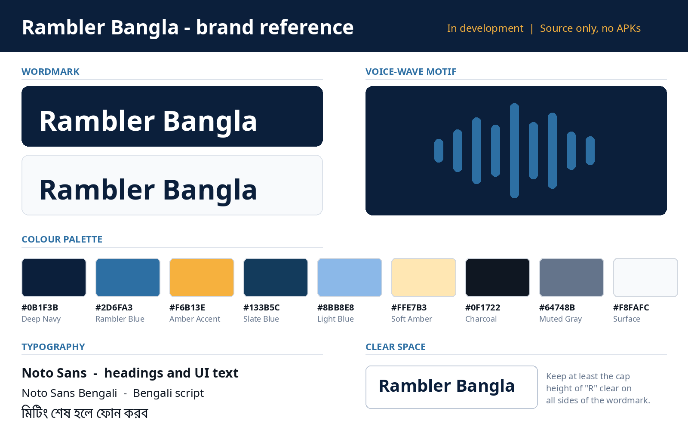
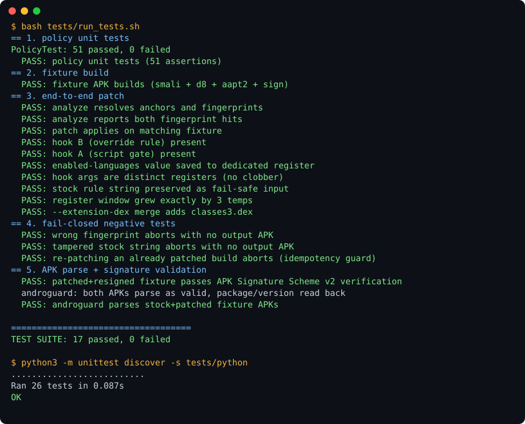
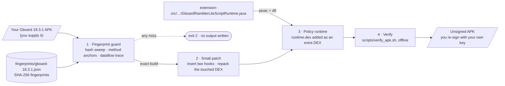

<p align="center"></p>

<h3 align="center">Dictate in Bangla. Get Bangla. Now a unified 59-patch Morphe suite for Gboard 18.5.4.</h3>

<p align="center">A fail-closed, fingerprint-guarded Morphe patch suite combining Bengali-first Rambler+ voice typing &amp; phonetic Bangla normalization with all features from <a href="https://github.com/abotmaker/gboard-rambler-enhancements">Gboard Rambler Enhancements</a>, <a href="https://github.com/jasonwu1994/Gboard-patches">Gboard Patches (GboardWu)</a>, and <a href="https://gitlab.com/johninnld/nl-morphe-patches">nl-morphe-patches</a>.</p>

<p align="center">
<a href="https://morphe.software/add-source?github=muhib-karim/Rambler-Bangla&name=Rambler%20Bangla&app=com.google.android.inputmethod.latin&appName=Gboard"></a>
<a href="https://github.com/muhib-karim/Rambler-Bangla/actions/workflows/ci.yml"></a>
<a href="https://github.com/muhib-karim/Rambler-Bangla/actions/workflows/tests.yml"></a>
<a href="https://github.com/muhib-karim/Rambler-Bangla/releases/latest"></a>
<a href="LICENSE"></a>


</p>

<p align="center">
<a href="#included-patches"><b>Included Patches (59)</b></a> ·
<a href="#install"><b>Install in Morphe</b></a> ·
<a href="#build-from-source"><b>Build from source</b></a> ·
<a href="#how-it-works"><b>How it works</b></a> ·
<a href="#faq"><b>FAQ</b></a> ·
<a href="docs/README.md"><b>Docs</b></a> ·
<a href="https://muhib-karim.github.io/Rambler-Bangla/"><b>Site</b></a>
</p>

<p align="center">
  
  
</p>

## What it is and why

Gboard's on-device voice cleanup stage tends to rewrite Bengali dictation into Latin letters ("ami bhalo achi" instead of "আমি ভালো আছি"), and it mangles sentences that mix Bangla and English. Rambler Bangla is an open-source patch layer for one exact build, Gboard 18.3.1, that fixes this at the source: a **fail-closed smali patcher** (Python) proves it is looking at the profiled build and inserts two hooks, a **pure-Java policy runtime** keeps Bangla in Bengali script and picks one language per sentence, and a **device-free CI suite** builds a synthetic APK, patches it and checks every step, including the refusals, on every push. It is a source-only tool: you patch an APK you obtain yourself and sign it with your own key.

> **No APKs are distributed.** Every build is your own: you run the patcher on an official Gboard APK you obtained yourself and sign the result with your own key. It is the same model as ReVanced and Morphe, which publish patches, not patched apps. Details: [Source only, no APKs](#source-only-no-apks).

> **Honest status.** This is a maintainer project with private test builds. Host tests and a static CI suite back the engineering claims below. The on-device results come from the maintainer's own phone. Anything marked "design intent" is design, not proof. CI never installs the keyboard on a device, and the website's UI illustrations are mock-ups with synthetic text.

## Contents

- [What it is and why](#what-it-is-and-why)
- [Features](#features)
- [How it works](#how-it-works)
- [Device-free CI](#device-free-ci)
- [Build from source](#build-from-source)
- [Safety: fail-closed by design](#safety-fail-closed-by-design)
- [Layouts and settings](#layouts-and-settings)
- [Source only, no APKs](#source-only-no-apks)
- [FAQ](#faq)
- [Roadmap](#roadmap)
- [Tech stack and project structure](#tech-stack-and-project-structure)
- [Links](#links)
- [Credits and licence](#credits-and-licence)

## Included Patches

Rambler Bangla v31.0.0 ships **59 selectable Morphe patches** in one unified `.mpp` bundle targeting Gboard `18.5.4.993608717-release-arm64-v8a`:

### Rambler Bangla (Bengali-First Voice, Phonetic Engine & Strip Tools)

<details>
  <summary><code>Rambler Bangla Lite Script Policy</code></summary>

  Fail-closed, SHA-256 fingerprint-guarded Bengali Unicode script policy for Gboard Rambler / Jetson Lite cleanup (`bn-BD`, `bn-IN`, `bn-Beng` stay in Bengali Unicode; explicit `bn-Latn` keeps Romanization).
</details>

<details>
  <summary><code>Rambler Bangla Phonetic &amp; Multilingual Engine</code></summary>

  Full V29.3+/V29.5 post-ASR Bengali phonetic transliteration with live active Gboard locale handoff (`fhv.w()`), unconditional Rambler+ activation, one-language-per-sentence multilingual AUTO routing (with EN/BN pairing enabled by default), Avro-derived 2,265-pair Tier-1 normalization, CMUdict-derived English loanword transliteration in Bangla (e.g. `company` → কোম্পানি), protected spans (`#hashtags`, `@handles`, URLs, emails, times), Unicode NFC normalization, fail-closed sensitive/password/incognito field bypass, and native Settings toggles.
</details>

<details>
  <summary><code>At-Mention &amp; Email Strip Suggestions</code></summary>

  SwiftKey-style `@handle` and email domain suggestion strip: automatically learns previously typed `@handles` (e.g. `@grok`, `@claude`) and email domains (e.g. `@gmail.com`) on-device, displays scrollable Material You tap-to-insert chips when typing `@` / `@prefix`, supports long-press to forget and Settings toggle/clear, enables Gboard's native `enable_email_provider_completion` flag, coexists cleanly with Simple Calculator and Manual Incognito, and stays strictly fail-closed in password/incognito fields.
</details>

### Dutch App Patches / `nl-morphe-patches` 18.5.4 Ports *(credit: [johninnld/nl-morphe-patches](https://gitlab.com/johninnld/nl-morphe-patches), GPL v3.0)*

<details>
  <summary><code>AMOLED Dark Keyboard</code></summary>

  Rewrites Gboard's Material 3 dark palette (`color_gm3_surface_dim`, `color_gm3_surface_container`, `color_gm3_surface_container_low`, `color_gm3_surface_container_lowest`) to pure AMOLED black (`#000000`) in dark mode while preserving light mode and accent colors.
</details>

<details>
  <summary><code>Rambler Toolbar &amp; Revert Extras</code></summary>

  Enables Gboard 18.5.4's floating Rambler toolbar overflow menu (`enable_rambler_al_toolbar_overflow_menu`), keeps rewritten text on transcript revert (`rambler_preserve_rewritten_text_on_revert`), and activates the one-tap direct clipboard quick-paste chip (`enable_system_clipboard_direct_paste_for_quick_paste`).
</details>

<details>
  <summary><code>Hidden Flags Override</code></summary>

  Writes curated Gboard 18.5.4 hidden/beta flags directly into Gboard's own `OVERRIDE` flag store (`okf.g(olk.OVERRIDE)` → `okq.e()`) with live toggles inside Settings (no restart required).
</details>

> **Note on 18.8-beta-only `nl-morphe-patches` flags:** Gboard 18.8-beta introduced a few brand-new flags (`enable_clipboard_pk_floating_chip`, `enable_invisible_floating_resizing`, `enable_dcontext_biasing`, `jetson_position_cursor_after_last_diff`) that do not exist in the Gboard 18.5.4 DEX; Rambler Bangla stays fail-closed and only exposes verified 18.5.4 flags with live consumers. Parakeet/Local AI companion dictation requires a separate third-party Local AI companion APK.

### Rambler Enhancements *(credit: [abotmaker/gboard-rambler-enhancements](https://github.com/abotmaker/gboard-rambler-enhancements), [Hex by Anomaly](https://github.com/anomalyco/hex) MIT, [nl-morphe-patches](https://gitlab.com/johninnld/nl-morphe-patches))*

<details>
  <summary><code>Rambler Waveform Animation</code></summary>

  Replaces Gboard Rambler's light bar with Hex by Anomaly's Listening (`Hex Dot Scope`, `Hex Android Wave`) and Processing (`Flow`, `Pulse`, `Sweep`) animations, independent colors, and Hex tuning.
</details>

<details>
  <summary><code>Rambler Custom Instructions</code></summary>

  Enables persistent custom style/formatting rules plus Per-app custom instructions (named presets, searchable zero-permission app picker, per-app Append-only / App context / Strip trailing period overrides, and disabled apps).
</details>

<details>
  <summary><code>Rambler Personal Dictionary</code></summary>

  Enables Gboard's `UserFeatureCache` `MUSE_STATS` personal voice biasing dictionary with live toggle, add, `.txt` import/export, remove, and clear controls.
</details>

<details>
  <summary><code>Rambler Contact Names</code></summary>

  Seeds up to 1,000 phone contact names into Rambler's `MUSE_STATS` voice dictionary when Contacts permission is granted, with manual sync and reset controls.
</details>

<details>
  <summary><code>Rambler Cursor-Aware Editing</code></summary>

  Enables cursor-aware editing, selected-text-only spoken edits, optional post-edit reselection (off by default), and Append-only dictation with clean cursor-boundary spacing.
</details>

<details>
  <summary><code>Rambler App Context</code></summary>

  Enables sharing active app name, input type, and field hint with Rambler, with a live toggle.
</details>

<details>
  <summary><code>Rambler Productivity Tools</code></summary>

  Adds Smart Search Bars (auto-strip trailing period + per-app Auto-Search on commit), Long-press Spacebar for Rambler (Smart Hybrid / Hold-to-Talk / Toggle), draggable Rambler toolbar quick-access button, 1-Tap Fix &amp; Learn from Dictation History, private On-Device Dictation Stats (WPM, latency, time saved), opt-in Voice Send &amp; Search suffixes, Voice Snippets, Find &amp; Replace (plain/regex, global/per-app), local 50-entry Dictation History, Auto Parallel Retry, configurable Max Dictation Duration, and JSON Settings Backup &amp; Restore.
</details>

### Gboard Patches / GboardWu *(credit: [jasonwu1994/Gboard-patches](https://github.com/jasonwu1994/Gboard-patches))*

<details>
  <summary><code>Dictionaries &amp; Predictions</code></summary>

  Choose resource versions for dictionaries, predictions, and input correction.
</details>

<details>
  <summary><code>Clipboard Enhancements</code></summary>

  Enhance clipboard retention time, item count limits, preview lines, countdown and creation-time labels, order index, grid columns, and optional 1,000-character preview truncation.
</details>

<details>
  <summary><code>Web Clipboard</code></summary>

  Phone-hosted LAN Web Clipboard portal with browser sync, image transfer, pairing code gate, and Quick Settings Tile.
</details>

<details>
  <summary><code>Floating Web Search</code></summary>

  Open a floating web page directly from Gboard to quickly search.
</details>

<details>
  <summary><code>Custom Theme</code></summary>

  Import custom ZIP themes and themes from the official Rboard repository.
</details>

<details>
  <summary><code>Frosted Glass</code></summary>

  Adds live background blur and custom-theme transparency to the keyboard on supported Android 12+ devices.
</details>

<details>
  <summary><code>FTP Server</code></summary>

  Hosts a LAN FTP server on your phone with file browsing, uploads, downloads, resume, and Quick Settings Tile.
</details>

<details>
  <summary><code>Long-Press Editing Shortcuts</code></summary>

  Add Select all, Undo, Copy, Cut, Paste, and Redo long-press shortcuts to English QWERTY and Zhuyin.
</details>

<details>
  <summary><code>Toolbar Editing Buttons</code></summary>

  Add Select All, Copy, Cut, Paste, Forward Delete, Home/End, Tab, and arrow buttons to the toolbar menu.
</details>

<details>
  <summary><code>Swipeable Custom Top Row</code></summary>

  Swipe the top row horizontally to open customizable text and JavaScript slots.
</details>

<details>
  <summary><code>Incognito Mode Toggle</code></summary>

  Add an Incognito toggle to the Access Point toolbar and configure clipboard and voice availability in Incognito mode.
</details>

<details>
  <summary><code>Custom Symbols</code></summary>

  Adds a dedicated symbols tab and a quick access entry from the comma long-press popup.
</details>

<details>
  <summary><code>Simple Calculator</code></summary>

  Inline arithmetic calculator in Gboard's suggestion row; tap to replace or long-press to copy.
</details>

<details>
  <summary><code>Swipe Down to Dismiss Keyboard</code></summary>

  Swipe down from suggestions or toolbar to close the keyboard.
</details>

<details>
  <summary><code>Shift + Backspace Forward Delete</code></summary>

  Hold Shift and press Backspace to forward-delete the character after the cursor.
</details>

<details>
  <summary><code>G Logo on Spacebar</code></summary>

  Show a built-in icon or custom PNG/WebP/JPEG on the spacebar with configurable color and size.
</details>

<details>
  <summary><code>Rounded Keyboard Panel</code></summary>

  Customize which corners of the keyboard panel are rounded and set top/bottom radii separately.
</details>

<details>
  <summary><code>Latin Globe Key Ignore Interval</code></summary>

  Add an independent English globe key ignore interval override for post-typing language-switch delay.
</details>

<details>
  <summary><code>Emojis, stickers &amp; GIFs Tab Order</code></summary>

  Customize the bottom tab order in Gboard's Emojis, stickers &amp; GIFs panel with drag-and-drop reordering.
</details>

<details>
  <summary><code>Backup &amp; Restore</code></summary>

  Export/restore Gboard Patches settings (JSON), Gboard personal data (ZIP), and raw PB/XML flag stores.
</details>

<details>
  <summary><code>Keypress Vibration Intensity Control</code></summary>

  Control keypress vibration intensity instead of duration.
</details>

<details>
  <summary><code>AI Writing Tools</code></summary>

  Enables the <code>Text correction &gt; Writing tools</code> setting with support for all languages.
</details>

<details>
  <summary><code>Advanced Voice Typing</code></summary>

  Enable Advanced Voice Typing (Rambler) with automatic punctuation, plus Traditional Chinese automatic punctuation.
</details>

<details>
  <summary><code>Enable OCR / Scan Text</code></summary>

  Enable the OCR / Scan Text feature with Latin, Chinese, Japanese, Korean, and Devanagari recognition backends.
</details>

<details>
  <summary><code>Use Bluetooth Microphone</code></summary>

  Enables the <code>Voice typing &gt; Use Bluetooth microphone</code> setting and its related rollout gate.
</details>

<details>
  <summary><code>Package Rename</code> &amp; <code>Add Gboard Signature Bypass</code></summary>

  Renames package &amp; app label (defaults to <code>Rambler Bangla</code> / <code>com.aidev2024.ramblerbangla</code>, configurable to <code>GboardWu</code> or stock) so it installs side-by-side with stock Gboard, and bypasses signature whitelist checks.
</details>

Plus all Gboard feature unlocks from `jasonwu1994/Gboard-patches`: `English QWERTY Up-Flick Uppercase`, `Enable Inline Autofill Suggestions`, `Grammar Checker`, `Inline Suggestions`, `Key Shape Selection`, `Change emoji size`, `Enable cursor trackpad mode`, `Enable split keyboard`, `Enable accessibility layout`, `Quick Insert`, `Close Proactive Suggestions`, `Clipboard Custom Character Limit`, `Access Points menu style`, `Top Toolbar Item Count`, `Settings Homepage Override`, `Developer options`, `Zhuyin Slide Input`, `Zhuyin Quick Traditional/Simplified Toggle`, and `Zhuyin Bottom Row Key Sizes`.

## Install

Add this repository as a **Morphe** patch source to patch stock Gboard `18.5.4.993608717-release-arm64-v8a` directly on your phone:

- [Open in Morphe](https://morphe.software/add-source?github=muhib-karim/Rambler-Bangla&name=Rambler%20Bangla&app=com.google.android.inputmethod.latin&appName=Gboard)
- Or manually add bundle URL: `https://raw.githubusercontent.com/muhib-karim/Rambler-Bangla/main/patches-bundle.json`

## Features

| Feature | What you get | Evidence |
| --- | --- | --- |
| **Bangla stays Bangla** | Bengali dictation stays in Bengali Unicode for `bn-BD`, `bn-IN` and `bn-Beng`; English stays in Latin | 22 end-to-end checks and 51 policy assertions in CI on a synthetic fixture. Bangla-only and English-only layouts confirmed on a real device |
| **Bangla and English together** | One language per sentence on the multilingual layout (abc → বাংলা) | 292-case host corpus. Confirmed on a real device, with a few misses in quick mid-sentence switches |
| **Real Bangla spellings for English words** | কোম্পানি, টেলিভিশন, বার্লিন instead of letter-by-letter output, from a CMU-derived table plus reviewed overrides | Blind check: 85 of 200 exact (historical), so expect misses |
| **Protected text** | #hashtags, @handles, links, emails and times stay in Latin letters | Checked in the V29.3 test corpus |
| **Clipboard Recent / History (V29.5)** | A Recent \| History toggle in the clipboard panel: up to 50 unique text clips kept across restarts, newest first, plus up to 10 pinned. Tap pastes; long-press pins or deletes. Sensitive clips, password fields and incognito are skipped | Static and host-tested only; on-device testing pending. |
| **Settings you control** | Bangla script correction switch (on by default) and opt-in diagnostics (off by default) | Design intent, see [Settings](#settings) |
| **Own package id** | Installs beside the stock keyboard; updates signed with the same key install in place | [`docs/SIDE-BY-SIDE.md`](docs/SIDE-BY-SIDE.md) |

A real run of both suites on a dev machine, rendered from the terminal output (no phone, no Google binaries). It predates the homepage tests, so it shows the 26 patcher helper tests:

<p align="center"></p>

## How it works



The patcher never edits bytes by offset. It disassembles the APK with baksmali and only patches once every check has passed:

1. **Fingerprint guard.** `fingerprints/gboard-18.3.1.json` lists SHA-256 hashes of strings the target build must contain, plus short identifying fragments such as the rule heading; the full Google prompt text is never reproduced. One miss means an unrecognized build. The cleanup-builder method and the method that owns the cleanup prompt must then exist with the exact class, name and signature in the profile. Finally, the patcher traces the `{ENABLED_LANGUAGES}` placeholder to its `String.replace` call to find the register that holds the enabled languages, rather than trusting a hard-coded register.
2. **Smali patch.** Two calls into `GboardRamblerLiteScriptRuntime` are inserted into the cleanup builder. The original rule string stays in place as the fail-safe input. Only the touched DEX is reassembled.
3. **Policy runtime.** The pure-Java runtime is compiled with `javac`, dexed with d8 and added as an extra DEX. At runtime, hook B replaces the injected "Hinglish Override" rule and hook A rewrites only the Romanization bullet of the prompt's SCRIPT GATE, based on the enabled languages. It is a set of `String` to `String` functions with no Android or network dependencies.
4. **Verify.** `scripts/verify_apk.sh` checks the output offline, on its own or against the stock APK. The patcher never signs: you re-sign the result with your own key (and optionally rename the package with `rename/` so it installs side by side; upstream builds also rename the package and bypass signature checks, see [`docs/SIDE-BY-SIDE.md`](docs/SIDE-BY-SIDE.md)).

Further runtime layers in the maintainer builds: segment-locked multilingual dictation (V28), Bangla spelling normalization with a 2,265-pair roman-to-script table (V29), and a loanword spelling table built from the CMU Pronouncing Dictionary plus reviewed overrides (V29.3, see `data/loanspell/`). The full pipeline, runtime policy and CI design are in [`docs/ARCHITECTURE.md`](docs/ARCHITECTURE.md).

## Device-free CI

No phone, emulator or Google binary is needed to prove the pipeline. [`ci.yml`](.github/workflows/ci.yml) runs on every push to `main` and every pull request, and [`tests.yml`](.github/workflows/tests.yml) runs the static suite on its own. Both fail unless every check passes.

The trick is the fixture: `fixtures/` builds a **synthetic APK with zero Google content** that mirrors the real anchors (class names, method signatures, the cleanup prompt shape). CI builds it from smali sources, patches it with the real patcher, and asserts on the result.

| Suite | What it covers |
| --- | --- |
| **88 Python unit tests** (`tests/python/`, stdlib only; the clipboard-history store test also needs a JDK) | The patcher's pure helpers: smali string unescaping, `invoke` parsing, register-slot maths, `.locals` bumping, the dataflow search on the fixture smali, profile validation, a `--help` smoke test, the loanword `OVERRIDE` block matching `data/loanspell/overrides.tsv`, homepage checks that keep this README and the site honest, and the clipboard-history store, privacy policy and guarded-build checks on synthetic fixtures, and the beta-personalization analyzer ([`scripts/find_personalization_flags.py`](scripts/find_personalization_flags.py), analysis only) on synthetic DEX and APK inputs |
| **Static suite**, 22 checks (`tests/run_tests.sh`) | 1. 51 JVM policy assertions (locale classification, override rule, SCRIPT GATE rewrite). 2. The fixture APK builds with smali, d8, aapt2 and signing. 3. End-to-end patch: anchors and fingerprints resolve, both hooks land, the enabled-languages value gets its own register, hook arguments don't clobber each other, the stock rule string is preserved, `--extension-dex` adds the runtime. 4. Fail-closed negatives: a wrong fingerprint, a one-character change to the stock rule and re-patching each exit 2 with no APK. 5. The patched, re-signed fixture passes APK Signature Scheme v2 verification and androguard parses both APKs. 6. Identity-rename round-trip: a label-variant fixture renamed to a label with an astral character reads the exact label back through aapt2's strict string-pool parser and androguard (guards the AXML UTF-16 length fix; the fixture carries no package-identity strings, so the gate exercises the manifest label rewrite, not package/dex/arsc renaming). 7. `scripts/verify_apk.sh single` passes on the stock and the patched, re-signed fixtures |

What CI does **not** prove: runtime behaviour inside real Gboard on a phone. That evidence is the maintainer's device testing, recorded with dates in [`docs/VALIDATION.md`](docs/VALIDATION.md) and [`docs/EVIDENCE.md`](docs/EVIDENCE.md). The V29.3 golden corpus in [`tests/v29.3/`](tests/v29.3/README.md) needs the maintainer build's runtime jar, so it is not part of CI. The emulator workflows (`android-smoke.yml`, `clipboard-e2e.yml`, `keyboard-onboarding-probe.yml`) are manual and pinned to a maintainer-supplied APK by SHA-256.

## Build from source

Requirements: Linux x86_64 (the pinned aapt2 is the Linux build), a JDK 17+ (CI uses Temurin 21), Python 3 (3.11 in CI), `curl`, `unzip` and `zip`. The profile targets Gboard version name `18.3.1.977415014 beta`, version code `176004238`, `arm64-v8a`. Any other build is refused.

```bash
git clone https://github.com/muhib-karim/Rambler-Bangla.git
cd Rambler-Bangla

# Fast unit tests: stdlib only, no toolchain needed
python3 -m unittest discover -s tests/python -v

# Fetch the pinned toolchain into ./tools (every file is checked against tools-src/toolchain.sha256)
python3 -m pip install androguard==4.1.4
bash scripts/bootstrap_tools.sh
source tools/tool-env.sh
bash tests/run_tests.sh                  # expect "TEST SUITE: 22 passed, 0 failed"

# Build the policy runtime DEX (same steps as fixtures/build_fixture.sh)
mkdir -p build/ext-classes build/ext-dex
javac -d build/ext-classes \
  extension-src/com/akshaykadam/pixelboard/extension/ramblerlite/GboardRamblerLiteScriptRuntime.java
java -cp tools/r8-8.3.37.jar com.android.tools.r8.D8 --min-api 24 \
  --output build/ext-dex build/ext-classes/com/akshaykadam/pixelboard/extension/ramblerlite/*.class

# 1. Fingerprint guard: check the APK matches the profile
python3 standalone-patcher/dex_patch.py analyze \
  --apk /path/to/gboard-18.3.1.apk --profile fingerprints/gboard-18.3.1.json

# 2-3. Smali patch plus policy runtime (exits 2 and writes nothing if any check fails)
python3 standalone-patcher/dex_patch.py patch \
  --apk /path/to/gboard-18.3.1.apk --out /path/to/out.apk \
  --profile fingerprints/gboard-18.3.1.json --extension-dex build/ext-dex/classes.dex

# 4. Verify the output offline, alone or against the stock APK
#    (single exits 1 until the APK is signed: the signature check is part of it)
scripts/verify_apk.sh single /path/to/out.apk --profile fingerprints/gboard-18.3.1.json
scripts/verify_apk.sh compare /path/to/stock.apk /path/to/out.apk
```

`scripts/bootstrap_tools.sh` downloads smali/baksmali/dexlib2 2.5.2, r8/d8 8.3.37, aapt2 8.3.0, apksig 8.3.0 and android.jar 4.1.1.4 from Maven Central and Google's Maven repository, builds the small fixture signer from `tools-src/MiniApkSigner.java`, and writes `tools/tool-env.sh`. Nothing is vendored; set `TOOLS_DIR` to put the toolchain elsewhere. Signing, installing on your own device, side-by-side renaming and troubleshooting are in [`docs/USER_GUIDE.md`](docs/USER_GUIDE.md).

## Safety: fail-closed by design

The patcher would rather do nothing than guess.

- **Exact build or nothing.** Any fingerprint, anchor or dataflow miss prints `FAIL-CLOSED ABORT: ...`, exits with status 2 and writes no output APK. An uncaught Python error exits 1: if it happens during the final repack (for example a mistyped `--extension-dex` path), delete any partial `--out` file and run again.
- **No double patching.** An APK that already references the runtime is refused, so a patch cannot be applied twice.
- **Hash-based profile.** The fingerprint profile stores SHA-256 hashes plus short identifying fragments, never the full prompt text.
- **Minimal footprint.** Two hook calls in one method plus one extra DEX. The stock rule string is kept as the fail-safe input.
- **Never signs, never uploads.** The patcher and `verify_apk.sh` run offline; you sign with your own key. Only the setup steps touch the network: `bootstrap_tools.sh` checks each download's SHA-256, and `pip` installs the pinned `androguard==4.1.4`.
- **Tested refusals.** CI asserts the refusals too (static suite stage 4), not just the happy path.

### Privacy

- **No network code in the patch layer.** The runtime sources in `extension-src/` use no networking APIs.
- **No new data collection.** Diagnostics are off by default. When turned on, the log is written to the phone's Downloads folder and stays there unless you share it.
- **Sensitive fields pass through.** Password and other sensitive input fields are meant to be left untouched. Any case where conversion runs in one is a security bug (see [`SECURITY.md`](SECURITY.md)).
- **On-device path only.** Bangla is not on Google's list of languages for cloud rewrite, so Rambler only changes the on-device cleanup path. It does not add Bangla to Google's cloud service, and this project does not audit Gboard's own network behaviour.

## Layouts and settings

### How each layout is designed to behave

Design intent for the V29.3 test build (unchanged in V29.4). Not re-verified on a current device.

| Layout | Voice and typing result |
| --- | --- |
| English (US) | English only. Rambler changes nothing. |
| বাংলা (native) | Bangla only. Romanized Bangla and English words become Bangla script. |
| abc → বাংলা | Multilingual. Each sentence is Bangla script or English, decided per sentence. |
| Bangla (Latin) | Treated as Bangla: output is Bangla script. |

Gboard's combined "EN · BN" keyboard reports itself as English (US), so it behaves like the English row. For mixed dictation, use the abc → বাংলা layout.

### Settings

Design intent, not re-verified on a current device. Both switches are in the keyboard's settings, in the Rambler section.

- **Bangla script correction** (on by default). On, Rambler converts Romanized Bangla to Bangla script, applies the loanword spellings and follows the per-layout rules above. Off means Rambler converts nothing, for voice or typing, and you get Gboard's own output unchanged. Useful if you prefer Romanized Bangla, or to tell whether an odd result comes from Rambler or from Gboard.
- **Rambler diagnostics** (off by default). Turn it on only to report a problem, reproduce it, then turn it off: a log is saved to Downloads as `RamblerBangla-diag-<date>-<time>.txt`. It records the active layout and the text before and after each conversion, so read it before you share it. Not yet re-audited for the current build.

## Source only, no APKs

This repository is **source only and publishes no APKs**, now or later. A patched keyboard contains Google's proprietary Gboard code, which is not licensed for redistribution. You apply the patch to a Gboard 18.3.1 APK you obtain yourself, for your own device, and sign it with your own key. Releases such as [v29.4](https://github.com/muhib-karim/Rambler-Bangla/releases/tag/v29.4) are tagged source plus notes.

**Legal note.** Rambler Bangla is an independent project and is **not affiliated with Google**, nor endorsed or sponsored by it. Gboard is a trademark of Google LLC, used here only to name the app the patch targets. The repository contains no Google binaries, keys, model files or full prompt text: the profile holds SHA-256 hashes plus short identifying fragments. Modifying software you use may be restricted by its terms of service or by the law where you live; checking that is your responsibility, and the software comes with no warranty (GPL-3.0, sections 15 and 16). Never upload a patched Google APK, a signing key or private diagnostic output to this repository. The full review is in [`docs/LICENSING-AUDIT.md`](docs/LICENSING-AUDIT.md).

## FAQ

**Can I download a ready-made APK?**
No. See [Source only, no APKs](#source-only-no-apks). Any site offering a "Rambler Bangla APK" is not from this project.

**Why only Gboard 18.3.1?**
The hooks go into obfuscated code whose class and method names change between builds. Pinning one build and proving it with fingerprints is what makes the patch safe. A new Gboard version needs a new, reviewed profile.

**What happens if I feed it a different version?**
It refuses: `FAIL-CLOSED ABORT`, exit status 2, no output. Nothing is half-patched.

**Does CI prove it works on my phone?**
No. CI proves the patching pipeline on a synthetic APK, including the refusals. Phone results come from the maintainer's device and are labelled as such.

**Does it send my voice or text anywhere?**
The patch layer has no network code. It only rewrites the prompt and rule strings inside Gboard's existing on-device cleanup step. Gboard's own behaviour is outside this project's audit.

**Does it translate English into Bangla?**
No. It transliterates: English words spoken inside Bangla get a Bangla spelling (কোম্পানি), they are never translated.

**Why do I need Linux?**
The pinned aapt2 binary used to build the test fixture is the Linux build. The patcher itself is plain Python.

**Can it sit next to the stock keyboard?**
Yes, if you rename the package with `rename/` before signing. See [`docs/SIDE-BY-SIDE.md`](docs/SIDE-BY-SIDE.md).

**Bangla still came out in Latin letters. Is that Rambler?**
Turn off **Bangla script correction** and try again. If the result is the same, it is Gboard's own output. If not, please [open an issue](https://github.com/muhib-karim/Rambler-Bangla/issues/new/choose) with the layout you used.

## Roadmap

### Released

- **v30.0.0 (2026-11-27)**, tag [v30.0.0](https://github.com/muhib-karim/Rambler-Bangla/releases/tag/v30.0.0): unified 55-patch Morphe suite targeting Gboard `18.5.4.993608717-release-arm64-v8a`, combining Rambler Bangla (Lite Script Policy + full V29.3+/V29.5 Phonetic & Multilingual Engine), all 7 patches from `abotmaker/gboard-rambler-enhancements` v1.3.4, and all 46 patches from `jasonwu1994/Gboard-patches` v4.5.0.
- **V29.4.1 (2026-10-21, docs only, untagged):** README and website refresh. No code changes.
- **V29.4 (2026-10-18)**, tag [v29.4](https://github.com/muhib-karim/Rambler-Bangla/releases/tag/v29.4): source release and new maintainer signing key; no conversion changes. Builds signed with the new key cannot install over a V29.3 build: uninstall once first. Notes: [`docs/V29.4-RELEASE-NOTES.md`](docs/V29.4-RELEASE-NOTES.md). Build record: [`ledger/v29.4-provenance.md`](ledger/v29.4-provenance.md).
- **V29.3 (2026-09-24)**, tag [v29.3](https://github.com/muhib-karim/Rambler-Bangla/releases/tag/v29.3): one language per sentence in multilingual dictation, English loanword spelling in Bangla voice output. Notes: [`docs/V29.3-RELEASE-NOTES.md`](docs/V29.3-RELEASE-NOTES.md). Build record: [`ledger/v29.3-provenance.md`](ledger/v29.3-provenance.md).
- **V29 (2026-09-23):** field iteration. Design: [`docs/V29-DESIGN.md`](docs/V29-DESIGN.md), fixtures: [`docs/V29-FIXTURES.md`](docs/V29-FIXTURES.md).
- **v28d:** last stable baseline (historical). Evidence: [`docs/V28-SEGMENT-LOCK.md`](docs/V28-SEGMENT-LOCK.md).

### Maintainer builds, October 2026

Test builds 245 to 253 are private maintainer builds. Each claim carries its evidence level.

| Item | Level |
| --- | --- |
| Updates signed with the same key install over the existing app, no uninstall | Confirmed on the maintainer's phone (build 253 over 251) |
| Gboard AI writing-tools (refinement) icon visible again on build 253 | Confirmed on the maintainer's phone. Cause not proven; 253 is a compatibility-only change |
| Build 253: retargets three stale internal ids and adds an observer, no behaviour flags changed | Two independent static reviews passed. No runtime proof |
| Stray "123" labels suppressed on pinned and list items (display only) | Static review only. Unpinned path clean on the phone; pinned fix not phone-confirmed |
| Clipboard recents setting (default 5, range 5 to 10) and masking default off | Static review only |

### Next

- Multilingual clause segmentation (within a sentence, not just per sentence).
- Phonetic typing with an EN/BN toggle, and a proper Bangla (Latin) layout.
- Clipboard drag-to-reorder, listed in the V29.3 notes and still in development.
- Better loanword accuracy than the historical 85 of 200 exact.

These are planned or in progress and **not working yet**.

### Known limitations

- Supports exactly one target build, Gboard 18.3.1. Any other build is refused by design.
- CI proves the patching pipeline on a synthetic fixture, not runtime behaviour inside real Gboard.
- Loanword spelling is approximate.
- The two V29.x sources in `extension-src/.../rambler/`, `GboardRamblerLoanSpell.java` and `GboardRamblerSentenceLang.java`, do not compile from this repository. They reference five classes that are not in it: `GboardRamblerDiag`, `GboardRamblerLoanTable`, `GboardRamblerScriptFix`, `GboardRamblerSegmentLock` and `GboardRamblerTier1`. `tests/v29.3/Golden.java` needs two of them as well. The Lite policy runtime in `extension-src/.../ramblerlite/`, which the patcher and CI use, is complete.
- `rename/rename_apk.py` refers to a `rename_sign.sh` signing step. That script is not included; sign with your own key as described in the [user guide](docs/USER_GUIDE.md#sign-with-your-own-key).

## Tech stack and project structure

| Area | Tools |
| --- | --- |
| Patcher | Python 3 (standard library only), smali/baksmali 2.5.2 |
| Policy runtime | Pure Java, no Android dependencies, `javac` then d8 (r8 8.3.37, `--min-api 24`) |
| Upstream integration | Kotlin Morphe bytecode patch (`morphe-patch/`) and patch-list entry (`integration/`) |
| APK tooling | aapt2 8.3.0, apksig 8.3.0 (`tools-src/MiniApkSigner.java`), androguard 4.1.4 for parsing |
| Data | Loanword table from the CMU Pronouncing Dictionary (`data/loanspell/`); V29 normalization pairs from the Avro Keyboard phonetic dictionary |
| CI | GitHub Actions on Ubuntu: Python unit tests and the static suite with Temurin 21 and Python 3.11 |

```
extension-src/        Java policy runtime (pure Java, no Android deps) + V29.x helpers
standalone-patcher/   dex_patch.py: fingerprint/dataflow-anchored smali patcher
fingerprints/         gboard-18.3.1.json fail-closed profile (hashes and short fragments)
fixtures/             synthetic APK fixture (smali sources, manifest, build script)
tests/                run_tests.sh static suite, python/ unit tests, Java policy test, v29.3 corpus
scripts/              bootstrap_tools.sh, verify_apk.sh, clip_e2e.py (emulator driver)
rename/               side-by-side package rename tooling
morphe-patch/         Morphe bytecode patch + RuntimeAbi snippet for the upstream tree
patches/              Unified Morphe Patcher 2.1.0 Gradle module (59 patches -> patches-31.0.0.mpp)
extensions/           Morphe Android extensions (gboard-patches.rve, calculator.rve, rambler-enhancements.rve + Rambler Bangla runtime)
docs/historical/      Historical V29.3 smali hook diff for the 18.3.1 patch layer's own classes
data/loanspell/       loanword table, overrides and Java generator
integration/          upstream patch-list entry
tools-src/            MiniApkSigner.java and pinned toolchain checksums
docs/                 design, evidence, validation, licensing docs and the GitHub Pages site
ledger/               per-version build provenance records
verification/         dated verification records
```

## Links

| Where | What |
| --- | --- |
| [Website](https://muhib-karim.github.io/Rambler-Bangla/) | The project homepage (GitHub Pages) |
| [`docs/README.md`](docs/README.md) | Index of every design, evidence, validation and licensing document |
| [`docs/USER_GUIDE.md`](docs/USER_GUIDE.md) | Step by step: verify, patch, sign, install, exit codes |
| [`docs/ARCHITECTURE.md`](docs/ARCHITECTURE.md) | Pipeline, policy runtime and CI design |
| [Releases](https://github.com/muhib-karim/Rambler-Bangla/releases) and [`CHANGELOG.md`](CHANGELOG.md) | Tagged source releases and full history; how releases are cut: [`docs/RELEASING.md`](docs/RELEASING.md) |
| [`CONTRIBUTING.md`](CONTRIBUTING.md) | Running the suites before a pull request, and what must never be committed |
| [`SECURITY.md`](SECURITY.md) | Report security problems privately through GitHub's advisory form |
| [`CODE_OF_CONDUCT.md`](CODE_OF_CONDUCT.md) | Contributor Covenant 2.1 |

## Contributing

Issues and pull requests are welcome. See [CONTRIBUTING.md](CONTRIBUTING.md) for the workflow. Please keep each pull request focused and say how you tested it.

## Credits and licence

Rambler Bangla combines and explicitly credits:

- **[Gboard Patches / GboardWu](https://github.com/jasonwu1994/Gboard-patches)** by Jason Wu (`@jasonwu1994`, GNU GPL v3.0) — all 46 Gboard keyboard, clipboard, theme, Frosted Glass, Web Clipboard, LAN FTP, Calculator, Advanced Voice Typing, OCR, Backup & Restore, Package Rename, and Signature Bypass patches.
- **[Gboard Rambler Enhancements](https://github.com/abotmaker/gboard-rambler-enhancements)** by `@abotmaker` (GNU GPL v3.0) — all 7 Rambler enhancement patches (Hex waveforms, custom instructions, per-app rules, `MUSE_STATS` dictionary, contacts sync, cursor-aware & append-only editing, app context, and productivity tools).
- **[Hex by Anomaly](https://github.com/anomalyco/hex)** by Christopher Langton (MIT License) — Hex Dot Scope, Hex Android Wave, and Processing waveform animations.
- **[`nl-morphe-patches` (Dutch App Patches)](https://gitlab.com/johninnld/nl-morphe-patches)** ([docs](https://nl-morphe-patches-ed90fa.gitlab.io/apps/gboard/)) by `@johninnld` (GNU GPL v3.0) — AMOLED Dark Keyboard (`#000000` Material 3 dark surface override), Rambler Toolbar & Revert Extras, unconditional Rambler cloud flag activation pattern, native `OVERRIDE`-store Hidden Flags architecture, and original Rambler Custom Instructions, `MUSE_STATS`, Contacts, Cursor-Aware Editing, and App Context concepts.
- **[PixelBoard](https://github.com/Akshayykadam/PixelBoard)** by Akshay Kadam (GNU GPL v3.0) — original 18.3.1 Rambler foundation.
- **[Morphe](https://morphe.software)** (`MorpheApp/morphe-patcher`, GNU GPL v3.0 + Section 7c notice in [`NOTICE`](NOTICE)) and **smali/baksmali** (JesusFreke, BSD).
- **Avro Keyboard phonetic dictionary** (MPL 2.0) and **CMU Pronouncing Dictionary** (BSD, see [`NOTICE-cmudict.txt`](NOTICE-cmudict.txt)).

Full third-party notices: [`ATTRIBUTION.md`](ATTRIBUTION.md) and [`THIRD-PARTY-NOTICES.md`](THIRD-PARTY-NOTICES.md).

Licensed under the GNU GPL v3.0 (see [`LICENSE`](LICENSE)). Not affiliated with Google or the Morphe project.
