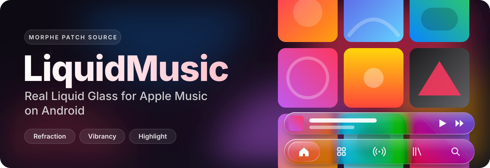
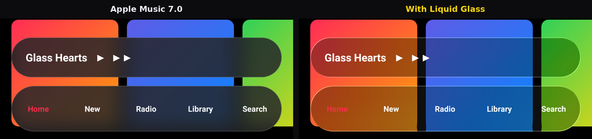
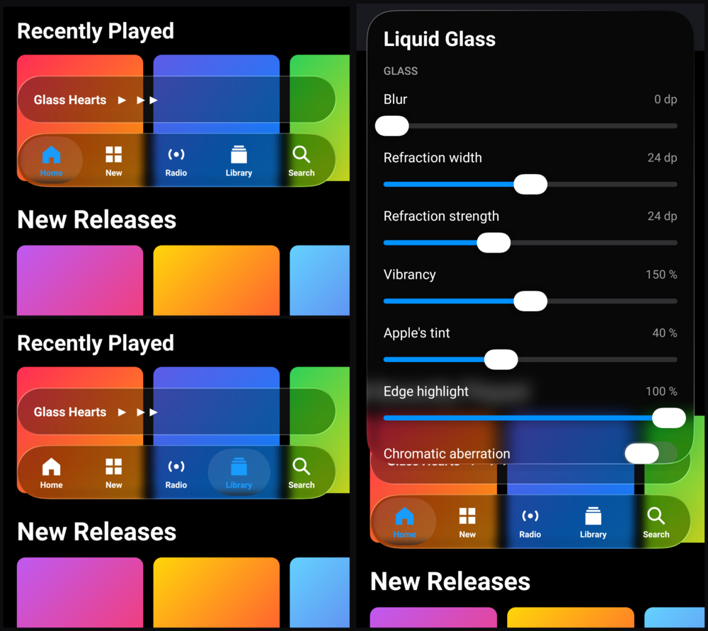
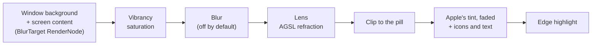

<div align="center">



<br>
<br>

**Real Liquid Glass for Apple Music on Android.**<br>
Clear glass with refracted edges, vibrancy and a specular rim on the mini player, a liquid tab bar<br>
with a drop of glass under the active tab, and live settings, packaged as [Morphe](https://morphe.software) patches.

<br>

[](https://github.com/myvoow/LiquidMusic/releases/latest)
[](https://github.com/myvoow/LiquidMusic/actions/workflows/release.yml)
[](https://morphe.software)
[](#what-you-get)
[](LICENSE)
[](https://github.com/myvoow/LiquidMusic/commits/main)
[](https://github.com/myvoow/LiquidMusic/stargazers)

<br>

<a href="https://morphe.software/add-source?github=myvoow/LiquidMusic">
  
</a>

</div>

<br>

## Add the source

On your phone, tap **Add to Morphe** above. You can also paste this address in Morphe Manager when you add a patch source:

```text
https://github.com/myvoow/LiquidMusic
```

## Install

1. Add the source (see above).
2. In Morphe, choose **Apple Music** and give it the APKM. The patch was built on **7.0.0-beta**; Morphe shows later versions as experimental.
3. Keep **Liquid Glass** selected, and change its [options](#options) if you like. **Accent color** and **Liquid Glass icon** are optional.
4. Uninstall the official Apple Music, since the patched app has a different signature, then install the patched one.

> [!WARNING]
> Morphe re-signs the app, and Apple Music sends a Play Integrity token when you sign in and when you pay ([details](docs/apple-music-7.0.0-beta.md#4-security-and-the-non-root-path)). Apple may refuse a re-signed copy at sign-in or when you subscribe. On the first device test, sign-in worked; subscribing and paying are untested. Sign in and play a song before you delete the downloads of the official app.

## What you get

<p align="center">
  
  <br>
  <sub>Rendered by <a href="tools/glass-preview">tools/glass-preview</a> with Android's own renderer, on a stand-in for Apple Music's layout.</sub>
</p>

| | Apple Music 7.0 | With Liquid Glass |
|---|---|---|
| Content behind the bar | 64 px blur, almost unreadable | clear, no blur, colors boosted to 150% |
| Edges | flat | bent like a lens (Android 13+) |
| Tint on top | two layers at 60% | 40% of Apple's tint, also after the player colors change |
| Rim | thin stroke | specular highlight, drawn over the tint |
| Surfaces | tab bar, mini player | tab bar, mini player, search bar, tablet sidebar |

### The liquid tab bar

<p align="center">
  
  <br>
  <sub>The drop moves to the tab you tap, and you can drag it from tab to tab. Long-press the bar to open the settings.</sub>
</p>

The tab bar is drawn by [`LiquidBottomTabs`](https://github.com/Kyant0/AndroidLiquidGlass), the liquid tab bar by Kyant, used as is: a capsule of glass with a drop under the active tab, which stretches when you drag it. Apple's own tab bar stays underneath and still does the navigation, so tapping a tab, tapping it again to go back to the top, and Apple switching tabs by itself all keep working.

- **Labels** under the icons, in Apple's font (can be turned off).
- **Hide New** and **Hide Radio** to keep only the tabs you use.
- **Start tab**: open the app on Home, New, Radio, Library or Search.
- **Haptics**: a light tick when the active tab changes.

Kyant's bar adds a light blur of its own to its glass. If you want the clear glass on the tab bar too, turn **Liquid tab bar** off: you get Apple's tab bar with the same clear glass as the mini player.

### Settings inside Apple Music

**Long-press the tab bar** to open the Liquid Glass settings: a glass sheet with Kyant's sliders, toggles and buttons. Changes apply at once to the glass under it, and stay after the app restarts. **Reset** goes back to the values chosen in Morphe; **Done** or Back closes the sheet. The "Search bar" and "Tablet sidebar" switches apply the next time those screens open.

### Other patches

| Patch | What it does |
|---|---|
| **Accent color** | Replaces Apple Music's red (buttons, links, selection, progress) with another color, blue by default, separately for the dark and light themes. |
| **Liquid Glass icon** | Replaces the app icon with the LiquidMusic icon, a drop of glass over the colors, with a themed icon for Android 13+. |

| Android | Result |
|:---:|---|
| 13+ | Full effect: refraction, vibrancy, highlight |
| 12 | Vibrancy and highlight, without refraction |
| 11 | Apple's original look; the patch stays inactive |

## Options

Every option can be changed in Morphe before patching.

| Option | Default | What it does |
|---|:---:|---|
| Blur radius | Off | Blur of the content behind the glass (Light 4 dp, Frosted 12 dp). Off keeps the glass clear |
| Refraction width | 24 dp | Width of the bent band along the edges (Off = no refraction) |
| Refraction strength | 24 dp | How far the content moves at the very edge |
| Vibrancy | 150% | Saturation of the content behind the glass |
| Tint opacity | 40% | How much of Apple's tint is kept (100% = Apple's look) |
| Edge highlight | 100% | Brightness of the rim light |
| Chromatic aberration | off | Splits the colors of the edges like a prism (Android 13+) |
| Search bar | on | Also covers the floating search bar and the tablet top bar |
| Tablet sidebar | on | Also covers the sidebar on tablets |
| Liquid tab bar | on | Draws the tab bar with Kyant's `LiquidBottomTabs` and its drop |
| Tab labels | on | Names under the icons of the liquid tab bar |
| Hide New tab | off | Removes New from the liquid tab bar |
| Hide Radio tab | off | Removes Radio from the liquid tab bar |
| Start tab | Home | Tab shown when the app opens |
| Haptic feedback | on | Light tick when the active tab changes |

These are the starting values: all of them can also be changed later in the app, with a long press on the tab bar.

## Patches

<!-- PATCHES_START EXPANDED -->
> **[v1.2.0](https://github.com/myvoow/LiquidMusic/releases/tag/v1.2.0)**&nbsp;&nbsp;•&nbsp;&nbsp;`main`&nbsp;&nbsp;•&nbsp;&nbsp;3 patches total
<details open>
<summary>📦 Apple Music&nbsp;&nbsp;•&nbsp;&nbsp;3 patches</summary>
<br>

**Package name:** `com.apple.android.music`

**🎯 Supported versions:**

| 7.0.0-beta |
| :---: |
| Floating tab bar and mini player redesign |  |

| 💊&nbsp;Patch | 📜&nbsp;Description | ⚙️&nbsp;Options |
|----------|----------------|-----------|
| [Accent color](#accent-color) | Replaces the red of Apple Music (buttons, links, the selected tab, progress) with another color. Blue matches the liquid tab bar. | • Color in the dark theme<br>• Color in the light theme |
| [Liquid Glass](#liquid-glass) | Liquid Glass on the floating tab bar and the mini player: clear glass with refracted edges, vibrancy and a specular rim, and the liquid tab bar of Backdrop by Kyant, with a drop of glass on the active tab. Refraction requires Android 13, the rest Android 12. | • Blur radius<br>• Refraction width<br>• Refraction strength<br>• Vibrancy<br>• Tint opacity<br>• Edge highlight<br>• Chromatic aberration<br>• Search bar<br>• Tablet sidebar<br>• Liquid tab bar<br>• Tab labels<br>• Hide the New tab<br>• Hide the Radio tab<br>• Start tab<br>• Haptic feedback |
| [Liquid Glass icon](#liquid-glass-icon) | Replaces the app icon with the LiquidMusic icon: a drop of glass over the colors. It also has a themed icon for Android 13+. |  |

</details>

<!-- PATCHES_END -->

## How it works

Apple Music 7.0 already blurs what is under the tab bar and the mini player with the BlurView library: a `BlurTarget` records the screen into a `RenderNode`, and pill-shaped `BlurView`s draw it blurred. The patch adds one call at the start of `BlurView.draw(Canvas)`, a method that keeps its name through obfuscation, and the bundled extension draws the glass instead:



The window background goes first, as in Apple's blur, so the glass is opaque: what is right behind its edges does not show through, only the content the lens bends there. Apple's translucent material is faded on every frame, because Apple sets it again whenever the colors of the player change, and the rim is drawn over it. If anything goes wrong (an unknown view, Android 11, an error), the extension hands drawing back to Apple's blur, so the app never crashes because of the patch.

The liquid tab bar is Jetpack Compose code, bundled in the extension with Kyant's components. R8 moves all of it (Compose included) to `app.liquidmusic.shaded`, and its resources get their own package id (`0x7e`), so nothing clashes with the Compose copy already inside Apple Music. It sits in a `ComposeView` next to Apple's `BottomNavigationView`, which stops drawing but keeps navigating, and follows it on every frame. The glass of the bar records the same `BlurTarget` content as the rest.

Full write-up: [PLAN.md](PLAN.md) and [the Apple Music 7.0.0-beta analysis](docs/apple-music-7.0.0-beta.md).

## FAQ

<details>
<summary><b>Nothing changed after patching</b></summary>
<br>

The glass needs Android 12 (vibrancy and highlight) or 13 (refraction); on Android 11 the patch stays inactive. Check that Liquid Glass was selected and that the APK is Apple Music 7.x. If it still looks the same, the extension logs the reason under the `LiquidGlass` tag:

```bash
adb logcat -s LiquidGlass
```

Open an [issue](https://github.com/myvoow/LiquidMusic/issues) with that output.
</details>

<details>
<summary><b>I can't sign in to my Apple account</b></summary>
<br>

That is the Play Integrity risk described above. Reinstall the official app from the Play Store. [PLAN.md](PLAN.md#5-plan-b-if-play-integrity-blocks-lsposed-module-root) describes a plan B that does not re-sign the app: an LSPosed module, which needs root.
</details>

<details>
<summary><b>Does it work with other Apple Music versions?</b></summary>
<br>

It was built and checked against 7.0.0-beta. It only relies on names that survive obfuscation (`BlurView.draw` and resource ids), so later 7.x versions are expected to work. Morphe shows them as experimental.
</details>

<details>
<summary><b>Scrolling stutters</b></summary>
<br>

The extra work is limited to the area of the pills, and the default glass has no blur. If your phone struggles, patch again with Refraction width set to Off, and Blur radius left Off.
</details>

## Credits

- [Backdrop (AndroidLiquidGlass)](https://github.com/Kyant0/AndroidLiquidGlass) by Kyant: the liquid tab bar (`LiquidBottomTabs`), the sliders, toggles and buttons of the settings, the glass library behind them, and the AGSL shaders. Their source files are copied unchanged in [`libs/`](libs/README.md).
- [Morphe](https://morphe.software): the patcher, the manager and the patch template.
- [BlurView](https://github.com/Dimezis/BlurView) by Dimezis: the blur library inside Apple Music that the patch builds on.

<details>
<summary><b>Development</b></summary>
<br>

The project follows the official [Morphe patches template](https://github.com/MorpheApp/morphe-patches-template):

```
patches/              # Morphe patches (Kotlin) → patches-<version>.mpp
extensions/           # Android code bundled into the patched app (Java, Kotlin, Compose) → liquidglass.mpe
libs/                 # Backdrop by Kyant, source files copied unchanged (see libs/README.md)
tools/*.py            # APK analysis with no dependencies (Python stdlib)
tools/glass-preview/  # renders the glass on the JVM, without a phone
tools/icon/           # renders the launcher icon (node tools/icon/render.js)
docs/                 # analysis of each Apple Music version
```

**Previewing the glass.** `./gradlew -p tools/glass-preview testDebugUnitTest` draws the tab bar and the mini player over album covers, with Apple's blur and with the glass, and writes the images to `tools/glass-preview/build/preview/`. Robolectric runs Android's real renderer (hwui), so RenderNode, RenderEffect and the AGSL shaders really execute. The views stand in for Apple Music's: same class names, same fields, same resources. The test also fails if what is right behind the glass shows through it, or if Apple's tint is not faded after a color change. Both bugs reached a phone in 1.0.1. Other tests tap and long-press the liquid tab bar: a tap must select the tab in Apple's bar, and a long press must open the settings sheet, whose changes must apply at once. It needs an Android SDK, and nothing from Apple.

**Building locally.** Run `./gradlew buildAndroid`. You need an Android SDK and a GitHub token with `read:packages` in `~/.gradle/gradle.properties` (`gpr.user`, `gpr.key`) to download the Morphe plugin. The output is `patches/build/libs/patches-*.mpp`, which you can test with [Morphe Desktop](https://github.com/MorpheApp/morphe-desktop).

**Publishing.** The repository must stay public, because Morphe Manager reads `patches-bundle.json` without authentication. Every push to `dev` (pre-release) or `main` (stable) runs `release.yml`, which builds the `.mpp`, creates the GitHub Release and updates `patches-bundle.json`. Use semantic commit messages (`feat:`, `fix:`, `chore:`), and do not edit `patches-bundle.json`, `patches-list.json` or `CHANGELOG.md` by hand.

**Analysing a new Apple Music version.**

```bash
python3 -I tools/apk_triage.py "Apple Music.apkm" --json triage.json
python3 -I tools/apk_res.py "Apple Music.apkm" layout res/layout/fragment_music_content.xml
python3 -I tools/dex_inspect.py "Apple Music.apkm" class 'Leightbitlab/com/blurview/BlurView;' --code
```
</details>

## Feedback

Tried it on your phone? Open an [issue](https://github.com/myvoow/LiquidMusic/issues) with your device and Android version, or leave a ⭐ if you like it.

## License

GPLv3, see [LICENSE](LICENSE). The code of Backdrop in `libs/` and the shaders ported from it stay under Apache-2.0, and the Morphe template adds a naming condition ([NOTICE](NOTICE)).

LiquidMusic is an independent project, compatible with Morphe and not affiliated with Morphe or Apple. Apple Music is a trademark of Apple Inc. This repository contains no part of the Apple Music app: you patch your own copy.
