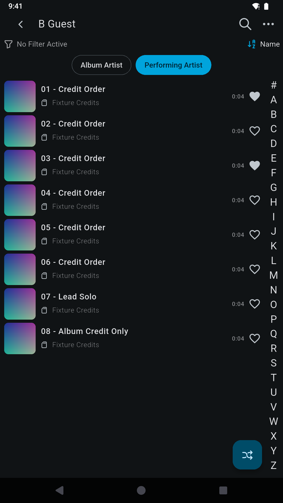
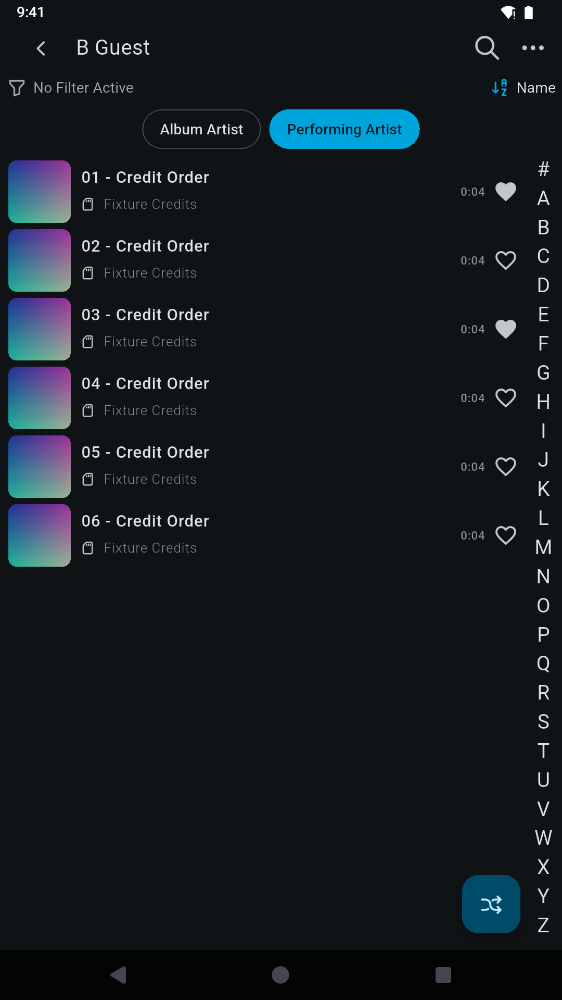
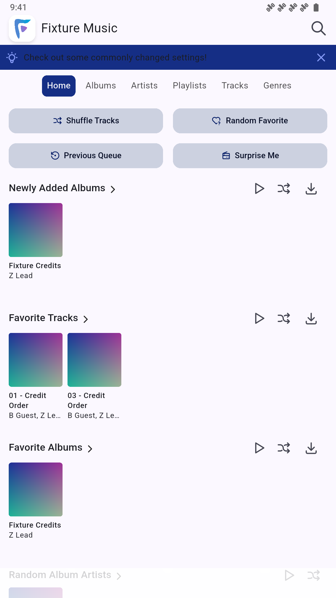
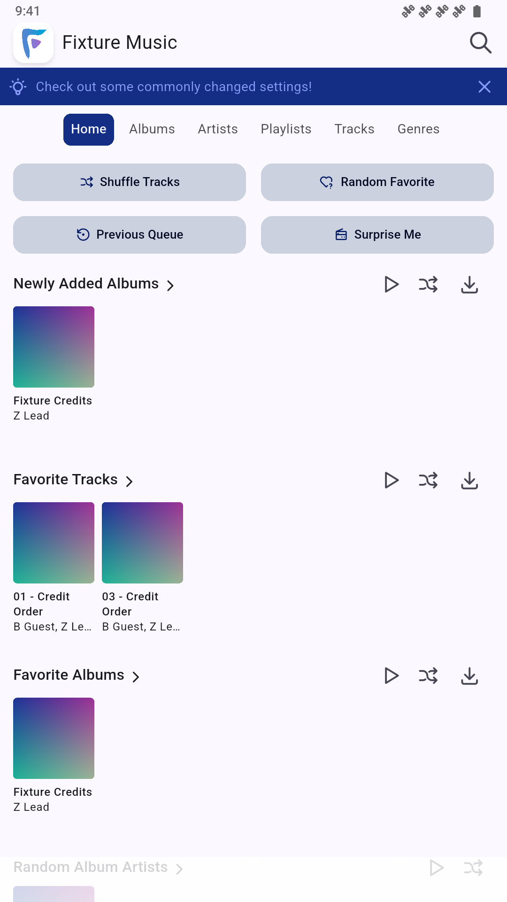
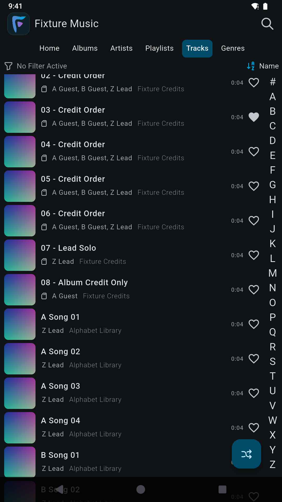
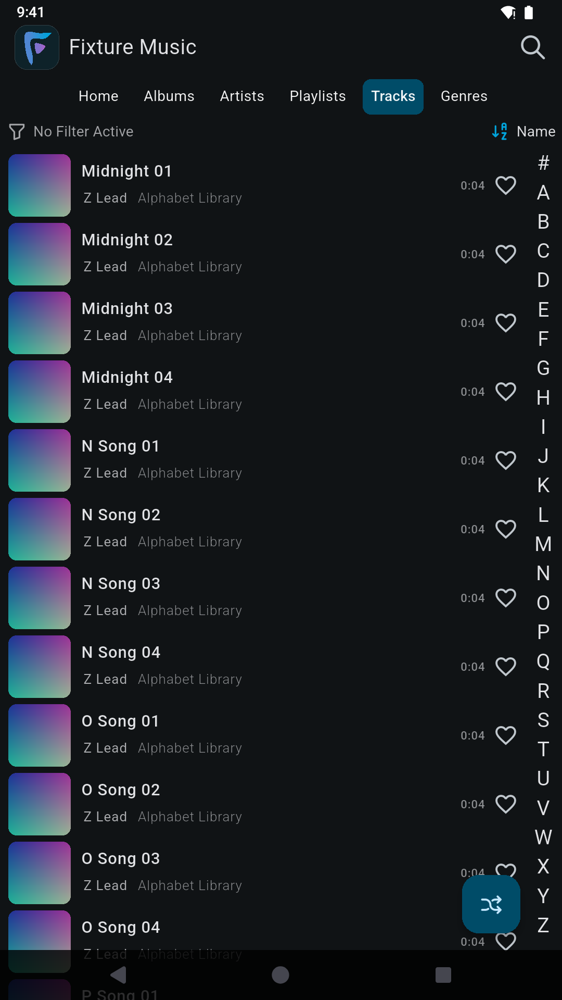
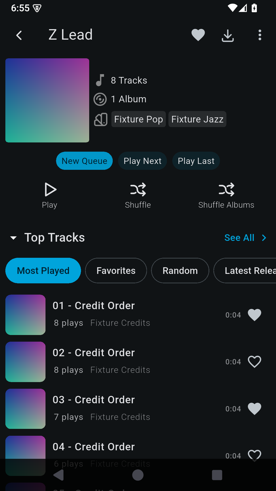
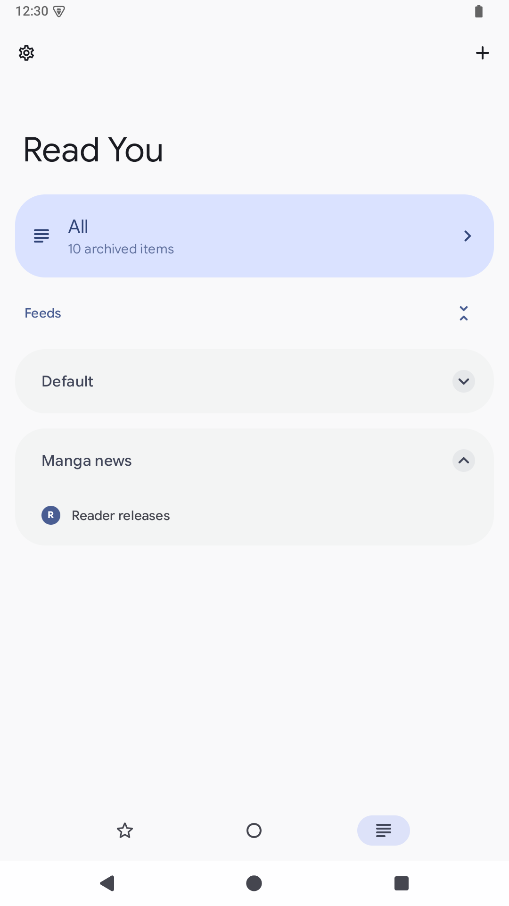
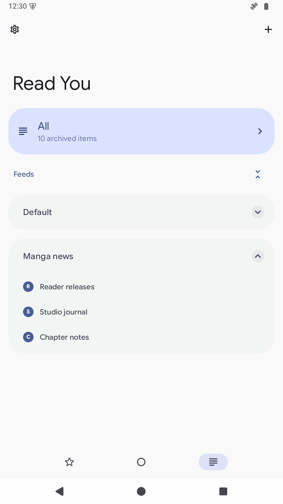

# Penguin Patches

<picture>
  <source media="(prefers-color-scheme: dark)" srcset="docs/assets/penguin-patches-banner-tailor-dark.png">
  <source media="(prefers-color-scheme: light)" srcset="docs/assets/penguin-patches-banner-tailor.png">
  
</picture>

**Your apps. A little better.**

Focused Android fixes, ready for Morphe.

<!-- PATCHES_SUMMARY_START -->
**21 patches · 12 apps · [v1.4.0](https://github.com/pengusto/penguin-patches/releases/tag/v1.4.0)**
<!-- PATCHES_SUMMARY_END -->

[Before & after](#patch-previews) · [Supported apps](#generated-patch-catalogue) · [Setup & signing](#patch-an-app) · [Latest release](https://github.com/pengusto/penguin-patches/releases/latest)

**Before installing:** use the exact original APK in your app's guide, verify your backup and keep your signing key. [Read the setup guide →](docs/SETUP.md)

## Finamp, with the album artist first.

Album artists first. Other credits alphabetical. More modes in settings.

| Before · original code | After · Song artist order |
| :---: | :---: |
|  |  |

Real Android APK captures with synthetic music data. [Evidence & limits](tests/finamp/evidence/2026-10-28/README.md).

<!-- FINAMP_COUNT_START -->
**[Explore the 7 Finamp patches →](docs/FINAMP_NATIVE.md)**
<!-- FINAMP_COUNT_END -->

Choose how song credits appear, keep Output reachable with hidden player buttons, improve banner contrast, and fix library browsing or settings errors. For the official **Finamp 1.0.1 universal APK → ARM64 output**.

**Upstream status · 2026-10-29:** the [title fix is merged](https://github.com/finamp-app/finamp/pull/1830), and the [banner fix already exists on `hotfix-1.0.2`](https://github.com/finamp-app/finamp/tree/hotfix-1.0.2). **All seven Penguin patches remain available for the original Finamp 1.0.1 APK**, including both backports. [Status & release details](docs/FINAMP.md#upstream-status-2026-10-29).

[Player output](#preview-keep-player-output-controls-accessible) · [Banner contrast](#preview-fix-quick-settings-banner-contrast) · [Title validation](#preview-fix-section-title-validation) · [Artist-page loading](#preview-load-artist-pages-faster) · [Offline artists](#preview-fix-offline-artist-tracks) · [Alphabet jumps](#preview-fix-track-alphabet-navigation)

| Feeder | Infinity+ |
| :--- | :--- |
| **Get closer to article images.** Tap to open a separate viewer; pinch, pan and double-tap to inspect the details. | **Use your own Reddit OAuth client.** Open the existing sign-in flow without the app's subscription gate. Reddit API approval/access is still required. |
| [Explore the Feeder patch →](docs/FEEDER.md) · [Before / after](#preview-zoom-article-images) | [Set up Infinity+ →](docs/INFINITY.md) · [Before / after](#preview-configure-custom-oauth-for-infinity) |

## Every patch, before & after

Open any patch below to see its matching before/after pair, right here. Grouped by app, with the capture baseline and evidence beside every pair. [Open the separate gallery →](docs/PATCH_EXAMPLES.md)

<!-- PATCHES_PREVIEWS_START -->

### Finamp · 7 patches

<strong>Fix offline artist tracks</strong> · Before / after

 

**Finamp 1.0.1** · [Setup & patch details](docs/FINAMP_NATIVE.md)

Keep only tracks credited to the selected performing artist when a downloaded
album contains several artists. Album-artist inclusion is preserved.

**Android APK captures.** Same downloaded synthetic album, B Guest performing-artist
filter, Name ordering, Dark theme and display size. Tracks 7–8 have other credits.
The after image is an actual Morphe Manager export installed with the same key.

| Before | After |
| :---: | :---: |
| **8 songs, including 2 unrelated tracks** | **6 matching songs** |
|  |  |

[Capture provenance & checks](tests/finamp/evidence/2026-10-28-next/README.md) · [Back to patch index](#patch-previews)

<strong>Fix quick settings banner contrast</strong> · Before / after

 

**Finamp 1.0.1** · [Setup & patch details](docs/FINAMP_NATIVE.md)

Keep the quick-settings banner readable with a custom accent. Its text uses the matching `onPrimaryContainer` color, like its existing icons.

**Upstream status · 2026-10-29:** the fix already exists on [`hotfix-1.0.2`](https://github.com/finamp-app/finamp/tree/hotfix-1.0.2) ([`124edc8`](https://github.com/finamp-app/finamp/commit/124edc8b94ea8fcba637a1dba31e7bd266644aa8)). Duplicate [PR #1837](https://github.com/finamp-app/finamp/pull/1837) is closed; this Penguin backport remains selectable for the original Finamp 1.0.1 APK.

**Android APK captures.** Same Home screen, synthetic music, Light theme, accent **#152E85**, viewport and clock. The before retains the official native code; the after is the installed Manager export with only this patch selected.

| Before | After |
| :---: | :---: |
| **Dark text is hard to read on the blue banner** | **Matching foreground keeps the banner readable** |
|  |  |

[Raw captures, provenance & Manager checks](tests/finamp/evidence/2026-10-29-ui/README.md) · [Closed duplicate PR #1837](https://github.com/finamp-app/finamp/pull/1837) · [Back to patch index](#patch-previews)

<strong>Fix section title validation</strong> · Before / after

 

**Finamp 1.0.1** · [Setup & patch details](docs/FINAMP_NATIVE.md)

Typing a valid custom home-section title updates validation and enables Save immediately.

**Upstream status · 2026-10-29:** [PR #1830](https://github.com/finamp-app/finamp/pull/1830) is merged into `redesign`. This Penguin backport remains selectable for the original Finamp 1.0.1 APK.

**Source-widget comparison, not Android APK screenshots.** These are actual Finamp widgets rendered by Flutter tests, upstream redesign versus the combined source fixes. The native APK fix is verified separately in the [APK record](tests/finamp/evidence/2026-10-28/README.md); its original before-image is obscured by the keyboard.

| Before | After |
| :---: | :---: |
| **Playlists entered; error remains and Save is disabled** | **Playlists entered; error clears and Save is enabled** |
|  |  |

[Capture provenance & checks](https://github.com/pengusto/finamp/tree/7e168434482e4e1e7b77a0c37337edb28291e2f8/contribution-evidence/2026-10-28) · [Back to patch index](#patch-previews)

<strong>Fix track alphabet navigation</strong> · Before / after

 

**Finamp 1.0.1** · [Setup & patch details](docs/FINAMP_NATIVE.md)

Compare the selected sidebar letter and track titles with consistent case.
Existing missing-letter behavior and paging remain in place.

**Android APK captures.** Same synthetic library, Name ordering, no filters and
the same tap on M. The after image uses the independently selected alphabet fix
exported by Morphe Manager. This is a correctness comparison, not a performance benchmark.

| Before | After |
| :---: | :---: |
| **M stays in the numeric section** | **M reaches Midnight 01** |
|  |  |

[Capture provenance & checks](tests/finamp/evidence/2026-10-28-next/README.md) · [Back to patch index](#patch-previews)

<strong>Keep player output controls accessible</strong> · Before / after

 

**Finamp 1.0.1** · [Setup & patch details](docs/FINAMP_NATIVE.md)

Open the existing output controls from the player menu even when bottom actions
are hidden and gestures disabled.

**Android APK captures.** Same paused synthetic track, Dark theme, settings and
viewport. The before APK retains the official native code; the after APK is an
actual Morphe Manager export, installed with the same test key.

| Before | After |
| :---: | :---: |
| **No Output entry in the player menu** | **Output opens the existing volume/device sheet** |
|  |  |

[Capture provenance & checks](tests/finamp/evidence/2026-10-29-ui/README.md) · [Back to patch index](#patch-previews)

<strong>Load artist pages faster</strong> · Before / after

 

**Finamp 1.0.1** · [Setup & patch details](docs/FINAMP_NATIVE.md)

Show the artist preview and track count without waiting for the full discography response.

**Android APK captures.** The fixture deliberately holds unbounded requests. Light before and Dark after are fixture settings, not a theme feature. This demonstrates query behavior, not a measured real-server speedup.

| Before | After |
| :---: | :---: |
| **Pending full-song queries: spinner and 0 Tracks** | **Bounded queries: preview and 8 Tracks appear** |
|  |  |

[Capture provenance & checks](tests/finamp/evidence/2026-10-28/README.md) · [Back to patch index](#patch-previews)

<strong>Song artist order</strong> · Before / after

 

**Finamp 1.0.1** · [Setup & patch details](docs/FINAMP_NATIVE.md)

Put the album artist first, then alphabetize the other song credits. Choose alternative modes in settings without rewriting music metadata.

**Android APK captures.** Same synthetic album and Dark theme. The before APK retains the official native code; the after APK has the native patch.

| Before | After |
| :---: | :---: |
| **A Guest, B Guest, Z Lead** | **Z Lead, A Guest, B Guest** |
|  |  |

[Capture provenance & checks](tests/finamp/evidence/2026-10-28/README.md) · [Back to patch index](#patch-previews)

### Feeder · 1 patch

<strong>Zoom article images</strong> · Before / after

 

**Feeder 2.25.0 · project GitHub F-Droid APK** · [Setup & patch details](docs/FEEDER.md)

Open an article image in its own viewer and pinch, pan or double-tap to inspect small details.

**Android APK captures.** Same synthetic offline article and image; the after capture shows actual zoom in the separate Morphe-patched viewer.

| Before | After |
| :---: | :---: |
| **Diagram stays at article width** | **Same diagram enlarged in the image viewer** |
|  |  |

[Capture provenance & checks](https://github.com/pengusto/penguin-patches/tree/8177428db162ed2e1a1b8de245cce479969046d3/feeder-391/2026-10-24) · [Back to patch index](#patch-previews)

### Infinity+ · 1 patch

<strong>Configure custom OAuth for Infinity+</strong> · Before / after

 

**Infinity+ 8.3.4** · [Setup & patch details](docs/INFINITY.md)

Use your own authorized Reddit OAuth client and reach the existing login flow without the app subscription prompt.

**Breal versus Penguin comparison.** Both are patched Infinity+ APKs; the Breal before capture uses the recorded billing state 4, not the unmodified official app. The after image shows login consent, with no account data. Reddit API approval/access is still required.

| Before | After |
| :---: | :---: |
| **Breal 1.4.123: Subscription prompt blocks login** | **Penguin: login reaches the User Agreement** |
|  |  |

[Capture provenance & checks](https://github.com/pengusto/penguin-patches/tree/8177428db162ed2e1a1b8de245cce479969046d3/infinity-834/2026-10-25) · [Back to patch index](#patch-previews)

### Fossify Calendar · 2 patches

<strong>Readable Calendar descriptions</strong> · Before / after

 

**Fossify Calendar 1.12.0** · [Setup & patch details](docs/CALENDAR.md)

Read an HTML event description as text while retaining an explicit Edit HTML source action.

**Previous versus revised Morphe patch.** This is the wrapperless-table regression on the official APK, not an original-versus-patched pair or a source-fork capture. It demonstrates readable cell text, not a full HTML table layout. Live Outlook sync is outside the evidence.

| Before | After |
| :---: | :---: |
| **Previous Morphe patch: raw table tags** | **Revised patch: Morning Workshop, with source editing** |
|  |  |

[Capture provenance & checks](https://github.com/pengusto/penguin-patches/tree/8177428db162ed2e1a1b8de245cce479969046d3/calendar-table-review) · [Back to patch index](#patch-previews)

<strong>Separate all-day reminder defaults</strong> · Before / after

 

**Fossify Calendar 1.12.0** · [Setup & patch details](docs/CALENDAR_REMINDERS.md)

Give new all-day events their own reminder defaults while keeping timed-event defaults separate.

**Android APK captures.** Same unsaved draft, dates and timed defaults. The after prototype includes both Calendar patches; the pictured difference is the all-day reminder defaults. These are configured example values, not the first-run defaults.

| Before | After |
| :---: | :---: |
| **All-day draft inherits 30 minutes / 2 hours** | **Same draft uses 6 hours / 1 day / at start** |
|  |  |

[Capture provenance & checks](https://github.com/pengusto/penguin-patches/tree/8177428db162ed2e1a1b8de245cce479969046d3/calendar-381/2026-10-24) · [Back to patch index](#patch-previews)

### Fossify Clock · 1 patch

<strong>Choose upcoming alarm notification time</strong> · Before / after

 

**Fossify Clock 1.6.0** · [Setup & patch details](docs/CLOCK.md)

Choose when upcoming-alarm notices appear and keep a separate notice for each alarm.

**Android APK captures.** Same two alarms, approximately 45 and 60 minutes ahead. The notices arrive through natural AlarmManager delivery. Lead time is configured in Morphe when patching; this adds no in-app setting.

| Before | After |
| :---: | :---: |
| **No upcoming notices outside the original ten-minute window** | **Two alarm notices within the configured 120-minute window** |
|  |  |

[Capture provenance & checks](https://github.com/pengusto/penguin-patches/tree/8177428db162ed2e1a1b8de245cce479969046d3/clock-14/2026-10-24) · [Back to patch index](#patch-previews)

### Fossify Contacts · 1 patch

<strong>Show emails and notes from merged contacts</strong> · Before / after

 

**Fossify Contacts 1.6.0** · [Setup & patch details](docs/CONTACTS.md)

See the email and note contributed by a duplicate contact in the merged detail view.

**Android APK captures.** The same synthetic contact pair is shown with Merge duplicate contacts enabled. Source contact records are retained; this is a display fix.

| Before | After |
| :---: | :---: |
| **Merged view hides the duplicate email and note** | **Email and Local note stays intact are visible** |
|  |  |

[Capture provenance & checks](https://github.com/pengusto/penguin-patches/tree/8177428db162ed2e1a1b8de245cce479969046d3/contact-music) · [Back to patch index](#patch-previews)

### Fossify File Manager · 1 patch

<strong>Keep favorites consistent after folder rename or removal</strong> · Before / after

 

**Fossify File Manager 1.6.2** · [Setup & patch details](docs/FILE_MANAGER.md)

Keep nested favorites pointing to the right folder after a parent-folder rename.

**Android APK captures.** Both follow a real Docs → Docs2 UI rename with synthetic files. This pair illustrates rename handling; selected-deletion cleanup and its pre-deletion timing are documented in the guide.

| Before | After |
| :---: | :---: |
| **Docs renamed to Docs2; favorite still uses Docs/Projects** | **Favorite follows Docs2/Projects** |
|  |  |

[Capture provenance & checks](https://github.com/pengusto/penguin-patches/tree/8177428db162ed2e1a1b8de245cce479969046d3/README.md) · [Back to patch index](#patch-previews)

### Fossify Messages · 3 patches

<strong>Avoid notifications for visible conversations</strong> · Before / after

 

**Fossify Messages 1.10.1** · [Setup & patch details](docs/MESSAGES.md)

Avoid leaving a notification for a message already received in the currently visible conversation.

**Android APK captures.** Same visible-thread scenario with synthetic SMS, followed by Back and the notification shade. No manual notification dismissal occurs between receipt and capture.

| Before | After |
| :---: | :---: |
| **Read while visible; notification remains after Back** | **Read while visible; no Messages notification after Back** |
|  |  |

[Capture provenance & checks](https://github.com/pengusto/penguin-patches/tree/8177428db162ed2e1a1b8de245cce479969046d3/messages-lifecycle) · [Back to patch index](#patch-previews)

<strong>Dismiss notifications when marking conversations read</strong> · Before / after

 

**Fossify Messages 1.10.1** · [Setup & patch details](docs/MESSAGES.md)

Remove a conversation notification after marking that conversation read from the app list.

**Android APK captures.** Synthetic SMS only. The final after run marks both fixture threads read; unrelated-thread retention is established by the separate tests, not this empty shade alone.

| Before | After |
| :---: | :---: |
| **Marked read in the list; notification remains** | **Marked read in the list; Messages notification removed** |
|  |  |

[Capture provenance & checks](https://github.com/pengusto/penguin-patches/tree/8177428db162ed2e1a1b8de245cce479969046d3/README.md) · [Back to patch index](#patch-previews)

<strong>Keep background conversations unread</strong> · Before / after

 

**Fossify Messages 1.10.1** · [Setup & patch details](docs/MESSAGES.md)

Keep an incoming message unread when its conversation is open in a background Activity.

**Android APK captures.** The fixture leaves the thread with Home, receives a synthetic SMS, then opens the conversation list. Provider records confirm read=1 before and read=0 after. Lifecycle patches are tested together and apply independently.

| Before | After |
| :---: | :---: |
| **Background message appears read; no unread count** | **Background message stays bold with unread count 1** |
|  |  |

[Capture provenance & checks](https://github.com/pengusto/penguin-patches/tree/8177428db162ed2e1a1b8de245cce479969046d3/messages-lifecycle) · [Back to patch index](#patch-previews)

### Fossify Music Player · 1 patch

<strong>Prefer each track&#x27;s embedded cover</strong> · Before / after

 

**Fossify Music Player 1.8.4** · [Setup & patch details](docs/MUSIC.md)

Show the artwork embedded in the current track rather than reusing another track's album cover.

**Android APK captures.** Two synthetic audio files share an album ID and have different embedded covers. File hashes and the existing fallback path are checked separately.

| Before | After |
| :---: | :---: |
| **Penguin Blue and Penguin Red both show red artwork** | **Penguin Blue shows blue; Penguin Red stays red** |
|  |  |

[Capture provenance & checks](https://github.com/pengusto/penguin-patches/tree/8177428db162ed2e1a1b8de245cce479969046d3/contact-music) · [Back to patch index](#patch-previews)

### Kvaesitso · 1 patch

<strong>Restore widget editing from the search menu</strong> · Before / after

 

**Kvaesitso 1.41.0** · [Setup & patch details](docs/KVAESITSO.md)

Reach the existing widget editor from the search-bar menu even when the on-screen Edit button is hidden.

**Android APK captures.** Same hidden-button preference and synthetic widget layout. The patched action opens the app's existing editor; it does not re-enable the hidden button.

| Before | After |
| :---: | :---: |
| **Search menu has no Edit widgets action** | **Edit widgets appears at the top of the same menu** |
|  |  |

[Capture provenance & checks](https://github.com/pengusto/penguin-patches/tree/8177428db162ed2e1a1b8de245cce479969046d3/kvaesitso-1504/2026-10-24) · [Back to patch index](#patch-previews)

### Read You · 1 patch

<strong>Import nested OPML feeds</strong> · Before / after

 

**Read You 0.16.2 · official GitHub APK** · [Setup & patch details](docs/READYOU.md)

Keep feeds inside nested OPML folders when importing subscriptions. Preserve feed
order and per-feed settings within the app's existing flat outer group.

**Android APK captures.** Same three-feed synthetic OPML, All filter, collapsed
Default group, light theme, display size and density. Original official payload
resigned with the fixture key versus the actual Morphe Manager export installed
with that same key. Each import starts without the synthetic Manga news group.

| Before | After |
| :---: | :---: |
| **Only 1 of 3 feeds imported** | **All 3 feeds imported** |
|  |  |

[Capture provenance & checks](tests/readyou/evidence/2026-10-29/README.md) · [Back to patch index](#patch-previews)

### Tasks.org · 1 patch

<strong>Navigate to the parent task</strong> · Before / after

 

**Tasks.org 15.13 · project GitHub F-Droid APK** · [Setup & patch details](docs/TASKS.md)

Open the immediate parent task from the child editor using an explicit up-arrow.

**Android APK captures.** Same synthetic child task, notes and date. The guide also records Save / Discard / Cancel for changed drafts. The red reminder warning is existing Android permission state, not a change made by this patch.

| Before | After |
| :---: | :---: |
| **Child editor has no parent-navigation action** | **Up-arrow appears next to the existing actions** |
|  |  |

[Capture provenance & checks](https://github.com/pengusto/penguin-patches/tree/8177428db162ed2e1a1b8de245cce479969046d3/tasks-2838/2026-10-24) · [Back to patch index](#patch-previews)

<!-- PATCHES_PREVIEWS_END -->

<!-- PATCHES_START -->

<strong>All 12 apps and supported versions</strong>

> **[v1.4.0](https://github.com/pengusto/penguin-patches/releases/tag/v1.4.0)**&nbsp;&nbsp;•&nbsp;&nbsp;`main`&nbsp;&nbsp;•&nbsp;&nbsp;21 patches total

📦 Fossify Messages&nbsp;&nbsp;•&nbsp;&nbsp;3 patches

 

**🎯 Supported versions:**

| 1.10.1 |
| :---: |

| 💊&nbsp;Patch | 📜&nbsp;Description | ⚙️&nbsp;Options |
|----------|----------------|-----------|
| [Avoid notifications for visible conversations](docs/MESSAGES.md) [Before / after](#preview-avoid-notifications-for-visible-conversations) | Check visible conversation on the main thread before posting an incoming-message notification. |  |
| [Dismiss notifications when marking conversations read](docs/MESSAGES.md) [Before / after](#preview-dismiss-notifications-when-marking-conversations-read) | Remove the selected conversation's notification after Mark as read in the conversation list. |  |
| [Keep background conversations unread](docs/MESSAGES.md) [Before / after](#preview-keep-background-conversations-unread) | Do not mark incoming messages read when their conversation is left in the background. |  |

📦 Fossify Clock&nbsp;&nbsp;•&nbsp;&nbsp;1 patch

 

**🎯 Supported versions:**

| 1.6.0 |
| :---: |

| 💊&nbsp;Patch | 📜&nbsp;Description | ⚙️&nbsp;Options |
|----------|----------------|-----------|
| [Choose upcoming alarm notification time](docs/CLOCK.md) [Before / after](#preview-choose-upcoming-alarm-notification-time) | Choose the advance notice in Morphe, with separate notifications and skip actions for each alarm occurrence. Keeps native ringing times and alarm definitions. | • Upcoming alarm notice (minutes) |

📦 Infinity+&nbsp;&nbsp;•&nbsp;&nbsp;1 patch

 

**🎯 Supported versions:**

| 8.3.4 |
| :---: |

| 💊&nbsp;Patch | 📜&nbsp;Description | ⚙️&nbsp;Options |
|----------|----------------|-----------|
| [Configure custom OAuth for Infinity+](docs/INFINITY.md) [Before / after](#preview-configure-custom-oauth-for-infinity) | Use a configured Reddit OAuth client consistently through login and token exchange in Infinity+ 8.3.4, without the app subscription gate. | • OAuth client ID • Registered redirect URI • API user agent |

📦 Finamp&nbsp;&nbsp;•&nbsp;&nbsp;7 patches

 

**🎯 Supported versions:**

| 1.0.1 |
| :---: |

| 💊&nbsp;Patch | 📜&nbsp;Description | ⚙️&nbsp;Options |
|----------|----------------|-----------|
| [Fix offline artist tracks](docs/FINAMP_NATIVE.md) [Before / after](#preview-fix-offline-artist-tracks) | Exclude unrelated songs from shared albums on offline performing-artist pages (#1689). Requires the original official Finamp 1.0.1 APK. Produces ARM64-only output; other native architectures are removed. |  |
| [Fix quick settings banner contrast](docs/FINAMP_NATIVE.md) [Before / after](#preview-fix-quick-settings-banner-contrast) | Use the banner's matching foreground color so its text stays readable with custom accents (#1756). Requires the original official Finamp 1.0.1 APK. Produces ARM64-only output; other native architectures are removed. |  |
| [Fix section title validation](docs/FINAMP_NATIVE.md) [Before / after](#preview-fix-section-title-validation) | Update validation and enable Save when a custom home-section title is entered (#1830). Requires the original official Finamp 1.0.1 APK. Produces ARM64-only output; other native architectures are removed. |  |
| [Fix track alphabet navigation](docs/FINAMP_NATIVE.md) [Before / after](#preview-fix-track-alphabet-navigation) | Compare song names and target letters consistently when jumping through the Tracks alphabet (#1790). Requires the original official Finamp 1.0.1 APK. Produces ARM64-only output; other native architectures are removed. |  |
| [Keep player output controls accessible](docs/FINAMP_NATIVE.md) [Before / after](#preview-keep-player-output-controls-accessible) | Open the existing output controls from the player menu even when bottom actions are hidden (#1355). Requires the original official Finamp 1.0.1 APK. Produces ARM64-only output; other native architectures are removed. |  |
| [Load artist pages faster](docs/FINAMP_NATIVE.md) [Before / after](#preview-load-artist-pages-faster) | Load artist previews and track counts without downloading the full discography (#1832). Requires the original official Finamp 1.0.1 APK. Produces ARM64-only output; other native architectures are removed. |  |
| [Song artist order](docs/FINAMP_NATIVE.md) [Before / after](#preview-song-artist-order) | Choose song-credit display order, including album artists first, metadata order and alphabetical (#1831). Requires the original official Finamp 1.0.1 APK. Produces ARM64-only output; other native architectures are removed. |  |

📦 Read You&nbsp;&nbsp;•&nbsp;&nbsp;1 patch

 

**🎯 Supported versions:**

| 0.16.2 |
| :---: |

| 💊&nbsp;Patch | 📜&nbsp;Description | ⚙️&nbsp;Options |
|----------|----------------|-----------|
| [Import nested OPML feeds](docs/READYOU.md) [Before / after](#preview-import-nested-opml-feeds) | Import feeds inside nested OPML folders into their outer group, preserving document order and feed settings. Official GitHub Read You 0.16.2 APK only. |  |

📦 Fossify File Manager&nbsp;&nbsp;•&nbsp;&nbsp;1 patch

 

**🎯 Supported versions:**

| 1.6.2 |
| :---: |

| 💊&nbsp;Patch | 📜&nbsp;Description | ⚙️&nbsp;Options |
|----------|----------------|-----------|
| [Keep favorites consistent after folder rename or removal](docs/FILE_MANAGER.md) [Before / after](#preview-keep-favorites-consistent-after-folder-rename-or-removal) | Update nested favorite paths after successful single or multiple renames and remove nested favorites with their deleted parent. |  |

📦 Tasks.org&nbsp;&nbsp;•&nbsp;&nbsp;1 patch

 

**🎯 Supported versions:**

| 15.13 |
| :---: |

| 💊&nbsp;Patch | 📜&nbsp;Description | ⚙️&nbsp;Options |
|----------|----------------|-----------|
| [Navigate to the parent task](docs/TASKS.md) [Before / after](#preview-navigate-to-the-parent-task) | Add a parent-task arrow to the existing editor. Keeps Back behavior and the current filter; asks whether to save, discard or cancel when the draft has changes. Official project F-Droid APK 15.13 only. |  |

📦 Fossify Music Player&nbsp;&nbsp;•&nbsp;&nbsp;1 patch

 

**🎯 Supported versions:**

| 1.8.4 |
| :---: |

| 💊&nbsp;Patch | 📜&nbsp;Description | ⚙️&nbsp;Options |
|----------|----------------|-----------|
| [Prefer each track's embedded cover](docs/MUSIC.md) [Before / after](#preview-prefer-each-track-s-embedded-cover) | Use file-specific cover artwork before shared album art, retaining the original fallback and worker callback. |  |

📦 Fossify Calendar&nbsp;&nbsp;•&nbsp;&nbsp;2 patches

 

**🎯 Supported versions:**

| 1.12.0 |
| :---: |

| 💊&nbsp;Patch | 📜&nbsp;Description | ⚙️&nbsp;Options |
|----------|----------------|-----------|
| [Readable Calendar descriptions](docs/CALENDAR.md) [Before / after](#preview-readable-calendar-descriptions) | Readable day/agenda summaries and native Outlook/Exchange HTML preview with explicit source editing; preserves the original editor text. |  |
| [Separate all-day reminder defaults](docs/CALENDAR_REMINDERS.md) [Before / after](#preview-separate-all-day-reminder-defaults) | Choose three separate default reminders for new all-day events in Calendar settings. Keeps timed-event defaults, existing events and the use-last-reminders setting. |  |

📦 Kvaesitso&nbsp;&nbsp;•&nbsp;&nbsp;1 patch

 

**🎯 Supported versions:**

| 1.41.0 |
| :---: |

| 💊&nbsp;Patch | 📜&nbsp;Description | ⚙️&nbsp;Options |
|----------|----------------|-----------|
| [Restore widget editing from the search menu](docs/KVAESITSO.md) [Before / after](#preview-restore-widget-editing-from-the-search-menu) | Open the existing widget editor from the search bar menu when the Edit button is hidden, without changing the preference or stored widgets. |  |

📦 Fossify Contacts&nbsp;&nbsp;•&nbsp;&nbsp;1 patch

 

**🎯 Supported versions:**

| 1.6.0 |
| :---: |

| 💊&nbsp;Patch | 📜&nbsp;Description | ⚙️&nbsp;Options |
|----------|----------------|-----------|
| [Show emails and notes from merged contacts](docs/CONTACTS.md) [Before / after](#preview-show-emails-and-notes-from-merged-contacts) | Include duplicate contact emails and notes in the detail view without changing stored contact records. |  |

📦 Feeder&nbsp;&nbsp;•&nbsp;&nbsp;1 patch

 

**🎯 Supported versions:**

| 2.25.0 |
| :---: |

| 💊&nbsp;Patch | 📜&nbsp;Description | ⚙️&nbsp;Options |
|----------|----------------|-----------|
| [Zoom article images](docs/FEEDER.md) [Before / after](#preview-zoom-article-images) | Open article images in a separate viewer with pinch, pan, double-tap and accessible zoom controls. Linked images offer View image or Open link. Uses Feeder's existing image loader and network policy. Official project F-Droid APK 2.25.0 only. |  |

<!-- PATCHES_END -->

<strong>Setup, signing & verification</strong>

1. [Add the source to Morphe](https://morphe.software/add-source?github=pengusto/penguin-patches).
2. Pick the exact original APK from the app guide, select patches and set their options.
3. Patch, sign and install with your backed-up Morphe key.

**Check your backup before migration.** These patches keep the original package ID. A different signing certificate cannot update an official installation in place; read the [full setup guide](docs/SETUP.md) before uninstalling anything.

Finamp passes [Android Manager 2.2.0 acceptance on an API 35 ARM64 emulator](tests/finamp/evidence/2026-10-28-manager/README.md). Physical devices remain unverified; other apps retain their guide-specific limits. [Verification record](docs/VERIFICATION.md) · [Report a problem](docs/SETUP.md#report-a-problem).

Stable releases come from `main`; `dev` carries pre-releases. Enable pre-releases in Morphe only if you intend to try upcoming changes.

[Build & contribute](docs/DEVELOPMENT.md) · [Upstream work & roadmap](docs/ROADMAP.md) · [Support development](https://github.com/sponsors/pengusto) · [License & provenance](docs/PROVENANCE.md)

Independent project; not affiliated with Morphe or the original app projects. Code: [GPL-3.0](LICENSE), with project-name terms and upstream credits in [NOTICE](NOTICE). [Illustration & screenshot credits](docs/PROVENANCE.md).
