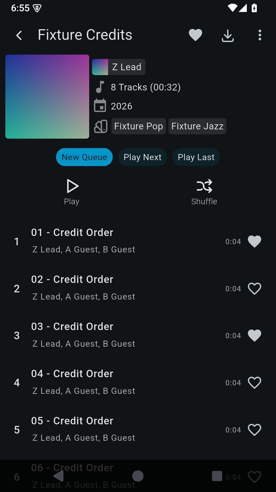

# Penguin Patches

<picture>
  <source media="(prefers-color-scheme: dark)" srcset="../assets/penguin-patches-banner-tailor-dark.png">
  <source media="(prefers-color-scheme: light)" srcset="../assets/penguin-patches-banner-tailor.png">
  
</picture>

[English](../../README.md) · [Deutsch](README.de.md) · [简体中文](README.zh-CN.md) · [日本語](README.ja.md) · [Español](README.es.md) · [한국어](README.ko.md) · [Português (Brasil)](README.pt-BR.md) · [Français](README.fr.md)

   

**Seus aplicativos, um pouco melhores.**

Penguin Patches é uma coleção independente de patches para Android compatível com o Morphe Manager. Ela melhora ou corrige funções de aplicativos existentes. O projeto não é afiliado ao Morphe nem aos projetos originais.

> Esta página foi traduzida com IA e ainda não recebeu revisão de falante nativo. A galeria completa e os guias técnicos estão em inglês; em caso de divergência, prevalece a versão em inglês.

## O que o projeto faz

Os patches incluem descrições legíveis no Calendar, zoom de imagens no Feeder, ajustes no Finamp e um cliente OAuth próprio do Reddit para o Infinity+. Consulte o catálogo e o guia de cada aplicativo para ver as mudanças e as versões originais compatíveis.

**Aplicativos compatíveis:** [Feeder](../FEEDER.md) · [Finamp](../FINAMP_NATIVE.md) · [Fossify Calendar](../CALENDAR.md) · [Fossify Clock](../CLOCK.md) · [Fossify Contacts](../CONTACTS.md) · [Fossify File Manager](../FILE_MANAGER.md) · [Fossify Messages](../MESSAGES.md) · [Fossify Music Player](../MUSIC.md) · [Infinity+](../INFINITY.md) · [Komikku](../KOMIKKU.md) · [Kvaesitso](../KVAESITSO.md) · [Mihon](../MIHON.md) · [Read You](../READYOU.md) · [Tasks.org](../TASKS.md)

[**Aplicativos e versões exatas compatíveis →**](../../README.md#generated-patch-catalogue)

## Antes e depois

Exemplo: no Finamp, o patch coloca o artista do álbum antes dos demais participantes. As imagens são capturas reais de um APK Android com dados musicais sintéticos.

| Antes: outros participantes aparecem antes do artista do álbum | Depois: o artista do álbum aparece primeiro |
| :---: | :---: |
|  |  |

[Ver todas as comparações](../../README.md#patch-previews) · [Capturas e evidências](../../tests/finamp/evidence/2026-10-28/README.md)

## Visão geral dos patches

- [Evitar notificações de conversas visíveis](../../README.md#preview-avoid-notifications-for-visible-conversations)
- [Escolher a antecedência do aviso de alarme](../../README.md#preview-choose-upcoming-alarm-notification-time)
- [Configurar cliente OAuth próprio no Infinity+](../../README.md#preview-configure-custom-oauth-for-infinity)
- [Dispensar a notificação ao marcar como lida](../../README.md#preview-dismiss-notifications-when-marking-conversations-read)
- [Finamp Complete: as oito melhorias](../../README.md#preview-finamp-complete-all-eight-fixes)
- [Importar feeds OPML aninhados](../../README.md#preview-import-nested-opml-feeds)
- [Manter conversas em segundo plano como não lidas](../../README.md#preview-keep-background-conversations-unread)
- [Manter favoritos após renomear ou excluir pastas](../../README.md#preview-keep-favorites-consistent-after-folder-rename-or-removal)
- [Preservar mangás locais em buscas de exclusão](../../README.md#preview-keep-local-manga-in-exclusion-searches)
- [Ir para a tarefa pai](../../README.md#preview-navigate-to-the-parent-task)
- [Priorizar a capa incorporada de cada faixa](../../README.md#preview-prefer-each-track-s-embedded-cover)
- [Manter downloads excluídos da categoria padrão](../../README.md#preview-preserve-excluded-default-category-downloads)
- [Exibir descrições legíveis no Calendar](../../README.md#preview-readable-calendar-descriptions)
- [Restaurar edição de widgets pelo menu de busca](../../README.md#preview-restore-widget-editing-from-the-search-menu)
- [Separar lembretes padrão para eventos de dia inteiro](../../README.md#preview-separate-all-day-reminder-defaults)
- [Exibir e-mails e notas de contatos mesclados](../../README.md#preview-show-emails-and-notes-from-merged-contacts)
- [Ampliar imagens de artigos](../../README.md#preview-zoom-article-images)

## Instalação

1. [Penguin Patches → Morphe](https://morphe.software/add-source?github=pengusto/penguin-patches). Adicione Penguin Patches como fonte no Morphe. Se o link não abrir, escolha “Sources → Add → Remote” no Morphe Manager e informe a URL do repositório.
2. Abra o guia do aplicativo no catálogo e confira a versão exata, a variante e o SHA-256 do APK original. Selecione os patches e as opções.
3. Aplique os patches, assine com a chave do Morphe previamente guardada e instale. Verifique primeiro o comportamento com dados descartáveis.

**Faça backup antes:** os patches mantêm o identificador do pacote original. Um APK assinado com outro certificado não pode atualizar diretamente a instalação existente. Guarde os dados do aplicativo e a chave de assinatura; não desinstale o aplicativo apenas para contornar um conflito de assinatura.

[Guia completo de instalação e assinatura →](../SETUP.md)

## Status e limitações

Somente os APKs originais indicados em cada guia foram verificados. Os registros diferenciam APKs oficiais modificados de forks de código testados separadamente. Dispositivos físicos ainda não foram verificados; consulte cada guia para outras limitações.

As versões estáveis vêm de `main`; ative pré-lançamentos de `dev` apenas para experimentar mudanças futuras. O Infinity+ exige seu próprio cliente OAuth autorizado do Reddit.

[Evidências e limitações](../VERIFICATION.md) · [Infinity+](../INFINITY.md) · [Finamp](../FINAMP_NATIVE.md)

## Tecnologias

As definições dos patches usam Kotlin e os componentes auxiliares do Android usam Java; o Gradle faz a compilação. O guia de desenvolvimento informa os requisitos de Java 21, Android SDK e acesso ao registro de pacotes.

## Desenvolvimento e ajuda

[Compilar e contribuir](../DEVELOPMENT.md) · [Trabalho upstream e roteiro](../ROADMAP.md) · [Relatar um problema](https://github.com/pengusto/penguin-patches/issues/new/choose) · [Apoiar o desenvolvimento](https://github.com/sponsors/pengusto)

## Licença e procedência

O código do projeto é distribuído sob GPL-3.0. Consulte NOTICE e os registros de procedência para as condições do nome do projeto e os créditos de código e imagens de terceiros.

[GPL-3.0](../../LICENSE) · [NOTICE](../../NOTICE) · [Procedência e créditos das imagens](../PROVENANCE.md)
