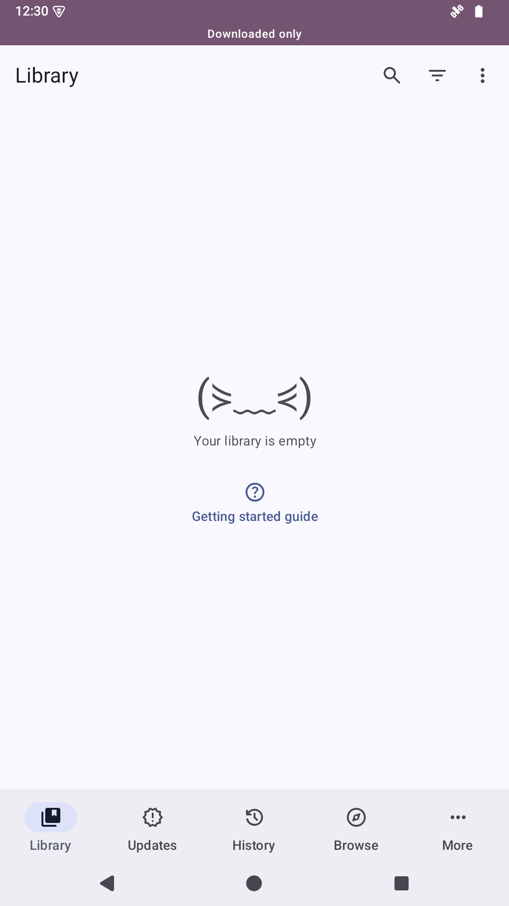
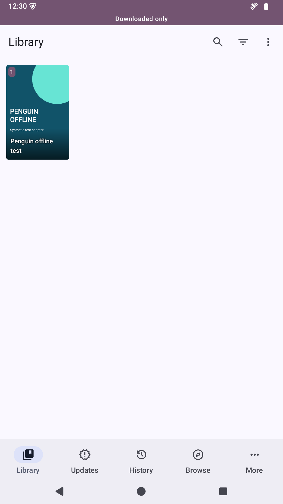

# Mihon installed-APK acceptance — 2026-10-29

These unedited 1080×1920 captures are from the owned Android 35 ARM64 `penguin`
AVD, `emulator-5580`. Light theme, synthetic favorite/chapter, Default excluded
from deletion, and **Downloaded only** are matched. No keyboard or modal covers
the app. Before: the original APK deletes the read download and the filtered list
appears empty. After: the actual Manager export retains the page and downloaded
entry. The favorite and chapter database records survive in both cases.

| Original code | Morphe Manager export |
| --- | --- |
|  |  |

## Results and provenance

- [Provenance, screenshot hashes and data comparisons](provenance.json).
- [Original APK native regression](original-native.json): 5/6 pass; the excluded
  Default/read case loses its page. [Manager export](manager-native.json) and
  [Desktop export](desktop-native.json): all six pass. Retained page bytes match.
- [Actual Manager selection](manager-selection.png), [raw hierarchy](manager-selection.xml),
  [successful application](manager-success.png), [raw hierarchy](manager-success.xml).
  Selection, application and Android document export were performed in Manager
  2.2.0; [runtime log](manager-runtime.txt) confirms ART. The exported APK was
  installed with the same disposable key as the baseline.
- [37 passing source tests](unit-summary.json), with [raw JUnit XML](source-tests); seven public deletion/pending-delete
  tests reproduce one failure before Marc Went / Dunky13's `0L` correction.
- [Canonical comparison](canonical-manager-comparison.txt): all 19,958 app/library
  classes agree between Desktop and actual Manager exports. [Runtime-module check](module-verification.txt)
  retains all seven previous MPEs unchanged. Mihon adds no runtime MPE.
- State snapshots in [state/](state) compare database rows and hashes of preferences
  and retained fixture files immediately around same-key update, patch removal,
  and reapplication. Each adjacent APK transition preserves all three exactly.
  Behavioral tests between transitions intentionally change disposable fixture files.

The former evidence bundling attempt expected `native/ui-before.json`, which does
not exist. Its actual raw output **does** exist as [ui-before.txt](ui-before.txt).
[ui-before-recovered.json](ui-before-recovered.json) is explicitly a parsed copy of
that output, not a recovered device file. The corresponding [before.xml](before.xml)
and [before.png](before.png) are original captures. [ui-after-indexed.json](ui-after-indexed.json)
also confirms the real cache sees the retained file. No missing artifact is invented.

The source proxy supplies an offline synthetic source identity; it does not replace
the real installed APK's deletion filter, provider, cache, preferences or filesystem.
Only default-category membership is native-tested; custom-category membership has
source-unit coverage. Physical devices, network extensions and remote storage
providers are outside this acceptance.

The original official APK's SHA-256 is
`0026bd25ce5b1c6bdc5bd2c9589a08a811ddc4fa7c994cf937729d5b7010619d`;
[the app guide](../../../../docs/MIHON.md) identifies its release, signer and author.
The original local bundle hash was not captured in this historical run. The
2026-10-30 candidate is independently compared against this Manager output and
its new verification record pins the candidate bundle.
