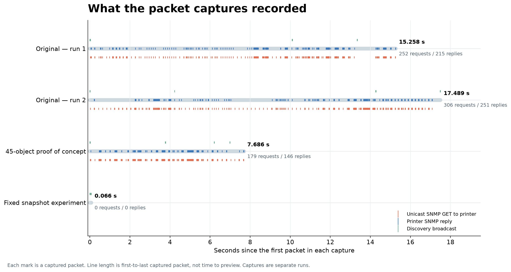
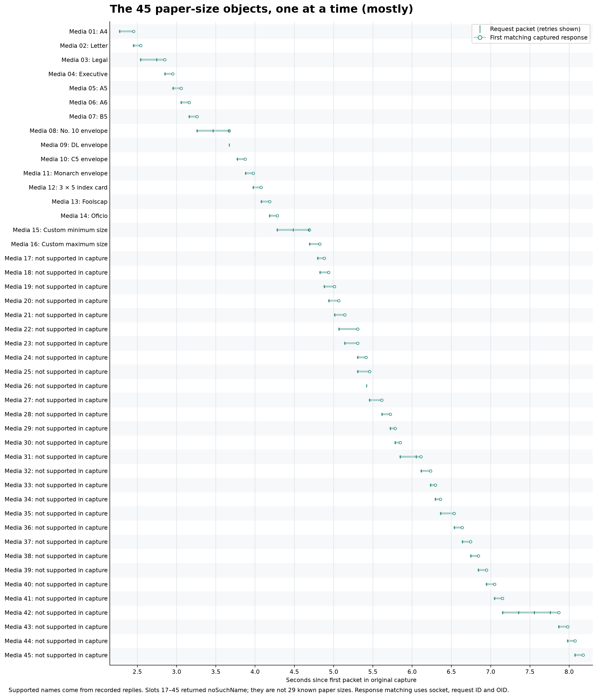

# Why print preview was slow: packet capture and cache experiment

This investigation used Brother Print Service Plugin 1.17.0 on a Google Pixel 9 and one Brother HL-L8260CDW printer. Captures were made with PCAPdroid. Results are observations from separate runs on one setup, not a controlled performance study or a claim about all Brother printers.

## Observations

| Run | First-to-last captured packet | Unicast SNMP GET packets to printer | Printer replies |
|---|---:|---:|---:|
| Original, run 1 | 15.258 s | 252 | 215 |
| Original, run 2 | 17.489 s | 306 | 251 |
| Initial 45-object fixed-response proof of concept | 7.686 s | 179 | 146 |
| Aggressive fixed-snapshot experiment | 0.066 s | 0 | 0 |

Counts include retries. The final capture also contained 35 broadcast discovery packets. These are the spans between the first and last captured packet, **not measured tap-to-preview times**. Captures were not synchronized to screen recordings. The user reported that the aggressive fixed-response version made preview feel nearly instant. The later automatic cache was also reported to work very well, but it has not been independently benchmarked with a matching cold/warm packet capture and timed screen recording. The zero-request observation is from the older fixed-snapshot experiment, not a measurement of the automatic cache.

## The paper-size sequence

The original service requested 45 consecutive objects in the Brother-specific subtree `1.3.6.1.4.1.2435.2.3.9.4.2.1.5.1.2.71.12.1.2`. Recorded replies showed 16 supported media values and 29 `noSuchName` results. The requests in this group spanned approximately 5.8 seconds in run 1 and 6.5 seconds in run 2. The spans overlap other activity and should not be added to the total capture span.

The sequence was largely, but not strictly, serial: 33 of 44 transitions in run 1 had a matching captured response before the next object's first request. Packet timing alone does not establish why requests were ordered that way or prove every request blocked preview. The remaining objects either overlapped or lacked a matched response in that interval.

[Full object timeline](docs/object-timeline-full.png) · [Object list with OIDs and timestamps](docs/object-requests.csv)

The full timeline marks known descriptions and capability-like objects as candidate cache entries and vendor-specific objects of unknown meaning separately. This classification is a design hypothesis, not a guarantee that any value never changes. No confirmed live-status object was identified in the plotted set; that does not mean the unknown objects cannot represent live state. Standard names were cross-checked against the [Printer MIB](https://www.rfc-editor.org/rfc/rfc3805.txt) and [Host Resources MIB](https://www.rfc-editor.org/rfc/rfc2790.txt). The media names came from captured replies. No device identifiers or printer addresses are published in the charts or object list.

## Current patch behaviour

The patch intercepts Brother's individual SNMP GET requests. A supported response already saved for the same IP address and OID is returned locally; on a cache miss the original request runs and a supported response is saved. Octet-string values, integer values and explicit `noSuchName` responses can be saved. Timeouts, unsupported types, multi-object GETs, other operation types and discovery broadcasts are not served by this cache. Saved data is app-private, persistent, and has no automatic expiry.

The pre-release checks a valid MAC address using the service's own SNMP request before reusing saved responses, and migrates a known identity's entries when the printer appears at a new IP. Requests fall through until identity is known; no usable MAC means the cache cannot be used. The verified state has a short in-memory lifetime and is refreshed whenever the service requests the MAC; it cannot guarantee detecting an IP reassignment during the interval between checks. Cached status or capabilities can also go stale. A separate optional background IPP query reports readiness in the settings screen; it does not prevent preview or alter Brother's reported status.

The previous fixed-snapshot experiments were deliberately aggressive: the 45-object version replayed recorded responses; a later experiment returned a fixed response or `noSuchName` for other unknown GETs. They established a speed hypothesis for this setup but are not the current learning-cache patch. They did not establish physical printing reliability or production safety.

## Ideas for a production implementation

- Separate relatively stable capabilities from dynamic readiness, errors, paper and consumable levels. Use appropriate expiries and refresh policies for each.
- Display known capabilities promptly and refresh asynchronously where possible; revalidate relevant live state before or during submission.
- Consider caching known unsupported objects with invalidation for firmware or configuration changes.
- Investigate batching or bounded parallel GETs for the actual printer and protocol version, accounting for missing objects, packet-size limits, retries and device load. [SNMP protocol operations](https://www.rfc-editor.org/rfc/rfc3416.html) support multiple variable bindings.
- Key caches using verified printer identity, handle address changes and reassignment, and provide clear controls and recovery from stale data.
- Measure tap-to-visible-preview, discovery, warm and cold cache, traffic, print success and status correctness across devices, models and network conditions.

The [Android printing API](https://developer.android.com/reference/android/print/package-summary) models capabilities, and [PrinterDiscoverySession](https://developer.android.com/reference/android/printservice/PrinterDiscoverySession) permits updating printer information. The best implementation depends on Brother's service and device behaviour.
