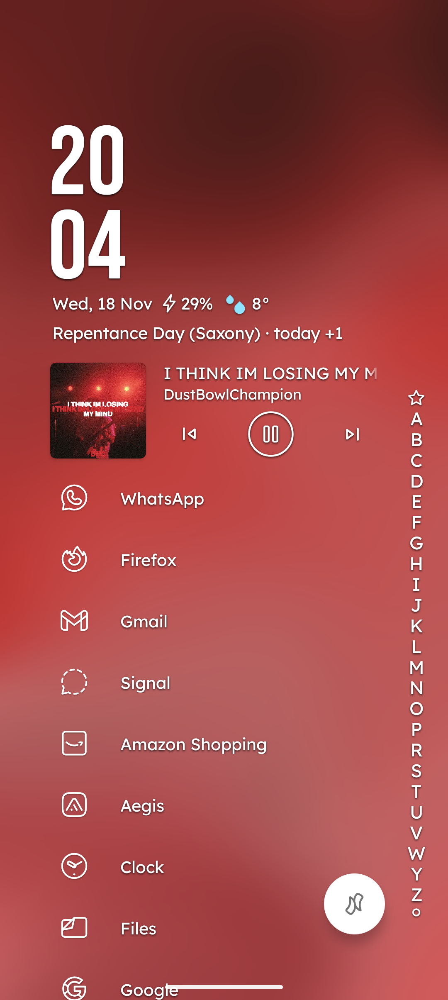

# Nick's Patches

Patches that I have written and loved.

### How to use these patches

Click the button below, or manually add this repo url to Morphe Manager: https://github.com/rathmerdominik/nick-patches

## 🩹 Patches list

<!-- PATCHES_START EXPANDED -->
> **[v1.0.0](https://github.com/rathmerdominik/nick-patches/releases/tag/v1.0.0)**&nbsp;&nbsp;•&nbsp;&nbsp;`main`&nbsp;&nbsp;•&nbsp;&nbsp;1 patches total

📦 Diffuse&nbsp;&nbsp;•&nbsp;&nbsp;1 patch

 

**Package name:** `com.depthware.lwp.diffuse.v2`

**🎯 Supported versions:**

| 1.1.0.0 (3433)-PUB |
| :---: |

| 💊&nbsp;Patch | 📜&nbsp;Description | ⚙️&nbsp;Options |
|----------|----------------|-----------|
| [Fix media notification detection](#fix-media-notification-detection) | Detects music notifications posted by foreground services that don't set FLAG_ONGOING_EVENT e.G Morphed YT Music. Requires a PairIP bypass patch! |  |

<!-- PATCHES_END -->

#### A list of your patches will automatically be shown here after your first patches release is created.

<h1>Showcase</h1>

### Diffuse Music Live Wallpaper

A patch that stops Diffuse from ending its operation when the music player is a foreground application and does not set the ongoing flag. This will allow Morphed YT Music to work with Diffuse.

Because Google is... Google you have to additionally use a PairIP bypass check. I recommend the one from [hoo-dles](https://github.com/hoo-dles/morphe-patches).

## 📜 License
Nick's Patches are licensed under the [GNU General Public License v3.0](LICENSE)
