<div align="center">

# ⌨️ Gboard Pro — The Advanced Google Keyboard (Gboard) Mod for Android

**The definitive open-source Google Keyboard (Gboard) mod featuring Pixel Gemini Rambler voice typing, on-device AI writing tools, Material 3 Expressive dynamic color themes, AMOLED Pure Black mode, and 24-hour extended clipboard history — 100% Free & Zero Root Required.**

<br>

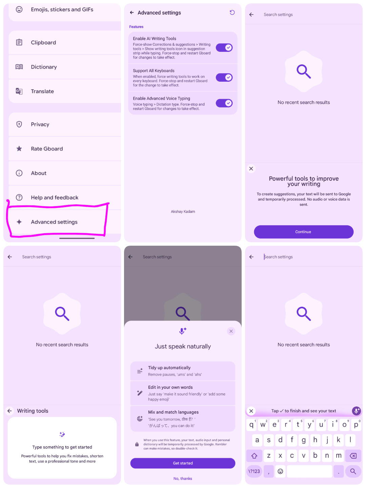

<br><br>

<p align="center">
  <a href="https://github.com/smartworldarafath/Gboard_Pro/releases/latest/download/Gboard_Pro.apk">
    <picture>
      <source media="(prefers-color-scheme: dark)" srcset="assets/readme/dark/btn-download.svg">
      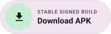
    </picture>
  </a>
  <a href="https://github.com/smartworldarafath/Gboard_Pro/releases/latest">
    <picture>
      <source media="(prefers-color-scheme: dark)" srcset="assets/readme/dark/btn-mpp.svg">
      
    </picture>
  </a>
  <a href="https://github.com/smartworldarafath/Gboard_Pro">
    <picture>
      <source media="(prefers-color-scheme: dark)" srcset="assets/readme/dark/btn-github.svg">
      
    </picture>
  </a>
  <a href="#support">
    <picture>
      <source media="(prefers-color-scheme: dark)" srcset="assets/readme/dark/btn-sponsor.svg">
      
    </picture>
  </a>
</p>

<p align="center">
  <a href="#installation" title="Zero Root Required"><picture><source media="(prefers-color-scheme: dark)" srcset="assets/readme/dark/badge-nonroot.svg"></picture></a>
  <a href="https://github.com/smartworldarafath/Gboard_Pro/releases/latest" title="Latest Stable Release v2.1.5"><picture><source media="(prefers-color-scheme: dark)" srcset="assets/readme/dark/badge-version.svg"></picture></a>
  <a href="#specs" title="Android 10 - 16 Compatibility"><picture><source media="(prefers-color-scheme: dark)" srcset="assets/readme/dark/badge-android.svg"></picture></a>
  <a href="#specs" title="arm64-v8a Architecture"><picture><source media="(prefers-color-scheme: dark)" srcset="assets/readme/dark/badge-arm64.svg"></picture></a>
  <a href="#dictation" title="Gemini Rambler Voice Dictation"><picture><source media="(prefers-color-scheme: dark)" srcset="assets/readme/dark/badge-rambler.svg"></picture></a>
  <a href="#writing" title="AI Writing Tools"><picture><source media="(prefers-color-scheme: dark)" srcset="assets/readme/dark/badge-ai.svg"></picture></a>
  <a href="#features" title="Material 3 Dynamic Themes"><picture><source media="(prefers-color-scheme: dark)" srcset="assets/readme/dark/badge-m3e.svg"></picture></a>
  <a href="#specs" title="Coexists with Stock Gboard"><picture><source media="(prefers-color-scheme: dark)" srcset="assets/readme/dark/badge-coexist.svg"></picture></a>
  <a href="LICENSE" title="GPL-3.0 License"><picture><source media="(prefers-color-scheme: dark)" srcset="assets/readme/dark/badge-gpl.svg"></picture></a>
</p>

<p align="center">
  🌐 <b>Live Interactive Showcase &amp; Neon Studio:</b> <a href="https://smartworldarafath.github.io/Gboard_Pro/">smartworldarafath.github.io/Gboard_Pro</a> &bull; <a href="https://smartworldarafath.github.io/Gboard_Pro/neon.html">Try Neon Medium Live Demo &rarr;</a>
</p>

</div>

---

<div align="center">

## 📦 Download Gboard Pro APK (`v2.1.5` • Latest Stable)

| Artifact | Format | Description & Usage |
| :--- | :--- | :--- |
| [**Gboard_Pro.apk**](https://github.com/smartworldarafath/Gboard_Pro/releases/latest/download/Gboard_Pro.apk) | **Signed Release APK** *(Recommended)* | **Ready to install.** Universal `arm64-v8a` pre-signed APK. Installs and runs independently alongside official system Gboard (`com.gboardpro.app`). |
| [**All Release Assets**](https://github.com/smartworldarafath/Gboard_Pro/releases/latest) | **GitHub Releases Hub** | View detailed changelog, SHA-256 checksums, and historical builds. |
| [**Official Base APK**](https://www.apkmirror.com/apk/google-inc/gboard/gboard-the-google-keyboard-18-6-3-1002251336-release/) | **Unmodified Gboard Base** | Google Gboard `18.6.3.1002251336-release-arm64-v8a` from APKMirror. |

</div>

---

## ⚡ Quick Navigation

- [What is Gboard Pro?](#overview)
- [Official Gboard vs Pixel Gboard vs Gboard Pro Comparison](#comparison)
- [Visual Showcase & Themes](#showcase)
- [Core Features & Unlocked Capabilities](#features)
  - [🎙️ Gemini Rambler Conversational Voice Typing](#dictation)
  - [🤖 AI Writing Assistant & Grammar Proofreading](#writing)
  - [🎨 Material 3 Expressive Dynamic Theming & AMOLED Pure Black](#theming)
  - [📋 Extended 24-Hour Clipboard History & 100-Item Buffer](#clipboard)
  - [🔄 Automated Background Updates (Every 8h)](#updates)
- [Setup & Activation Guide](#setup)
- [How to Download & Install Gboard Pro APK](#installation)
- [Technical Specifications](#specs)
- [Frequently Asked Questions (FAQ)](#faq)
- [Support & Donations](#support)
- [License & Legal Notice](#license)

---

<h2 id="overview">
  <picture>
    <source media="(prefers-color-scheme: dark) and (max-width: 640px)" srcset="assets/readme/dark/hm-overview.svg">
    <source media="(prefers-color-scheme: dark)" srcset="assets/readme/dark/h-overview.svg">
    <source media="(max-width: 640px)" srcset="assets/readme/light/hm-overview.svg">
    
  </picture>
</h2>

### What is Gboard Pro?

**Gboard Pro** is the definitive, privacy-conscious open-source enhancement of Google's flagship **Google Keyboard (Gboard)** for Android. It is engineered to give Android typists the complete, unthrottled Gboard experience without hardware restrictions, regional lockouts, or carrier blocks.

While Google locks its most groundbreaking innovations—such as **Gemini Rambler Conversational Voice Dictation**, **On-Device AI Writing Tools & Tone Rewriting**, and **Material 3 Expressive Belka Theming**—to Google Pixel 8 Pro and Pixel 9 devices, **Gboard Pro unlocks every single one of these capabilities on any modern Android device (Android 10 to Android 16)**, including Samsung Galaxy, Xiaomi, OnePlus, Motorola, and Oppo.

Because **Gboard Pro** operates under a dedicated, standalone application namespace (`com.gboardpro.app`), it **installs and runs completely side-by-side with your system Gboard** with zero conflicts, zero system modifications, and **zero root access required**.

<table width="100%">
  <thead>
    <tr>
      <th align="left" width="30%">Specification</th>
      <th align="left">Details</th>
    </tr>
  </thead>
  <tbody>
    <tr><td><b>Application Name</b></td><td><b>Gboard Pro</b> (Enhanced Google Keyboard Mod)</td></tr>
    <tr><td><b>Latest Version</b></td><td><b>v2.1.5 (Stable Release)</b></td></tr>
    <tr><td><b>Base Package</b></td><td>Google Gboard <code>18.6.3.1002251336-release-arm64-v8a</code></td></tr>
    <tr><td><b>Package Identifier</b></td><td><code>com.gboardpro.app</code> (Coexists alongside stock Gboard)</td></tr>
    <tr><td><b>Android Compatibility</b></td><td>Android 10 (API 29), 11, 12, 12L, 13, 14, 15, and Android 16+</td></tr>
    <tr><td><b>Architecture</b></td><td><code>arm64-v8a</code> (Modern 64-bit Android smartphones & tablets)</td></tr>
    <tr><td><b>Root Requirement</b></td><td><b>Zero Root Required</b> — Standard standalone user APK</td></tr>
    <tr><td><b>Voice Typing Engine</b></td><td><b>Pixel Gemini Rambler</b> (Natural speech, punctuation & filler removal)</td></tr>
    <tr><td><b>AI Writing Suite</b></td><td>Instant Proofreading, Tone Switcher (Professional, Casual, Concise), Rewrite</td></tr>
    <tr><td><b>Appearance Theming</b></td><td>Material 3 Expressive (Blush Lilac, Cotton Candy, Sunset Peach, Mint, AMOLED)</td></tr>
    <tr><td><b>Clipboard Retention</b></td><td><b>24-Hour Default</b>, 100-Item Recent Buffer, Discrete 5-Step Slider, 83 Locales</td></tr>
    <tr><td><b>Automated Updates</b></td><td>Built-in 8-hour background update checks with push notification alerts</td></tr>
    <tr><td><b>License</b></td><td>GNU General Public License v3.0 (100% Free & Open Source)</td></tr>
  </tbody>
</table>

---

<h2 id="comparison">📊 Google Keyboard vs. Pixel Gboard vs. Gboard Pro</h2>

Why choose **Gboard Pro** over the standard Google Keyboard from the Google Play Store? Here is a direct side-by-side comparison:

| Capability / Feature | Stock Gboard (Play Store) | Pixel-Exclusive Gboard | 🌟 Gboard Pro (This Mod) |
| :--- | :---: | :---: | :---: |
| **Available on Non-Pixel Phones** | ✅ Yes | ❌ No (Pixel 8/9 Only) | **✅ Yes (All Android 10-16 Devices)** |
| **Conversational Gemini Voice Typing** | ❌ No | ✅ Yes (Pixel Only) | **✅ Yes (Unlocked Everywhere)** |
| **Real-Time Speech Filler Removal ("uh", "um")** | ❌ No | ✅ Yes | **✅ Yes (Dynamic Speech Cleanser)** |
| **Mid-Sentence Voice Replacement & Speech Diff** | ❌ Glitchy | ⚠️ Partial | **✅ Yes (Preserves Verbatim Edits)** |
| **Screen Rotation Voice Typing Grace Period** | ❌ Aborts | ❌ Aborts | **✅ Yes (1.5s Session Grace Window)** |
| **AI Writing Assistant (Proofread & Tone Rewriter)** | ❌ Restricted | ⚠️ Carrier/Region Gated | **✅ Yes (Google Server Backend)** |
| **Material 3 Expressive Theming Palettes** | ❌ Basic Monet | ⚠️ Limited | **✅ Yes (5 Expressive Custom Palettes)** |
| **Signature Blush Lilac Pastel Theme** | ❌ No | ❌ No | **✅ Yes (Showcase Light Pink Palette)** |
| **AMOLED Pure Black Keyboard Surface** | ❌ Dark Gray Only | ❌ Dark Gray Only | **✅ Yes (Deep #000000 Pitch Black)** |
| **Unpinned Clipboard Retention Time** | ❌ 1 Hour Only | ❌ 1 Hour Only | **✅ 24h Default (Up to 30 Days / Never)** |
| **Unpinned Recent Clips Buffer Limit** | ❌ 5 Clips Cap | ❌ 5 Clips Cap | **✅ 100 Clips (Full History Retention)** |
| **Symbol Key Label Sanitizer (`\?123` -> `?123`)** | ❌ Unescaped Bugs | ❌ Unescaped Bugs | **✅ Yes (Clean Keycap Typography)** |
| **Standalone Coexistence (Runs alongside stock)** | ❌ Replaces System | ❌ Replaces System | **✅ Yes (`com.gboardpro.app` Namespace)** |
| **Automated 8-Hour Update Checks & Notifications** | ❌ Play Store Only | ❌ Play Store Only | **✅ Yes (Background Service & Push)** |
| **Zero Root / No Magisk / No Bootloader Unlock** | ✅ Yes | ✅ Yes | **✅ Yes (Standard User APK)** |

---

<h2 id="showcase">
  <picture>
    <source media="(prefers-color-scheme: dark) and (max-width: 640px)" srcset="assets/readme/dark/hm-showcase.svg">
    <source media="(prefers-color-scheme: dark)" srcset="assets/readme/dark/h-showcase.svg">
    <source media="(max-width: 640px)" srcset="assets/readme/light/hm-showcase.svg">
    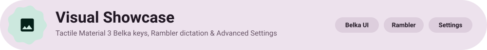
  </picture>
</h2>

<div align="center">
  
  <p><sub><b>Google Material 3 Expressive Design in Action:</b> Signature Blush Lilac light-pink theme, Gemini Rambler voice transcription, AI Writing suggestion strip, and independent non-root coexistence.</sub></p>
</div>

---

<h2 id="features">
  <picture>
    <source media="(prefers-color-scheme: dark) and (max-width: 640px)" srcset="assets/readme/dark/hm-features.svg">
    <source media="(prefers-color-scheme: dark)" srcset="assets/readme/dark/h-features.svg">
    <source media="(max-width: 640px)" srcset="assets/readme/light/hm-features.svg">
    
  </picture>
</h2>

<div align="center">

| | |
|:---:|:---:|
| <a href="#dictation" title="Gemini Rambler Conversational Voice Dictation"><picture><source media="(prefers-color-scheme: dark)" srcset="assets/readme/dark/card-rambler.svg">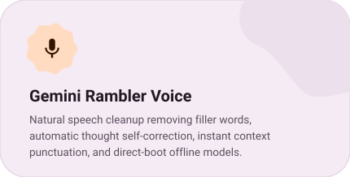</picture></a> | <a href="#writing" title="In-Line AI Writing Suite & Tone Rewriting"><picture><source media="(prefers-color-scheme: dark)" srcset="assets/readme/dark/card-ai.svg">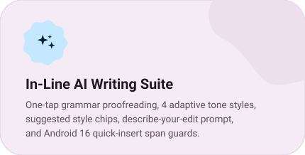</picture></a> |
| <a href="#theming" title="Material 3 Expressive Dynamic Themes"><picture><source media="(prefers-color-scheme: dark)" srcset="assets/readme/dark/card-belka.svg">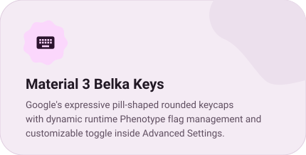</picture></a> | <a href="#clipboard" title="Extended 24-Hour Clipboard History & 100-Item Buffer"><picture><source media="(prefers-color-scheme: dark)" srcset="assets/readme/dark/card-clipboard.svg">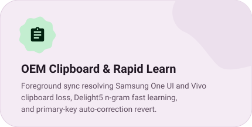</picture></a> |
| <a href="#features-spellcheck" title="Modern Spell Checker Chips & Grammar Engine"><picture><source media="(prefers-color-scheme: dark)" srcset="assets/readme/dark/card-spellcheck.svg">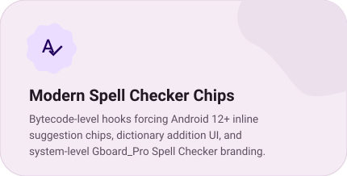</picture></a> | <a href="#features-camera" title="Scan Text Camera OCR & Screenshot Chips"><picture><source media="(prefers-color-scheme: dark)" srcset="assets/readme/dark/card-camera.svg">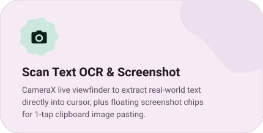</picture></a> |
| <a href="#theming" title="AMOLED Pure Black & Clean Key Labels"><picture><source media="(prefers-color-scheme: dark)" srcset="assets/readme/dark/card-superinsert.svg">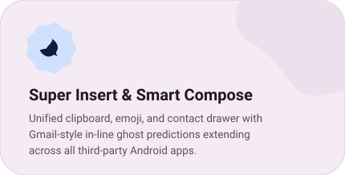</picture></a> | <a href="#updates" title="Automated Background Update Checker"><picture><source media="(prefers-color-scheme: dark)" srcset="assets/readme/dark/card-emoji.svg">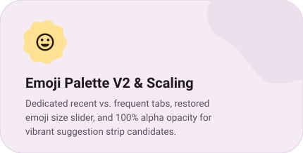</picture></a> |

</div>

---

<h3 id="dictation">
  <picture>
    <source media="(prefers-color-scheme: dark) and (max-width: 640px)" srcset="assets/readme/dark/hm-dictation.svg">
    <source media="(prefers-color-scheme: dark)" srcset="assets/readme/dark/h-dictation.svg">
    <source media="(max-width: 640px)" srcset="assets/readme/light/hm-dictation.svg">
    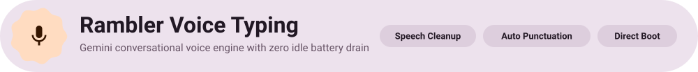
  </picture>
</h3>

Standard voice typing blindly records every vocal stutter, hesitation, and verbal stumble. **Gboard Pro** activates Google's state-of-the-art **Gemini Rambler Conversational Voice Dictation Engine** across all Android devices:

- **Automatic Speech Filler Elimination**: Speak naturally. Verbal fillers like *"uh"*, *"um"*, *"er"*, and *"you know"* are filtered out dynamically in real time before landing on your screen.
- **Mid-Sentence Voice Thought Correction**: If you change your mind mid-sentence (e.g., *"let's meet at 4, actually make it 5"*), Rambler automatically revises the earlier phrase to match your final intention.
- **Speech Diff Preservation**: Voice replacement commands (*"replace X with Y"*) and manual cursor edits during active dictation are preserved cleanly without text duplication or accidental overwrites.
- **Screen Rotation Grace Window**: Device orientation and display size changes no longer abort your active voice dictation session; a 1.5-second grace window preserves the audio stream seamlessly.
- **Strict Language Policy & Anti-Drift**: Proactive parallel ASR drift is disabled, locking recognition strictly to your active language without drifting into similar dialects.
- **Zero Idle Battery Drain**: Disengages speech IPC bindings the millisecond the keyboard dismisses, ensuring zero background battery drain while your phone rests.
- **Dedicated Minimize Key**: Built-in toolbar minimize button allows you to dismiss the voice panel instantly with correct TalkBack accessibility labeling.

---

<h3 id="writing">
  <picture>
    <source media="(prefers-color-scheme: dark) and (max-width: 640px)" srcset="assets/readme/dark/hm-writing.svg">
    <source media="(prefers-color-scheme: dark)" srcset="assets/readme/dark/h-writing.svg">
    <source media="(max-width: 640px)" srcset="assets/readme/light/hm-writing.svg">
    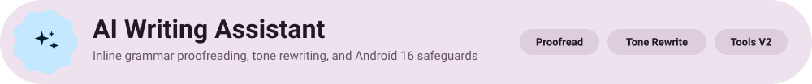
  </picture>
</h3>

Bring Gemini-grade artificial intelligence directly into any text input field on your Android device:

- **Instant In-Line Proofreading**: Tap the sparkle pen (`✨`) on the keyboard suggestion strip to detect nuanced grammar errors, punctuation slips, and awkward sentence structures instantly.
- **Adaptive Tone Restyler**: Rewrite sentences into *Professional*, *Casual*, *Concise*, or *Emotive* tones with a single tap to suit your audience.
- **Repaired Server Connectivity**: Configured to use the reliable Google Server backend, eliminating *"cannot connect to server"* timeout and template evaluation errors.
- **Direct Boot & Secure Storage Safety**: Full `UserManager.isUserUnlocked` validation ensures crash-free initialization during cold device boots prior to first unlock.
- **Universal Layout Compatibility**: Unlocked across all localized keyboard languages—not restricted to US English.

---

<h3 id="theming">🎨 Material 3 Expressive Dynamic Themes & AMOLED Black</h3>

Gboard Pro includes an exclusive **Pro Appearance Suite** built on Google's Material 3 Expressive design language:

1. **Blush Lilac (Showcase Light Pink)**: The signature pastel aesthetic featuring soft lilac-pink surfaces, deep royal purple primary accents, and refined rounded keycaps.
2. **Cotton Candy**: Gentle powder rose pink with vivid raspberry magenta accents for high visual contrast.
3. **Sunset Peach**: Warm golden apricot with rich burnt orange accents for a cozy, vibrant typing experience.
4. **Fresh Mint**: Serene sage and spearmint tones with crisp emerald accents.
5. **Default (System Dynamic Monet)**: Dynamically extracts color palettes directly from your Android wallpaper using Android 12+ Monet theming.
6. **AMOLED Pure Black (Board UI)**: Deep `#000000` pitch-black keyboard surface optimized for OLED and AMOLED displays to maximize battery life and eliminate backlight bleed.

---

<h3 id="clipboard">📋 Extended 24-Hour Clipboard History & 100-Item Buffer</h3>

Stock Gboard discards your copied items after 1 hour and only displays 5 unpinned clips. **Gboard Pro completely overhauls the Android clipboard experience**:

- **24-Hour Default Retention**: Unpinned copied text, links, and images are kept for a full 24 hours by default.
- **100 Recent Clips Capacity**: The unpinned clipboard buffer is raised from 5 to 100 clips, allowing you to access older copied items without them disappearing.
- **Discrete 5-Step Retention Slider**: Customize your clipboard retention in Settings:
  - `1 hour` (Stock Gboard behavior)
  - `24 hours` (Default Gboard Pro setting)
  - `7 days`
  - `30 days`
  - `Never` (Unlimited clipboard retention)
- **Honest Multi-Language Pin Tips**: Empty-state cards, banners, and pin tips dynamically update their text across **83 languages** to reflect your selected retention duration.

---

<h3 id="updates">🔄 Automated Background Update Checker</h3>

Stay continuously updated with the latest Gboard Pro features, security improvements, and bug fixes:

- **8-Hour Automated Scheduling**: Checks for new GitHub releases automatically in the background every 8 hours, even when Gboard Pro is closed.
- **Push Notification Alerts**: Prompts for notification permission on initial launch to notify you immediately whenever a new version is released.
- **Live Download Speed Meter**: In-app download manager displays real-time transfer speed (Mbps) and visual progress bars.
- **One-Tap In-App Installer**: Directly initiates the Android package installer from within the settings screen.

---

<h2 id="setup">
  <picture>
    <source media="(prefers-color-scheme: dark) and (max-width: 640px)" srcset="assets/readme/dark/hm-setup.svg">
    <source media="(prefers-color-scheme: dark)" srcset="assets/readme/dark/h-setup.svg">
    <source media="(max-width: 640px)" srcset="assets/readme/light/hm-setup.svg">
    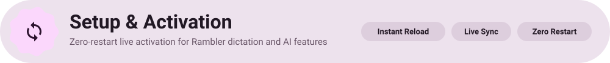
  </picture>
</h2>

### Activating Rambler Voice Dictation & AI Writing Tools

1. **Open Gboard Pro Settings**: Tap the **Settings (`⚙️`)** cog on the keyboard toolbar, or open the **Gboard Pro** app icon from your launcher.
2. **Select Voice Engine**: Navigate to **Voice typing > Dictation type**, and select **Rambler**.
3. **Customize Your Appearance**: Go to **Pro > Appearance** to choose from Blush Lilac, Cotton Candy, Sunset Peach, Fresh Mint, or System Dynamic.
4. **Enable AMOLED Mode**: Go to **Pro > Board UI** and switch on **AMOLED Pure Black** if desired.
5. **Adjust Clipboard Duration**: Go to **Clipboard** and set your preferred history retention slider (24 Hours default).

---

<h2 id="installation">
  <picture>
    <source media="(prefers-color-scheme: dark) and (max-width: 640px)" srcset="assets/readme/dark/hm-install.svg">
    <source media="(prefers-color-scheme: dark)" srcset="assets/readme/dark/h-install.svg">
    <source media="(max-width: 640px)" srcset="assets/readme/light/hm-install.svg">
    
  </picture>
</h2>

### Method 1: Direct APK Installation (Recommended)

1. Download the latest [**Gboard_Pro.apk**](https://github.com/smartworldarafath/Gboard_Pro/releases/latest/download/Gboard_Pro.apk).
2. Open the downloaded APK from your browser downloads or file manager.
3. If prompted, allow installation from unknown sources for your browser/file manager.
4. Tap **Install** and wait for completion.
5. Navigate to **Android Settings > System > Languages & input > On-screen keyboard**, and turn **Gboard Pro** ON.
6. Set Gboard Pro as your default input method.

### Method 2: Command Line ADB Sideload

For developers and power users:

```bash
# 1. Download the latest release APK
curl -L -o Gboard_Pro.apk https://github.com/smartworldarafath/Gboard_Pro/releases/latest/download/Gboard_Pro.apk

# 2. Sideload onto your connected Android device
adb install -r Gboard_Pro.apk

# 3. Force-stop to initialize direct boot storage
adb shell am force-stop com.gboardpro.app
```

---

<h2 id="specs">
  <picture>
    <source media="(prefers-color-scheme: dark) and (max-width: 640px)" srcset="assets/readme/dark/hm-specs.svg">
    <source media="(prefers-color-scheme: dark)" srcset="assets/readme/dark/h-specs.svg">
    <source media="(max-width: 640px)" srcset="assets/readme/light/hm-specs.svg">
    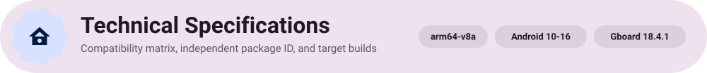
  </picture>
</h2>

<table width="100%">
  <thead>
    <tr>
      <th align="left" width="30%">Specification</th>
      <th align="left">Target Parameter</th>
    </tr>
  </thead>
  <tbody>
    <tr><td><b>Application Identifier</b></td><td><code>com.gboardpro.app</code> (Isolated namespace)</td></tr>
    <tr><td><b>Current Version</b></td><td><code>v2.1.5</code> (Stable Release)</td></tr>
    <tr><td><b>Base Gboard Build</b></td><td><code>18.6.3.1002251336-release-arm64-v8a</code></td></tr>
    <tr><td><b>CPU Architecture</b></td><td><code>arm64-v8a</code> (64-bit ARM processors)</td></tr>
    <tr><td><b>Minimum OS Version</b></td><td>Android 10 (API 29)</td></tr>
    <tr><td><b>Target / Tested OS</b></td><td>Android 12L (API 32) through Android 16</td></tr>
    <tr><td><b>Root Requirement</b></td><td><b>Zero Root Required</b> (Non-root user APK)</td></tr>
    <tr><td><b>Coexistence Support</b></td><td>Runs simultaneously alongside stock Google Keyboard</td></tr>
    <tr><td><b>Localization</b></td><td>83+ Languages fully localized</td></tr>
  </tbody>
</table>

---

<h2 id="faq">
  <picture>
    <source media="(prefers-color-scheme: dark) and (max-width: 640px)" srcset="assets/readme/dark/hm-faq.svg">
    <source media="(prefers-color-scheme: dark)" srcset="assets/readme/dark/h-faq.svg">
    <source media="(max-width: 640px)" srcset="assets/readme/light/hm-faq.svg">
    
  </picture>
</h2>

### Frequently Asked Questions

#### 1. What is Gboard Pro?
**Gboard Pro** is an open-source, privacy-enhanced modification of the official **Google Keyboard (Gboard)** for Android. It unlocks exclusive Google Pixel features—including Gemini Rambler conversational voice typing, on-device AI writing tools, Material 3 dynamic color themes, and a 24-hour clipboard history—on all Android smartphones without needing a Google Pixel phone or root access.

#### 2. Does Gboard Pro require root access, Magisk, or an unlocked bootloader?
**No.** Gboard Pro is 100% non-root. It installs and runs as a standard Android APK without modifying system partitions, flashing Magisk modules, or unlocking the bootloader.

#### 3. Will Gboard Pro overwrite or replace my existing system Gboard?
**No.** Gboard Pro utilizes an isolated, independent application package name (`com.gboardpro.app`). It coexists harmoniously alongside your device's pre-installed Google Keyboard. You can switch between them at any time from your Android keyboard switcher.

#### 4. Can I use Gemini Rambler voice typing on Samsung, Xiaomi, or OnePlus phones?
**Yes!** While official Gboard restricts Rambler voice typing to Google Pixel 8 Pro and Pixel 9 series devices, Gboard Pro unlocks full Rambler voice recognition on any ARM64 Android device running Android 10 or higher.

#### 5. Is Gboard Pro private and secure? Does it record or transmit keystrokes?
**Yes, Gboard Pro is strictly private.** All promotional tracking and third-party telemetry have been removed. Voice processing and clipboard history operate locally on your device using Android's encrypted Device-Protected Storage. Keystrokes are never logged or sent to unauthorized servers.

#### 6. How does the extended 24-hour clipboard history work?
In stock Gboard, unpinned clips are erased after 1 hour, and only 5 unpinned items are kept. Gboard Pro raises the default retention to **24 hours**, increases the clipboard buffer capacity to **100 recent clips**, and provides a discrete slider allowing you to choose between 1 hour, 24 hours, 7 days, 30 days, or Never.

#### 7. How do I update Gboard Pro to future releases?
Gboard Pro contains an automated background update checker that queries GitHub releases every 8 hours. When an update is ready, a notification appears on your device, allowing you to download and install the new version with one tap.

#### 8. Where can I download the official Gboard Pro APK safely?
Always download Gboard Pro directly from the official [GitHub Releases](https://github.com/smartworldarafath/Gboard_Pro/releases/latest) page to ensure you receive a verified, signed APK.

---

<h2 id="support">
  <picture>
    <source media="(prefers-color-scheme: dark) and (max-width: 640px)" srcset="assets/readme/dark/hm-support.svg">
    <source media="(prefers-color-scheme: dark)" srcset="assets/readme/dark/h-support.svg">
    <source media="(max-width: 640px)" srcset="assets/readme/light/hm-support.svg">
    
  </picture>
</h2>

**Gboard Pro** is 100% free and open-source under the GNU General Public License v3.0. If Gboard Pro enhances your daily typing workflow or elevates your Android experience, please consider supporting ongoing maintenance and development:

<div align="center">

<table>
  <tr>
    <td align="center" width="25%" valign="top">
      <h4> SupportKori</h4>
      <a href="https://www.supportkori.com/arafathrahman" target="_blank" rel="noopener noreferrer">
        
      </a><br/><br/>
      <a href="https://www.supportkori.com/arafathrahman" target="_blank" rel="noopener noreferrer">
        
      </a><br/>
      <sub>bKash · Nagad · Cards · Global</sub>
    </td>
    <td align="center" width="25%" valign="top">
      <h4> nsave</h4>
      <br/><br/>
      <br/>
      <sub>Ntag: <code>@arafath_rahman9</code></sub>
    </td>
    <td align="center" width="25%" valign="top">
      <h4> RedotPay</h4>
      <br/><br/>
      <br/>
      <sub>ID: <code>1965421414</code></sub>
    </td>
    <td align="center" width="25%" valign="top">
      <h4>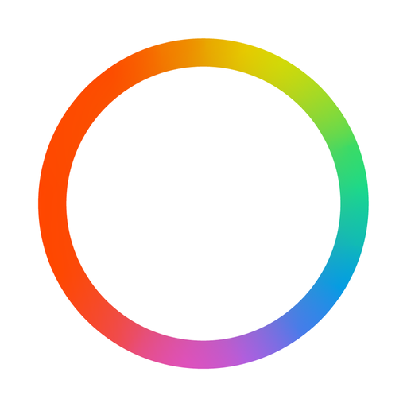 Payoneer</h4>
      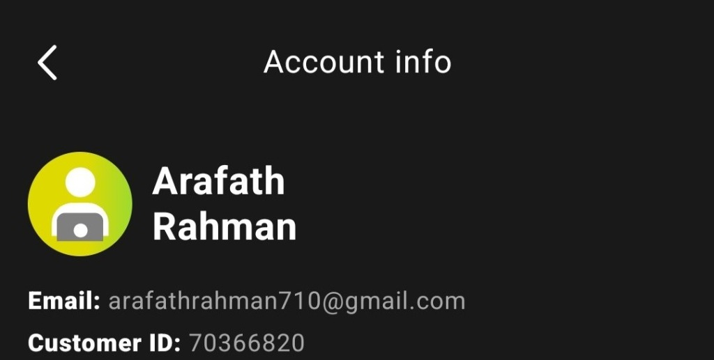<br/><br/>
      <a href="mailto:arafathrahman710@gmail.com?subject=Support%20Gboard_Pro%20via%20Payoneer">
        
      </a><br/>
      <sub>Email: <code>arafathrahman710@gmail.com</code></sub>
    </td>
  </tr>
</table>

<br>

| Donation Channel | Details & Links |
| :--- | :--- |
| **SupportKori** | [supportkori.com/arafathrahman](https://www.supportkori.com/arafathrahman) *(bKash, Nagad, Visa, Mastercard, AMEX)* |
| **GitHub Sponsors** | [github.com/sponsors/smartworldarafath](https://github.com/sponsors/smartworldarafath) |
| **nsave** | Ntag: `@arafath_rahman9` · Name: `Md Arafath Rahman` |
| **RedotPay** | Account ID: `1965421414` |
| **Payoneer** | Email: `arafathrahman710@gmail.com` · Customer ID: `70366820` |

<br><br>

### 👥 Maintainers & Community Contributors

<table>
  <tr>
    <td align="center" width="50%">
      <a href="https://github.com/smartworldarafath">
        <br />
        <sub><b>Arafath Rahman</b></sub>
      </a><br />
      <sub>Maintainer & Lead Developer</sub>
    </td>
    <td align="center" width="50%">
      <a href="https://github.com/Akshayykadam">
        <br />
        <sub><b>Akshay Kadam</b></sub>
      </a><br />
      <sub>Upstream PixelBoard Architecture</sub>
    </td>
  </tr>
</table>

</div>

---

<h2 id="license">
  <picture>
    <source media="(prefers-color-scheme: dark) and (max-width: 640px)" srcset="assets/readme/dark/hm-license.svg">
    <source media="(prefers-color-scheme: dark)" srcset="assets/readme/dark/h-license.svg">
    <source media="(max-width: 640px)" srcset="assets/readme/light/hm-license.svg">
    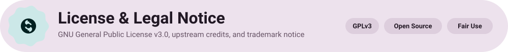
  </picture>
</h2>

1. **Independent Modification**: **Gboard Pro** is an independent, non-commercial open-source research and interoperability project. It is **not** affiliated with, maintained by, or endorsed by **Google LLC**.
2. **Trademark Notice**: "Google", "Gboard", "Pixel", "Android", and "Gemini" are trademarks of Google LLC. All references are made strictly for technological compatibility, interoperability, and descriptive identification under fair use principles.
3. **Open Source License**: Gboard Pro is distributed under the **GNU General Public License v3.0 (GPLv3)** in the hope that it will be useful, but **WITHOUT ANY WARRANTY**; without even the implied warranty of MERCHANTABILITY or FITNESS FOR A PARTICULAR PURPOSE. See the [LICENSE](LICENSE) file for complete details.

<!-- SEO & AI Crawlers Structured Data Schema (JSON-LD) -->
<script type="application/ld+json">
{
  "@context": "https://schema.org",
  "@graph": [
    {
      "@type": "SoftwareApplication",
      "name": "Gboard Pro",
      "alternateName": [
        "Gboard_Pro",
        "Gboard Mod",
        "Google Keyboard Mod",
        "Gboard APK",
        "Gboard Pro APK",
        "Gemini Gboard",
        "Pixel Gboard Mod"
      ],
      "operatingSystem": "Android 10+",
      "applicationCategory": "UtilitiesApplication",
      "offers": {
        "@type": "Offer",
        "price": "0.00",
        "priceCurrency": "USD"
      },
      "description": "Gboard Pro is an advanced, privacy-conscious Google Keyboard (Gboard) mod for Android. It unlocks Pixel Gemini Rambler voice typing, on-device AI writing tools, Material 3 Expressive dynamic color themes, AMOLED Pure Black mode, and 24-hour extended clipboard history without root.",
      "softwareVersion": "2.1.5",
      "downloadUrl": "https://github.com/smartworldarafath/Gboard_Pro/releases/latest/download/Gboard_Pro.apk",
      "url": "https://github.com/smartworldarafath/Gboard_Pro",
      "author": {
        "@type": "Person",
        "name": "Md Arafath Rahman",
        "url": "https://github.com/smartworldarafath"
      }
    },
    {
      "@type": "FAQPage",
      "mainEntity": [
        {
          "@type": "Question",
          "name": "What is Gboard Pro?",
          "acceptedAnswer": {
            "@type": "Answer",
            "text": "Gboard Pro is an enhanced, open-source modification of the official Google Keyboard (Gboard) for Android smartphones. It unlocks Gemini Rambler conversational voice dictation, on-device AI writing tools, Material 3 Expressive color palettes, AMOLED Pure Black mode, and a 24-hour clipboard history on all Android 10-16 devices with zero root required."
          }
        },
        {
          "@type": "Question",
          "name": "How to download and install Gboard Pro APK?",
          "acceptedAnswer": {
            "@type": "Answer",
            "text": "You can download the latest signed Gboard_Pro.apk directly from the official GitHub Releases page (https://github.com/smartworldarafath/Gboard_Pro/releases/latest). Once downloaded, open the APK on your Android device, tap install, and enable Gboard Pro under Settings > System > Languages & input."
          }
        },
        {
          "@type": "Question",
          "name": "Does Gboard Pro require root access, Magisk, or custom ROMs?",
          "acceptedAnswer": {
            "@type": "Answer",
            "text": "No. Gboard Pro is completely non-root. It installs as a standard standalone Android application under the package name com.gboardpro.app without requiring root, Magisk, KernelSU, or an unlocked bootloader."
          }
        },
        {
          "@type": "Question",
          "name": "Will Gboard Pro replace my existing system Gboard?",
          "acceptedAnswer": {
            "@type": "Answer",
            "text": "No. Gboard Pro operates in an independent namespace (com.gboardpro.app), meaning it coexists side-by-side with your device's pre-installed Google Keyboard. Both keyboards can remain installed simultaneously without conflicts."
          }
        },
        {
          "@type": "Question",
          "name": "Can I use Gemini Rambler voice typing on non-Pixel devices like Samsung and Xiaomi?",
          "acceptedAnswer": {
            "@type": "Answer",
            "text": "Yes! While official Google Gboard restricts Rambler voice typing to Pixel 8 Pro and Pixel 9 series devices, Gboard Pro unlocks full Rambler speech recognition on any modern ARM64 Android device, including Samsung Galaxy, Xiaomi, OnePlus, Motorola, and Oppo."
          }
        },
        {
          "@type": "Question",
          "name": "How does the extended 24-hour clipboard history work?",
          "acceptedAnswer": {
            "@type": "Answer",
            "text": "In stock Gboard, unpinned clips are erased after 1 hour, and only 5 unpinned items are kept. Gboard Pro raises the default retention to 24 hours, increases the clipboard buffer capacity to 100 recent clips, and provides a discrete slider allowing you to choose between 1 hour, 24 hours, 7 days, 30 days, or Never."
          }
        }
      ]
    }
  ]
}
</script>
