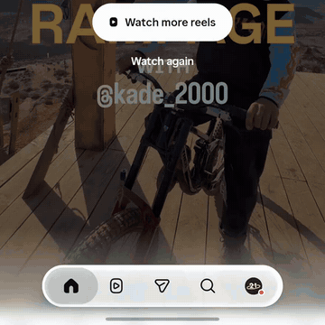
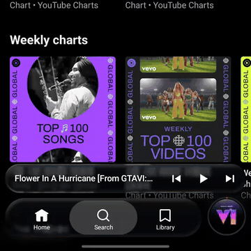

  <picture>
    <source media="(prefers-color-scheme: dark)" srcset=".github/readme/logo-dark.svg">
    
  </picture>

<h3 align="center">southstar21's patches for Instagram, Spotify and YouTube Music.</h3>

  Patches with Morphe. Pick them in Morphe Manager, then switch and tune each one from a menu inside the app.

  <a href="https://morphe.software/add-source?github=southstar21dev/southstar21-patches"><picture><source media="(prefers-color-scheme: dark)" srcset=".github/readme/button-add-to-morphe-dark.svg"></picture></a>
  <a href="CHANGELOG.md"><picture><source media="(prefers-color-scheme: dark)" srcset=".github/readme/button-changelog-dark.svg"></picture></a>

  
  
  
  
   
  <!-- APP_BADGES_START -->
  
  
  
  <!-- APP_BADGES_END -->

  <picture>
    <source media="(prefers-color-scheme: dark)" srcset=".github/readme/instagram-dark.gif">
    
  </picture>
  
  <a href="https://star-history.com/#southstar21dev/southstar21-patches&Date"><picture><source media="(prefers-color-scheme: dark)" srcset="https://api.star-history.com/svg?repos=southstar21dev/southstar21-patches&type=Date&theme=dark"></picture></a>

## What you get

<table>
  <tr>
    <th width="33%">Instagram</th>
    <th width="33%">YouTube Music</th>
    <th width="33%">Spotify</th>
  </tr>
  <tr>
    <td valign="top">
      <ul>
        <li>Liquid Glass tab bar in two styles</li>
        <li>Conscious gate: a daily scroll budget</li>
        <li>Reels out of the feed and Explore</li>
        <li>No ads, full size profile pictures</li>
      </ul>
    </td>
    <td valign="top">
      <ul>
        <li>Glass tab bar with the mini player docked beside it</li>
        <li>No Ask Music button</li>
        <li>One neutral player color</li>
      </ul>
    </td>
    <td valign="top">
      <ul>
        <li>Glass tab bar and mini player</li>
      </ul>
    </td>
  </tr>
</table>

## Install

1. Install [Morphe Manager](https://morphe.software), then tap **Add to Morphe** above, or add `https://github.com/southstar21dev/southstar21-patches` as a patch source by hand.
2. Download the app's **APKM** bundle from APKMirror, in the version listed under [Patches](#patches).
3. Patch it in Morphe Manager, choose your patches and install. Uninstall the Play Store version first: the patched app is signed with a different key.

> [!NOTE]
> **YouTube Music** signs in to Google only through **GmsCore support** from Morphe Patches, which Morphe Manager ships with, and [MicroG-RE](https://github.com/MorpheApp/MicroG-RE). Turn on **Expert mode** in Morphe Manager (Settings, Patching), patch with both sources ticked, and install MicroG-RE when the app asks. Without GmsCore support, patching stops with a message saying so.
>
> **Spotify** checks the app when you log in: a patched Spotify logs in on a regular phone, but is refused on emulators and other devices that fail Google's integrity check.

> [!WARNING]
> The terms of Instagram, Spotify and YouTube Music don't allow modified clients. Use these patches at your own risk.

## Patches

<!-- PATCHES_START -->
**[v1.5.0](https://github.com/southstar21dev/southstar21-patches/releases/tag/v1.5.0)**, 12 patches. Click a patch for its settings and how it works.

<b>Instagram</b>&nbsp;&nbsp;8 patches, 456.1.0.56.78

 

| Patch | What it does | Selected |
|-------|--------------|:--------:|
| [Bypass signature check](#bypass-signature-check) | Stops Instagram rejecting apps by their signature, which a patched app no longer matches. | Yes |
| [Conscious gate](#conscious-gate) | Gives the home feed, Reels, Explore and stories a daily time budget. In the last 15 seconds they frost over and can only be scrolled, then a gate closes them until the next day. Searching for people, messages and profiles keep working. Off until you switch it on in the settings. | No |
| [Disable Reels](#disable-reels) | Removes reels from the home feed and Explore, and stops scrolling from one reel to the next. Each part is off until you switch it on in the settings. | Yes |
| [Hide ads](#hide-ads) | Removes sponsored posts, stories and reels, and ad units in the home feed. Each part can be switched off in the settings. | Yes |
| [Hide navigation buttons](#hide-navigation-buttons) | Adds settings to hide Search, Reels, Create, Messages and other tabs from the bottom bar. Every tab stays until you hide it in the settings. | Yes |
| [Liquid Glass navigation bar](#liquid-glass-navigation-bar-instagram) | Turns the bottom tab bar into a floating iOS 26 style Liquid Glass pill with live background blur and edge refraction. Refraction needs Android 13+, blur needs Android 12+, older versions get a tinted pill. | Yes |
| [Remove build expired popup](#remove-build-expired-popup) | Removes the popup that appears after a while, when the app version ages. | Yes |
| [View profile picture](#view-profile-picture) | Adds a button on the profile picture of profile pages that shows the profile picture in full resolution and saves it to the gallery. | Yes |

<b>YouTube Music</b>&nbsp;&nbsp;3 patches, 9.46.51

 

| Patch | What it does | Selected |
|-------|--------------|:--------:|
| [Disable dynamic player color](#disable-dynamic-player-color) | Keeps the full player's background one neutral color instead of changing with each song's album art. Switch it on and pick the color (YouTube Music's default, black or dark grey) in the southstar21 Patches menu in the top bar. Requires Morphe Patches with GmsCore support, applied together in Expert mode. | No |
| [Hide Ask Music button](#hide-ask-music-button) | Removes the Ask Music AI assistant button (the sparkle) from the top bar, the full player, the mini player, the video's fullscreen controls and the search bar, with its banner. It can be switched off again in the southstar21 Patches menu in the top bar. Requires Morphe Patches with GmsCore support, applied together in Expert mode. | No |
| [Liquid Glass navigation bar](#liquid-glass-navigation-bar-youtube-music) | Turns the bottom tab bar into floating iOS 26 style Liquid Glass with live background blur and edge refraction, with the mini player docked beside it as round album art with a progress ring, a glass playback bar above, and the content scrolling on behind them. Lightweight glass (the default, switchable to the full effect in the southstar21 Patches menu in the top bar) blurs on Android 14+ and gets a solid pill before that; the full effect adds refraction on Android 13+ and blur on Android 12+. Requires Morphe Patches with GmsCore support, applied together in Expert mode. | Yes |

<b>Spotify</b>&nbsp;&nbsp;1 patch, 9.2.0.2053

 

| Patch | What it does | Selected |
|-------|--------------|:--------:|
| [Liquid Glass navigation bar](#liquid-glass-navigation-bar-spotify) | Turns the bottom tab bar and the mini player above it into floating iOS 26 style Liquid Glass with live background blur and edge refraction. Refraction needs Android 13+, blur needs Android 12+, older versions get a tinted pill. | Yes |

<!-- PATCHES_END -->

### Liquid Glass navigation bar (Instagram)

Instagram's iOS 26 Liquid Glass design on Android, matched against screen recordings of the iOS app.

- **Two styles.** The *Navigation bar* entry in the settings menu opens with two cards: *Solid*, a plain pill floating over the page and the lightest on the phone (nothing behind it is recorded, blurred or bent), and *Liquid Glass*. Each has its own customize page.
- **Floating glass tab bar.** A frosted pill with live background blur, a subtle refracting rim and a grey capsule behind the selected tab.
- **Shrinks while scrolling.** Scrolling down scales the whole bar down (every tab stays visible and tappable), scrolling up brings it back.
- **Gliding selection.** Drag along the bar to slide the grey selection capsule between tabs, as on iOS, with a haptic tick per tab; let go to open the tab underneath. Switch on *Glass while dragging* to turn the capsule into clear glass while it moves.
- **Switch after the glide.** A tapped tab opens once the selection has glided to it, so the moment Instagram spends building the page doesn't stutter the glide (on by default).
- **Adaptive tint.** The glass frosts more when what's behind it would make the icons hard to read, and turns dark on Reels and in dark mode.
- **Frosted header.** On Home and Explore the feed runs up under the header and the status bar, blurred and faded towards the top edge of the screen, like the blur behind the bar at the bottom. When the header slides away the status bar stays frosted. As on iOS, the header's buttons (new post, notifications, saved, more) blend into it at rest and get glass circles while the feed scrolls fast. These and the glass sheets live in their own *Liquid Glass* entry of the settings menu (*Blur under the header*, *Glass header buttons* and *Glass share menu* are on by default; *Glass comments*, which turns the comments on Reels and posts into the same frosted glass sheet as the share menu, with a glass field to type in, is off until you switch it on).
- **Videos blur too.** Instagram normally plays videos in a separate layer apps can't see, which would leave the glass solid over them. *Blur videos behind the bar* (on by default) switches the player to Instagram's other way of drawing video, so the glass and the blur at the bottom of the screen blur videos like the rest of the feed.
- **southstar21 style.** An optional switch in the settings menu (off by default) gives the bar thicker glass that bends what's behind it towards the edges. A press swells the selection into a drop of clear glass that bends what's under its rim outward, with rainbow fringes at the edge; it wobbles, stretches as you drag it and ticks over each tab. The bar shrinks back behind the drop, leans and glows under your finger.
- **Customize pages.** Each style's page has a live preview of the bar pinned at the top: tap and drag along it, scroll the sample feed under it, and it changes as you move each slider.
  - **Under the preview:** light or dark, three backdrops (photos, text, colors), pause, hold to compare with the default look, and on the glass page one-tap presets (iOS, Clear, Frosted, Bold, Minimal, Neon).
  - **A "?" on every setting** opens a short demo of what it changes: the bar sweeping that setting while it acts out a drag, taps or scrolling, or a small mock screen for the header blur, header buttons, share menu, comments and videos. The demos are drawn live, so they add no files.
  - **Solid:** color, rim, shadow, shape and selection.
  - **Liquid Glass:** blur, refraction, opacity, vibrancy, clear edge, rim, end glare, shadow, tint, tilt light, shape, selection (shade, width, inset, 3D pill, edge colors, drop size) and blur videos.
  - **Shape:** height, side margin, bottom gap, roundness and tab inset.
- Taps, double taps and long presses on the tabs still go to Instagram untouched.

Android 13+ gets the full effect, Android 12 gets blur without refraction, and older versions get a translucent tinted pill.

| Option | Default | |
|---|---|---|
| Blur radius | 4 dp | How frosted the glass is (0 to 40). iOS Instagram barely blurs. |
| Refraction strength | 60 | How strongly the edge bends what's behind it (0 to 100). |
| Extend content behind bar | on | Lets feeds scroll under the bar so there's something to see through the glass. |

How it works

A hook in `InstagramMainActivity.onWindowFocusChanged` (an unobfuscated method, so it should survive app updates) starts the extension, which finds the tab bar by its resource name and gives it a background drawable that re-records the views behind it into a `RenderNode` each frame, then runs that through a blur and an AGSL refraction shader.

### Conscious gate

A daily time budget for the parts of Instagram made for endless scrolling, so you can still check in every day but stop where you chose to. Off by default: select it in Morphe Manager to include it, then switch it on from its page in the [settings menu](#settings-menu).

- **One shared budget.** The home feed, Reels, Explore, stories and post feeds share one daily budget, counted only while one of them is on screen. Messages, searching for people and profiles keep working the whole time.
- **Frost, then the gate.** In the last 15 seconds the gated screens frost over and can only be scrolled, with a badge counting down. Then a gate closes them until the new day starts and pauses Reels and stories. The tab bar stays usable, and swiping to Create or Messages still works.
- **Extra time, on purpose.** The gate can give you a few more minutes, but its button counts down first, so taking more time is a choice rather than a reflex.
- **Schedules.** Quiet hours keep the screens closed overnight, and a morning start keeps them closed until a set time.

| Setting | Default | |
|---|---|---|
| Gated screens | all on | Home feed, Reels, Explore, Stories and Post feeds, each with its own switch. Your own posts and saved posts stay open. |
| Weekday / weekend time | 20 / 30 min | The budget for Monday to Friday and for the weekend. |
| New day starts at | 4:00 | Scrolling after midnight still counts towards the night before. |
| Quiet hours | off | Closed from 23:00 until 07:00, both adjustable. |
| Morning start | off | Closed each morning until 09:00, adjustable. |
| Extra minutes | 5 min, once a day | How much the gate's button adds and how often; 0 times turns it off. |
| Wait before extending | 10 s | How long the button counts down before it can be used. |
| Gate message | | Your own words on the gate, instead of "That's the feed for today". |

How it works

The extension runs from the same main activity hook as the rest of the patches and counts time on a timer while the app is in focus. Each gated screen's largest list (or the whole screen for stories) is found by walking the view tree of its fragment; it is frosted with a `RenderEffect` blur on Android 12+ plus a tint, and a gate view placed over it lets drags through to the list while frosting, swallows taps once closed, and hands sideways swipes to Instagram's swipe navigation.

### Disable Reels

Takes Reels out of Instagram. Each part has its own switch on the patch's page in the [settings menu](#settings-menu), and the Reels tab itself is hidden with [Hide navigation buttons](#hide-navigation-buttons).

| Setting | Default | |
|---|---|---|
| Home feed | off | Drops reel posts and "Suggested reels" style units as the feed loads. |
| Explore | off | Drops Explore grid sections that contain a reel. Whole sections go, since removing single tiles would break Instagram's grid layouts. |
| Stop scrolling | off | A reel opened from a message or a profile plays alone, with swiping to the next one locked. |
| Block Reels player | off | Reels don't open at all, including ones sent in messages. |

How it works

Instagram parses every home feed item, and every Explore section, through one method each; the patch returns nothing for reels there, which Instagram already skips. The Reels player's pager is found by its view id (`clips_viewer_view_pager`), and the player itself is closed from `ClipsViewerFragment.onViewCreated` when blocked.

### Hide ads

Takes ads out of Instagram. Each part has its own switch on the patch's page in the [settings menu](#settings-menu).

| Setting | Default | |
|---|---|---|
| Sponsored posts | on | Ads in the home feed, Stories, Reels and feeds opened from Explore. |
| Ad units in the feed | on | Ad carousels and "Why am I seeing ads" prompts that come with the home feed. |

Ads Instagram had already loaded may still show once after switching it on.

How it works

Feed, Stories, Reels and the other feeds share one sponsored content controller, which receives every batch of ads Instagram fetches and slots them between posts. The patch empties each batch on arrival, which Instagram handles as a delivery with no ads. Ad units that come inside the home feed response (`AD`, ad pivots, ads feedback prompts) are dropped where each feed item is parsed, the same method Disable Reels uses.

### View profile picture

A small round button sits on the bottom left of the profile picture on every profile page, however it's opened: search, DMs, notifications or your own profile, where the story "+" stays on the bottom right.

- **Full resolution.** The picture opens fullscreen in its original size, growing out of the avatar and shrinking back into it when closed. The small picture shows straight away and the full size one replaces it once it's downloaded, with the resolution shown at the bottom.
- **Zoom and close.** Pinch or double tap to zoom, swipe down or press Back to close, tap to hide the controls.
- **Save it.** The download button saves the picture to **Pictures/Instagram**, exactly as Instagram serves it, without re-compressing.

How it works

Profile pages (`UserDetailFragment`) are tracked from `onViewCreated`, and each page's own view tree is watched so the button is added whenever its header is laid out, in any activity. It floats in the parent shared by the avatar (`row_profile_header_imageview_frame_layout`) and its story ring (`reel_ring`), which is drawn on top of the avatar, and follows the ring's position. On tap, the user is read live from the page's `UserDetailTabController`, which carries the full size picture (`hd_profile_pic_url_info`) once the profile has loaded.

### Hide navigation buttons

Off by default; select it in Morphe Manager to include it. Adds a **Navigation buttons** page to the settings menu with a switch for each tab: Search, Reels, Create, Messages, Activity (the heart, also the one at the top of the home page) and the rotating tab some accounts get, all off at first. Home and Profile always stay, because the menu button lives on Profile. Changes apply after Instagram restarts.

Hidden tabs are removed from the list Instagram builds the bar from, so you can't swipe into them either. If the tab Instagram would open at launch is hidden, Home opens instead.

### Bypass signature check

Instagram checks its own signature, which a patched app no longer matches. This stops it from rejecting itself.

### Remove build expired popup

Removes the popup Instagram shows once the installed version has aged, asking you to update.

### Liquid Glass navigation bar (Spotify)

Spotify's bottom tab bar and the mini player above it as Liquid Glass, in the southstar21 style.

- **Floating glass tab bar.** A clear glass pill, 8 dp from the screen edges, with live blur and a strongly refracting rim.
- **Glass mini player.** The now playing card above the bar gets the same glass, corners and width, instead of its album-colored background.
- **Gliding selection.** Press the selected tab and it swells into a drop of clear glass you can drag between tabs, with a tick per tab; let go to open the tab underneath. Taps go to Spotify untouched.
- **Easy on the battery.** The glass only redraws while what's behind it can move (scrolling, layout changes), not every frame.

Spotify has no settings menu yet, so the look comes from the patch options in Morphe Manager. Android 13+ gets the full effect, Android 12 gets blur without refraction, and older versions get a translucent tinted pill.

| Option | Default | |
|---|---|---|
| Blur radius | 4 dp | How frosted the glass is (0 to 40). |
| Refraction strength | 100 | How strongly the rim bends what's behind it (0 to 100). |
| southstar21 style | on | Thick glass and the swelling drop. Off gives the iOS style grey capsule. |

How it works

A hook in `SpotifyMainActivity.onWindowFocusChanged` (unobfuscated) starts the extension, which finds the tab bar and the mini player by their resource names and gives them the glass background used for Instagram. Spotify draws all its tabs in one Compose view, so the selection follows stand-in views laid over each tab, and the selected tab is read from which label Spotify draws white.

### Liquid Glass navigation bar (YouTube Music)

YouTube Music's bottom tab bar and the mini player as Liquid Glass, with the same glass as on Spotify, and the mini player docked beside the tabs.

- **Floating glass tab bar.** A clear glass capsule, 8 dp from the screen edges, with live blur and a strongly refracting rim. Pressing a tab no longer shows Android's ripple: the glass is the feedback.
- **Docked mini player.** While something plays, the tab bar narrows and the mini player shrinks to its round album art beside it, ringed by the song's progress. Above them a full width glass bar shows the title and artist with previous, play/pause and next buttons; tap the title or the art to open the player. Opening the full player fades the glass out and grows the art from its spot by the tabs, bringing YouTube Music's own background and artwork corners back.
- **Content behind the glass.** Pages scroll on behind the bar and the mini player instead of stopping above them.
- **Gliding selection.** Press the selected tab and it swells into a drop of clear glass you can drag between tabs; let go to open the tab underneath.

The blur radius, refraction strength and southstar21 style come from the patch options in Morphe Manager, like on Spotify. How the glass is drawn is switched inside the app: a sliders button in YouTube Music's top bar, next to the notifications bell, opens the **southstar21 Patches** menu, laid out like the Instagram one. Its *Liquid Glass* page has two style cards, which apply right away:

- **Lightweight** (the default) draws the glass the way Morphe Patches' own glass navigation bar does, and is much smoother on most phones. What's behind the glass goes through one blur with a little extra color, under a translucent fill, a sheen and a painted shadow. There's no refraction, no blurred band along the bottom of the screen, the player's buttons are painted glass circles that still swell under your finger, and the full player keeps YouTube Music's own background instead of the blurred album cover. Android 14+ gets the blur; older versions get a solid pill, since a blur redrawn while the player moves can crash the app on Android 12 and 13.
- **Full Liquid Glass**: refraction on the bar, the selection drop and the player's liquid buttons, plus the blurred band along the bottom. Android 13+ gets the full effect, Android 12 gets blur without refraction, and older versions get a translucent tinted pill.

How it works

A hook in `MusicActivity.onWindowFocusChanged` (unobfuscated) starts the extension. The tab bar is a Material `TabLayout` (`pivot_bar`); its tab strip's padding shapes the capsule, so the bar's own padding, which YouTube Music keeps resetting, is never touched. `WatchWhileLayout` measures the bar and rests the player (a bottom sheet) just above it; two hooks in its `onMeasure` give the content the full height so it runs on behind the glass, and lower the player's resting height so the mini player sits in the bar's row. The bar then narrows with a right margin and the mini player with margins of its own, so each keeps its own touches. The album art is placed and sized from the docked slot, blended with YouTube Music's own animation as the player opens. The progress ring, the title and the playback buttons use YouTube Music's media session. The mini player is the top of the player page, whose background is wrapped so it shows the glass while the player is collapsed.

### Hide Ask Music button

Removes Ask Music, YouTube Music's AI assistant (the sparkle button), from the top bar next to the notifications bell, the full player, the mini player, the video's fullscreen controls and the search bar, along with its banner. The rest of each bar closes the gap. It's off by default in Morphe Manager; once included, it's on, and the southstar21 Patches menu (*Hide Ask Music*) can switch it off again, which brings the buttons back right away.

How it works

No hooks in YouTube Music's code: the extension hides the buttons after each layout pass, since YouTube Music shows them again whenever it builds a screen. The player's, mini player's, fullscreen and search bar buttons have ids of their own. The top bar's buttons are generic ones YouTube Music fills from its server's data, so Ask Music is told apart by its label, YouTube Music's own translated "Ask Music" string. Lists are skipped while looking, as none of the buttons is in one and a list lays itself out on every frame it scrolls.

### Disable dynamic player color

YouTube Music colors the full player's background from each song's album art, so it changes with every song. This patch keeps it one neutral color. It's off by default, both in Morphe Manager and once included: switch it on in the southstar21 Patches menu (*Neutral player color*), where the color can be chosen too: *YouTube Music* (the dark grey it shows between songs), *Black* or *Dark grey*. Changes apply to the player right away.

How it works

YouTube Music colors the player in one method of its player page controller, which takes the two colors (top and bottom) and puts them on the page's gradient, on the color that fades in while swiping between songs, and on the scrims. The patch passes both colors through the extension at the start of that method. To apply a changed setting at once, the extension runs the method again with the last song's colors.

## Settings menu

Every patched Instagram gets a **southstar21 Patches** button in the top bar of your own profile, next to Threads and ☰. It opens a menu listing every patch you included, each with its own page where it can be switched on and off and configured.

Patches you didn't select in Morphe Manager aren't listed. **Restart Instagram** applies settings that only take effect at launch, and **Reset all settings** puts everything back to its defaults.

YouTube Music gets the same menu, in its dark colors, behind a sliders button next to the notifications bell in the top bar. It lists the included patches with settings (Liquid Glass's lightweight or full glass, Hide Ask Music and Neutral player color), with **Restart YouTube Music** and **Reset all settings**. The first time YouTube Music opens with the patches, a welcome card points at that button, thanks you for installing, and explains how to switch to the full Liquid Glass.

## Contributing

Bug reports, ideas and code are welcome. See [CONTRIBUTING.md](CONTRIBUTING.md) for how to report a bug, request a feature, build the patches and add your own.

## License

Free software under the [GNU General Public License v3.0](LICENSE), based on the [Morphe patches template](https://github.com/MorpheApp/morphe-patches-template). See [NOTICE](NOTICE) for the Morphe name restriction.
