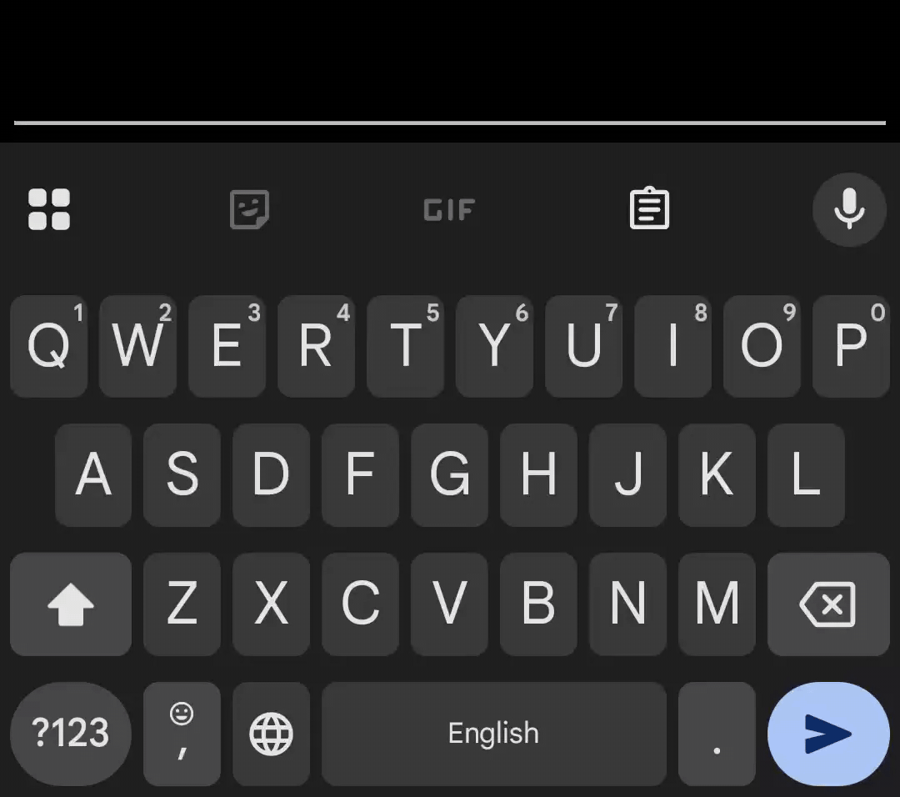
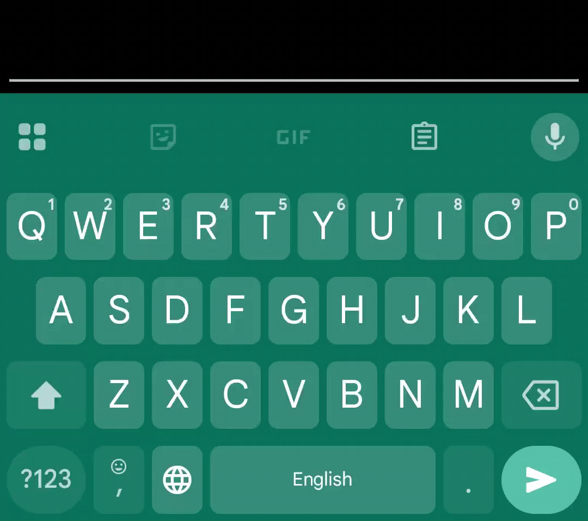
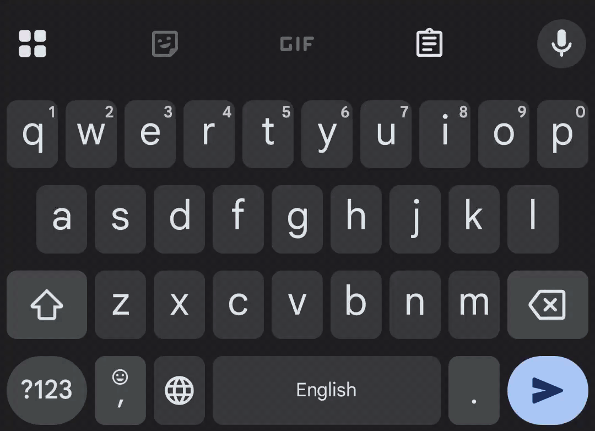

<div align="center">

# GinType (Gboard Patches)

[](LICENSE)
[](https://play.google.com/store/apps/details?id=com.google.android.inputmethod.latin)
[](https://morphe.software)

**Morphe patches for Google Gboard — bringing NinType-style two-finger gesture typing and power features to Gboard.**

The patches in this repository bring two-finger swipe typing (**MultiGlide**), an **improved suggestion bar (Thicc Top Bar)**, **custom key hold popups**, and **typing animations** to Gboard, inspired by [Nintype/Keyboard69](https://apps.apple.com/us/app/nintype/id796959534) by jormy.

<br>
<a href="https://morphe.software/add-source?github=srwi/GinType">
  
</a>
<br>
<br>

<table>
  <tr>
    <th width="50%" align="center"><a href="#multiglide">MultiGlide</a></th>
    <th width="50%" align="center"><a href="#thicc-top-bar">Thicc Top Bar</a></th>
  </tr>
  <tr>
    <td align="center"><a href="#multiglide"></a></td>
    <td align="center"><a href="#thicc-top-bar"></a></td>
  </tr>
  <tr>
    <th width="50%" align="center"><a href="#typing-effects-animations">Typing Effects</a></th>
    <th width="50%" align="center"><a href="#custom-hold-popups">Custom Hold Popups</a></th>
  </tr>
  <tr>
    <td align="center"><a href="#typing-effects-animations"></a></td>
    <td align="center"><a href="#custom-hold-popups"></a></td>
  </tr>
</table>

</div>

<br>

> [!NOTE]
> This project was created through vibe coding with extensive testing. Because the patches modify Gboard behavior at runtime, results may vary across devices and Gboard versions. Please review the project and decide whether these patches are suitable for your own device and use case.

## Features

### MultiGlide

- **Simultaneous two-finger swiping**: Glide both thumbs at once to type faster with fluid multi-finger gestures.
- **Tap + Swipe chording**: Tap opening letters with one finger while swiping the rest of the word with the other (or vice versa).
- **Native Gboard dictionaries**: Uses Gboard's installed language dictionaries and supports accent/umlaut folding out of the box.
- **In-app tuning**: Adjust gesture timing, beam sensitivity, and autospace behavior.

### Thicc Top Bar

- **Vertical suggestion wheels**: Swipe up or down inside the top suggestion bar to browse alternative word predictions and sentence variants in a 2D grid.
- **Double-tap & drag text selection**: Double-tap and drag across the suggestion bar to quickly highlight and select words.
- **Sentence branch history**: Flick back through earlier sentence contexts and restore previous wording cleanly.
- **Jump-to-end shortcut**: Quickly jump back to the latest active suggestions with a single tap.

### Typing Effects (Animations)

- **Animated swipe trails**: Draws vibrant, color-cycling swipe trails with an optional glow layer, configurable trail width, fade duration, and cycle speed.
- **Glitter & particle explosions**: Emits trailing glitter particles (`Sparkles`, `Sparks`, `Confetti`, or `Mixed`) and triggers tap/release particle bursts (`Sparks Ring`, `Sparkles`, `Confetti`, or `All Out`) with optional expanding shockwave rings.
- **Key highlights**: Animates pressed keys with `Neon Glow`, `Plasma Pulse`, or `Soft Fill` effects and adjustable highlight duration.
- **Keyboard warp & wind streams**: Adds interactive touch-area warp distortion and flowing wind streams during swipes, with tunable warp strength/radius and wind intensity/spread.
- **Color palettes & customization**: Choose between **Rainbow**, **Neon**, **Fire**, **Galaxy**, and **Pastel** palettes and fine-tune every animation toggle, particle count, size, speed, and lifetime.

### Custom Hold Popups

- **Direct on-keyboard editing**: Long-press any key and slide to the pencil icon to add a new symbol, or hold on an existing popup item for 2 seconds to edit or replace it.
- **Characters, symbols, emojis, and snippets**: Assign custom characters, punctuation, emojis, or frequently used text snippets to any key's long-press popup.

### Package Rename (Side-by-Side Installation)
- Enabled by default so non-rooted phones can install the patched keyboard **alongside** official Play Store Gboard (`dev.srwi.com.google.android.inputmethod.latin`), complete with a customizable app name (`GinType` by default).
- Can be disabled if you prefer an in-place replacement (requires root/mount or matching signatures).

## Install

### Requirements
- **Morphe Manager** or **Morphe CLI**
- A clean copy of Gboard **`18.5.4.993608717-release-arm64-v8a`** (`.apk`, `.xapk`, `.apkm`, or `.apks`)

### Add this repository to Morphe

Add the repository as a Morphe source:

- [Open in Morphe](https://morphe.software/add-source?github=srwi/GinType)
- Or add `https://github.com/srwi/GinType` manually.

Select a clean supported Gboard installer, then choose the patches you want:

- **Thicc Top Bar** for vertical word suggestions and sentence history
- **MultiGlide** for two-finger and tap-plus-swipe typing
- **Typing Effects** for animated swipe trails, glitter, explosions, key highlights, and warp/wind effects
- **Custom Hold Popups** for on-keyboard editing of long-press symbols and text snippets
- **Package Rename** for side-by-side installation on non-rooted devices

After patching, install the generated APK, enable the keyboard in **Android Settings > System > Keyboard > On-screen keyboard**, and switch to it.

## Build

Before running Gradle locally, authenticate to Morphe's GitHub Packages registry with either:

- `gpr.user` and `gpr.key` in `~/.gradle/gradle.properties` (Windows: `%USERPROFILE%\.gradle\gradle.properties`)
- `GITHUB_ACTOR` and `GITHUB_TOKEN` environment variables

Build the Android patch bundle:

```powershell
.\gradlew.bat :patches:buildAndroid
```

Regenerate the patch metadata:

```powershell
.\gradlew.bat :patches:generatePatchesList
```

Generated outputs:

- `patches/build/libs/*.mpp`
- `patches-list.json`
- `patches-bundle.json`

## Credits & License

- **Patch architecture**: Based on [Gboard Patches](https://github.com/jasonwu1994/Gboard-patches) by `jasonwu1994`.
- **Gesture-decoding algorithm**: Based on the [Kinetica implementation](https://github.com/EZ-eta/kinetica).
- **Patcher Framework**: [Morphe](https://github.com/MorpheApp)

Licensed under **GPLv3**. See [LICENSE](LICENSE) and [NOTICE](NOTICE) for details.
