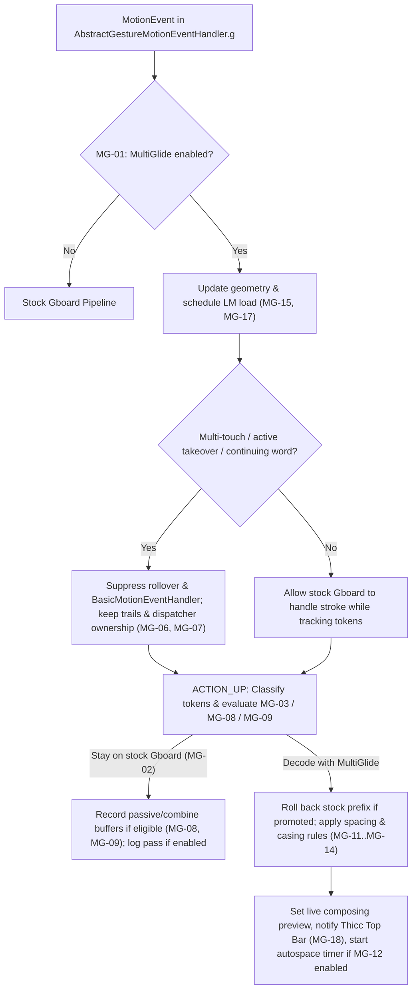

# MultiGlide Gboard Integration Specification

This document is the **single source of truth** for how **MultiGlide** integrates into Google Gboard (`com.google.android.inputmethod.latin`). It defines all normative behavioral rules, edge-case handling, and test coverage expectations for the Gboard integration layer.

> **Scope Boundary (Integration vs. Upstream Kinetica):**
> This specification covers **only the Gboard integration behavior** (touch routing, stock-Gboard preservation, motion-handler hooks, trail accenting, multi-stroke buffers, text/spacing/punctuation context, keyboard geometry boundaries, dictionary loading, Thicc Top Bar synchronization, settings, and telemetry).
> Internal mathematical details of the upstream **Kinetica** decoding engine (`KineticaDtwDecoder`, `DtwMatcher`, `KineticaMatcher`, `ThumbBeam`, `MergeAlternatives`) are intentionally out of scope so upstream algorithm updates can be synced independently without rewriting this specification.

---

## 1. Change Control & Review Policy

1. **Authoritative Behavior Contract:** The rules (`MG-01` through `MG-21`) in this document define the intended runtime behavior of the MultiGlide integration. Code and tests must conform to this specification.
2. **Explicit User Confirmation Required for Behavioral Changes:**
   - Whenever a proposed code change (feature, bugfix, refactor, or default/threshold adjustment) would **alter, add, remove, or contradict** any rule defined in this document, **the user must explicitly confirm the specification change** before the behavioral change is accepted.
   - Any agent or contributor proposing such a change must clearly identify which `MG-*` rule(s) are affected, describe the old vs. new behavior, and ask for explicit confirmation so previously defined behaviors are never broken accidentally.
3. **Spec–Code–Test Synchronization:**
   - Every approved change to an integration rule must update:
     1. The corresponding `MG-*` rule(s) in this document,
     2. The implementation, and
     3. Automated test coverage in the traceability matrix below.
4. **Upstream Kinetica Sync Invariant:**
   - Re-syncing Kinetica decoder files from upstream must preserve all integration interfaces consumed by `GboardMultiGlideRuntime`, `MultiGlideWordSession`, `GboardMultiGlideSettings`, `GboardMultiGlideDictionaryManager`, and `MultiGlideGeometry` (including runtime tuning constants via `KineticaConstants.applyRuntimeTuning`, `MAX_WORD_LEN`, `RESTING_FINGER_MIN_MS`, `PERSONAL_MERGE_MIN_COUNT`, and token/geometry inputs).

---

## 2. Integration Architecture Overview

### Key Integration Components

| Responsibility | Primary Files |
| :--- | :--- |
| Bytecode hooks into Gboard touch pipeline | `patches/.../multiglide/GboardMultiGlideBytecodePatch.kt`, `patches/.../runtimeabi/RuntimeAbi.kt` |
| Android touch routing, trail styling, reflection | `extensions/.../multiglide/GboardMultiGlideRuntime.java` |
| Pure-JVM word session, buffers, spacing, Backspace compound state | `extensions/.../multiglide/MultiGlideWordSession.java` |
| Key bounds, letter-area hit testing, midline | `extensions/.../multiglide/MultiGlideGeometry.java` |
| Gboard `.lm` extraction, `UserDictionary`, session learning | `extensions/.../multiglide/GboardMultiGlideDictionaryManager.java`, `GboardLmReader.java` |
| Settings defaults, clamping, UI visibility, decoder tuning sync | `extensions/.../multiglide/GboardMultiGlideSettings.java`, `GboardMultiGlideSettingsFeature.java` |
| JSONL trace logging & time-window export | `extensions/.../multiglide/GboardMultiGlideTraceLogger.java` |
| Top bar candidate & sentence-history sync | `extensions/.../thicctopbar/GboardThiccTopBarRuntime.java`, `ThiccTopBarGboardReflector.java` |

---

## 3. Normative Integration Rules

### A. Activation, Routing & Stock Gboard Coexistence

#### `MG-01` — Feature Toggle & Safe Bypass
- **Rule:** When MultiGlide is disabled (`pref_multiglide_enabled == false`), all Gboard touch and gesture events must pass through to stock Gboard without modification.
- **Details:**
  - `onGestureEventEntry` returns immediately.
  - `shouldStartGesture` returns `stockShouldStart` and `resolveLetterStarted` returns `stockLetterStarted`.
  - `shouldReceiveEventsDuringOtherOwner`, `shouldSuppressBasicMotionEventHandler`, and `shouldSuppressRolloverCommitOnPointerDown` all return `false`.
- **Implementation:** `GboardMultiGlideRuntime`, `MultiGlideWordSession`, `GboardMultiGlideSettings.readEnabled`.

#### `MG-02` — Single-Finger Stock Gboard Preservation
- **Rule:** Normal single-finger taps and single-finger swipes stay on stock Gboard's native pipeline (stock recognition, stock commit, stock gesture trail color), except when explicitly promoted or continued under `MG-03`, `MG-08`, `MG-09`, or `MG-10`, or when post-swipe autospace (`MG-12`, only when `pref_multiglide_auto_space_before_word == false`) appends a trailing space after the combine window expires. When `pref_multiglide_auto_space_before_word == true` (Gboard style), single-finger stock swipes remain 100% on stock Gboard with no post-swipe autospace timer.
- **Details:**
  - A standalone single-finger stroke does not activate `multiGlideTakeoverActive` and does not intercept `Lqit;->n(...)V` dispatch (`shouldInterceptGestureDispatch` returns `false`).
  - Pressing Space (or Enter, punctuation, or navigating in the text field) clears open buffers so the next single-finger stroke again executes purely on stock Gboard (e.g., swipe `"ha"` → Space → swipe `"lo"` produces `"ha lo"` via stock Gboard).
  - Pure multi-touch rollover taps that contain **no** swipe anywhere in the current stroke or active word (`hasSwipe == false`) also remain on stock Gboard (`reason = "rollover_no_swipe"`).
- **Implementation:** `GboardMultiGlideRuntime.onGestureEventEntry`, `MultiGlideWordSession`, `shouldInterceptGestureDispatch`.

#### `MG-03` — MultiGlide Decode Trigger Conditions
- **Rule:** MultiGlide takes over on `ACTION_UP` and decodes via Kinetica if and only if at least one of the following holds:
  1. The stroke involved multi-touch or active MultiGlide takeover (`sawMultiTouch || multiGlideTakeoverActive`) **and** at least one `SWIPE` token is present in the stroke or active word buffer;
  2. The stroke is continuing an active MultiGlide word (`multiGlideWordActive && !wordTokens.isEmpty()`) **and** at least one `SWIPE` token is present;
  3. `PassiveTapBuffer` holds a prior multi-touch tap prefix (`hadMultiTouch == true`) and the current stroke completes with a `SWIPE` (`promoteMultiTouchPassive && hasSwipe`);
  4. `SingleTouchCombineBuffer` is active (`!autoSpaceEnabled || singleTouchCombineDelayMs > 0`) and promotes sequential single-touch strokes containing at least one `SWIPE` without non-letter touches (`promoteSingleTouchCombine`).
- **Empty Candidate Fallback (`0` Candidates):**
  - **First promotion of `SingleTouchCombineBuffer` when `autoSpaceEnabled == true`:** If Kinetica returns `0` candidates (`!wasMultiGlideWordActive && !isMultiGlideGesture`), MultiGlide leaves the existing editor text untouched and does **not** block stock Gboard's dispatch so fast consecutive 1-finger stock words are never swallowed.
  - **First promotion of `SingleTouchCombineBuffer` when `autoSpaceEnabled == false`:** MultiGlide still takes over (`multiGlideTakeoverActive = true`, `multiGlideWordActive = true`), suppresses stock Gboard dispatch (preventing Gboard from inserting a second separated word without Space), keeps the existing best match/stock prefix intact in the editor, and retains all combined tokens in `wordTokens` so subsequent strokes can continue combining.
  - **Continuation of an already active MultiGlide word (`wasMultiGlideWordActive == true`):** Regardless of `autoSpaceEnabled`, if Kinetica returns `0` candidates after adding another stroke, MultiGlide keeps the previous best decoded match in the editor, blocks stock dispatch, and retains the newly added tokens in `wordTokens`.
- **Implementation:** `GboardMultiGlideRuntime.onGestureEventEntry`, `MultiGlideWordSession.onActionUp`.

#### `MG-04` — Pointer Token Classification (Swipe vs. Tap vs. Resting Finger)
- **Rule:** Each pointer track is classified into a `SWIPE`, a `TAP`, a dropped resting finger, or ignored non-letter touch using net displacement rather than jitter arc length:
  1. **Swipe:** Requires `>= 2` points and net displacement from start `>= max(22px, keyWidthPx * 0.24f)`.
  2. **Resting Finger (Dropped):** If a pointer overlapped with another pointer (`overlapped == true`), did not exceed the swipe threshold, and remained down for `>= 400ms` (`KineticaConstants.RESTING_FINGER_MIN_MS`), it is dropped and emits **no** token.
  3. **Tap:** Otherwise, if the pointer started on the letter area (`startedOnLetter && startKeyChar != '\0'`), it emits a `TAP` token at its nearest letter key.
  4. **Non-Letter Touch:** Touching outside the letter area emits no token and marks `sawNonLetterThisSession = true`.
- **Implementation:** `GboardMultiGlideRuntime.PointerTrack` (`isSwipe`, `isRestingFinger`, `toToken`).

#### `MG-05` — Dynamic Thumb Midline & Slot Assignment
- **Rule:** Active pointers are assigned to thumb slot `0` (left) or `1` (right) based on `x < geometry.midlinePx()`, falling back to the free opposite slot if the preferred slot is already occupied by an active pointer.
- **Details:** `midlinePx()` is calculated from the midpoint between `t` and `y`/`z` (using whichever is on the top row with `t`) and between `g` and `h`, so asymmetric right-hand columns (such as German `ü`/`ö`/`ä`) do not shift the midline.
- **Implementation:** `GboardMultiGlideRuntime.registerPointerDown`, `MultiGlideGeometry.midlinePx`.

---

### B. Gboard Motion-Handler Hooks & Visual Trail

#### `MG-06` — Multi-Touch Dispatcher & Rollover Protection
- **Rule:** When multi-touch or an active MultiGlide word is in progress, Gboard's internal single-touch assumptions must not cancel gesture tracking, commit premature rollover taps, or overwrite MultiGlide output:
  1. **Gesture Start (`shouldStartGesture`):** Forces native gesture start once multi-touch (or an active MultiGlide word) has a swiping pointer (`startedOnLetter && isSwipe`), enables trail recording (`U.a = true`), and claims dispatcher ownership (`p.m()`).
  2. **Letter Guard (`resolveLetterStarted`):** Forces `letterStarted` (`u`) to `true` during multi-touch, takeover, or when completed tokens exist so `g(MotionEvent)` does not early-return.
  3. **Dispatcher Coexistence (`gu()` / `shouldReceiveEventsDuringOtherOwner`):** Returns `true` whenever pointers are active, multi-touch was seen, or takeover is active so ownership changes away from `BasicMotionEventHandler` do not starve the gesture handler.
  4. **Reset Protection (`B()` / `shouldInterceptGestureReset`):** Aborts Gboard's gesture state reset while pointers remain down in an active MultiGlide session so `softKeyMap`, `letterStarted`, and trails stay intact.
  5. **Tap Handler Suppression (`shouldSuppressBasicMotionEventHandler`):** Suppresses `BasicMotionEventHandler.t(MotionEvent)` while `multiGlideTakeoverActive` is `true`, **except** for fresh `ACTION_DOWN` events (which must pass through so subsequent single-finger typing continues to work).
  6. **Rollover Suppression (`shouldSuppressRolloverCommitOnPointerDown`):** Suppresses `Lqil`'s premature pointer-0 commit on `ACTION_POINTER_DOWN` when `multiGlideTakeoverActive` is `true`, OR when both pointers land on the letter area within `220ms` of `ACTION_DOWN`.
  7. **Native Gesture Dispatch Suppression (`shouldInterceptGestureDispatch`):** Blocks `Lqit;->n(...)V` once `multiGlideTakeoverActive` is `true` so stock Gboard does not decode and overwrite the MultiGlide result.
- **Implementation:** `GboardMultiGlideBytecodePatch.kt`, `GboardMultiGlideRuntime`, `MultiGlideWordSession`.

#### `MG-07` — Trail Stability & Distinct MultiGlide Trail Accent
- **Rule:** MultiGlide reuses Gboard's native trail renderer safely and visually distinguishes MultiGlide gestures from stock single-finger swipes via a distinct trail color:
  1. **Index Safety & Cleanup:** Trail start indices (`U.c` vs `U.b`) are sanitized on entry, during multi-touch `ACTION_MOVE`, and on pointer finish to prevent out-of-bounds crashes in Gboard's redraw runnable. Finished swipe trails with `>= 3` points are transferred to Gboard's fading list (`U.e`); shorter/tap trails are recycled without leaving stray dots.
  2. **Distinct Accent Color:** When MultiGlide takeover or word continuation is active, `GestureOverlayView`'s `Paint` `ColorMatrixColorFilter` is switched to:
     - Android 12+ Material You `system_accent3` (tertiary) if color distance to stock primary RGB is `>= 56`,
     - Otherwise `system_accent2` (secondary) if color distance is `>= 56`,
     - Otherwise a `+120°` hue rotation of the stock accent (or fixed rose `0xEFB8C8` / `0x7D5260` if achromatic).
  3. **Stock Restoration:** Returning to single-finger/idle state or `ACTION_CANCEL` restores the captured stock `ColorFilter`.
  4. **Theme Capture:** Capturing the stock filter also reports the stock trail RGB to `ThiccTopBarGboardReflector.recordStockTrailAccent`.
- **Implementation:** `GboardMultiGlideRuntime` (`sanitizeTrailIndices`, `finishTrailForPointer`, `setMultiGlideTrailAccentActive`, `chooseMultiGlideTrailColor`).

---

### C. Multi-Stroke Buffers & Word Composition

#### `MG-08` — Passive Pre-Swipe Tap Prefix Promotion & Baseline Rollback
- **Rule:** Pure-letter tap prefixes (including multi-touch rollover taps) followed by a MultiGlide swipe combine into a single MultiGlide word, rolling back the prefix characters already inserted by stock Gboard.
- **Timing & Capacity:**
  - When `autoSpaceEnabled == true`: active only when `pref_multiglide_tap_to_multiglide_delay_ms > 0` (default `150ms`, range `50..500ms`), gap must be `<= tapToMultiGlideDelayMs`, and token count `<= 8` (`MAX_PASSIVE_TAP_TOKENS`).
  - When `autoSpaceEnabled == false`: time gap is **unlimited** (timeout setting ignored) and capacity extends to `KineticaConstants.MAX_WORD_LEN` (`40`).
- **Guards & Rollback:**
  - Cleared immediately on any expired gap (when `autoSpaceEnabled == true`), non-letter `ACTION_DOWN` (Space, Enter, Backspace, punctuation), non-letter token (`sawNonLetterThisSession`), any non-MultiGlide swipe, cursor navigation, or if the typed delta since `baselineText` exceeds `tokenCount + 2` or contains non-letter characters.
  - Rollback supports both exact prefix extension (`currentStr.startsWith(baseline)`) and `>= 256`-character sliding-window `InputConnection` snapshots (up to `32` extra chars).
  - **Smart Tap+Swipe Split (`pref_multiglide_smart_tap_swipe_split_enabled == true`):** Before rolling back a `1..6`-letter pure-tap prefix into a swipe, `SmartTapSwipeSplitJudge` evaluates candidate cut points `k = 1..min(4, len)` where the left `k` tapped letters form a valid standalone word across any active language (`activeLanguages()`, length `1`: union of active language-specific allowlists such as `en -> {a, i}`, `es -> {y, a, o, e, u}`, `it -> {e, a, o, i, è}`, `pt -> {a, o, e, é}`, `fr -> {a, à, y}`, `pl -> {w, z, i, o, a, u}`, `cs/sk -> {v, z, s, k, u, o, a, i}`, `hu -> {a}`, `da/nb/nn/no -> {i, å}`, `sv -> {i}`, `ca -> {i, a, o}`, `ro -> {o, e, a}`, `nl -> {u}`, `de -> {}`; length `2..3`: max dictionary frequency across active packs `>= MIN_PREFIX_FREQ_2_3`; length `4`: max dictionary frequency `>= MIN_PREFIX_FREQ_4`) and compares the combined decode (`all taps + swipe`) against the split decode (`tapTokens[k..] + swipe` with `left` as `prevWord`). When multiple cuts qualify (e.g., `"them"` vs `"the"`), a full-prefix preference breaks ties in favor of keeping `"them"` intact. If a split reading wins by the required margin (higher margin for `1`-letter prefixes to protect `"a" + "bout" -> "about"`), the left `k` tapped characters stay committed in the editor, any remaining `tapTokens[k..]` stay attached to the swipe, and the new MultiGlide word starts with a forced leading `" "` (e.g., `"so"` + swipe `"gut"` → `"so gut"`, or `"she"` + `"w"` + swipe `"oul"` → `"she "` + `"w+oul"`).
  - *Example:* Tapping `f` then `n` (stock Gboard displays `"fn"`), then multi-touch swiping `"ktio"` + `"niert"` rolls back `"fn"` and decodes `"funktioniert"`.
- **Implementation:** `MultiGlideWordSession.PassiveTapBuffer`, `GboardMultiGlideRuntime.PassiveTapBuffer`, `SmartTapSwipeSplitJudge`, `computeExtraCharsAfterBaseline`.

#### `MG-09` — Sequential Single-Touch Combine Buffer
- **Rule:** Sequential single-touch strokes combine into one MultiGlide word if at least one stroke is a `SWIPE`, rolling back stock Gboard's intermediate text:
  - **When `autoSpaceEnabled == true`:** Active only when `pref_multiglide_single_touch_combine_delay_ms > 0` (slider range `50..500ms`, default `150ms`; boolean toggle `pref_multiglide_single_touch_combine_enabled` yields `0ms` when disabled) and strokes are separated by `<= combineDelayMs`.
  - **When `autoSpaceEnabled == false`:** Timeout settings have no effect (`combineDelayMs` is ignored even if `0`); consecutive single-touch letter strokes remain combinable across arbitrarily long pauses until an explicit word boundary (Space, Enter, Backspace, punctuation, or cursor navigation). Even if a promoted continuation yields `0` Kinetica candidates, stock Gboard dispatch is suppressed so no unintended second Gboard word appears (`MG-03`).
- **Guards:**
  - Never promotes pure tap-only sequences with zero swipes.
  - When `autoSpaceEnabled == true` and `tapToMultiGlideDelayMs == 0` (*"Continue tapped letters with a swipe"* disabled), `SingleTouchCombineBuffer` does **not** promote tap-only prefixes into a following swipe; it only promotes sequences that already contain at least one `SWIPE` token in the buffer.
  - Cleared immediately if the inter-stroke gap exceeds `combineDelayMs` (only when `autoSpaceEnabled == true`), `ACTION_DOWN` is outside the letter area, `sawNonLetterThisSession` is `true`, or the typed text since baseline ends with `' '` (e.g., stock Gboard committed `"Seiten "`), contains non-letter/non-space characters, or reflects cursor navigation (`isCombinePrefix` / `extractTypedPrefixSinceBaseline`).
  - Allows internal spaces within the prefix (e.g., `" Mi r"`) so multi-stroke split candidates can still roll back cleanly.
  - **Smart Tap+Swipe Split (`pref_multiglide_smart_tap_swipe_split_enabled == true`):** When a pure-tap `1..6`-letter `SingleTouchCombineBuffer` is followed by a single-finger `SWIPE` stroke, `SmartTapSwipeSplitJudge` applies the same combined-vs-split evaluation as `MG-08` before promoting or falling back to stock Gboard; when a split wins at cut `k`, the left `k` tapped characters stay in the editor and `tapTokens[k..] + swipe` starts a new MultiGlide word with a forced leading `" "`.
  - *Example (Auto-Space off):* Swipe `"ha"` → long pause → tap `'l'` → long pause → swipe `"lo"` → decodes `"hallo"`. Swipe `"ha"` → Space → swipe `"lo"` → Space clears buffer, producing `"ha lo"` via stock Gboard.
- **Implementation:** `MultiGlideWordSession.SingleTouchCombineBuffer`, `GboardMultiGlideRuntime.SingleTouchCombineBuffer`, `SmartTapSwipeSplitJudge`, `isCombinePrefix`.

#### `MG-10` — Multi-Stroke Word Continuation & Live Composing Preview
- **Rule:** While a MultiGlide word is active (`multiGlideWordActive`), touching down on the letter area continues the same word instead of starting a new one:
  - **When `autoSpaceEnabled == true`:** Continues if the autospace timer is pending OR within `autoSpaceDelayMs + 80ms` of the previous lift.
  - **When `autoSpaceEnabled == false`:** Continues across **any** pause duration as long as the cursor has not navigated away from the active composing word (`snapshotNow` still matches the expected preview snapshot).
- **Details:**
  - Cancels any pending autospace timer, preserves `wordTokens`, keeps the MultiGlide trail accent active, appends the new stroke's tokens, and re-decodes the full `wordTokens` buffer (retaining all `wordTokens` and the previous displayed match if `0` candidates are returned).
  - Displays the updated top candidate as live composing text (`ic.setComposingText(word, 1)`).
  - Touching down outside the letter area (Space, Enter, Shift, punctuation) or navigating in the text field immediately breaks continuation and clears the word buffer. A short Backspace tap in `last_input` mode (`MG-21`) keeps `multiGlideWordActive` active as long as at least one `SWIPE` token remains after removing the latest-started token.
- **Implementation:** `MultiGlideWordSession.onActionDown`, `GboardMultiGlideRuntime.onGestureEventEntry`, `previewWordToInputConnection`.

---

### D. Text Context, Spacing, Punctuation & Compound Attachment

#### `MG-11` — Pre-Word Leading Space Insertion
- **Rule:** When starting a new MultiGlide word (`!leadingSpaceEvaluated`), if `autoSpaceEnabled == true` and the text immediately before the cursor at `ACTION_DOWN` ends with a letter, digit (`Character.isLetterOrDigit`), or closing sentence punctuation (`.`, `,`, `!`, `?`, `;`, `:`), MultiGlide commits a leading `" "` before the composing word unless suppressed by `MG-13`.
- **Rationale:** Stock Gboard single-finger swipes and taps leave no trailing space after a word or punctuation; without a leading space, `"es"` or `"Hallo,"` followed by MultiGlide `"dir"` / `"Welt"` would become `"esdir"` / `"Hallo,Welt"` instead of `"es dir"` / `"Hallo, Welt"`.
- **Details:** No leading space is inserted at the start of a field, after whitespace/newlines, after opening/joining punctuation like `"("`, `"\""`, `"-"`, `"/"`, or when `autoSpaceEnabled == false`.
- **Implementation:** `MultiGlideWordSession.shouldPrependLeadingSpace`, `GboardMultiGlideRuntime.shouldPrependLeadingSpace`.

#### `MG-12` — Post-Word Autospace & Punctuation Retraction (`eatBefore`)
- **Rule:** When `autoSpaceEnabled == true`:
  - **After-Word Mode (`pref_multiglide_auto_space_before_word == false`):**
    - **MultiGlide words:** After all fingers lift from a MultiGlide word, a timer runs for `pref_multiglide_auto_space_delay_ms` (default `300ms`, range `0..2000ms`). On expiry (if no fingers are down), `ic.finishComposingText()` commits the active word, a trailing `" "` is committed, and `autospaceInserted` is set to `true`.
    - **Single-finger stock swipes:** After a single-finger letter swipe (`hasSwipe == true`, `!sawNonLetterThisSession`, `!strokeHadMultiTouch`, and confirmed by Gboard's native gesture start `stockShouldStart == true` when observed so short single-finger tap jitters never trigger autospace), a timer runs for `pref_multiglide_single_touch_combine_delay_ms` (when `> 0`) or `pref_multiglide_auto_space_delay_ms` (when `0`). On expiry (if no fingers are down and the text immediately before the cursor ends with a letter or digit), `ic.finishComposingText()` + `ic.commitText(" ", 1)` appends a trailing `" "` and sets `autospaceInserted = true`. Pure taps (`hasSwipe == false`) never trigger post-stroke autospace.
  - **Before-Next-Word Mode (`pref_multiglide_auto_space_before_word == true`, Gboard style, default):**
    - **MultiGlide words:** The same `pref_multiglide_auto_space_delay_ms` timer commits the active MultiGlide word **without** appending a trailing `" "` (`appendSpace = false`, `autospaceInserted = false`) and arms `pendingLeadingSpaceBeforeNextWord`.
    - **Single-finger stock swipes:** No trailing `" "` is appended (`eatBefore` / double-space-period overrides remain inactive), and once the combine window (if any) expires for a confirmed single-finger stock swipe (`stockShouldStart == true` when observed), `pendingLeadingSpaceBeforeNextWord` is armed.
    - **Next word (`tap` or `swipe`):** On the next letter `ACTION_DOWN` (when not continuing the word and not suppressed by `MG-13`), if the text before the cursor ends with a letter or digit, `" "` is inserted before that letter so both tapped words (e.g. `"so"`) and swiped words receive a leading space. Pure taps never arm `pendingLeadingSpaceBeforeNextWord`.
  - **Punctuation `eatBefore` & Post-Autospace Double-Space Period:**
    - If the very next `ACTION_DOWN` lands on a hugging punctuation key (`.,!?;:)]}»…`, `MultiGlideGeometry.NO_SPACE_BEFORE`) while `autospaceInserted == true` and the character before the cursor is `' '`, MultiGlide immediately deletes that trailing space (`ic.deleteSurroundingText(1, 0)`) before the punctuation is handled. If the user first taps a non-character modifier/layout-switch key (such as `?123` or `Shift`, `character == '\0'` and not Space) without changing the editor text (`autospaceSnapshot` unchanged), `autospaceInserted` is preserved so tapping `:` or other punctuation on the symbols layout still retracts the trailing space.
    - If the user taps Spacebar once after an autospace (`autospaceInserted == true`), the auto-inserted space is **kept** so multiple spaces can still be typed normally (`"word  "`, `"word   "`). However, if the user performs a quick second Spacebar tap within `500ms` (`DOUBLE_SPACE_PERIOD_TIMEOUT_MS`) and Gboard's own `enable_double_space_period` preference is enabled (default `true`), MultiGlide replaces the two trailing spaces before the second tap (`"  "`) with `"."` on `ACTION_DOWN` right before Gboard inserts its space, yielding `". "` just like native double-space-period. When `enable_double_space_period` is disabled, double-tapping Spacebar inserts spaces normally without inserting a period.
    - `autospaceInserted` is cleared on any subsequent character/Space `ACTION_DOWN` or if the editor text changed away from `autospaceSnapshot`.
- **When `autoSpaceEnabled == false`:** No autospace timer is started (for either MultiGlide or single-finger stock swipes), no trailing space is appended, and `autospaceInserted` remains `false`.
- **Single-Word Commit Undo Tracking (`MG-21`):** When `finalizeAutospace` commits a MultiGlide word, MultiGlide retains an undo record for that single committed word (exact post-commit snapshot, word length + any trailing autospace) until the next non-Backspace key press, cursor/text change, or `MG-21` Backspace consumption.
- **Implementation:** `MultiGlideWordSession.finalizeAutospace`, `MultiGlideWordSession.finalizeStockSwipeAutospace`, `GboardMultiGlideRuntime.finalizeComposingAndAutospace`, `MultiGlideGeometry.NO_SPACE_BEFORE`.

#### `MG-13` — Compound Word Attachment & Lowercasing Strictly After Backspace
- **Rule:** If and only if the user deletes characters via **Backspace** back onto an existing letter/digit stem and immediately MultiGlides a second word, MultiGlide attaches directly to the remaining stem with **no** leading space and **lowercases** the attached word's initial letter.
- **Concrete Example:**
  1. User swipes `"Seiten"` → autospace commits `"Seiten "`.
  2. User taps Backspace → `"Seiten"` (cursor text shrank relative to `"Seiten "` and ends in a letter/digit).
  3. User MultiGlides `"Leiste"` → leading space is suppressed and `"Leiste"` is lowercased to `"leiste"`, producing **`"Seitenleiste"`** instead of `"Seiten Leiste"` or `"SeitenLeiste"`.
- **Strict Guards (No False Triggers):**
  - Deletion is only armed when a non-Space, non-punctuation keyboard key press (`!downOnLetter && !isSpaceKey && !isPunctuationKey`, i.e. Backspace) preceded the text shrinkage (`didDeleteTrailingChars`).
  - **Sliding Window (`>= 256` chars):** `didDeleteTrailingChars` detects both length reduction (`cur.length() < prev.length()`) and shifted 256-char sliding-window deletions (`cur.regionMatches(d, prev, 0, len - d)` for `1 <= d <= 32`).
  - **Cursor Repositioning & Spacebar Swipe:** Moving the cursor in the text field (no Backspace key press) or swiping on the Spacebar (`isSpaceKey == true`) does **not** arm compound attachment — when `autoSpaceEnabled == true`, a normal leading space is inserted (e.g., `"Hallo schöne Welt"`), and when `autoSpaceEnabled == false`, initial casing is **not** forced lowercase.
  - Pressing Space or punctuation clears any armed Backspace attachment immediately; if text advances past the post-Backspace baseline via unrelated stock typing without buffer promotion, armed attachment also resets.
  - When armed (`attachingAfterBackspace`), MultiGlide suppresses sentence-start capitalization (`capitalizeFirst = false`) and lowercases the first character (`lowercaseFirstChar`) of both `bestWord` and every entry in `alternativeWords`.
  - When `MG-21` deletes a whole MultiGlide word, any leading space that preceded the word (e.g., `"Hallo "` before `"Welt"`) remains intact, so `MG-13` does not trigger unless the user explicitly presses Backspace again to delete that space back onto a letter/digit stem.
- **Implementation:** `MultiGlideWordSession` (`didDeleteTrailingChars`, `isAttachingAfterDeletion`, `lowercaseFirstChar`), `GboardMultiGlideRuntime`, `MultiGlideGeometry.isSpaceKeyAt`.

#### `MG-14` — Shift, Caps Lock & Sentence-Start Capitalization
- **Rule:** MultiGlide respects Gboard's live Shift and Caps Lock keyboard state (`CapsMode`) captured on `ACTION_DOWN` (and preserved across promoted `MG-08`/`MG-09` tap/combine prefixes and `MG-10` word continuations):
  - **`CAPS_LOCK` (`SHIFT_LOCK`):** Uppercases the entire word (`toUpperCase(Locale.ROOT)`) for `bestWord`, all `alternativeWords`, and live-guess previews.
  - **`SHIFT` (one-shot Shift or auto-caps):** Capitalizes the first character of `bestWord`, all `alternativeWords`, and live-guess previews (`capitalizeFirstChar`), even mid-sentence or after `Backspace -> Shift -> Word`.
  - **`NONE` (unshifted):** Leaves dictionary casing intact (without forcing sentence-start capitalization even at field start or after `.` / `!` / `?` if the user toggled Shift off), and lowercases the first character when attaching after Backspace (`MG-13`).
  - **`AUTO` (fallback when keyboard state is unavailable):** Lowercases the first character when attaching after Backspace (`MG-13`); otherwise capitalizes the first character if the text before the cursor is empty, contains only whitespace, ends with `'\n'`, or ends with `'.'`, `'!'`, or `'?'` (ignoring trailing whitespace).
- **Implementation:** `GboardMultiGlideRuntime.readKeyboardCapsMode`, `MultiGlideWordSession.CapsMode`, `applyWordCasing`, `shouldCapitalizeFirstLetter`, `capitalizeFirstChar`.

---

### E. Keyboard Geometry & Non-Letter Boundaries

#### `MG-15` — Dynamic Keyboard Geometry Extraction
- **Rule:** MultiGlide derives per-key bounds and centers from the active Gboard layout rather than relying on a fixed grid:
  1. **Primary:** Gboard's internal native layout object (`Ltjz` via reflection), which works on Canvas-rendered themes without `TextView` children (requires `>= 20` keys).
  2. **Secondary:** `SoftKeyboardView` view-hierarchy traversal (`SoftKeyView` / `TextView` / `contentDescription`, requires `>= 20` keys).
  3. **Fallback:** Synthetic standard QWERTZ (`de`) or QWERTY layout.
- **Details:** Supported character labels are all Latin letters foldable by `MultiGlideAccentFolder` (`a–z`, `ä`, `ö`, `ü`, `ñ`, `å`, `ø`, `æ`, `œ`, `ç`, `ş`, `ğ`, etc.) and `NO_SPACE_BEFORE` punctuation; all other visible keys (`w > 10 && h > 10`, e.g., Shift, Backspace, Space, Enter, or non-Latin script keys) are stored with `character = '\0'` as explicit non-letter keys. Geometry refreshes automatically whenever keyboard dimensions or native layout instance change; non-Latin layouts with `>= 20` extracted keys are cached without falling back to synthetic QWERTY/QWERTZ so MultiGlide stays cleanly on stock Gboard without repeated reflection.
- **Implementation:** `GboardMultiGlideRuntime` (`ensureGeometryUpdated`, `extractKeysFromNativeLayout`, `collectLetterKeysFromViewHierarchy`, `isSupportedGeometryChar`), `MultiGlideAccentFolder.isFoldableLatinLetter`.

#### `MG-16` — Strict Letter-Area Hit Testing & Dedicated Latin Letter Inclusion
- **Rule:** A touch position `(px, py)` counts as being on the letter area (`isOnLetterArea`) if and only if:
  1. It lies inside any `a–z` letter key's bounding box OR any dedicated foldable Latin letter key's bounding box (including **`ä`, `ö`, `ü`, `ñ`, `å`, `ø`, `æ`, `œ`, `ç`, `ş`, `ğ`**), OR
  2. It does **not** lie inside any explicit non-letter key's bounding box (e.g., Shift, Backspace, Space, Comma, Enter, or non-Latin script keys) **and** falls within a `0.12 * keyWidthPx` / `0.12 * keyHeightPx` inter-key gap margin around the letter rows (`minLetterY..maxLetterY`) and nearest letter key.
- **Rationale:** Dedicated Latin letter keys (`ä`, `ö`, `ü`, `ñ`, `å`, `ø`, `ç`, `ş`, `ğ`, etc.) must behave as normal letters for word continuation (`MG-10`), buffer promotion (`MG-08`, `MG-09`), and tap/swipe start (`MG-04`, `MG-06`), while Shift, Backspace, Space, punctuation, number/toolbar rows, and non-Latin layouts must never count as Latin letter touches.
- **Implementation:** `MultiGlideGeometry` (`setKeys`, `isOnLetterArea`, `nearestLetterKey`, `isSpaceKeyAt`, `isPunctuationAt`).

---

### F. Dictionaries, Thicc Top Bar, Settings & Telemetry

#### `MG-17` — Native Gboard Dictionary Extraction, Multilingual Decoding, Accent Folding & Session Learning
- **Rule:** MultiGlide reads Gboard's installed language models directly on-device across all active multilingual languages and augments each with user vocabulary:
  - **Active Language Detection:** Detects the ordered, deduplicated list of active normalized base language tags from `Delight5Facilitator` (primary locale first, followed by secondary multilingual locales from `Delight5Facilitator`'s active `List<Locale>` field and loaded `MAIN` LM descriptors, capped at `4`; fallback `Locale.getDefault()`, fallback `"de"`).
  - **Source Resolution & Multi-Pack Loading:** Resolves each active language via `Delight5Facilitator` main LM descriptors (type `1`) with recursive disk scan fallback (`superpacks`/`delight`/`delight5`, excluding userhistory/contacts/shortcuts/blocklist), caching one independent `LanguagePack` per active language and refreshing when dedicated-umlaut layout state or underlying file timestamp/size changes. Secondary language loads run asynchronously without blocking the UI thread.
  - **Multilingual Candidate Merging & Context Prior:** When multiple active `LanguagePack`s are ready, `MultiGlideMultilingualDecoder` decodes across each pack, applies a mild context-language boost (`1.06x`) inferred from up to the last `3` words before the cursor (or a neutral `1.02x` primary-language tie-break when context is empty/ambiguous), deduplicates case-insensitive collisions keeping the highest adjusted score, and returns the top `TOP_K` candidates.
  - **Token Filtering & Folding:** Excludes standalone internal tokens (`<epsilon>`, `<UNK>`, isolated `_`-prefixed/suffixed/infixed tokens, digits, control bytes) and folds accented characters (including `æ -> "ae"` and `œ -> "oe"`) transparently according to `hasDedicatedUmlauts`. Joins up to `120,000` strongest 2-part Level-1 compound bigrams (`X_ -> _Y`, ordered by `q_unigram(X_) + q_bigram(X_, _Y)`, covering 100% of Gboard 2-part compounds) and up to `50,000` strongest 3-part compounds (prioritizing explicit Level-2 `NGramFst` trigram compound transitions `_Y_ -> X_ -> _Z` followed by top chained `X_ -> _Y_ -> _Z` transitions filtered by per-step edge quality `q_bigram <= 96` and ordered by `q_unigram(X_) + q_bigram(X_, _Y_) + q_bigram(_Y_, _Z)`) into the bitmask-compacted `MultiGlideTrie` using German compound casing (`Teil_` + `_weise` → `teilweise`, `Teil_` + `_Zeit` → `Teilzeit`, `Daten_` + `_Schutz_` + `_Erklärung` → `Datenschutzerklärung`, hyphen preservation `Rhein_` + `_Land-_` + `_Pfalz` → `Rheinland-Pfalz`) when not already present as standalone words.
  - **User & Session Augmentation:** Merges Android `UserDictionary.Words` entries per language and attributes committed words/bigrams (`recordCommittedWord`, after `2` commits via `KineticaConstants.PERSONAL_MERGE_MIN_COUNT`) to the matching active `LanguagePack` (`resolveCommitLanguage`).
- **Implementation:** `GboardMultiGlideDictionaryManager`, `MultiGlideMultilingualDecoder`, `GboardLmReader`.

#### `MG-18` — Top Bar Synchronization & Native Quick-Access Suppression
- **Rule:**
  - **Thicc Top Bar enabled:** Whenever MultiGlide decodes a live preview (including re-decoding after `MG-21` `last_input` Backspace) or finalizes a committed word, it sends `(word, alternativeWords)` to `GboardThiccTopBarRuntime.recordMultiGlideDecodedWord(...)` so Thicc Top Bar's vertical alternative wheels and sentence branch history remain synchronized with MultiGlide words. During active MultiGlide movement (`ACTION_MOVE`), throttled (`>= 100ms`, single-flight) background Kinetica snapshot decodes also update Thicc Top Bar's right-hand active wheel (`updateLiveGuess`) with the centered intermediate guess.
  - **Thicc Top Bar disabled (Native Top Bar):** When MultiGlide takeover activates (`multiGlideTakeoverActive == true` or `ACTION_UP` MultiGlide decode), MultiGlide clears stale 1-finger candidate slots in `LatinFixedCountCandidatesHolderView` and suppresses Gboard's Quick-Access/toolbar sibling views (`setNativeTopBarBlankForMultiGlide(true)`) so the native top bar stays blank instead of showing a frozen 1-finger Gboard guess or flashing Quick-Access buttons between `ACTION_UP` and Gboard's asynchronous candidate update. During active MultiGlide movement (`ACTION_MOVE`), throttled (`>= 100ms`, single-flight) background Kinetica snapshot decodes may display an intermediate centered guess in the native top bar overlay (`updateNativeTopBarLiveGuess`) without mutating the editor text. Blanking and any live-guess overlay end as soon as Gboard's `onCandidatesUpdated` populates non-empty word candidates, on `ACTION_CANCEL` / stock fallback / non-letter key down (Space, Enter, Backspace), or after a `600ms` safety timeout.
- **Implementation:** `GboardMultiGlideRuntime`, `MultiGlideWordSession`, `GboardThiccTopBarRuntime` (`recordMultiGlideDecodedWord`, `setNativeTopBarBlankForMultiGlide`, `updateNativeTopBarLiveGuess`).

#### `MG-19` — Settings Persistence, UI Visibility, Clamping & Trace Diagnostics
- **Rule:** All MultiGlide settings persist in Gboard shared preferences with strict range sanitization, defaults reset, conditional timeout UI visibility, and opt-in JSONL telemetry:
  - **Defaults & Bounds:** `enabled=true`, `autoSpace=true`, `autoSpaceBeforeWord=true`, `autoSpaceDelayMs=300` `[0..2000]`, `singleTouchCombineEnabled=true`, `singleTouchCombineDelayMs=150` `[50..500]` (effective `0` when disabled), `tapToMultiGlideEnabled=true`, `tapToMultiGlideDelayMs=150` `[50..500]` (effective `0` when disabled), `smartTapSwipeSplitEnabled=true`, `spacebarTimerIndicator=true`, `wordReadyVibration=false`, `backspaceMode="whole_word"` (`{"whole_word", "last_input"}`), `beamWidth=256` `[32..1024]`, `freqWeightFloor=0.25` `[0.05..1.0]`, `geoExponent=3.75` `[1.0..8.0]`, `beamFreqWeight=0.50` `[0.0..2.0]`, `traceLogging=false`.
  - **UI Visibility:** When `autoSpaceEnabled == false`, the `Auto-space before next word (Gboard style)`, `Auto-space delay`, `Spacebar timer indicator`, and `Vibrate when ready for new word` rows are hidden/disabled in the MultiGlide settings screen. The `Auto-space` section appears before the `Gestures & Timing` section. `Single-finger combine timeout` and `Tap-to-MultiGlide timeout` live in the `Gestures & Timing` section and are enabled based on `enabled && singleTouchCombineEnabled` and `enabled && tapToMultiGlideEnabled`. The `Smart tap+swipe split` toggle sits directly below `Tap-to-MultiGlide timeout` and is enabled based on `enabled && tapToMultiGlideEnabled`. The `Backspace behavior` row remains visible regardless of `autoSpaceEnabled`.
  - **Trace Logging:** Disabled by default. When enabled, emits `geom` (once per unique geometry hash), `word`, `pass` (skipped stock gestures), and `commit` JSONL records to logcat (`GboardMultiGlideTrace`) and rolling `multiglide_trace.jsonl` files, exportable by trailing minute window (`1..1440`, or `0` for all) while retaining referenced `geom` headers.
- **Implementation:** `GboardMultiGlideSettings`, `GboardMultiGlideSettingsFeature`, `GboardMultiGlideTraceLogger`.

#### `MG-20` — Optional Spacebar Timer Indicator, Elapse Flash & Word-Ready Vibration
- **Rule:** When `autoSpaceEnabled == true`, MultiGlide tracks the active **word-finalizing timer** that currently delays finalization/Auto-Space and prevents the next input from starting a new word (`MG-12` MultiGlide word autospace timer `autospaceTimerPending`, or the stock-swipe autospace/combine timer `stockSwipeAutospacePending` when `!autoSpaceBeforeWord || singleTouchCombineDelayMs > 0`). Pure-tap strokes without any `SWIPE` token (`MG-08` passive tap prefix / tap-only `MG-09` combine buffer) remain silent in the background and do **not** trigger the spacebar countdown or word-ready vibration, because subsequent taps continue typing in the same word without Auto-Space:
  1. **Center-Out Fill (`pref_multiglide_spacebar_timer_indicator == true`):** Renders an animated translucent pill-shaped shading directly on the spacebar `SoftKeyView` (or its pill background child `View`) via `ViewOverlay`, using `Drawable.getOutline` to match the spacebar's exact pill geometry and corner radius, expanding smoothly from the center toward both edges over the active timer's duration. All word-finalizing timer types share the same visual style.
  2. **Timer-Elapse Flash & Word-Ready Vibration:** Whenever an active word-finalizing timer completes without being cancelled (meaning the word is finalized and the next input will now start a new word), the spacebar indicator briefly flashes and fades out smoothly (if `pref_multiglide_spacebar_timer_indicator == true`), and MultiGlide emits a subtle haptic tick/vibration (if `pref_multiglide_word_ready_vibration == true`).
  3. **Cancellation & Reset:** Any touch down (`ACTION_DOWN`), buffer clear, or gesture reset cancels pending timers, suppresses vibration, and smoothly fades out an active fill without flashing.
- **Implementation:** `SpacebarTimerOverlay`, `GboardMultiGlideRuntime` (`resolveSpacebarTargetView`, `triggerWordReadyVibration`), `MultiGlideWordSession` (`onScheduleAutospaceTimer`, `onCancelAutospaceTimer`, `onScheduleStockSwipeAutospaceTimer`, `onCancelStockSwipeAutospaceTimer`, `onBufferTimerUpdated`, `onWordReadyTimerElapsed`).

#### `MG-21` — Configurable MultiGlide Backspace Behavior (`whole_word` vs. `last_input`)
- **Rule:** A short tap on the Backspace key immediately following a MultiGlide word (either while `multiGlideWordActive == true`, or immediately after `finalizeAutospace` while no other key press or cursor/text change has occurred) deletes according to `pref_multiglide_backspace_mode`:
  1. **Scope & Native Preservation:** Applies **only** to short single taps on Backspace (no drag/swipe-delete and no long-press repeat; holding or swiping from Backspace passes through 100% natively to stock Gboard). Does not apply to stock single-finger swipes (`MG-02`), nor after Space/Enter/punctuation has been pressed.
  2. **`whole_word` Mode (Default):** Both while pending (`multiGlideWordActive == true`) and after commit, a single Backspace tap deletes the entire MultiGlide word (including any trailing auto-space appended in `autoSpaceBeforeWord == false` mode). Any leading space that preceded the word (e.g., `"Hallo "` before `"Welt"`) is preserved. A subsequent Backspace tap deletes a single character normally.
  3. **`last_input` Mode:**
     - **While pending (`multiGlideWordActive == true`):** Removes the single token in `wordTokens` with the latest `startTimeMs` (tie-breaking on the most recently added token):
       - If at least one `SWIPE` token remains: re-decodes `wordTokens`, updates the live composing preview, notifies Thicc Top Bar (`MG-18`), keeps `multiGlideWordActive = true`, and restarts the autospace timer if `autoSpaceEnabled == true`.
       - If only `TAP` tokens remain (no `SWIPE` token left, e.g., after `MG-08` `"fn"` + `"ktion"`): restores the originally typed tap prefix (`"fn"`) as normal text, returns the tap tokens to `PassiveTapBuffer`, and ends `multiGlideWordActive`.
       - If no tokens remain: deletes the entire word just like `whole_word`.
     - **After commit (`multiGlideWordActive == false`):** Individual stroke tokens are no longer active; a single Backspace tap deletes the entire last committed MultiGlide word just like `whole_word`.
- **Implementation:** `MultiGlideWordSession` (`onBackspaceTap`, `LastCommittedWordUndo`), `MultiGlideGeometry.isBackspaceKeyAt`, `GboardMultiGlideRuntime`, `GboardMultiGlideSettings`.

---

## 4. Rule-to-Test Traceability Matrix

| Rule ID | Implementation | Automated Test Coverage | Status |
| :--- | :--- | :--- | :--- |
| `MG-01` | `GboardMultiGlideRuntime`, `MultiGlideWordSession`, `GboardMultiGlideSettings` | `MultiGlideIntegrationTest#disabledFeatureBypassesAllHooksAndWordSession`, `GboardMultiGlideSettingsTest#defaultsTraceLoggingOffAndResetsAllSettingsToDefaults` | **Covered** |
| `MG-02` | `MultiGlideWordSession`, `GboardMultiGlideRuntime` | `MultiGlideIntegrationTest#singleFingerSwipeAndSpaceStayOnStockGboard`, `rolloverMultiTouchWithoutSwipeStaysOnStockGboard` | **Covered** |
| `MG-03` | `MultiGlideWordSession.onActionUp`, `GboardMultiGlideRuntime` | `MultiGlideIntegrationTest#singleTouchCombineLeavesStockTextIntactWhenZeroCandidates`, `autoSpaceOffRetainsBestMatchAndTokensWhenAdditionalSwipeYieldsZeroCandidates`, `pureTapsWithoutSwipeStayOnStockEvenWithAutoSpaceOff` | **Covered** |
| `MG-04` | `GboardMultiGlideRuntime.PointerTrack` | `MultiGlideDecoderTest#runtimePointerTrackRejectsJitterAndDropsRestingFinger`, `pointerTrackExtractsStickyKeyContactsAndDwellRuns` | **Covered** |
| `MG-05` | `GboardMultiGlideRuntime.registerPointerDown`, `MultiGlideGeometry.midlinePx` | `MultiGlideDecoderTest#dynamicMidlineIgnoresAsymmetricUmlautColumn` | **Covered** |
| `MG-06` | `GboardMultiGlideBytecodePatch.kt`, `MultiGlideWordSession` hook predicates | `GboardMultiGlideSmaliCompilationTest` (all 7 Smali hook tests), `MultiGlideIntegrationTest#motionHandlerHooksProtectMultiTouchAndKeepFreshActionDown` | **Covered** |
| `MG-07` | `GboardMultiGlideRuntime` (trail cleanup & accenting) | `GboardMultiGlideSettingsTest#selectsDistinctMaterialDynamicAccentForMultiGlideTrail` | **Partial** (accent color covered; Android `SparseArray`/`View` trail rendering runtime-only) |
| `MG-08` | `MultiGlideWordSession.PassiveTapBuffer`, `GboardMultiGlideRuntime.PassiveTapBuffer` | `MultiGlideDecoderTest#passiveTapBufferPromotesTapPrefixAcrossLiftsAndRollsBackSlidingWindow`, `MultiGlideIntegrationTest#autoSpaceOffCombinesPassiveTapsAndSwipeAcrossLongPauses` | **Covered** |
| `MG-09` | `MultiGlideWordSession.SingleTouchCombineBuffer`, `GboardMultiGlideRuntime.SingleTouchCombineBuffer` | `MultiGlideDecoderTest#singleTouchCombineBufferPromotesSequentialSwipesAndSwipeTapWithinTimeout`, `MultiGlideIntegrationTest#autoSpaceOffCombinesSequentialStrokesAcrossLongPausesUntilSpaceOrNavigation` | **Covered** |
| `MG-10` | `MultiGlideWordSession.onActionDown`, `decodeAndPreview` | `MultiGlideIntegrationTest#wordContinuationRespectsDelayWhenAutoSpaceOnAndHasNoTimeoutWhenOff` | **Covered** |
| `MG-11` | `MultiGlideWordSession.shouldPrependLeadingSpace` | `GboardMultiGlideSettingsTest#detectsWhenLeadingSpaceIsNeededBeforeMultiGlideWord`, `MultiGlideIntegrationTest#prependsLeadingSpaceAfterStockWordWhenAutoSpaceOn` | **Covered** |
| `MG-12` | `MultiGlideWordSession.finalizeAutospace`, `eatBefore` | `GboardMultiGlideSettingsTest#sanitizesAndPersistsAutoSpaceAndDelayPreferences`, `MultiGlideIntegrationTest#autospaceCommitsSpaceAndRetractsBeforeHuggingPunctuation` | **Covered** |
| `MG-13` | `MultiGlideWordSession` (`didDeleteTrailingChars`, `isAttachingAfterDeletion`) | `MultiGlideDecoderTest#suppressesLeadingSpaceAndLowercasesWhenAttachingAfterBackspace`, `MultiGlideIntegrationTest#backspaceCompoundAttachmentWorksInShortAndLongTextsAndIgnoresCursorMoves` | **Covered** |
| `MG-14` | `GboardMultiGlideRuntime.readKeyboardCapsMode`, `MultiGlideWordSession` (`CapsMode`, `applyWordCasing`, `shouldCapitalizeFirstLetter`) | `MultiGlideIntegrationTest#capitalizesSentenceStartsAndNewlinesUnlessAttachingAfterBackspace`, `respectsShiftCapsLockAndUnshiftedStateAcrossMultiGlideWords` | **Covered** |
| `MG-15` | `GboardMultiGlideRuntime` (`extractKeysFromNativeLayoutArrays`, etc.) | `MultiGlideDecoderTest#extractsNativeLayoutKeysWithoutTextViewsIncludingUmlauts` | **Covered** |
| `MG-16` | `MultiGlideGeometry` (`setKeys`, `isOnLetterArea`, `isSpaceKeyAt`) | `MultiGlideDecoderTest#isOnLetterAreaRejectsNonLetterKeysAndAcceptsLetterKeysAndUmlauts` | **Covered** |
| `MG-17` | `GboardMultiGlideDictionaryManager`, `MultiGlideMultilingualDecoder`, `GboardLmReader` | `GboardLmReaderTest` (LM parsing/filtering/compounds/compact trie), `MultiGlideMultilingualDecoderTest` (secondary-language decode, mid-sentence switching, context-language tie-breaking, multilingual `SmartTapSwipeSplitJudge`, commit attribution) | **Partial** (LM parsing/filtering/compounds/compact trie & multilingual decode/context prior covered; Android `UserDictionary` ContentResolver query & `Delight5Facilitator` reflection runtime-only) |
| `MG-18` | `MultiGlideWordSession` -> `LifecycleCallbacks.onWordDecoded` / `onWordCommitted` / `onNativeTopBarBlankChanged`, `GboardThiccTopBarRuntime.setNativeTopBarBlankForMultiGlide` | `MultiGlideIntegrationTest#notifiesThiccTopBarListenerOnPreviewAndCommit`, `nativeTopBarBlankSuppressesQuickAccessAcrossActionUpAndClearsOnCancelOrSpace` | **Covered** (Android `ViewTreeObserver` guard runtime-only) |
| `MG-19` | `GboardMultiGlideSettings`, `GboardMultiGlideSettingsFeature`, `GboardMultiGlideTraceLogger` | `GboardMultiGlideSettingsTest` (all tests, incl. hiding timeout rows when Auto-Space is off), `MultiGlideDecoderTest#traceLoggerEmitsGeometryOnceAndSerializesRawTouchPointsAndCandidates` | **Covered** |
| `MG-20` | `SpacebarTimerOverlay`, `MultiGlideGeometry.getSpaceKey`, `MultiGlideWordSession`, `GboardMultiGlideRuntime` | `GboardMultiGlideSettingsTest`, `MultiGlideIntegrationTest#spacebarTimerIndicatorNotifiesBufferAndAutospaceTimers`, `wordReadyTimerAndSpacebarIndicatorAlignAcrossAllTimers` | **Partial** (timer callbacks & settings covered; Android `ViewOverlay`/`ValueAnimator` rendering & `Vibrator` runtime-only) |
| `MG-21` | `MultiGlideWordSession` (`onBackspaceTap`, `LastCommittedWordUndo`), `MultiGlideGeometry.isBackspaceKeyAt`, `GboardMultiGlideRuntime`, `GboardMultiGlideSettings` | `GboardMultiGlideSettingsTest#persistsAndResetsBackspaceModePreference`, `MultiGlideIntegrationTest#backspaceWholeWordModeDeletesPendingAndCommittedWordsPreservingLeadingSpace`, `backspaceLastInputModeRemovesLatestStartTimeTokenAndRestoresTapPrefix`, `backspaceAfterSpaceOrSecondTapDeletesSingleChar` | **Covered** |

---

## 5. Notes & Residual Runtime-Only Boundaries

All pure-JVM integration rules (`MG-01`–`MG-21`) are aligned and covered by automated tests. Only three Android-framework interactions remain runtime-verified on device rather than pure JVM:
- Android `GestureOverlayView` / `TrailManager` (`SparseArray`) visual drawing (`MG-07` index sanitization).
- Android `UserDictionary.Words` `ContentResolver` IPC query (`MG-17`).
- Android `ViewOverlay` / `ValueAnimator` spacebar timer indicator drawing (`MG-20`).
