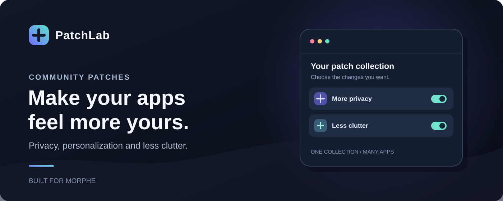

<p align="center">
  
</p>

<p align="center">
  <a href="https://github.com/stivencop414-bot/PatchLab/releases/latest"></a>
  <a href="LICENSE"></a>
  
  
</p>

<p align="center">
  <strong>One collection. More ways to make your apps your own.</strong><br>
  Community patches for privacy, personalization, and a less cluttered experience.
</p>

<p align="center">
  <a href="https://morphe.software/add-source?github=stivencop414-bot%2FPatchLab"></a>
  &nbsp;
  <a href="https://github.com/stivencop414-bot/PatchLab/releases/latest"></a>
</p>

## What is PatchLab?

PatchLab brings community patches for different Android apps together in a single bundle. Depending on the app, patches can reduce ads and tracking, adjust the interface, or add convenient options. Choose the patches you want in Morphe Manager.

PatchLab is an independent community project. It is not affiliated with Morphe or the developers of the supported apps.

## Supported apps

The list below is generated from the current release and will grow as new apps and patches are added.

<!-- PATCHES_START -->
> **[v0.3.1](https://github.com/stivencop414-bot/PatchLab/releases/tag/v0.3.1)**&nbsp;&nbsp;&middot;&nbsp;&nbsp;`main`&nbsp;&nbsp;&middot;&nbsp;&nbsp;**18 patches** across **3 apps**&nbsp;&nbsp;&middot;&nbsp;&nbsp;[Full details](PATCHES.md)

| # | App | Patches | Version | Package |
|---|---|---|---|---|
| 1 | [**Ditu**](PATCHES.md#ditu-comcaracolstreaming) | 7 | `2.8.1` | [`com.caracol.streaming`](https://play.google.com/store/apps/details?id=com.caracol.streaming) |
| 2 | [**TV Colombia Play**](PATCHES.md#tv-colombia-play-colombiatvplus) | 3 | `1015` | [`colombia.tv.plus`](https://play.google.com/store/apps/details?id=colombia.tv.plus) |
| 3 | [**ViX**](PATCHES.md#vix-comunivisionprendetv) | 8 | `4.52.1_mobile` | [`com.univision.prendetv`](https://play.google.com/store/apps/details?id=com.univision.prendetv) |
<!-- PATCHES_END -->

Each patch is intended for the versions and original signing certificates listed in its compatibility details. Other versions or distributions may not work.

## Get started

1. Install **Morphe Manager 2.6.0 or newer**.
2. Tap **Add to Morphe** above, or add this repository under **Sources**:

   `https://github.com/stivencop414-bot/PatchLab`

3. Choose a compatible, original APK or XAPK obtained through authorized means.
4. Select your patches and build the patched app on your device.

[Browse all patches and compatibility details](PATCHES.md) · [Download the latest bundle](https://github.com/stivencop414-bot/PatchLab/releases/latest)

> Patches change app behavior on the client; they do not grant paid subscriptions or DRM licenses. Ads embedded in a broadcast may remain, and protected video surfaces can still block screenshots.

## Build from source

You need JDK 21, the Android SDK, and the Morphe dependencies used by this project, including `morphe-patcher` 2.4.0.

```bash
./gradlew :patches:buildAndroid :patches:generatePatchesList --no-daemon
```

The Android build produces the `.mpp` bundle. Releases and the patch list are generated automatically through GitHub Actions.

## License

[GPL-3.0](LICENSE), with the additional terms and upstream notices in [NOTICE](NOTICE). PatchLab does not distribute app APKs or XAPKs.
