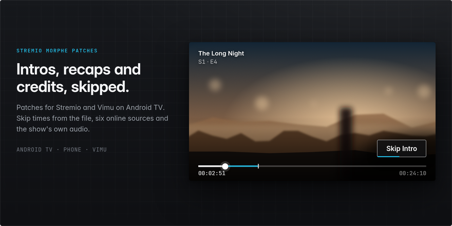
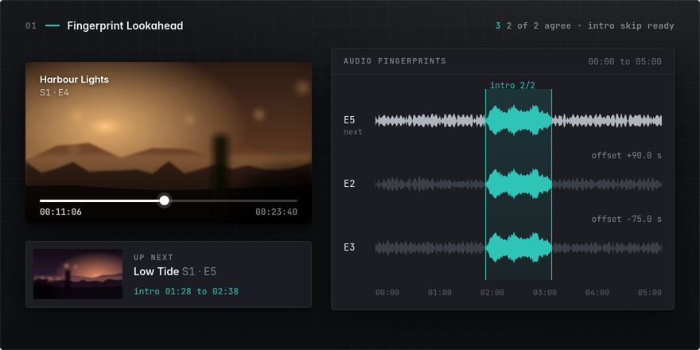
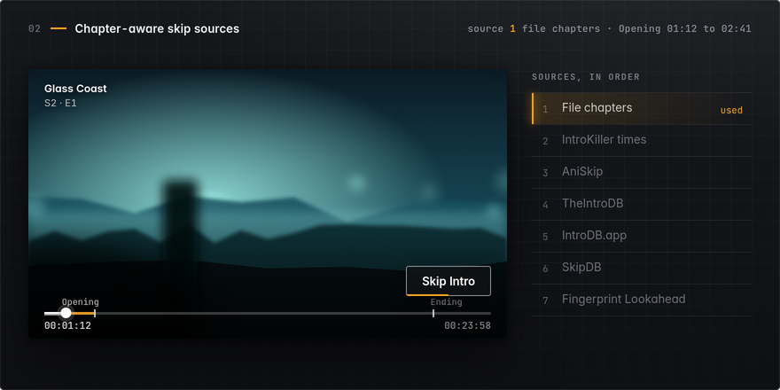
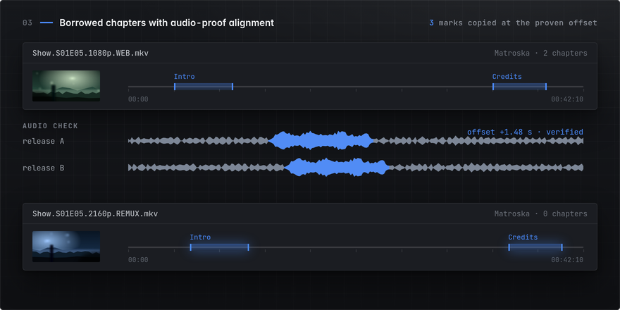
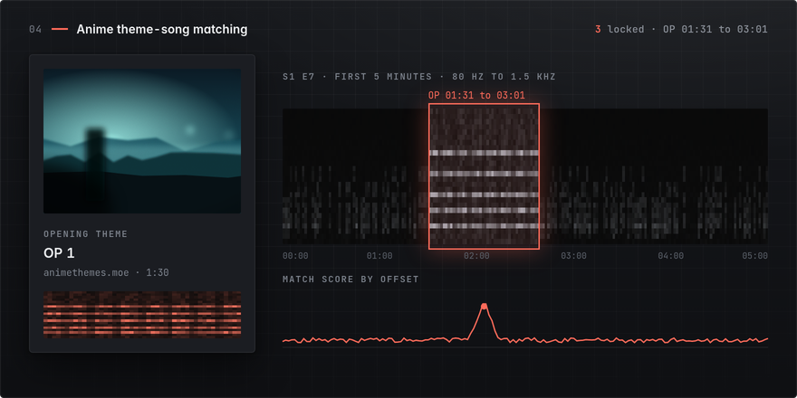
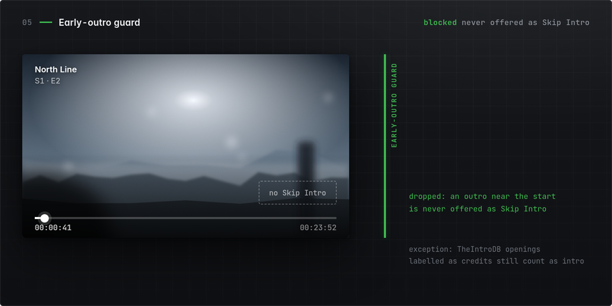
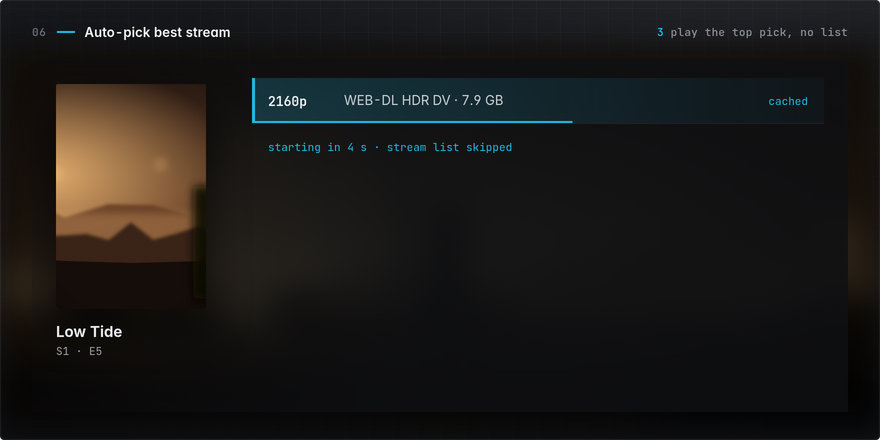
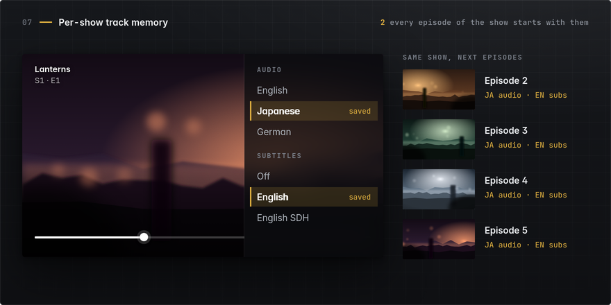
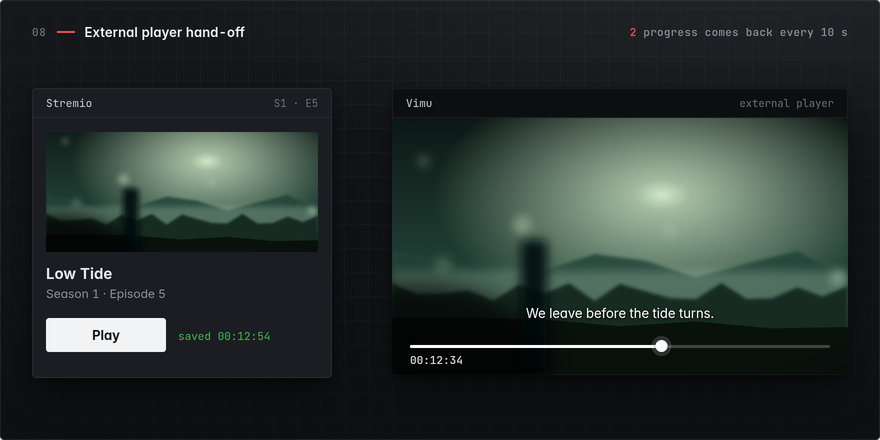
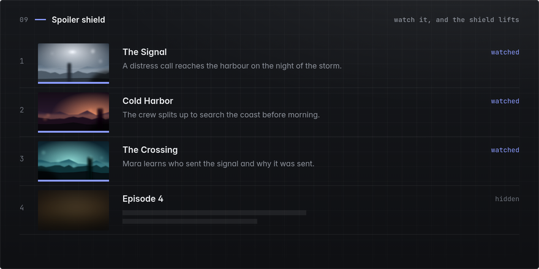

<picture>
  <source srcset="assets/hero@2x.webp" type="image/webp">
  
</picture>

Skip intros, recaps, and credits in Stremio and Vimu, including on episodes no database has timed. The patches add on-device skip detection, automatic stream selection, per-show audio and subtitle memory, an SDH subtitle filter (SDH: subtitles for the deaf and hard of hearing), and external player hand-off. Built for Android TV, with phone support since 1.7. Apply them to your own APK with the Morphe app patcher.

## At a glance

| Feature | What you get | Where you turn it on |
|---|---|---|
| [Fingerprint Lookahead](#fingerprint-lookahead) | Skip times for episodes no online source covers, worked out from the season's audio while you watch the previous episode. | Mod settings, `Fingerprint Lookahead` (off by default) |
| [Chapter-aware skip sources](#chapter-aware-skip-sources) | Intros, recaps, and credits skipped from the file's chapters first, then this project's timings and four online sources. | `Intro Skip` patch |
| [Borrowed chapters](#borrowed-chapters-with-audio-proof-alignment) | Intro and credits marks for a release that has none, copied from another release once audio proves the files match. | Mod settings, `Borrow chapters from other releases` (off by default) |
| [Anime theme-song matching](#anime-theme-song-matching) | Anime intros and credits found from the show's official theme songs, in a single episode. | Runs with `Fingerprint Lookahead` |
| [Early-outro guard](#early-outro-guard) | An early outro is never offered as "Skip intro". | Always on |
| [Auto-pick best stream](#auto-pick-best-stream) | Press play and the best stream starts, without a selection list. | `Auto-pick best stream` patch (on by default) |
| [Per-show track memory](#per-show-track-memory) | Choose audio and subtitle languages once. Every later episode of the show starts with them. | `Remember tracks per show` patch |
| [External player hand-off](#external-player-hand-off) | Your external player gets the episode, position, and subtitles. Progress comes back, and the next episode starts there. | `External player progress` and `Binge with external players` patches |
| [Spoiler shield](#spoiler-shield) | Browse a series without seeing what happens next. | `Hide spoilers` patch |

## Install

1. Add this patch source in Morphe Manager: https://morphe.software/add-source?github=tikkamasalla/stremio-morphe-patches
2. Select Stremio or Vimu and choose your patches, such as "Intro Skip".
3. Patch and install the APK.

**Keep your original Stremio app.** The patched APK replaces your existing Stremio installation by default. Enable the `Side-by-side install` patch (off by default) to install the build as "Stremio Morphe" (`com.stremio.one.morphe`) alongside your original app.

**Patch a clean Vimu 12.00 APK.** Do not use pre-modified APKs from third parties, which include extra tamper checks these patches do not remove. Stock Vimu also closes if its signing certificate changes. Keep the `Re-sign check (Vimu)` patch enabled so the re-signed build runs.

**Open Mod settings.** Every patch option lives in the Mod settings screen:
* **Android TV:** Select Mod settings from the top row of Stremio Settings, or press the `MENU` key on your remote.
* **Phone:** Long-press the Stremio icon on your home screen.

## Supported versions

Eleven Stremio patches are on by default across all five supported versions. A twelfth patch, `Side-by-side install`, is off by default. Support for 1.12.0 and 2.5.0 arrived in 1.7.

| App | Version | Notes |
|---|---|---|
| Stremio TV (`com.stremio.one`, Android TV) | 1.6.12 | Best-supported build. Supports every feature, exact seeks, and progress bar skip marks. |
| Stremio TV | 1.10.4 | `arm64` and `armeabi-v7a` builds. |
| Stremio TV | 1.12.0 | `arm64` and `armeabi-v7a` (bundle). |
| Stremio phone (`com.stremio.one`, touch UI) | 2.4.0, 2.5.0 | Touch skip button. Open Mod settings from the launcher shortcut. |
| Vimu Media Player (`net.gtvbox.videoplayer`) | 12.00 | Seven dedicated Vimu patches. |

On every Stremio version except 1.6.12, skips snap to keyframes (landing 1-2 seconds early) and the progress bar does not show skip marks. See the [feature guide](docs/FEATURES.md) for a full version breakdown.

## Features

### Fingerprint Lookahead

<picture>
  <source srcset="assets/fingerprint-lookahead@2x.webp" type="image/webp">
  
</picture>

A Skip button on episodes no database has timed: new releases, niche shows, and files the online sources never indexed. The next episode is analysed in the background while you watch, so its intro and credits are ready when it starts.

Fingerprint Lookahead is the only on-device skip detection for Stremio on Android TV that we have found.  Nuvio reads the chapters stored in the video file and three online databases, and does not detect anything itself. Jellyfin Intro Skipper detects on a media server instead of in the player.

An isolated background process fingerprints the audio at the start and end of the next episode, matches it against other episodes of the show, and reports an intro or credits when at least 2 other episodes agree. Detected times rank below every other source and follow your Auto or Manual setting.

**Against  Jellyfin Intro Skipper.** The shipped v1.8.0 detector and Intro Skipper v12.0.6.0 at default settings ran on the same 150 episodes (intros and credits), checked against the same hand-verified times. A wrong skip means it cut more than 1 second of the story.

**Story skipped by mistake, in seconds (lower is better)**

| Shows |  Fingerprint Lookahead |  Intro Skipper |
|---|---:|---:|
| Western series, 72 episodes | **45.6** | 2,052.2 |
| Western shows not used for tuning, 18 episodes | **0.0** | 21.4 |
| Korean drama set 1, 36 episodes | **124.8** | 1,567.0 |
| Korean drama set 2, 18 episodes | **104.6** | 1,269.3 |
| Korean drama set 3, 6 episodes | **42.8** | 70.0 |

**Wrong skips (lower is better)**

| Shows |  Fingerprint Lookahead |  Intro Skipper |
|---|---:|---:|
| Western series, 72 episodes | **6** | 46 |
| Western shows not used for tuning, 18 episodes | **0** | 8 |
| Korean drama set 1, 36 episodes | **18** | 42 |
| Korean drama set 2, 18 episodes | **8** | 29 |
| Korean drama set 3, 6 episodes | 5 | 5 |

**Intros and credits found (higher is better)**

| Shows |  Fingerprint Lookahead |  Intro Skipper |
|---|---:|---:|
| Western series, 72 episodes | 50 | **55** |
| Western shows not used for tuning, 18 episodes | **17** | 16 |
| Korean drama set 1, 36 episodes | **16** | 8 |
| Korean drama set 2, 18 episodes | **4** | 0 |
| Korean drama set 3, 6 episodes | 0 | **6** |

Intro Skipper finds more intros and credits on two sets, at the cost of the wrong skips shown above. On the Western series it found 55 and Fingerprint Lookahead found 50. On the third Korean drama set it found 6 and Fingerprint Lookahead found 0.

**Against  Skiptro 1.4.0, intros only.** This test ran on the v1.8.1 detector, just before its last small update. Both tools used the same audio and the same hand-verified times, covering 183 intros across 32 shows with 6 episodes per season, each compared against the other 5.

| Measure |  Fingerprint Lookahead |  Skiptro 1.4.0 |
|---|---:|---:|
| Story skipped, in seconds | **0** | 331 |
| Wrong skips | **0** | 37 |
| Intros found | **125** | 113 |
| Skips where the episode has no intro | **0** | 7 |
| Intros left unmarked | 58 | **33** |

When each episode is compared against only 3 other episodes (averaged over runs), Fingerprint Lookahead finds 112.2 intros with 3.8 wrong skips and 64.5 seconds of story skipped. Skiptro finds 111.8 intros with 30.0 wrong skips and 271.8 seconds skipped. Plex was not tested.

| Streamer hardware test (real streams) | Time per episode | Debrid data read | Result |
|---|---:|---:|---|
| 1080p, comparison episodes cached locally | about 6 minutes | about 0.4 GB | Intro skipped automatically |
| 1080p, one comparison episode to fetch | about 19 minutes | about 0.9 GB | Intro and credits found, frame-accurate |
| 4K remux, nothing cached locally | about 40 minutes | about 5 GB | Analysis finished, no matches on that show |

Results apply only to the exact file analyzed, with one attempt per episode per day. If analysis finishes while you are inside the detected intro or credits, the player shows a Skip button and never jumps.

### Chapter-aware skip sources

<picture>
  <source srcset="assets/skip-sources@2x.webp" type="image/webp">
  
</picture>

Intros, recaps, and credits skip automatically, or on a button press in Manual mode, from seven sources in a fixed priority order. No API keys are needed. Community timestamps drift between releases, so every online time is verified against your file first. Movies and post-credit scenes never skip. Credits skip to the end of the credits instead of the end of the file.

| Order | Source | Notes |
|---:|---|---|
| 1 | Embedded video chapters | Matroska and WebM files streamed over `http(s)`. Online timestamps snap to chapter start and end times. |
| 2 | [IntroKiller Engine](https://github.com/tikkamasalla/introkiller-engine) | This project's published timings |
| 3 | AniSkip | Anime, matched to the exact season and broadcast block first |
| 4 | TheIntroDB | |
| 5 | IntroDB.app | Fills in whichever of intro, recap, or credits is missing |
| 6 | SkipDB | Final online fallback |
| 7 | Fingerprint Lookahead | Lowest priority, only when switched on |

Online timestamps apply only when your file's duration matches the source's runtime to within 2 seconds. Playback never waits for a slow or offline server. Failed sources retry at 5, 20, and 60 seconds.

### Borrowed chapters with audio-proof alignment

<picture>
  <source srcset="assets/borrowed-chapters@2x.webp" type="image/webp">
  
</picture>

A release with no chapters gets the intro and credits marks of another release of the same episode. Releases of the same episode are cut differently, so a copied timestamp is safe only once audio proves how far the two files are shifted. Both files are lined up and the match is checked before any mark is copied. If the files cannot be lined up, nothing is copied. `Borrow chapters from other releases` is off by default and works independently of `Fingerprint Lookahead`.

| Offline test, 40 file pairs | Result |
|---|---:|
| Copied intros and credits that landed within 1 second | 44 of 45 |
| Median error, in seconds | 0.001 |
| Story cuts | 0 |
| Deliberately mismatched pairs refused | 62 of 62 |

### Anime theme-song matching

<picture>
  <source srcset="assets/theme-matching@2x.webp" type="image/webp">
  
</picture>

Intro and credits for anime episodes no source has timed, found from the show's own theme songs. It needs a single episode, so it works where comparing episodes cannot. It matches the official opening and ending songs from AnimeThemes.moe against the episode audio, runs with `Fingerprint Lookahead`, requires a Kitsu id, fills only an intro or credits that is missing, and never overrides another source.

| Standalone PC test, 123 episodes | Result |
|---|---:|
| Intros found | 82 of 114 |
| Credits found | 80 of 105 |
| Real wrong skips | 0 |
| Blood+ intros found | 0 of 5, then 5 of 5 |
| Episodes where the app matcher agreed | 99 of 99 compared |

### Early-outro guard

<picture>
  <source srcset="assets/early-outro-guard@2x.webp" type="image/webp">
  
</picture>

"Skip intro" never appears on an outro. On episodes with no intro, an online credits entry near the start would be offered as one. The guard drops that entry and keeps openings that TheIntroDB mislabels as credits. Self-tests cover it in Stremio's player and Vimu.

### Auto-pick best stream

<picture>
  <source srcset="assets/auto-pick@2x.webp" type="image/webp">
  
</picture>

Press play and the best stream starts. Addon results mix in CAM copies, wrong episodes, and warning cards, so the filter removes CAM, telesync, and screener copies, wrong season or episode numbers, addon warning cards, and external web links before ranking the rest. If every stream fails, the list stays on screen.

| Rank | Rule |
|---:|---|
| 1 | Single-episode file before a season pack |
| 2 | Cached before uncached |
| 3 | Resolution (requires an explicit 4K label such as `2160p` or `4K`; a bare `UHD` tag does not count) |
| 4 | HDR or Dolby Vision, then file size, codec, and seeders |

Next-episode prefetch (`Prepare next episode`) resolves the next episode's best stream in the background, so pressing Next, finishing the episode, or using Binge starts it immediately.

### Per-show track memory

<picture>
  <source srcset="assets/track-memory@2x.webp" type="image/webp">
  
</picture>

Choose Japanese audio and English subtitles once, and every later episode of that show starts with them, in Stremio's player and Vimu. The SDH subtitle filter (`Avoid SDH subtitles`) selects standard dialogue tracks over hearing-impaired subtitles.

### External player hand-off

<picture>
  <source srcset="assets/external-player@2x.webp" type="image/webp">
  
</picture>

Watch in your own player and keep Stremio's progress and your binge. The title, episode, start position, and subtitles go to the player, progress is recorded, and the next episode starts in the same player. Vimu writes its position every 10 seconds, so progress survives a crash. Pressing Back, Home, or stopping early never launches the next episode. Vimu, mpv, and Just Player are tested.

### Spoiler shield

<picture>
  <source srcset="assets/spoiler-shield@2x.webp" type="image/webp">
  
</picture>

`Hide spoilers` hides thumbnails and synopses of unwatched episodes and replaces their titles with `Episode N`. Each episode is revealed once you watch it.

### Also included

| Feature | What it does |
|---|---|
| Smoother playback | Frame-rate matching in Stremio's own player: `Seamless only`, `Always`, or `Off`. |
| Larger playback buffer | Buffers 50-120 seconds ahead (up to 256 MB), on by default, to cut stalls on high-bitrate streams. |
| Mod settings | One screen with every patch option. |
| Side-by-side install | Installs the patched app as Stremio Morphe next to the original. Off by default. |

## Known limits

* **Embedded chapters:** Read from Matroska and WebM files streamed over `http(s)`.
* **Unmarked scenes:** Online credits timestamps can skip over an unmarked mid-credits or post-credits scene.
* **Required settings:** `Remember tracks` requires Stremio's built-in "auto select" option on builds newer than 1.6.12. `Auto-pick` requires `Always show stream list` to be turned off.

## Network connections

Outside of standard Stremio traffic, your addons, and your debrid service, the patches connect only to these hosts:

* **Skip timestamps:** `api.aniskip.com`, `api.theintrodb.org`, `api.introdb.app`, `api.skipdb.tv`, and `raw.githubusercontent.com` (for this project's published timings file).
* **Anime theme-song backup (only when `Fingerprint Lookahead` is on):** `kitsu.app`, `graphql.anilist.co`, `graphql.animethemes.moe`, and AnimeThemes' audio host.
* **Show matching:** `graphql.anilist.co`, `kitsu.app`, and `v3-cinemeta.strem.io`.

Requests send only the show id or title, season, episode number, and file duration (where required by the source). The patches never send account credentials, stream URLs, or debrid keys.

## Help

If patching fails or a feature misbehaves, open an issue with your app version, device model, the Morphe log, and relevant logcat lines. See the [feature guide](docs/FEATURES.md) for logcat filter tags.

To build the patches from source, run `./gradlew :patches:build` and load `patches/build/libs/patches-*.mpp` in Morphe Desktop.

<!-- PATCHES_START -->
> **[v1.8.2](https://github.com/tikkamasalla/stremio-morphe-patches/releases/tag/v1.8.2)**&nbsp;&nbsp;•&nbsp;&nbsp;`main`&nbsp;&nbsp;•&nbsp;&nbsp;19 patches total

 Vimu&nbsp;&nbsp;•&nbsp;&nbsp;7 patches

 

**Supported versions:**

| 12.00 ST | 12.00 |
| :---: | :---: |

| Patch | Description | Options |
|----------|----------------|-----------|
| [Addon subtitles in subtitle menu (Vimu)](#addon-subtitles-in-subtitle-menu-vimu) | Lists the addon subtitles from Stremio in Vimu's subtitle menu. Runs with the Intro Skip (Vimu) patch. |  |
| [External player result (Vimu)](#external-player-result-vimu) | Returns position and duration from Vimu so Stremio saves progress. Runs with the Intro Skip (Vimu) patch. |  |
| [Intro Skip (Vimu)](#intro-skip-vimu) | Adds intro and recap skip for TV shows, movies and anime in Vimu.  Intro Skip v1.0.0 Repository: https://github.com/tikkamasalla/stremio-morphe-patches |  |
| [Intro Skip native fix (Vimu)](#intro-skip-native-fix-vimu) | Fixes native crashes on rapid seeks in the Vimu media engine. Runs with the Intro Skip (Vimu) patch. |  |
| [Intro Skip settings row (Vimu)](#intro-skip-settings-row-vimu) | Adds the Intro Skip settings to Vimu Settings. Runs with the Intro Skip (Vimu) patch. |  |
| [Progress journal provider (Vimu)](#progress-journal-provider-vimu) | Declares the progress journal provider. Runs with External player result (Vimu). |  |
| [Re-sign check (Vimu)](#re-sign-check-vimu) | Lets the app run after re-signing. |  |

 Stremio&nbsp;&nbsp;•&nbsp;&nbsp;12 patches

 

| Patch | Description | Options |
|----------|----------------|-----------|
| [Auto-pick best stream](#auto-pick-best-stream) | Skips the stream list and plays the top ranked stream. Enable Always show stream list to see every stream. |  |
| [Avoid SDH subtitles](#avoid-sdh-subtitles) | Prefers full dialogue subtitles over SDH/CC tracks and strips sound notes when none remain.  Avoid SDH v1.0.0 Repository: https://github.com/tikkamasalla/stremio-morphe-patches |  |
| [Binge with external players](#binge-with-external-players) | Auto-plays the next episode in the same external player when an episode finishes in Vimu, MX Player, VLC or mpv. |  |
| [External player progress](#external-player-progress) | Saves watch progress in Stremio when playing in an external player, and starts the player at the saved position. |  |
| [External player progress manifest](#external-player-progress-manifest) | Declares the keep-alive service for External player progress. Runs with that patch. |  |
| [Hide spoilers](#hide-spoilers) | Hides thumbnails and synopses for unwatched episodes in Stremio.  Hide spoilers v1.0.0 Repository: https://github.com/tikkamasalla/stremio-morphe-patches |  |
| [Intro Skip](#intro-skip) | Adds intro and recap skip controls for TV shows, movies and anime in Stremio.  Intro Skip v1.0.0 Repository: https://github.com/tikkamasalla/stremio-morphe-patches | • Enable debug mode |
| [Mod settings](#mod-settings) | Adds one Mod settings screen with every setting of these patches: from Stremio Settings on TV 1.10.4/1.12.0, from the launcher shortcut or App info on phone 2.x. |  |
| [Mod settings manifest](#mod-settings-manifest) | Declares the Mod settings screen in the manifest. Runs with Mod settings. |  |
| [Remember tracks per show](#remember-tracks-per-show) | Remembers the last audio and subtitle choice for each series and applies it to other episodes. |  |
| [Side-by-side install](#side-by-side-install) | Installs the patched app separately as Stremio Morphe (package com.stremio.one.morphe) so it can sit next to the normal Stremio instead of replacing it. Off by default. |  |
| [Smoother playback](#smoother-playback) | Frame-rate matching (Seamless only / Always / Off), a larger, debrid-friendly playback buffer, and no stream re-open freeze when arriving addon subtitles would not change what is on screen, for Stremio's own player. |  |

<!-- PATCHES_END -->

## Credits

Started from [aniskip-stremio](https://github.com/AzukiSensei/aniskip-stremio) by AzukiSensei, GPLv3. Rewritten with chapter-based skipping, IntroDB support and new skip logic. The SDH annotation rules are adapted from liongalahad-nuviotv-morphe-patches (GPLv3).

## License

GPLv3, see [LICENSE](LICENSE).
