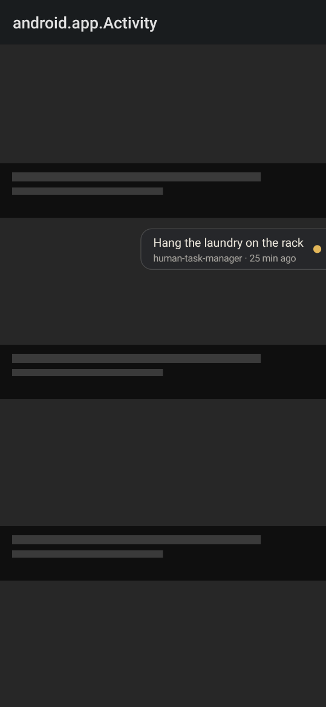
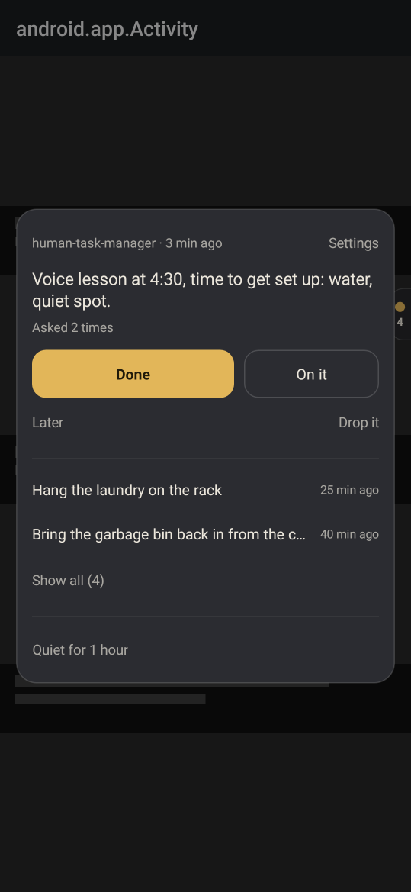
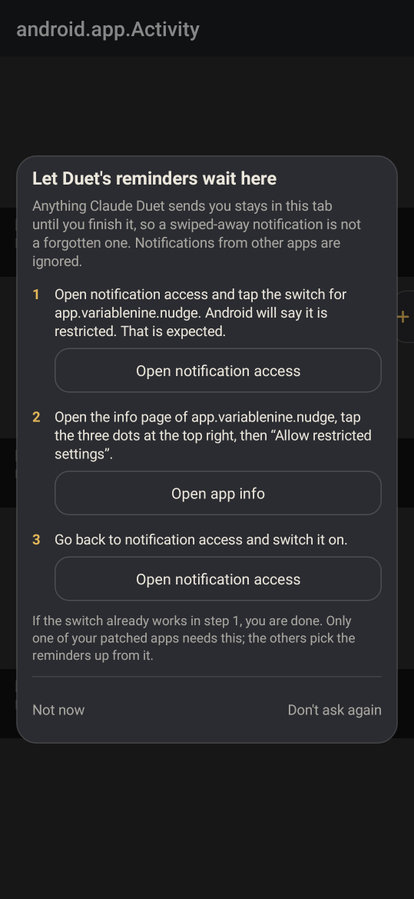

# variablenine Patches

Add-on patches for [Morphe](https://morphe.software) that put your **Claude Duet reminders inside
YouTube and Reddit**, in a small tab at the edge of the screen that stays until you mark the
reminder done.

They are made to be used **together with the official Morphe patches**, not instead of them. This
bundle contains nothing but the reminder patches.

<p>
  
  
  
</p>

## What it does

- Anything Claude Duet sends to your phone is kept as a reminder inside the app. Swiping the
  notification away no longer makes it disappear.
- A small still tab sits at the screen edge while something is waiting. When nothing is waiting,
  there is no tab.
- Now and then (when you open the app, when a reminder arrives, and every 15 minutes or so) the tab
  extends for a few seconds to show the top reminder and how long it has been waiting. Then it
  goes back to being a tab. It never blocks the screen and it hides during fullscreen video.
- Tap the tab for the card: **Done**, **On it** (it checks back in 20 minutes), **Later**
  (30 minutes, 2 hours, 12 hours) or **Drop it**. Done and Drop it can be undone for a few seconds.
- A reminder finished in YouTube is finished in Reddit too.
- **Quiet for 1 hour** is always one tap away, and everything about how often the tab speaks up is
  adjustable under Settings in the card.
- Everything stays on your phone. Nothing is sent anywhere, and notifications from apps other than
  Claude Duet and Claude are never read.

## Install

1. Add this source to Morphe Manager:

   <a href="https://morphe.software/add-source?github=variablenine/morphe-patches">
     
   </a>

   or add the repository address by hand: `https://github.com/variablenine/morphe-patches`

   Keep the official Morphe source as well.
2. Switch Morphe Manager to **Expert mode** (in its settings). The simple mode patches from one
   source at a time, and you want two.
3. Patch YouTube. Leave the official patches as they are, open the **variablenine Patches** tab and
   make sure **Duet reminders** is on. Morphe will mention that several sources are selected. That
   is what you want.
4. Do the same for Reddit.
5. Install both.

Root "mount" installs are not supported, because the patch adds components to the app, which a
mount install cannot do.

## First start

Open one of the patched apps. A tab with a plus appears at the right edge. Tap it and follow the
three steps. Android needs them because it treats every app that was installed from a file as
"restricted" and greys out the notification access switch until you lift that for the app:

1. Open notification access and tap the switch for the app. Android says it is restricted. That
   is expected, and it is what makes the next step available.
2. Open the app's info page, tap the three dots at the top right, then **Allow restricted
   settings**.
3. Go back to notification access and switch it on.

The card has a button for each of those screens. **You only need to do this in one app.** The
other one picks the reminders up from it.

To see what a reminder looks like right away: tap the tab, then Settings, then **Sample reminder**.

## Good to know

- The tab can be dragged up and down, and to the other edge of the screen.
- Reminders older than 36 hours stop asking for attention and move to "Older" under "Show all" in
  the card. The time can be changed, or set to never.
- Each Duet channel that sends you something gets its own switch under Settings, so a channel that
  only reports status can be turned off.
- The app that has notification access stays in memory in the background, the way every app with
  notification access does. If that bothers you, turn on "Listen only while this app is open". A
  notification that is swiped away while the app is closed is then missed.
- If reminders do not show up: check that notification access is still on (Settings in the card
  shows it), and that Duet's notifications are switched on in Android.

## Updates

Releases are published automatically. Morphe Manager looks for them when it starts and marks
YouTube and Reddit as having new patches when a release changes something for them. For that to
work an app has to have been patched with this source at least once.

A scheduled Claude task checks every new release of the official Morphe patches against this
bundle and publishes a fix by itself if one is needed. How that works is written down in
[docs/MAINTENANCE.md](docs/MAINTENANCE.md).

## 🩹 Patches list

<!-- PATCHES_START EXPANDED -->
> **[v2.0.0](https://github.com/variablenine/morphe-patches/releases/tag/v2.0.0)**&nbsp;&nbsp;•&nbsp;&nbsp;`main`&nbsp;&nbsp;•&nbsp;&nbsp;2 patches total
<details open>
<summary>📦 YouTube&nbsp;&nbsp;•&nbsp;&nbsp;1 patch</summary>
<br>

**Package name:** `com.google.android.youtube`

| 💊&nbsp;Patch | 📜&nbsp;Description | ⚙️&nbsp;Options |
|----------|----------------|-----------|
| [Duet reminders](#duet-reminders) | Keeps reminders from Claude Duet in a small tab at the edge of the screen until you mark them done. Meant to be used together with the official Morphe patches. Needs notification access, which the app asks for the first time it is opened. Does not work with root mount installs. |  |

</details>

<details open>
<summary>📦 Reddit&nbsp;&nbsp;•&nbsp;&nbsp;1 patch</summary>
<br>

**Package name:** `com.reddit.frontpage`

| 💊&nbsp;Patch | 📜&nbsp;Description | ⚙️&nbsp;Options |
|----------|----------------|-----------|
| [Duet reminders](#duet-reminders) | Keeps reminders from Claude Duet in a small tab at the edge of the screen until you mark them done. Meant to be used together with the official Morphe patches. Needs notification access, which the app asks for the first time it is opened. Does not work with root mount installs. |  |

</details>

<!-- PATCHES_END -->

## Building

```
./gradlew :extensions:nudge:testDebugUnitTest :patches:test :patches:buildAndroid
scripts/compat-check.sh
```

The bundle is written to `patches/build/libs/patches-<version>.mpp`. Building needs a GitHub token
with the `read:packages` scope, because the Morphe build tools are published on GitHub Packages
(see the [Morphe documentation](https://github.com/MorpheApp/morphe-documentation)).

## History

Versions 1.x of this repository were a personal fork of the complete official patch set with a few
extras. That fork was retired with version 2.0.0. Its source is still in the git history.

## 📜 License

GNU General Public License v3.0, see [LICENSE](LICENSE) and [NOTICE](NOTICE). Built from the
[Morphe patches template](https://github.com/MorpheApp/morphe-patches-template). This project is
not affiliated with or endorsed by Morphe or Anthropic. "Claude" and "Claude Duet" are names of
Anthropic products and are used here only to say what the patches work with.
