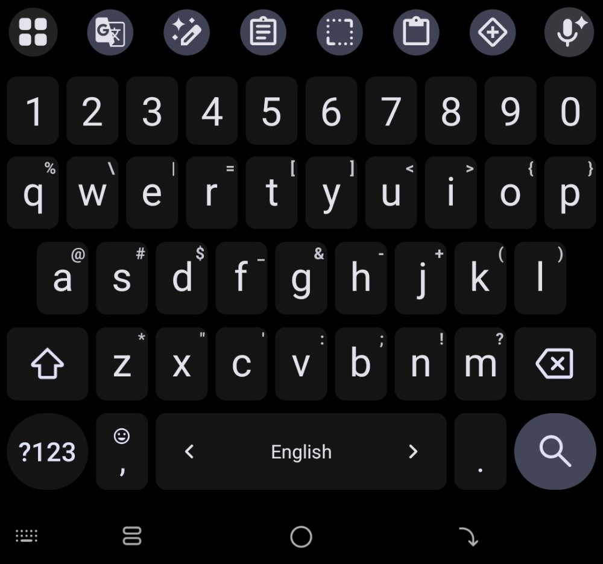
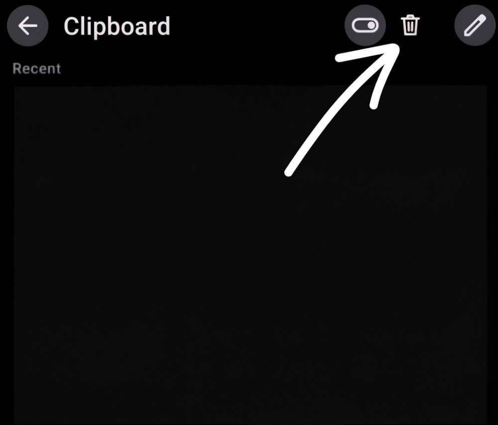
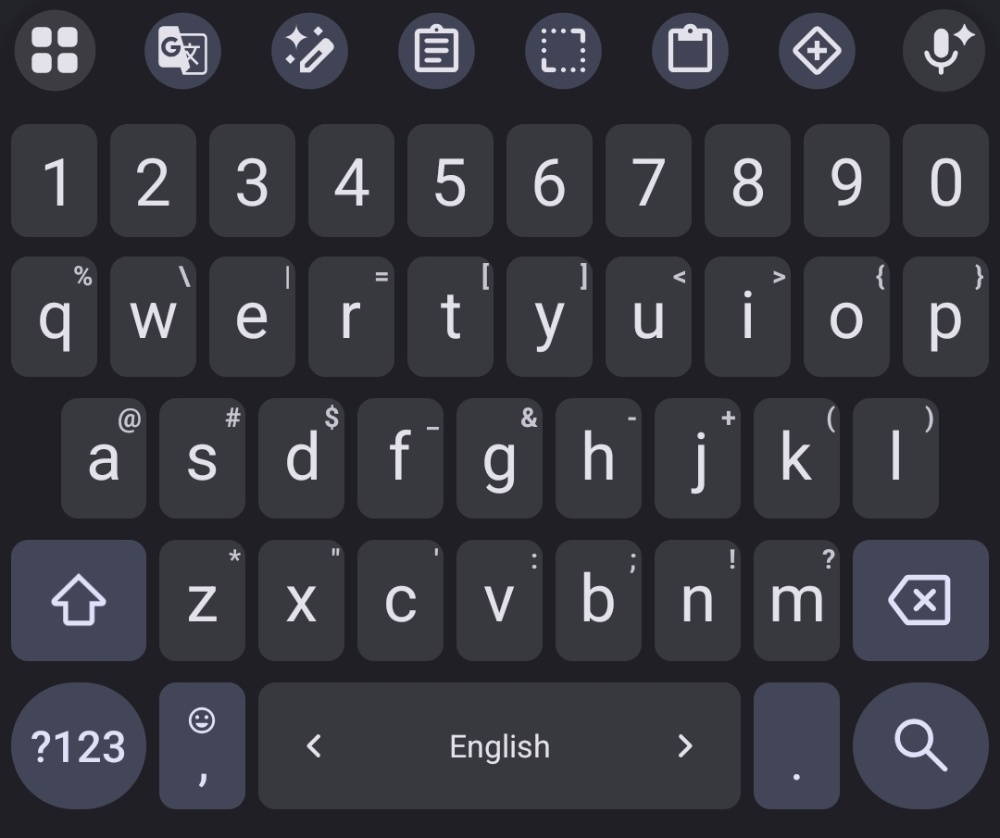
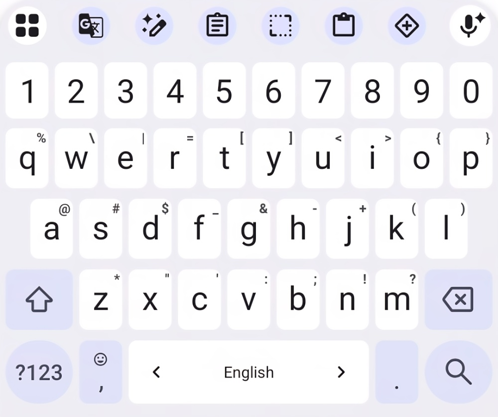
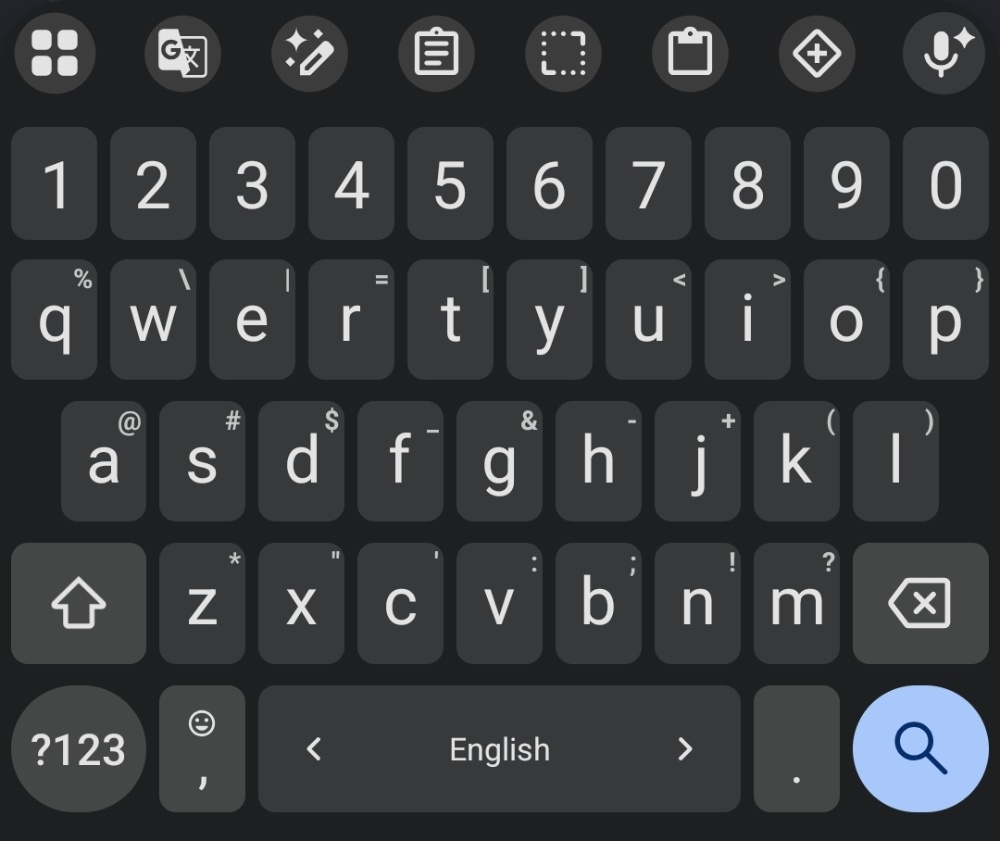
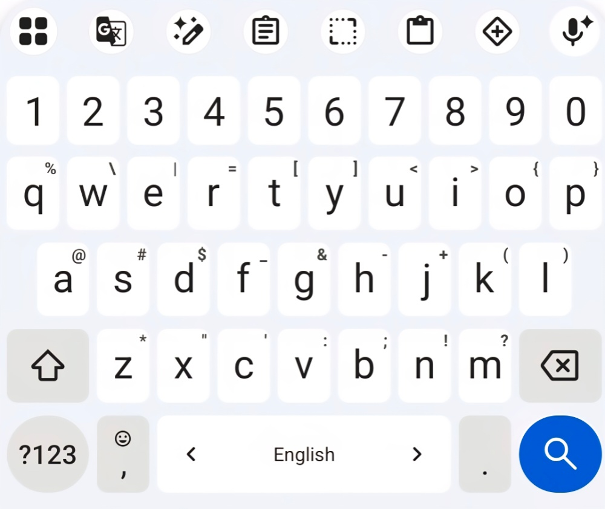
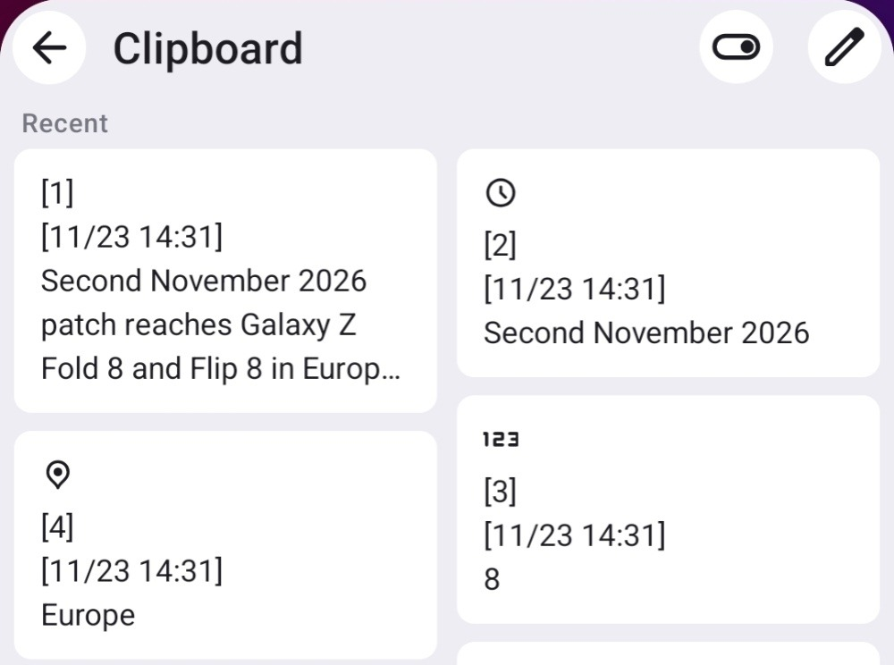

<div align="center">

<picture>
  <source media="(prefers-color-scheme: dark)" srcset="docs/assets/logo-dark.png">
  <source media="(prefers-color-scheme: light)" srcset="docs/assets/logo.png">
  
</picture>

# GboardSamsung

**The best of Google. The ergonomics of Samsung One UI.**

*A curated, no-root Morphe patch suite for Gboard — pairing Google's typing engine and predictions with Samsung-grade gestures, true AMOLED black, whole-block clipboard, and quality-of-life upgrades you won't find in stock Gboard.*

[English](README.md) · [Русский](README.ru.md)

[](https://morphe.software/add-source?github=vortexnode/GboardSamsung)

[](https://github.com/vortexnode/GboardSamsung/releases/latest)
[](https://github.com/vortexnode/GboardSamsung/releases)
[](https://github.com/vortexnode/GboardSamsung/actions/workflows/ci.yml)


[](LICENSE)

<br/>

[✨ Exclusives](#-exclusive-to-gboardsamsung) · [📸 Preview](#-preview) · [⚖️ Comparison](#%EF%B8%8F-gboardsamsung-vs-stock-gboard) · [⚡ Quick Install](#-quick-install-morphe-manager) · [🧩 Patch Catalog](#-active-patch-catalog-37-patches)

</div>

---

## ✨ Exclusive to GboardSamsung

Built as a focused downstream fork of [jasonwu1994/Gboard-patches](https://github.com/jasonwu1994/Gboard-patches), **GboardSamsung** strips out 13 unused/Taiwan-only patches and adds **11 exclusive upgrades** engineered for daily comfort on One UI and modern Android:

<table>
  <tr>
    <td valign="top" width="50%">
      <h4>🖤 AMOLED Black Theme <code>NEW</code></h4>
      Pure <code>#000000</code> keyboard, header, and bottom navigation bar with subtle charcoal keycaps (<code>#141414</code>) in Dark Mode — preserving vibrant <b>Material You</b> accents on action keys. Works seamlessly when Frosted Glass is off.
    </td>
    <td valign="top" width="50%">
      <h4>🔇 Disable Rambler Microphone Beep <code>NEW</code></h4>
      Completely silences the start/stop beep of the <b>Rambler</b> voice typing microphone regardless of system volume or ringer mode.
    </td>
  </tr>
  <tr>
    <td valign="top" width="50%">
      <h4>🗑️ One-Tap Clear Unpinned Clipboard <code>NEW</code></h4>
      Adds a native-styled trash button right in the Clipboard header that deletes all <b>unpinned</b> items in one tap while keeping every pinned item safe.
    </td>
    <td valign="top" width="50%">
      <h4>🚫 Disable Long-Press Enter → One-Handed <code>NEW</code></h4>
      Stops accidental one-handed mode triggers when holding the Enter key, while leaving normal Enter and the toolbar One-Handed button untouched.
    </td>
  </tr>
  <tr>
    <td valign="top" width="50%">
      <h4>⌨️ Samsung Spacebar Gestures &amp; 2D Cursor</h4>
      Swipe spacebar to switch languages in <b>3 selectable modes</b> (Samsung One UI fixed cycle <code>1→2→3→4</code>, Gboard MRU, or Free direction with 5s rollback), long-press for hybrid <b>2D cursor control</b> (left/right/up/down), plus optional <code>&lt; Language &gt;</code> chevrons.
    </td>
    <td valign="top" width="50%">
      <h4>⚪ Toolbar Round Chips</h4>
      Adaptive circular backgrounds behind 3–8 top toolbar icons while keeping Google's original icons: matches Material You in Dynamic Color and crisp white/dark in standard themes. Includes an independent toggle for a fixed <code>38dp</code> circle behind <code>⊞</code>.
    </td>
  </tr>
  <tr>
    <td valign="top" width="50%">
      <h4>📋 Samsung Clipboard (Whole-Block Mode)</h4>
      Saves copied text as one clean block like Samsung Keyboard — stopping Gboard from fragmenting a single copy into separate cards for URLs, phone numbers, dates, and addresses.
    </td>
    <td valign="top" width="50%">
      <h4>🔵 New Settings Highlight</h4>
      Morphe-style teal indicator dot (<code>•</code>) highlights newly added options and their parent groups for 0–10 days (default 7) until opened or cleared in one tap.
    </td>
  </tr>
  <tr>
    <td valign="top" width="50%">
      <h4>🛡️ APKM-First &amp; Play Store Update Blocker</h4>
      Prioritizes the <code>18.5.4</code> <b>APKM Bundle</b> so <b>Advanced Voice Typing</b> (<code>libdictation_jni.so</code>) works out of the box, plus an optional <b>Disable Play Store updates</b> patch (<code>versionCode 2147483647</code>) and side-by-side <b>Package Rename</b>.
    </td>
    <td valign="top" width="50%">
      <h4>🌐 Complete RU / EN UI &amp; Adaptive Icon</h4>
      Full Russian &amp; English localization across the Patches entry, all feature screens, hidden Developer options, search index, and Morphe release notes — paired with a One UI squircle-fitted Light/Dark app icon.
    </td>
  </tr>
</table>

---

## 📸 Preview

<table>
  <tr>
    <td align="center" valign="top" width="50%">
      <br/>
      <sub><b>AMOLED Black Theme</b> — pure <code>#000000</code> background extending seamlessly to the bottom navigation bar + charcoal keys &amp; Material You accents</sub>
    </td>
    <td align="center" valign="top" width="50%">
      <br/>
      <sub><b>Clear Unpinned Clipboard Button</b> — native trash icon in the Clipboard header deletes all unpinned items in one tap while keeping pinned items</sub>
    </td>
  </tr>
  <tr>
    <td align="center" valign="top" width="50%">
      <br/>
      <sub><b>Material You Dark</b> — dynamic toolbar chips + fixed ⊞ &amp; mic</sub>
    </td>
    <td align="center" valign="top" width="50%">
      <br/>
      <sub><b>Material You Light</b> — dynamic pastel chips + white ⊞ &amp; mic</sub>
    </td>
  </tr>
  <tr>
    <td align="center" valign="top" width="50%">
      <br/>
      <sub><b>System Dark</b> — neutral dark chips matching the mic button</sub>
    </td>
    <td align="center" valign="top" width="50%">
      <br/>
      <sub><b>System Light</b> — crisp white chips matching the mic button</sub>
    </td>
  </tr>
</table>

### Samsung Clipboard vs. Stock Gboard

<table>
  <tr>
    <td align="center" valign="top" width="50%">
      <br/>
      <sub><b>Samsung Clipboard</b> — keeps the same copied text as one clean whole block</sub>
    </td>
    <td align="center" valign="top" width="50%">
      <br/>
      <sub><b>Stock Gboard</b> — splits one copied text into 4 separate cards (full text, date, number, location)</sub>
    </td>
  </tr>
</table>

---

## ⚖️ GboardSamsung vs. Stock Gboard

| Capability | **GboardSamsung** | Stock Gboard |
| :--- | :---: | :---: |
| **Samsung Spacebar Swipe (3 modes) + 2D Cursor** | ✅ | ❌ |
| **AMOLED Pure `#000000` Theme (incl. Nav Bar & Material You accents)** | ✅ | ❌ |
| **Disable Rambler Microphone Start/Stop Beep** | ✅ | ❌ |
| **One-Tap Clear All Unpinned Clipboard Button** | ✅ | ❌ |
| **Disable Long-Press Enter → One-Handed Mode** | ✅ | ❌ |
| **Samsung Whole-Block Clipboard Mode** | ✅ | ❌ |
| **Adaptive Toolbar Round Chips + `⊞` Circle** | ✅ | ❌ |
| **Morphe-Style New Settings Highlight Dot** | ✅ | ❌ |
| **Disable Play Store Updates Patch** | ✅ | ❌ |
| **Full Russian + English Patches & Dev UI** | ✅ | ❌ |
| **APKM-First Auto-Selection for Advanced Voice** | ✅ | ⚠️ |
| **Curated Power Features (AI, Frosted Glass, Calculator, Custom Themes, etc.)** | ✅ *(33 curated)* | ❌ |

---

## ⚡ Quick Install (Morphe Manager)

1. **[Tap here to add GboardSamsung to Morphe in 1 tap](https://morphe.software/add-source?github=vortexnode/GboardSamsung)** — or open [Morphe Manager](https://github.com/MorpheApp/morphe-manager) → **Sources** → **Add source** and paste:
   ```text
   https://github.com/vortexnode/GboardSamsung
   ```
2. Select the recommended stock **Gboard `18.5.4` APKM Bundle** (`arm64-v8a` — prioritized automatically by Morphe Manager & Helper so **Advanced Voice Typing** / `libdictation_jni.so` works out of the box; standalone `.apk` also works).
3. Pick your desired patches (keep **Package Rename** enabled to install alongside stock Gboard) and tap **Patch**.
4. Install the patched APK and enable **GboardSamsung** in Android **Settings → System → Keyboard**.

> [!TIP]
> **Updating to a new release?** Install the newly patched APK **as an update over your existing app** instead of uninstalling first — your learned dictionary, slang, and personal preferences stay completely intact.

> [!NOTE]
> **Compatibility:** Tested on **Gboard `18.5.4` APKM Bundle (`arm64-v8a`)** on Samsung Galaxy S22 / Android 16 / One UI 8. **No root required.** New releases automatically publish `.mpp` bundles and update `patches-bundle.json` for Morphe Manager.

---

## 🧩 Active Patch Catalog (37 patches)

**4 GboardSamsung-exclusive patches** + **33 curated upstream patches** (enhanced with our exclusive options). Expand any category below:

<details>
<summary><b>✨ Samsung One UI Experience (3 exclusive patches)</b></summary>

- **Custom App Icon** — Adaptive Light/Dark GboardSamsung launcher icon fitted inside One UI's squircle safe zone.
- **Samsung Spacebar Gestures** — Swipe spacebar to switch languages with 3 selectable modes (Samsung One UI fixed order, Gboard recent-first, Free direction), long-press for **2D cursor control** (left/right/up/down), and optional `< Language >` chevrons.
- **Toolbar Round Chips** — Adaptive circular backgrounds for 3–8 toolbar icons (Dynamic Material You & standard themes) + separate toggle for the `⊞` menu button.

</details>

<details>
<summary><b>🎨 Themes, Appearance &amp; Layout (12 patches)</b></summary>

- **Access Points menu style** — Switch between new and legacy Access Points menu styles.
- **Change emoji size** — Adjust emoji size on the keyboard.
- **Custom Theme** — Import custom ZIP themes and themes from the Rboard repository.
- **Emojis, stickers &amp; GIFs Tab Order** — Reorder bottom tabs with drag-and-drop.
- **Enable split keyboard** — Enable split keyboard layout.
- **Frosted Glass** — Live background blur, custom-theme opacity, seamless nav bar, and **AMOLED black theme** (`#000000` background extending to the bottom navigation bar + `#141414` keys preserving Material You accents in Dark Mode).
- **Key Shape Selection** — Enable Key shape options (including rounded/rectangular keys) in Theme details.
- **Keypress Vibration Intensity Control** — Control vibration intensity instead of duration.
- **Rounded Keyboard Panel** — Customize rounded corners and radii of the keyboard panel.
- **Settings Homepage Override** — Switch between new and legacy Gboard settings pages.
- **Top Toolbar Item Count** — Customize the number of top toolbar Access Points (3–8).
- **Swipe Down to Dismiss Keyboard** — Swipe down from suggestions or toolbar to close the keyboard.

</details>

<details>
<summary><b>⌨️ Typing, Editing &amp; Keyboard Tools (9 patches)</b></summary>

- **Clipboard Custom Character Limit** — Customize max character count per clipboard item.
- **Clipboard Enhancements** — Includes **Samsung Clipboard** (whole-block copy mode without entity splitting), **Clear unpinned clipboard button** (one-tap trash icon in Clipboard header preserving pinned items), plus extended retention time, item limit, preview lines, and timestamps.
- **Close Proactive Suggestions** — Show a dismiss button in proactive suggestions.
- **Custom Symbols** — Dedicated custom symbols tab via long-press comma.
- **Floating Web Search** — Open a floating web page directly from Gboard.
- **Long-Press Editing Shortcuts** — Long-press Select All, Undo, Copy, Cut, Paste, Redo shortcuts, plus **Disable long-press Enter one-handed mode**.
- **Quick Insert** — Enable the Quick Insert panel and toolbar access point.
- **Simple Calculator** — Evaluate typed math expressions directly in the suggestion strip.
- **Toolbar Editing Buttons** — Add Select All, Copy, Cut, and Paste actions to the toolbar menu.

</details>

<details>
<summary><b>🎙️ Language, AI, Suggestions &amp; Voice (7 patches)</b></summary>

- **AI Writing Tools** — Enable AI writing tools across all languages.
- **Advanced Voice Typing** — Enable Advanced Voice Typing with auto-punctuation and **Disable Rambler microphone beep** (silences the Rambler voice start/stop beep regardless of volume).
- **Dictionaries &amp; Predictions** — Choose resource versions (including Pixel Delight catalogs) and inspect loaded models.
- **Enable Inline Autofill Suggestions** — Enable inline autofill suggestions.
- **Grammar Checker** — Enable Text correction → Grammar check.
- **Inline Suggestions** — Enable Text correction → Smart Compose.
- **`Use Bluetooth Microphone`** — Enable Voice typing → Use Bluetooth microphone.

</details>

<details>
<summary><b>🛡️ Packaging, Security &amp; Utilities (6 patches)</b></summary>

- **Add Gboard Signature Bypass** — Bypass Gboard signature whitelist checks.
- **Backup &amp; Restore** — Export/restore Patches settings and Gboard user data.
- **Developer options** — Unlock localized RU/EN Developer options and Flag Editor.
- **Disable Play Store updates** — Optional patch (`default: off`) that sets max `versionCode` (`2147483647`) to block Play Store updates when using the official or custom package name.
- **Incognito Mode Toggle** — Toolbar Incognito toggle with clipboard privacy controls.
- **Package Rename** — Custom Android package name (default: `gboardsamsung.com.google.android.inputmethod.latin`).

</details>

<details>
<summary><b>🧹 Excluded Upstream Patches (13 removed from upstream)</b></summary>

To keep the project focused, clean, and free of unused dependencies or conflicting gestures, the following 13 upstream patches from `jasonwu1994/Gboard-patches` are intentionally **not included**:

1. `Enable OCR / Scan Text`
2. `Enable accessibility layout`
3. `Enable cursor trackpad mode` *(replaced by Samsung Spacebar Gestures)*
4. `English QWERTY Up-Flick Uppercase`
5. `FTP Server`
6. `G Logo on Spacebar`
7. `Latin Globe Key Ignore Interval`
8. `Shift + Backspace Forward Delete`
9. `Swipeable Custom Top Row`
10. `Web Clipboard`
11. `Zhuyin Bottom Row Key Sizes` *(Taiwan-specific)*
12. `Zhuyin Quick Traditional/Simplified Toggle` *(Taiwan-specific)*
13. `Zhuyin Slide Input` *(Taiwan-specific)*

</details>

---

## 🛠️ Build & Verification

```bash
./gradlew :patches:test :extensions:extension:testDebugUnitTest :extensions:calculator:testDebugUnitTest
```

## 📜 Provenance & License

- **Upstream:** Based on [jasonwu1994/Gboard-patches](https://github.com/jasonwu1994/Gboard-patches) by Jason Wu (`jasonwu1994`).
- **Downstream maintainer:** [vortexnode](https://github.com/vortexnode).
- **License:** [GNU General Public License v3.0](LICENSE) (see also [NOTICE](NOTICE)).
