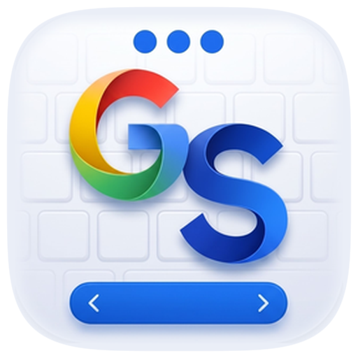
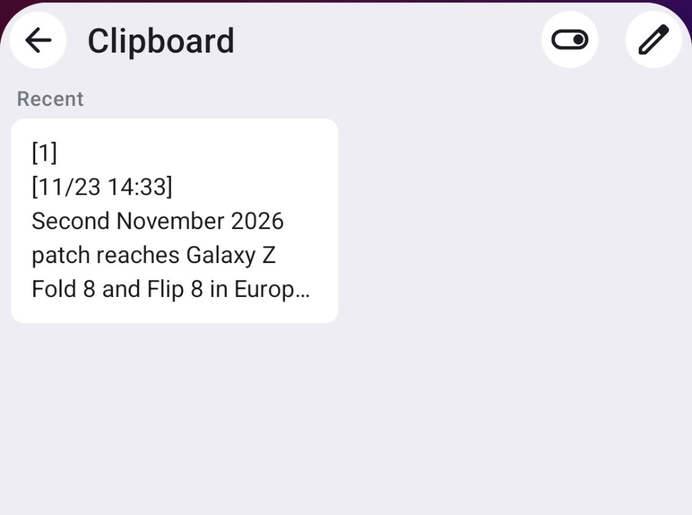

<div align="center">

<picture>
  <source media="(prefers-color-scheme: dark)" srcset="docs/assets/logo-dark.png">
  <source media="(prefers-color-scheme: light)" srcset="docs/assets/logo.png">
  
</picture>

# GboardSamsung

**The best of Google. The feel of Samsung.**

Morphe patches that bring Samsung One UI ergonomics and polish to Gboard — without giving up Google's typing engine, predictions, or original icons.

[English](README.md) · [Русский](README.ru.md)

[](https://morphe.software/add-source?github=vortexnode/GboardSamsung)

[](https://github.com/vortexnode/GboardSamsung/releases/latest)
[](https://github.com/vortexnode/GboardSamsung/releases)
[](https://github.com/vortexnode/GboardSamsung/actions/workflows/ci.yml)


[](LICENSE)

</div>

## Preview

<table>
  <tr>
    <td align="center" valign="top" width="50%">
      <br/>
      <sub><b>Material You Dark</b> — dynamic toolbar chips + fixed ⊞ &amp; mic</sub>
    </td>
    <td align="center" valign="top" width="50%">
      <br/>
      <sub><b>Material You Light</b> — dynamic pastel chips + white ⊞ &amp; mic</sub>
    </td>
  </tr>
  <tr>
    <td align="center" valign="top" width="50%">
      <br/>
      <sub><b>System Dark</b> — neutral dark chips matching the mic button</sub>
    </td>
    <td align="center" valign="top" width="50%">
      <br/>
      <sub><b>System Light</b> — crisp white chips matching the mic button</sub>
    </td>
  </tr>
</table>

### Samsung Clipboard vs. Stock Gboard

<table>
  <tr>
    <td align="center" valign="top" width="50%">
      <br/>
      <sub><b>Stock Gboard</b> — splits one copied text into 4 separate cards (full text, date, number, location)</sub>
    </td>
    <td align="center" valign="top" width="50%">
      <br/>
      <sub><b>Samsung Clipboard</b> — keeps the same copied text as one clean whole block</sub>
    </td>
  </tr>
</table>

## What makes GboardSamsung different

Built as a focused downstream fork of [jasonwu1994/Gboard-patches](https://github.com/jasonwu1994/Gboard-patches), GboardSamsung adds dedicated Samsung One UI UX upgrades and strips out unused Taiwan/legacy patches:

| Feature | What it does |
| --- | --- |
| **Samsung Spacebar Gestures** | Swipe left/right on the spacebar to switch languages with 3 mutually exclusive modes (**Samsung One UI** fixed cycle `1→2→3→4`, **Gboard** recent-first MRU, and **Free direction** with 5-second rollback memory — each with visual preview diagrams), long-press for cursor control, and optional `< Русский >` / `< English >` chevrons via passive `ViewOverlay`. |
| **Toolbar Round Chips** | Adaptive circular backgrounds behind 3–8 top toolbar icons (preserving original Google icons): matches Material You functional keys in Dynamic Color, and crisp white/neutral dark in standard themes. Includes an independent toggle for a fixed `38dp` Rambler-style circle behind the `⊞` menu button (preserving the native circle when expanded to `✕`). |
| **Samsung Clipboard** | Optional toggle inside **Clipboard → General** that saves copied text as one single whole block like Samsung Keyboard — preventing Gboard from splitting copied text into separate URL, phone, email, and address cards while keeping images, pinning, retention, and all other clipboard features intact. |
| **Custom App Icon** | Adaptive Light/Dark GboardSamsung launcher icon fitted cleanly inside One UI's squircle safe zone. |
| **Full RU / EN Patches UI** | Complete Russian and English localization for the in-app Patches settings, search index, and Morphe Manager release notes. |
| **Side-by-side Package Rename** | Installs cleanly alongside stock Gboard (`gboardsamsung.com.google.android.inputmethod.latin`) without root. |

## Quick Install (Morphe Manager)

1. **[Tap here to add GboardSamsung to Morphe in one tap](https://morphe.software/add-source?github=vortexnode/GboardSamsung)** — or open [Morphe Manager](https://github.com/MorpheApp/morphe-manager) → **Sources** → **Add source** and paste:
   ```text
   https://github.com/vortexnode/GboardSamsung
   ```
2. Select a compatible stock **Gboard `18.5.4`** APK (`arm64-v8a` recommended).
3. Choose the patches you want (enable **Package Rename** if you want to keep stock Gboard installed) and tap **Patch**.
4. Install the patched APK and enable **GboardSamsung** in Android **Settings → System → Keyboard**.

> **Tip:** To keep your learned dictionary and personal predictions intact, install new builds **as an update over the existing app** instead of uninstalling first.

## Compatibility

- **Recommended target:** Gboard `18.5.4` (`arm64-v8a`, tested on Samsung Galaxy S22 / Android 16 / One UI).
- **Root:** Not required.
- **Updates:** New releases automatically publish `.mpp` bundles and update `patches-bundle.json` for Morphe Manager.

## Active Patch Catalog (36 patches)

**3 GboardSamsung-exclusive patches** + **33 curated upstream patches**. Expand any category below:

<details>
<summary><b>Samsung One UI Experience (3 exclusive patches)</b></summary>

- **Custom App Icon** — Adaptive Light/Dark GboardSamsung launcher icon.
- **Samsung Spacebar Gestures** — Swipe spacebar to switch languages with 3 selectable modes (Samsung One UI fixed order, Gboard recent-first, Free direction), long-press for cursor control, and optional `< Language >` chevrons.
- **Toolbar Round Chips** — Adaptive circular backgrounds for 3–8 toolbar icons (Dynamic Material You & standard themes) + separate toggle for the `⊞` menu button.

</details>

<details>
<summary><b>Themes, Appearance &amp; Layout (12 patches)</b></summary>

- **Access Points menu style** — Switch between new and legacy Access Points menu styles.
- **Change emoji size** — Adjust emoji size on the keyboard.
- **Custom Theme** — Import custom ZIP themes and themes from the Rboard repository.
- **Emojis, stickers &amp; GIFs Tab Order** — Reorder bottom tabs with drag-and-drop.
- **Enable split keyboard** — Enable split keyboard layout.
- **Frosted Glass** — Live background blur and custom-theme opacity.
- **Key Shape Selection** — Enable Key shape options (including rounded/rectangular keys) in Theme details.
- **Keypress Vibration Intensity Control** — Control vibration intensity instead of duration.
- **Rounded Keyboard Panel** — Customize rounded corners and radii of the keyboard panel.
- **Settings Homepage Override** — Switch between new and legacy Gboard settings pages.
- **Top Toolbar Item Count** — Customize the number of top toolbar Access Points (3–8).
- **Swipe Down to Dismiss Keyboard** — Swipe down from suggestions or toolbar to close the keyboard.

</details>

<details>
<summary><b>Typing, Editing &amp; Keyboard Tools (9 patches)</b></summary>

- **Clipboard Custom Character Limit** — Customize max character count per clipboard item.
- **Clipboard Enhancements** — Includes **Samsung Clipboard** (whole-block copy mode without entity splitting), plus extended retention time, item limit, preview lines, and timestamps.
- **Close Proactive Suggestions** — Show a dismiss button in proactive suggestions.
- **Custom Symbols** — Dedicated custom symbols tab via long-press comma.
- **Floating Web Search** — Open a floating web page directly from Gboard.
- **Long-Press Editing Shortcuts** — Long-press Select All, Undo, Copy, Cut, Paste, and Redo shortcuts.
- **Quick Insert** — Enable the Quick Insert panel and toolbar access point.
- **Simple Calculator** — Evaluate typed math expressions directly in the suggestion strip.
- **Toolbar Editing Buttons** — Add Select All, Copy, Cut, and Paste actions to the toolbar menu.

</details>

<details>
<summary><b>Language, AI, Suggestions &amp; Voice (7 patches)</b></summary>

- **AI Writing Tools** — Enable AI writing tools across all languages.
- **Advanced Voice Typing** — Enable Advanced Voice Typing with auto-punctuation.
- **Dictionaries &amp; Predictions** — Choose resource versions (including Pixel Delight catalogs) and inspect loaded models.
- **Enable Inline Autofill Suggestions** — Enable inline autofill suggestions.
- **Grammar Checker** — Enable Text correction → Grammar check.
- **Inline Suggestions** — Enable Text correction → Smart Compose.
- **`Use Bluetooth Microphone`** — Enable Voice typing → Use Bluetooth microphone.

</details>

<details>
<summary><b>Packaging, Security &amp; Utilities (5 patches)</b></summary>

- **Add Gboard Signature Bypass** — Bypass Gboard signature whitelist checks.
- **Backup &amp; Restore** — Export/restore Patches settings and Gboard user data.
- **Developer options** — Unlock Developer options and Flag Editor.
- **Incognito Mode Toggle** — Toolbar Incognito toggle with clipboard privacy controls.
- **Package Rename** — Custom Android package name (default: `gboardsamsung.com.google.android.inputmethod.latin`).

</details>

<details>
<summary><b>Excluded Upstream Patches (13 removed from upstream)</b></summary>

To keep the project focused, clean, and free of unused dependencies or conflicting gestures, the following 13 upstream patches from `jasonwu1994/Gboard-patches` are intentionally **not included**:

1. `Enable OCR / Scan Text`
2. `Enable accessibility layout`
3. `Enable cursor trackpad mode` *(replaced by Samsung Spacebar Gestures)*
4. `English QWERTY Up-Flick Uppercase`
5. `FTP Server`
6. `G Logo on Spacebar`
7. `Latin Globe Key Ignore Interval`
8. `Shift + Backspace Forward Delete`
9. `Swipeable Custom Top Row`
10. `Web Clipboard`
11. `Zhuyin Bottom Row Key Sizes` *(Taiwan-specific)*
12. `Zhuyin Quick Traditional/Simplified Toggle` *(Taiwan-specific)*
13. `Zhuyin Slide Input` *(Taiwan-specific)*

</details>

## Build & Verification

```bash
./gradlew :patches:test :extensions:extension:testDebugUnitTest :extensions:calculator:testDebugUnitTest
```

## Provenance & License

- **Upstream:** Based on [jasonwu1994/Gboard-patches](https://github.com/jasonwu1994/Gboard-patches) by Jason Wu (`jasonwu1994`).
- **Downstream maintainer:** [vortexnode](https://github.com/vortexnode).
- **License:** [GNU General Public License v3.0](LICENSE) (see also [NOTICE](NOTICE)).
