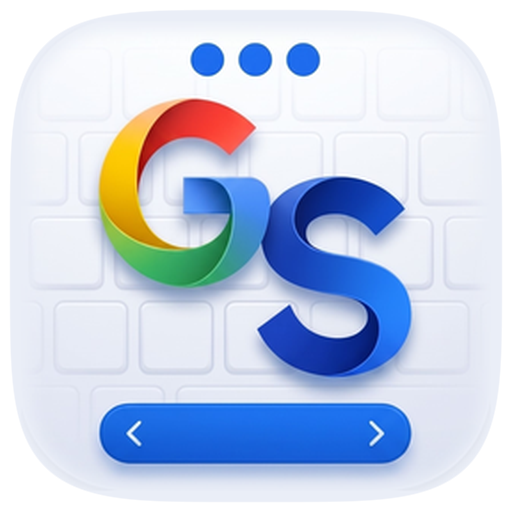
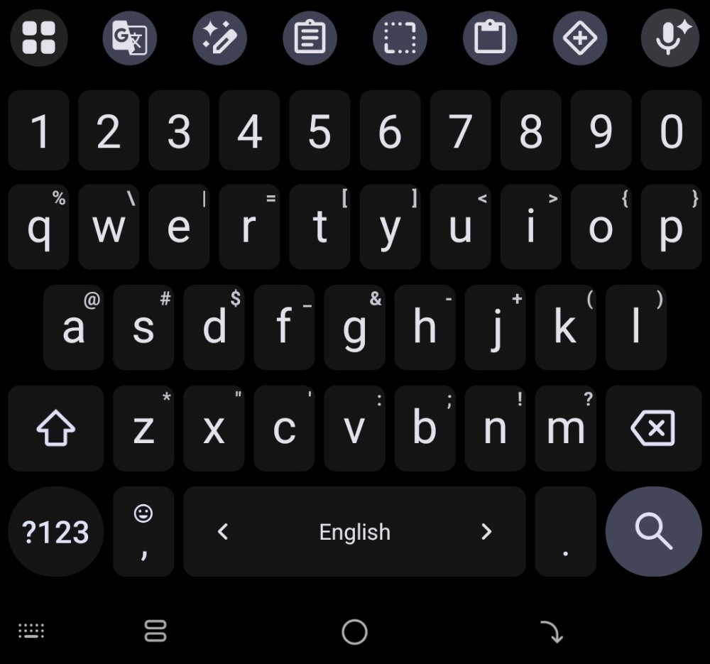
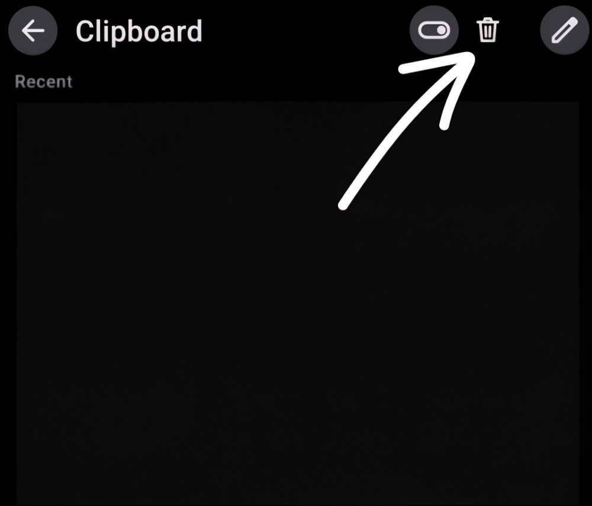
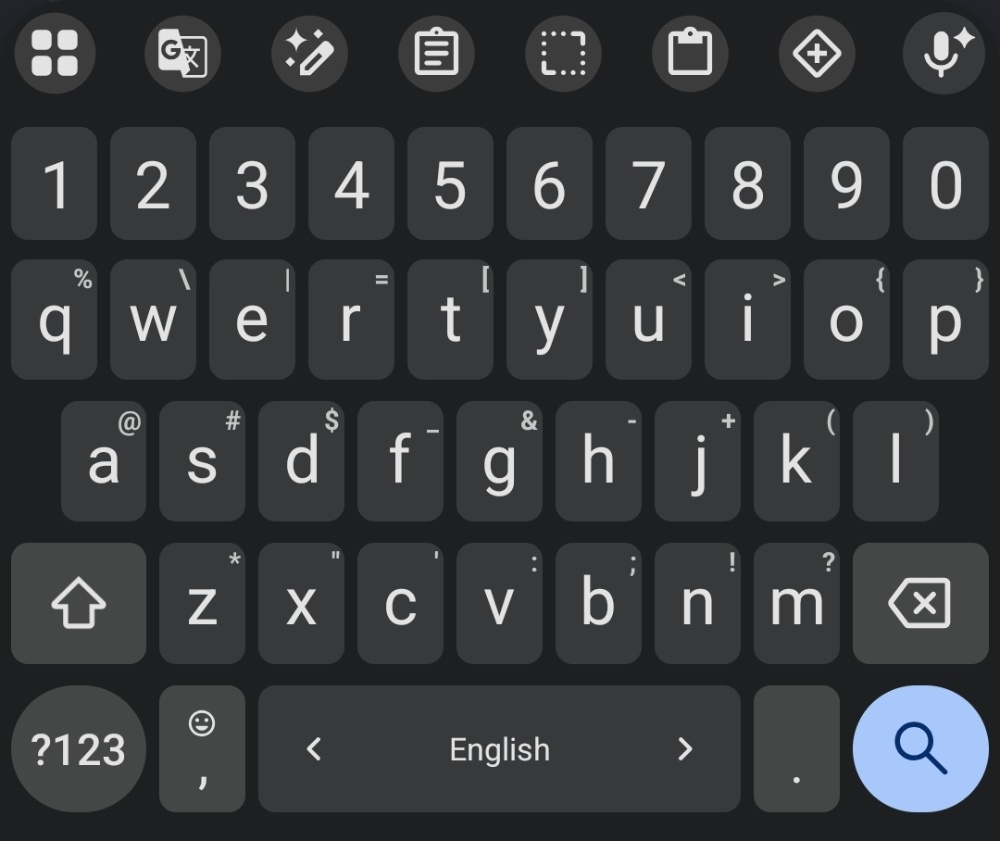
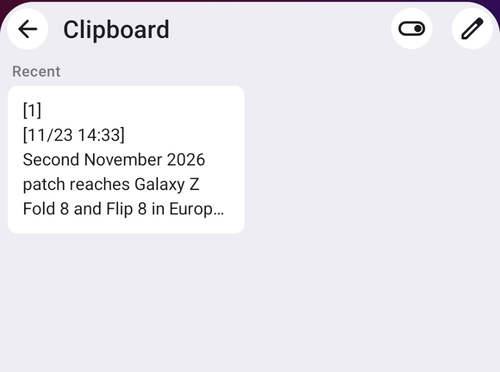
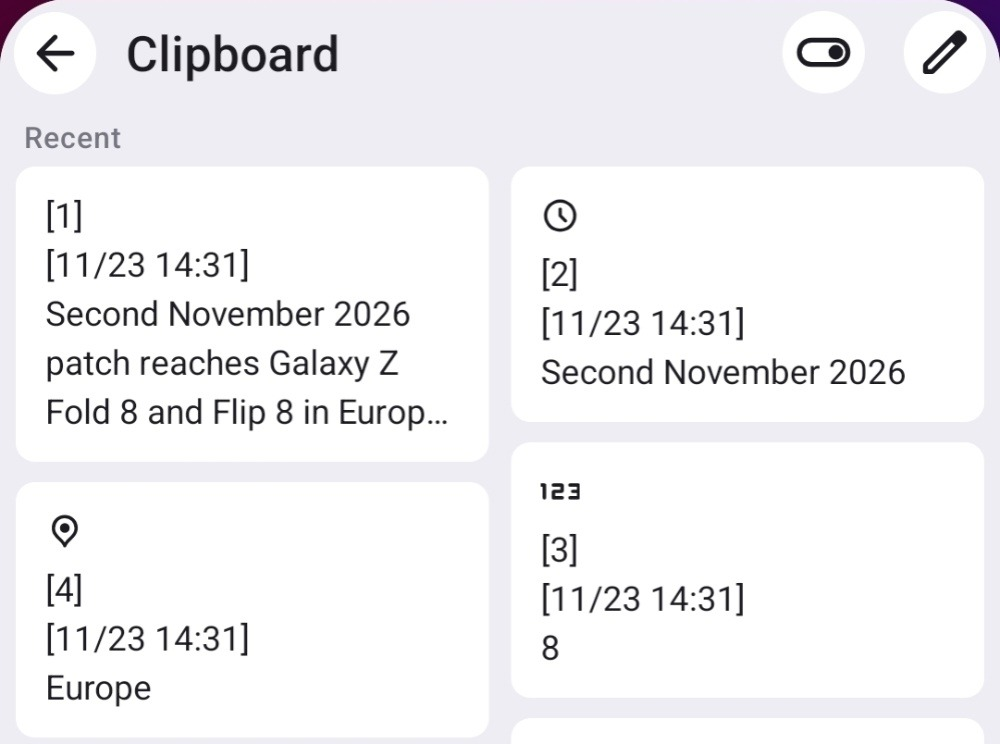

<div align="center">

<picture>
  <source media="(prefers-color-scheme: dark)" srcset="docs/assets/logo-dark.png">
  <source media="(prefers-color-scheme: light)" srcset="docs/assets/logo.png">
  
</picture>

# GboardSamsung

**Лучшее от Google. Эргономика и комфорт Samsung One UI.**

*Сфокусированный набор Morphe-патчей для Gboard без root-прав — объединяет движок ввода и подсказки Google с жестами в стиле Samsung, чистым AMOLED-чёрным фоном, цельным буфером обмена и доработками, которых нет в стоковом Gboard.*

[English](README.md) · [Русский](README.ru.md)

[](https://morphe.software/add-source?github=vortexnode/GboardSamsung)

[](https://github.com/vortexnode/GboardSamsung/releases/latest)
[](https://github.com/vortexnode/GboardSamsung/releases)
[](https://github.com/vortexnode/GboardSamsung/actions/workflows/ci.yml)


[](LICENSE)

<br/>

[✨ Эксклюзивы](#-эксклюзивы-gboardsamsung) · [📸 Внешний вид](#-внешний-вид) · [⚖️ Сравнение](#%EF%B8%8F-gboardsamsung-vs-стоковый-gboard) · [⚡ Установка](#-быстрая-установка-через-morphe-manager) · [🧩 Каталог патчей](#-каталог-активных-патчей-37)

</div>

---

## ✨ Эксклюзивы GboardSamsung

Создан на базе [jasonwu1994/Gboard-patches](https://github.com/jasonwu1994/Gboard-patches), очищен от 13 лишних/тайваньских патчей и дополнен **11 собственными эксклюзивными возможностями**, продуманными для ежедневного комфорта на One UI и современном Android:

<table>
  <tr>
    <td valign="top" width="50%">
      <h4>🖤 AMOLED-чёрная тема <code>NEW</code></h4>
      Чистый чёрный фон <code>#000000</code> для клавиатуры, шапки и нижней панели навигации плюс графитовые клавиши (<code>#141414</code>) в тёмной теме — с полным сохранением акцентов <b>Material You</b>. Не конфликтует с матовым стеклом.
    </td>
    <td valign="top" width="50%">
      <h4>🔇 Отключение звука микрофона Rambler <code>NEW</code></h4>
      Полностью убирает раздражающий звуковой сигнал начала и окончания голосового ввода микрофона <b>Rambler</b> независимо от громкости и режима звука телефона.
    </td>
  </tr>
  <tr>
    <td valign="top" width="50%">
      <h4>🗑️ Очистка буфера обмена в 1 тап <code>NEW</code></h4>
      Аккуратная кнопка корзины прямо в шапке буфера обмена: удаляет все <b>незакреплённые</b> записи одним нажатием, бережно сохраняя все закреплённые.
    </td>
    <td valign="top" width="50%">
      <h4>🚫 Блокировка удержания Enter → одной рукой <code>NEW</code></h4>
      Убирает случайное включение режима одной руки при долгом нажатии Enter — сам Enter и кнопка режима одной руки в тулбаре работают как обычно.
    </td>
  </tr>
  <tr>
    <td valign="top" width="50%">
      <h4>⌨️ Жесты пробела Samsung и 2D-курсор</h4>
      Свайп по пробелу в <b>3 режимах</b> (Samsung One UI цикл <code>1→2→3→4</code>, Gboard недавние, Свободный с памятью 5 сек), долгое нажатие для гибридного <b>2D-курсора</b> (влево/вправо/вверх/вниз) и отключаемые шевроны <code>&lt; Русский &gt;</code>.
    </td>
    <td valign="top" width="50%">
      <h4>⚪ Круглые подложки тулбара</h4>
      Адаптивные круглые подложки под 3–8 иконками верхнего тулбара с сохранением оригинальных иконок Google: цветные в Material You и белые/тёмные в системных темах. Отдельный тумблер для круга <code>38dp</code> под кнопкой <code>⊞</code>.
    </td>
  </tr>
  <tr>
    <td valign="top" width="50%">
      <h4>📋 Буфер обмена Samsung (цельный блок)</h4>
      Сохраняет скопированный текст единой карточкой, как в клавиатуре Samsung — без раздражающей разбивки на отдельные блоки для ссылок, телефонов, дат и адресов.
    </td>
    <td valign="top" width="50%">
      <h4>🔵 Подсветка новых настроек</h4>
      Бирюзовая точка (<code>•</code>) в стиле Morphe отмечает новые пункты и их разделы в течение 0–10 дней (по умолчанию 7), пока вы их не откроете или не сбросите одним нажатием.
    </td>
  </tr>
  <tr>
    <td valign="top" width="50%">
      <h4>🛡️ Приоритет APKM и защита от Play Store</h4>
      Автоматически выбирает <b>APKM Bundle</b> <code>18.5.4</code> для работы <b>Расширенного голосового ввода</b> (<code>libdictation_jni.so</code>) из коробки, плюс опциональный патч <b>Disable Play Store updates</b> и отдельный пакет <b>Package Rename</b>.
    </td>
    <td valign="top" width="50%">
      <h4>🌐 Полная локализация RU / EN и иконка One UI</h4>
      Русский и английский интерфейс всех разделов «Патчи», скрытых параметров разработчика, встроенного поиска и релизов в Morphe Manager + адаптивная светлая/тёмная иконка под One UI.
    </td>
  </tr>
</table>

---

## 📸 Внешний вид

<table>
  <tr>
    <td align="center" valign="top" width="50%">
      <br/>
      <sub><b>AMOLED-чёрная тема</b> — чистый фон <code>#000000</code>, при включении распространяется также на нижнюю панель навигации + графитовые клавиши и акценты Material You</sub>
    </td>
    <td align="center" valign="top" width="50%">
      <br/>
      <sub><b>Кнопка очистки буфера обмена</b> — иконка корзины в шапке удаляет все незакреплённые записи в 1 тап, сохраняя закреплённые</sub>
    </td>
  </tr>
  <tr>
    <td align="center" valign="top" width="50%">
      <br/>
      <sub><b>Динамическая тёмная</b> — цветные круги тулбара + фиксированные ⊞ и микрофон</sub>
    </td>
    <td align="center" valign="top" width="50%">
      <br/>
      <sub><b>Динамическая светлая</b> — пастельные круги + белые ⊞ и микрофон</sub>
    </td>
  </tr>
  <tr>
    <td align="center" valign="top" width="50%">
      <br/>
      <sub><b>Системная тёмная</b> — нейтральные тёмные подложки в стиль микрофона</sub>
    </td>
    <td align="center" valign="top" width="50%">
      <br/>
      <sub><b>Системная светлая</b> — чистые белые подложки в стиль микрофона</sub>
    </td>
  </tr>
</table>

### Буфер обмена Samsung vs. стандартный Gboard

<table>
  <tr>
    <td align="center" valign="top" width="50%">
      <br/>
      <sub><b>Буфер обмена Samsung</b> — сохраняет скопированный текст одним цельным блоком</sub>
    </td>
    <td align="center" valign="top" width="50%">
      <br/>
      <sub><b>Стандартный Gboard</b> — дробит тот же текст на 4 отдельные карточки (текст, дата, число, место)</sub>
    </td>
  </tr>
</table>

---

## ⚖️ GboardSamsung vs. стоковый Gboard

| Возможность | **GboardSamsung** | Стоковый Gboard |
| :--- | :---: | :---: |
| **Жесты пробела Samsung (3 режима) + 2D-курсор** | ✅ | ❌ |
| **AMOLED-чёрная тема `#000000` (включая панель навигации и акценты Material You)** | ✅ | ❌ |
| **Отключение звука микрофона Rambler (сигнал старта/стопа)** | ✅ | ❌ |
| **Кнопка очистки незакреплённых записей в буфере обмена** | ✅ | ❌ |
| **Отключение режима одной руки по удержанию Enter** | ✅ | ❌ |
| **Буфер обмена Samsung (цельным блоком)** | ✅ | ❌ |
| **Адаптивные круглые подложки тулбара + круг `⊞`** | ✅ | ❌ |
| **Подсветка новых настроек в стиле Morphe** | ✅ | ❌ |
| **Патч блокировки обновлений Google Play Store** | ✅ | ❌ |
| **Полная локализация RU / EN (включая Dev Options)** | ✅ | ❌ |
| **Приоритет APKM для Расширенного голосового ввода** | ✅ | ⚠️ |
| **Отобранные мощные фичи (ИИ, матовое стекло, калькулятор, темы и др.)** | ✅ *(33 патча)* | ❌ |

---

## ⚡ Быстрая установка через Morphe Manager

1. **[Нажмите здесь, чтобы добавить GboardSamsung в Morphe в 1 тап](https://morphe.software/add-source?github=vortexnode/GboardSamsung)** — или откройте [Morphe Manager](https://github.com/MorpheApp/morphe-manager) → **Источники** → **Добавить источник** и вставьте ссылку:
   ```text
   https://github.com/vortexnode/GboardSamsung
   ```
2. Выберите рекомендуемый оригинальный **APKM Bundle Gboard `18.5.4`** (`arm64-v8a` — Morphe Manager и Helper ищут бандл автоматически, чтобы сразу работал **Расширенный голосовой ввод** с `libdictation_jni.so`; обычный `.apk` тоже поддерживается).
3. Отметьте нужные патчи (оставьте **Package Rename**, если хотите сохранить стоковый Gboard параллельно) и нажмите **Патчить**.
4. Установите собранный APK и включите **GboardSamsung** в настройках Android (**Система → Клавиатура**).

> [!TIP]
> **Обновляетесь на новую версию?** Устанавливайте пересобранный APK **обновлением поверх**, не удаляя приложение — ваш словарь обучения, сленг и все настройки полностью сохранятся.

> [!NOTE]
> **Совместимость:** Проверено на **Gboard `18.5.4` APKM Bundle (`arm64-v8a`)** на Samsung Galaxy S22 / Android 16 / One UI 8. **Root-права не требуются.** Каждый релиз автоматически собирает `.mpp` и обновляет `patches-bundle.json` для Morphe Manager.

---

## 🧩 Каталог активных патчей (37)

**4 собственных патча GboardSamsung** + **33 отобранных патча из upstream** (дополненных нашими эксклюзивными настройками). Нажмите на категорию, чтобы раскрыть список:

<details>
<summary><b>✨ Фишки Samsung One UI (3 собственных патча)</b></summary>

- **Custom App Icon** — адаптивная светлая и тёмная иконка GboardSamsung с точной посадкой под маску One UI.
- **Samsung Spacebar Gestures** — свайп по пробелу в 3 режимах (Samsung One UI, Gboard, Свободное переключение), долгое нажатие для **2D-курсора** (влево/вправо/вверх/вниз) и отключаемые шевроны `< Русский >`.
- **Toolbar Round Chips** — адаптивные круглые подложки под 3–8 кнопками тулбара (Material You + стандартные темы) и отдельный тумблер для кнопки меню `⊞`.

</details>

<details>
<summary><b>🎨 Темы, внешний вид и раскладка (12 патчей)</b></summary>

- **Access Points menu style** — переключение между новым и классическим стилем меню панели инструментов.
- **Change emoji size** — настройка размера эмодзи.
- **Custom Theme** — импорт собственных ZIP-тем и тем из репозитория Rboard.
- **Emojis, stickers &amp; GIFs Tab Order** — изменение порядка нижних вкладок перетаскиванием.
- **Enable split keyboard** — включение разделённой раскладки.
- **Frosted Glass** — живое размытие фона, прозрачность тем, бесшовная панель навигации и **AMOLED-чёрная тема** (`#000000` фон, распространяющийся на нижнюю панель навигации + `#141414` клавиши с акцентами Material You в тёмной теме).
- **Key Shape Selection** — выбор формы клавиш (включая прямоугольные со скруглением) в параметрах темы.
- **Keypress Vibration Intensity Control** — настройка силы вибрации вместо длительности.
- **Rounded Keyboard Panel** — скругление углов панели клавиатуры и настройка радиуса.
- **Settings Homepage Override** — переключение между новым и старым экраном настроек Gboard.
- **Top Toolbar Item Count** — настройка количества значков в верхнем тулбаре (от 3 до 8).
- **Swipe Down to Dismiss Keyboard** — свайп вниз от подсказок или тулбара для скрытия клавиатуры.

</details>

<details>
<summary><b>⌨️ Ввод, редактирование и инструменты (9 патчей)</b></summary>

- **Clipboard Custom Character Limit** — настройка максимальной длины записей буфера обмена.
- **Clipboard Enhancements** — включает **«Буфер обмена Samsung»** (цельным блоком без разбивки), **кнопку очистки незакреплённых записей** в шапке буфера обмена, а также увеличенное время хранения, лимит записей, строки предпросмотра и отметки времени.
- **Close Proactive Suggestions** — кнопка закрытия проактивных подсказок.
- **Custom Symbols** — отдельная вкладка пользовательских символов по долгому нажатию запятой.
- **Floating Web Search** — плавающее окно веб-поиска прямо из клавиатуры.
- **Long-Press Editing Shortcuts** — быстрые действия (Выбрать всё, Отменить, Копировать, Вырезать, Вставить, Повторить) по долгому нажатию, а также **отключение режима одной руки по удержанию Enter**.
- **Quick Insert** — панель быстрой вставки и её кнопка на тулбаре.
- **Simple Calculator** — вычисление математических выражений прямо в строке подсказок.
- **Toolbar Editing Buttons** — кнопки «Выбрать всё», «Копировать», «Вырезать» и «Вставить» в меню тулбара.

</details>

<details>
<summary><b>🎙️ Языки, ИИ, подсказки и голос (7 патчей)</b></summary>

- **AI Writing Tools** — ИИ-инструменты редактирования текста с поддержкой всех языков.
- **Advanced Voice Typing** — расширенный голосовой ввод с автопунктуацией и **отключением звука микрофона Rambler** (полностью убирает сигнал старта/стопа независимо от громкости).
- **Dictionaries &amp; Predictions** — выбор версий словарей (включая более свежие каталоги Pixel Delight) и просмотр загруженных моделей.
- **Enable Inline Autofill Suggestions** — встроенные подсказки автозаполнения.
- **Grammar Checker** — раздел «Исправление текста → Проверка грамматики».
- **Inline Suggestions** — «Умный ввод» (Smart Compose).
- **Use Bluetooth Microphone** — опция использования Bluetooth-микрофона для голосового ввода.

</details>

<details>
<summary><b>🛡️ Сборка, безопасность и утилиты (6 патчей)</b></summary>

- **Add Gboard Signature Bypass** — обход проверки подписи Gboard.
- **Backup &amp; Restore** — резервное копирование и восстановление настроек патчей и данных Gboard.
- **Developer options** — разблокировка русифицированных параметров разработчика и Flag Editor.
- **Disable Play Store updates** — опциональный патч (по умолчанию выключен), задающий максимальный `versionCode` (`2147483647`) для блокировки обновлений из Google Play Store.
- **Incognito Mode Toggle** — переключатель режима инкогнито на тулбаре с контролем буфера обмена.
- **Package Rename** — смена имени пакета (по умолчанию `gboardsamsung.com.google.android.inputmethod.latin`).

</details>

<details>
<summary><b>🧹 Что вырезано из upstream (13 патчей)</b></summary>

Чтобы проект оставался чистым, предсказуемым и без конфликтующих жестов или лишних зависимостей, следующие 13 патчей из `jasonwu1994/Gboard-patches` намеренно **не включены**:

1. `Enable OCR / Scan Text`
2. `Enable accessibility layout`
3. `Enable cursor trackpad mode` *(заменён на Samsung Spacebar Gestures)*
4. `English QWERTY Up-Flick Uppercase`
5. `FTP Server`
6. `G Logo on Spacebar`
7. `Latin Globe Key Ignore Interval`
8. `Shift + Backspace Forward Delete`
9. `Swipeable Custom Top Row`
10. `Web Clipboard`
11. `Zhuyin Bottom Row Key Sizes` *(тайваньский ввод)*
12. `Zhuyin Quick Traditional/Simplified Toggle` *(тайваньский ввод)*
13. `Zhuyin Slide Input` *(тайваньский ввод)*

</details>

---

## 🛠️ Сборка и тестирование

```bash
./gradlew :patches:test :extensions:extension:testDebugUnitTest :extensions:calculator:testDebugUnitTest
```

## 📜 Происхождение и лицензия

- **Upstream:** основано на [jasonwu1994/Gboard-patches](https://github.com/jasonwu1994/Gboard-patches) (автор — Jason Wu / `jasonwu1994`).
- **Адаптация и развитие:** [vortexnode](https://github.com/vortexnode).
- **Лицензия:** [GNU General Public License v3.0](LICENSE) (см. также [NOTICE](NOTICE)).
