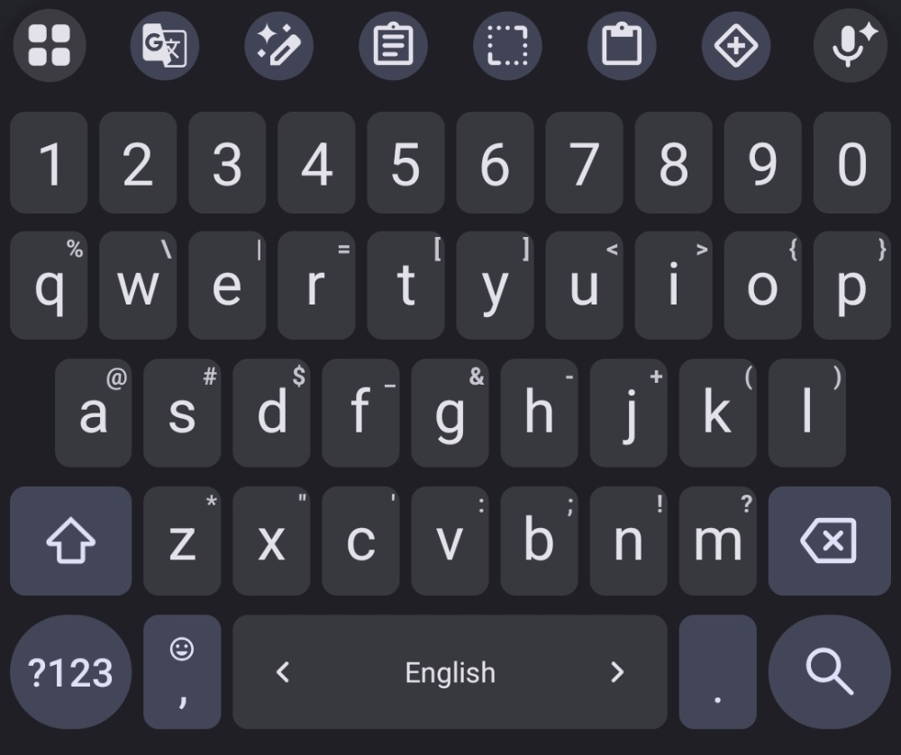
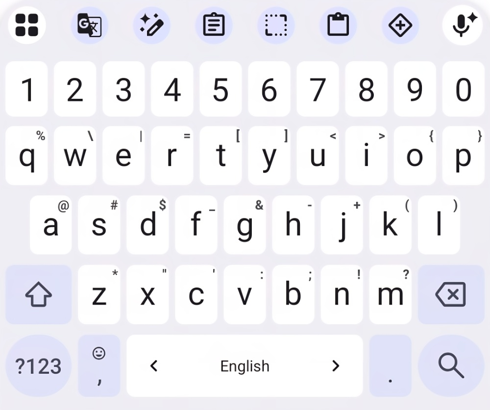
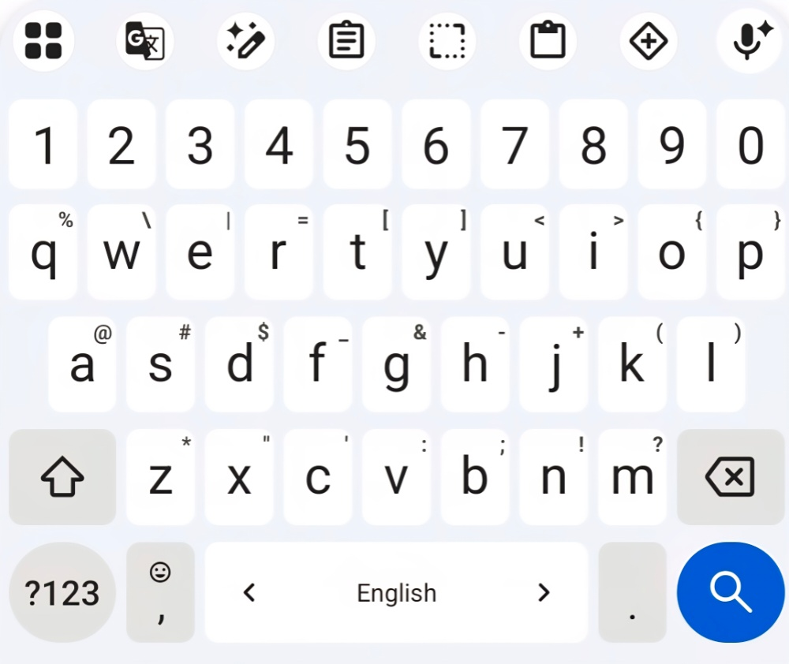

<div align="center">

<picture>
  <source media="(prefers-color-scheme: dark)" srcset="docs/assets/logo-dark.png">
  <source media="(prefers-color-scheme: light)" srcset="docs/assets/logo.png">
  
</picture>

# GboardSamsung

**Лучшее от Google. Комфорт от Samsung.**

Morphe-патчи, которые переносят эргономику и эстетику Samsung One UI в Gboard — сохраняя точность ввода, подсказки и оригинальные иконки Google.

[English](README.md) · [Русский](README.ru.md)

[](https://morphe.software/add-source?github=vortexnode/GboardSamsung)

[](https://github.com/vortexnode/GboardSamsung/releases/latest)
[](https://github.com/vortexnode/GboardSamsung/releases)
[](https://github.com/vortexnode/GboardSamsung/actions/workflows/ci.yml)


[](LICENSE)

</div>

## Внешний вид

<table>
  <tr>
    <td align="center" valign="top" width="50%">
      <br/>
      <sub><b>Динамическая тёмная</b> — цветные круги тулбара + фиксированные ⊞ и микрофон</sub>
    </td>
    <td align="center" valign="top" width="50%">
      <br/>
      <sub><b>Динамическая светлая</b> — пастельные круги + белые ⊞ и микрофон</sub>
    </td>
  </tr>
  <tr>
    <td align="center" valign="top" width="50%">
      <br/>
      <sub><b>Системная тёмная</b> — нейтральные тёмные подложки в стиль микрофона</sub>
    </td>
    <td align="center" valign="top" width="50%">
      <br/>
      <sub><b>Системная светлая</b> — чистые белые подложки в стиль микрофона</sub>
    </td>
  </tr>
</table>

### Буфер обмена Samsung vs. стандартный Gboard

<table>
  <tr>
    <td align="center" valign="top" width="50%">
      <br/>
      <sub><b>Стандартный Gboard</b> — дробит один скопированный текст на 4 отдельные карточки (текст, дата, число, место)</sub>
    </td>
    <td align="center" valign="top" width="50%">
      <br/>
      <sub><b>Буфер обмена Samsung</b> — сохраняет тот же текст одним цельным блоком</sub>
    </td>
  </tr>
</table>

## Чем GboardSamsung отличается от оригинала и upstream

Проект развивается как сфокусированный форк [jasonwu1994/Gboard-patches](https://github.com/jasonwu1994/Gboard-patches) с собственными визуальными и UX-доработками под Samsung One UI и без лишних тайваньских/неиспользуемых патчей:

| Возможность | Что делает |
| --- | --- |
| **Жесты пробела Samsung** | Свайп влево/вправо по пробелу с 3 взаимоисключающими режимами (**Samsung One UI** — фиксированный цикл `1→2→3→4`, **Gboard** — недавние языки первыми, **Свободное переключение** с 5-секундной памятью направления и наглядными превью-схемами), долгое нажатие для курсора и отключаемые шевроны `< Русский >` через пассивный `ViewOverlay`. |
| **Круглые подложки тулбара** | Адаптивные круглые подложки под 3–8 иконками верхнего тулбара (оригинальные иконки Google сохраняются): в теме «Динамический цвет» подхватывают тон больших клавиш Material You, в стандартных темах повторяют стиль микрофона Rambler. Отдельным тумблером включается фиксированная круглая подложка `38dp` под кнопкой меню `⊞` (при раскрытии в `✕` сохраняется родной круг Gboard). |
| **Буфер обмена Samsung** | Переключатель в **Буфер обмена → Основные**, сохраняющий скопированный текст одним цельным блоком, как в клавиатуре Samsung — без разбивки на отдельные карточки со ссылками, телефонами, адресами и почтой, не затрагивая картинки, закрепление, сроки хранения и остальные функции. |
| **Фирменная иконка приложения** | Адаптивная светлая и тёмная иконка GboardSamsung с точной посадкой в безопасную зону маски One UI. |
| **Полная локализация RU / EN** | Русский и английский интерфейс всех разделов «Патчи», встроенный поиск по настройкам и русские описания релизов в Morphe Manager. |
| **Отдельный пакет (`Package Rename`)** | Устанавливается параллельно с обычным Gboard (`gboardsamsung.com.google.android.inputmethod.latin`) без root-прав. |

## Быстрая установка через Morphe Manager

1. **[Нажмите здесь, чтобы добавить GboardSamsung в Morphe в 1 тап](https://morphe.software/add-source?github=vortexnode/GboardSamsung)** — или откройте [Morphe Manager](https://github.com/MorpheApp/morphe-manager) → **Источники** → **Добавить источник** и вставьте ссылку:
   ```text
   https://github.com/vortexnode/GboardSamsung
   ```
2. Выберите совместимый оригинальный APK **Gboard `18.5.4`** (рекомендуется `arm64-v8a`).
3. Отметьте нужные патчи (оставьте **Package Rename**, если хотите не заменять стоковый Gboard) и нажмите **Патчить**.
4. Установите собранный APK и включите **GboardSamsung** в настройках Android (**Система → Клавиатура**).

> **Совет:** при выходе новых версий устанавливайте пересобранный APK **обновлением поверх**, не удаляя приложение — так сохранятся ваш словарь обучения, сленг и настройки.

## Совместимость

- **Рекомендуемая версия:** Gboard `18.5.4` (`arm64-v8a`, проверено на Samsung Galaxy S22 / Android 16 / One UI).
- **Root-права:** не требуются.
- **Автообновления:** каждый релиз автоматически собирает `.mpp` и обновляет `patches-bundle.json` для Morphe Manager.

## Каталог активных патчей (36)

**3 собственных патча GboardSamsung** + **33 отобранных патча из upstream**. Нажмите на нужную категорию, чтобы раскрыть список:

<details>
<summary><b>Фишки Samsung One UI (3 собственных патча)</b></summary>

- **Custom App Icon** — адаптивная светлая и тёмная иконка GboardSamsung.
- **Samsung Spacebar Gestures** — свайп по пробелу в 3 режимах (Samsung One UI, Gboard, Свободное переключение), долгое нажатие для курсора и отключаемые шевроны `< Русский >`.
- **Toolbar Round Chips** — адаптивные круглые подложки под 3–8 кнопками тулбара (Material You + стандартные темы) и отдельный тумблер для кнопки меню `⊞`.

</details>

<details>
<summary><b>Темы, внешний вид и раскладка (12 патчей)</b></summary>

- **Access Points menu style** — переключение между новым и классическим стилем меню панели инструментов.
- **Change emoji size** — настройка размера эмодзи.
- **Custom Theme** — импорт собственных ZIP-тем и тем из репозитория Rboard.
- **Emojis, stickers &amp; GIFs Tab Order** — изменение порядка нижних вкладок перетаскиванием.
- **Enable split keyboard** — включение разделённой раскладки.
- **Frosted Glass** — живое размытие фона и прозрачность кастомных тем.
- **Key Shape Selection** — выбор формы клавиш (включая прямоугольные со скруглением) в параметрах темы.
- **Keypress Vibration Intensity Control** — настройка силы вибрации вместо длительности.
- **Rounded Keyboard Panel** — скругление углов панели клавиатуры и настройка радиуса.
- **Settings Homepage Override** — переключение между новым и старым экраном настроек Gboard.
- **Top Toolbar Item Count** — настройка количества значков в верхнем тулбаре (от 3 до 8).
- **Swipe Down to Dismiss Keyboard** — свайп вниз от подсказок или тулбара для скрытия клавиатуры.

</details>

<details>
<summary><b>Ввод, редактирование и инструменты (9 патчей)</b></summary>

- **Clipboard Custom Character Limit** — настройка максимальной длины записей буфера обмена.
- **Clipboard Enhancements** — включает режим **«Буфер обмена Samsung»** (сохранение текста цельным блоком без разбивки), а также увеличенное время хранения, лимит записей, строки предпросмотра и отметки времени.
- **Close Proactive Suggestions** — кнопка закрытия проактивных подсказок.
- **Custom Symbols** — отдельная вкладка пользовательских символов по долгому нажатию запятой.
- **Floating Web Search** — плавающее окно веб-поиска прямо из клавиатуры.
- **Long-Press Editing Shortcuts** — быстрые действия (Выбрать всё, Отменить, Копировать, Вырезать, Вставить, Повторить) по долгому нажатию.
- **Quick Insert** — панель быстрой вставки и её кнопка на тулбаре.
- **Simple Calculator** — вычисление математических выражений прямо в строке подсказок.
- **Toolbar Editing Buttons** — кнопки «Выбрать всё», «Копировать», «Вырезать» и «Вставить» в меню тулбара.

</details>

<details>
<summary><b>Языки, ИИ, подсказки и голос (7 патчей)</b></summary>

- **AI Writing Tools** — ИИ-инструменты редактирования текста с поддержкой всех языков.
- **Advanced Voice Typing** — расширенный голосовой ввод с автопунктуацией.
- **Dictionaries &amp; Predictions** — выбор версий словарей (включая более свежие каталоги Pixel Delight) и просмотр загруженных моделей.
- **Enable Inline Autofill Suggestions** — встроенные подсказки автозаполнения.
- **Grammar Checker** — раздел «Исправление текста → Проверка грамматики».
- **Inline Suggestions** — «Умный ввод» (Smart Compose).
- **Use Bluetooth Microphone** — опция использования Bluetooth-микрофона для голосового ввода.

</details>

<details>
<summary><b>Сборка, безопасность и утилиты (5 патчей)</b></summary>

- **Add Gboard Signature Bypass** — обход проверки подписи Gboard.
- **Backup &amp; Restore** — резервное копирование и восстановление настроек патчей и данных Gboard.
- **Developer options** — разблокировка настроек разработчика и Flag Editor.
- **Incognito Mode Toggle** — переключатель режима инкогнито на тулбаре с контролем буфера обмена.
- **Package Rename** — смена имени пакета (по умолчанию `gboardsamsung.com.google.android.inputmethod.latin`).

</details>

<details>
<summary><b>Что вырезано из upstream (13 патчей)</b></summary>

Чтобы проект оставался чистым, предсказуемым и без конфликтующих жестов или лишних зависимостей, следующие 13 патчей из `jasonwu1994/Gboard-patches` намеренно **не включены**:

1. `Enable OCR / Scan Text`
2. `Enable accessibility layout`
3. `Enable cursor trackpad mode` *(заменён на Samsung Spacebar Gestures)*
4. `English QWERTY Up-Flick Uppercase`
5. `FTP Server`
6. `G Logo on Spacebar`
7. `Latin Globe Key Ignore Interval`
8. `Shift + Backspace Forward Delete`
9. `Swipeable Custom Top Row`
10. `Web Clipboard`
11. `Zhuyin Bottom Row Key Sizes` *(тайваньский ввод)*
12. `Zhuyin Quick Traditional/Simplified Toggle` *(тайваньский ввод)*
13. `Zhuyin Slide Input` *(тайваньский ввод)*

</details>

## Сборка и тестирование

```bash
./gradlew :patches:test :extensions:extension:testDebugUnitTest :extensions:calculator:testDebugUnitTest
```

## Происхождение и лицензия

- **Upstream:** основано на [jasonwu1994/Gboard-patches](https://github.com/jasonwu1994/Gboard-patches) (автор — Jason Wu / `jasonwu1994`).
- **Адаптация и развитие:** [vortexnode](https://github.com/vortexnode).
- **Лицензия:** [GNU General Public License v3.0](LICENSE) (см. также [NOTICE](NOTICE)).
