> **Актуальное обновление после повторного анализа оригинального APK:** см. [SPACEBAR_STAGE_4_2_APK_REANALYSIS.md](SPACEBAR_STAGE_4_2_APK_REANALYSIS.md).
> Этот документ ниже содержит предыдущие заметки; если они расходятся с новым отчётом, приоритет у нового отчёта.
# Архитектура Samsung-подобного управления пробелом в Gboard (Этап 3)

- **Репозиторий:** `vortexnode/GboardSamsung`
- **Целевое приложение:** Google Gboard (`com.google.android.inputmethod.latin`)
- **Целевая версия Gboard:** `18.5.4.993608717-release-arm64-v8a` (`versionCode = 180698026`)
- **Эталон пользовательского поведения:** Samsung Keyboard (`com.samsung.android.honeyboard`, One UI 8)
- **Целевое устройство:** Samsung Galaxy S22 5G (`SM-S901U1`), Android 16 (SDK 36), One UI 8
- **Формат результата сборки:** Morphe patch bundle (`.mpp`) для оригинального APK Gboard
- **Статус документа:** Исследование и финальная архитектурная спецификация Этапа 3 (исходный код, bindings, Gradle и workflows не изменялись)

> **Стандарт достоверности документа:** каждое утверждение в тексте явно маркируется категорией доказательности:
> - **[ПОДТВЕРЖДЕНО В КОДЕ]** — проверено напрямую в файлах репозитория `vortexnode/GboardSamsung` (с указанием файла, класса, метода и строк) или в официальной документации Android / Samsung One UI.
> - **[ОБОСНОВАННОЕ ПРЕДПОЛОЖЕНИЕ / ИНЖЕНЕРНАЯ МОДЕЛЬ]** — выведено из наблюдаемого поведения Samsung Keyboard / стандартной архитектуры Android `InputMethodService`, но не проверено по декомпилированному APK.
> - **[НЕ ИССЛЕДОВАНО — ТРЕБУЕТ APK]** — отсутствует в рабочей среде и требует прямой инспекции APK Gboard `18.5.4.993608717-release-arm64-v8a` и/или Samsung Keyboard (`com.samsung.android.honeyboard`) с One UI 8.

---

## 1. Исследование Samsung Keyboard

### 1.1. Проверка доступных материалов в рабочей среде

**[ПОДТВЕРЖДЕНО В КОДЕ]** По результатам проверки корневого дерева репозитория `vortexnode/GboardSamsung` (`/`):
- Оригинальный APK Samsung Keyboard (`com.samsung.android.honeyboard`), его декомпилированные исходники, Smali-файлы, XML-ресурсы и системные библиотеки One UI **отсутствуют в рабочей среде**.
- Оригинальный APK Google Gboard `18.5.4.993608717-release-arm64-v8a` также отсутствует в репозитории (что соответствует правилу из `docs/PROJECT_SCOPE.md:47` и `AGENTS.md`).
- Доступными источниками для данного этапа являются:
  1. Полный исходный код downstream-репозитория `vortexnode/GboardSamsung` (`patches/`, `extensions/`, `gboard-version-bindings.json`, `gboard-port-product-catalog.json`).
  2. Официальная пользовательская документация Samsung One UI по Samsung Keyboard (`com.samsung.android.honeyboard`) и публичная документация Android IME (`InputMethodService`, `InputConnection`, `ViewConfiguration`, `MotionEvent`).

### 1.2. Материалы, необходимые для полного исследования (если потребуется точность до миллисекунд/пикселей Samsung)

Для верификации внутренних констант и Smali-реализации **непосредственно из кода** (без коммита проприетарных файлов в репозиторий) потребуются:
1. **APK Google Gboard `18.5.4.993608717-release-arm64-v8a`** (критический блокер для Этапа 4):
   - проверка обфусцированного менеджера `InputMethodEntry`, обработчика `-0x271b`, конструктора `Lohe;`, поведения `ScrubMoveMotionEventHandler` и `GestureMotionEventHandler` (Glide Typing).
2. **APK Samsung Keyboard (`com.samsung.android.honeyboard`) с устройства `SM-S901U1` (Android 16 / One UI 8)** (опционально — для точной калибровки порогов и кривой ускорения курсора):
   - извлечение точных констант таймаута удержания, dead-zone, порога свайпа и шага перемещения курсора в One UI 8.

---

## 2. Подтверждённые сведения о поведении Samsung Keyboard

### 2.1. Три базовых сценария эталонного поведения

**[ПОДТВЕРЖДЕНО ПО ДОКУМЕНТАЦИИ SAMSUNG ONE UI]** В Samsung Keyboard (`com.samsung.android.honeyboard`) на устройствах Galaxy (One UI 6/7/8) управление клавишей пробела строится вокруг трёх взаимоисключающих действий, задаваемых в настройках:
- `Languages and types → Language switching method` (`Language key and space bar swipe` / `Space bar swipe only`);
- `Swipe, touch, and feedback → Touch and hold space bar → Cursor control`.

Поведение пользователя в этом режиме:
1. **Короткое нажатие (`TAP`):** быстрое касание и отпускание пробела вставляет ровно один пробел (`KEYCODE_SPACE`), без смены языка и без входа в режим курсора.
2. **Горизонтальный свайп (`SWIPE`):** немедленное горизонтальное скольжение по пробелу слева направо переключает язык вперёд (следующий язык), справа налево — назад (предыдущий язык). Пробел не вставляется. Переключение происходит циклически по упорядоченному списку настроенных языков.
3. **Долгое удержание пробела (`LONG_PRESS_CURSOR`):** удержание пальца на пробеле без немедленного горизонтального свайпа переводит клавиатуру в режим управления курсором: срабатывает тактильный отклик, клавиши клавиатуры визуально приглушаются / очищаются (превращая всю область клавиатуры в сенсорную панель), и дальнейшее перемещение пальца влево/вправо (а также по площади клавиатуры) точно перемещает текстовый курсор. При отпускании пальца режим завершается; пробел не вставляется, язык не переключается.

### 2.2. Ответы на 15 контрольных вопросов по Samsung Keyboard

| № | Вопрос | Статус | Технический ответ |
|---|---|---|---|
| 1 | Как определяется короткое нажатие пробела? | **[ПОДТВЕРЖДЕНО / МОДЕЛЬ]** | `ACTION_DOWN` в границах пробела + `ACTION_UP` до истечения порога удержания и без выхода за порог горизонтального свайпа. Пробел отправляется на `ACTION_UP`. |
| 2 | Как определяется горизонтальный свайп? | **[ПОДТВЕРЖДЕНО / МОДЕЛЬ]** | Горизонтальное смещение `\|dx\|` от точки `ACTION_DOWN` на пробеле, начатое **до** срабатывания таймера удержания, с преобладанием оси X над осью Y и преодолением порога дистанции. |
| 3 | Используется временной порог, дистанция или скорость? | **[ОБОСНОВАННОЕ ПРЕДПОЛОЖЕНИЕ]** | **Комбинация времени (окно до активации удержания) и дистанции (`dx` относительно `touchSlop`/ширины пробела с ограничением `dy`)**. Чистая модель «только по времени» не позволяет отличить удержание от свайпа без задержки; точные константы HoneyBoard One UI 8 — **[НЕ ИССЛЕДОВАНО — ТРЕБУЕТ APK]**. |
| 4 | Как определяется долгое удержание? | **[ПОДТВЕРЖДЕНО / МОДЕЛЬ]** | Таймер удержания (`Handler`/отложенная задача), запускаемый на `ACTION_DOWN` и отменяемый при выходе пальца за радиус удержания (dead-zone) или при `ACTION_UP`/`ACTION_CANCEL`. Точная длительность в One UI 8 (обычно `~300–400ms`, близко к системному `ViewConfiguration.getLongPressTimeout()`) — **[НЕ ИССЛЕДОВАНО — ТРЕБУЕТ APK]**. |
| 5 | В какой момент начинается управление курсором? | **[ПОДТВЕРЖДЕНО ПО ONE UI]** | **В момент срабатывания таймера удержания** (ещё до начала движения пальца): пользователь получает тактильный отклик и визуальное переключение клавиатуры в режим трекпада, после чего начинает двигать палец. |
| 6 | Как предотвращается конфликт между свайпом и управлением курсором? | **[ПОДТВЕРЖДЕНО ПО ONE UI / МОДЕЛЬ]** | **Взаимоисключающая развилка на этапе `POSSIBLE_SPACE_TAP`:**<br>• Движение `\|dx\| >= swipeStartThreshold` **до** срабатывания таймера удержания → отмена таймера → только смена языка.<br>• Срабатывание таймера удержания пока палец неподвижен → переход в `LONG_PRESS_CURSOR` → горизонтальное движение двигает только курсор, смена языка заблокирована до `ACTION_UP`.<br>*(В пользовательских отзывах One UI отмечается, что слишком резкая пауза перед свайпом иногда активирует курсор, а слишком быстрое движение до срабатывания таймера — смену языка; корректно подобранный таймер `~320ms` и радиус удержания минимизируют оба случая.)* |
| 7 | Как обрабатываются небольшие случайные движения пальца? | **[ОБОСНОВАННОЕ ПРЕДПОЛОЖЕНИЕ]** | Через мёртвую зону (`touchSlop` / `holdSlop`): микродрожание пальца в пределах `~8–12dp` не отменяет ни обычный `TAP`, ни таймер `LONG_PRESS_CURSOR`. |
| 8 | Как обрабатываются вертикальные движения? | **[ОБОСНОВАННОЕ ПРЕДПОЛОЖЕНИЕ]** | До входа в курсор: значительное вертикальное смещение `\|dy\|` дисквалифицирует свайп языка и отменяет удержание (исключает конфликт с соседним рядом букв). После входа в `LONG_PRESS_CURSOR`: вертикальное движение допускается (пользователь может водить пальцем по всей площади клавиатуры без сброса режима). |
| 9 | Что происходит при мультитач-жестах? | **[ОБОСНОВАННОЕ ПРЕДПОЛОЖЕНИЕ]** | Второй палец (`ACTION_POINTER_DOWN`) до подтверждения жеста отменяет свайп и удержание, позволяя продолжить быстрый двуручный набор текста. |
| 10 | Как Samsung предотвращает вставку пробела после распознавания жеста? | **[ОБОСНОВАННОЕ ПРЕДПОЛОЖЕНИЕ]** | Событие `TAP` (вставка `KEYCODE_SPACE`) отправляется только на `ACTION_UP` при отсутствии захваченного жеста; при переходе в `SWIPE` или `LONG_PRESS_CURSOR` внутреннее состояние нажатой клавиши пробела сбрасывается/отменяется (`ACTION_CANCEL`). |
| 11 | Как осуществляется переключение между языками? | **[ПОДТВЕРЖДЕНО ПО ONE UI / МОДЕЛЬ]** | Циклический переход вперёд (`+1`) при свайпе L→R и назад (`-1`) при свайпе R→L по упорядоченному списку включённых языков HoneyBoard без закрытия клавиатуры. |
| 12 | Как система получает список доступных языков и текущий язык? | **[ОБОСНОВАННОЕ ПРЕДПОЛОЖЕНИЕ]** | Внутренний менеджер языковых профилей HoneyBoard (хранит активный список `Locale`/раскладок и индекс текущего языка, независимый от системного списка сторонних IME). Точные классы HoneyBoard — **[НЕ ИССЛЕДОВАНО — ТРЕБУЕТ APK]**. |
| 13 | Как обрабатываются случаи, когда настроен только один язык? | **[ПОДТВЕРЖДЕНО ПО ONE UI]** | Стрелки-индикаторы на пробеле скрыты, свайп по пробелу не выполняет переключение языка; короткое нажатие и удержание для курсора работают в штатном режиме. |
| 14 | Как ведёт себя клавиатура при быстром повторном выполнении жеста? | **[ОБОСНОВАННОЕ ПРЕДПОЛОЖЕНИЕ]** | Один непрерывный свайп переключает язык **ровно один раз**; новый свайп после отпускания пальца сразу переключает на следующий/предыдущий язык (допускает серию быстрых свайпов подряд: EN → RU → UK). |
| 15 | Как реализована визуальная обратная связь? | **[ПОДТВЕРЖДЕНО ПО ONE UI]** | • **Язык на пробеле:** отображается название активного языка с боковыми стрелками-шевронами `‹ Русский ›` (при `>= 2` языках); при свайпе текст языка плавно смещается/обновляется на новый.<br>• **Управление курсором:** при активации удержания клавиши клавиатуры приглушаются/скрываются (эффект «чистой сенсорной панели»), сопровождаемый тактильным откликом. |

---

## 3. Доступные сведения о внутренней реализации Samsung Keyboard

**[ПОДТВЕРЖДЕНО ПО ПУБЛИЧНОЙ ДОКУМЕНТАЦИИ ANDROID / SAMSUNG]**
- Идентификатор пакета: `com.samsung.android.honeyboard`.
- Базовая архитектура: наследник `android.inputmethodservice.InputMethodService` (`HoneyBoardService`) с собственной иерархией View раскладок и конвейером обработки `MotionEvent`.
- Перемещение текстового курсора в Android IME выполняется через публичный контракт `InputConnection` (завершение композиции `finishComposingText()` и отправка направленных событий `KEYCODE_DPAD_LEFT`/`KEYCODE_DPAD_RIGHT` через `sendKeyEvent`, либо `setSelection` в зависимости от редактора).

**[НЕ ИССЛЕДОВАНО — ТРЕБУЕТ APK]** Ввиду отсутствия APK `com.samsung.android.honeyboard` в репозитории, точные имена внутренних Java/Kotlin-классов HoneyBoard, точные миллисекундные пороги One UI 8, таблица коэффициентов ускорения курсора и внутренний API смены раскладок HoneyBoard **не верифицированы по байткоду** и в данном документе за факты не выдаются.

---

## 4. Сравнение архитектуры Samsung Keyboard и Gboard (`18.5.4`)

| Архитектурный аспект | Samsung Keyboard (`com.samsung.android.honeyboard`) | Штатный Gboard (`18.5.4.993608717`) **[ПОДТВЕРЖДЕНО В КОДЕ]** | Целевое решение в `GboardSamsung` |
|---|---|---|---|
| **Перехват `MotionEvent`** | Единый пайплайн перехвата на уровне клавиатурного окна до оценки нажатия клавиш **[МОДЕЛЬ]** | `KeyboardViewHolder.dispatchTouchEvent(MotionEvent)Z` (`GboardSwipeDismissBytecodePatch.kt:23-68`), затем `SoftKeyboardView` и `MotionEventHandler` (`ScrubMove`, `Glide`, `Lqin`) | Перехват на уровне `KeyboardViewHolder.dispatchTouchEvent` через единый `GboardTouchDispatchFamilyComposer` |
| **Идентификация пробела** | Внутренняя модель клавиши пробела **[МОДЕЛЬ]** | `SoftKeyView` с `id == 0x7f0b05b5`, `pressKeycode == 62`, метка `TextView 0x7f0b05f5` (`GboardSpacebarLogoAdapter.java:17-19, 53-118`) | Отслеживание активного `SoftKeyView` пробела через `GboardSoftKeyFamilyComposer` (`SoftKeyView.s()`) |
| **Горизонтальный свайп по пробелу** | Циклическое переключение языка L→R / R→L | **Конфликт:** `enable_scrub_move` (движение курсора при немедленном свайпе по пробелу, `GboardCursorTrackpadRuntime.java:12`) | **Отключаем `enable_scrub_move` и штатный `free_cursor`**, отдаём горизонтальный свайп по пробелу переключению языка |
| **Долгое удержание пробела** | Активация режима управления курсором (`Cursor control`) с визуальным приглушением клавиш и тактильным откликом | Либо диалог выбора языка (стандартно), либо штатный `free_cursor` Trackpad (`GboardCursorTrackpadPolicy.java:4-5`), зависящий от `enable_scrub_move` | **Собственный `LONG_PRESS_CURSOR`:** таймер удержания → `ACTION_CANCEL` в Gboard → тактильный + визуальный отклик → собственный контроллер курсора через `InputConnection` |
| **Перемещение курсора** | Внутренний контроллер через `InputConnection` **[МОДЕЛЬ]** | `ScrubMoveMotionEventHandler` / `free_cursor` (внутренний, закрытый) | Собственный `GboardSpacebarCursorController` через `service.getCurrentInputConnection()` (`finishComposingText()` + `KEYCODE_DPAD_LEFT/RIGHT` + нелинейное ускорение + auto-repeat у краёв) |
| **Переключение языка** | Внутренний циклический список языков (`+1` / `-1`) | Globe tap `-0x271b` (`PRESS`), Globe long-press `-0x2726` (`LONG_PRESS`) через `Lqil;->f` / `Lphr;->aw(Lohe;)Z` (`GboardGlobeDragAdapter.java:10, 78-96`) | Прямой циклический переход по `InputMethodEntry` Gboard (`(i ± 1 + N) % N`) после верификации биндингов APK `18.5.4` |
| **Индикатор языка на пробеле** | Название языка с боковыми шевронами `‹ Язык ›` | Штатный `TextView 0x7f0b05f5` с названием языка (при `>= 2` языках), управляемый через `SoftKeyView.s()` | Наследование стиля `TextView 0x7f0b05f5` + неинтерактивные шевроны `‹` / `›` + мягкий сдвиг при свайпе |

---

## 5. Подтверждённый механизм переключения языка в Gboard

### 5.1. Факты, строго подтверждённые в коде репозитория

1. **Идентификаторы событий Globe `[ПОДТВЕРЖДЕНО В КОДЕ]`:**
   - `KEYCODE_SWITCH_TO_NEXT_LANGUAGE = -0x271b` (`-10011`), `action = qae.PRESS`, `payload = "globe"` — `extensions/extension/src/main/java/dev/jason/gboardpatches/extension/longpressquickactions/GboardGlobeDragAdapter.java:10, 78-96` и `GboardLongPressQuickActionsReflectionHandles.java:27, 223-230`.
   - `KEYCODE_SHOW_LANGUAGE_PICKER = -0x2726` (`-10022`), `action = qae.LONG_PRESS`, `payload = "globe"` — `GboardLongPressQuickActionsReflectionHandles.java:28, 223-230`.
2. **Путь доставки событий `[ПОДТВЕРЖДЕНО В КОДЕ]`:**
   - Диспетчер жестов клавиш: `Lqil;->f(Lqin;Lqae;Lqbc;SoftKeyDef;JZZIZJI)V` → `Lqil;->n:Lqij;` → `Lqij;->o(...)V` (`patches/src/main/kotlin/dev/jason/gboardpatches/patches/gboard/shared/GboardGestureFamilyComposer.kt:334-361`).
   - Входящий диспетчер событий `InputMethodService`: `Lphr;->aw(Lohe;)Z` (`patches/src/main/kotlin/dev/jason/gboardpatches/patches/gboard/features/longpressquickactions/GboardLongPressQuickActionsInputEventPatch.kt:62-66`, `GboardLatinGlobeKeyIgnoreIntervalBytecodePatch.kt:21-217`).
   - Конструктор `Lqbc(int keyCode, Lqbb intention, Object data, int unused)` и поля `Lohe;` (`a: qae`, `b: qbc[]`, `c: SoftKeyDef`, `w: int`) подтверждены в `GboardLongPressQuickActionsReflectionHandles.java:98-123`.
   - Тип `Lphr;`: наследник `android.inputmethodservice.InputMethodService` (`GboardLongPressQuickActionsReflectionHandles.java:457`). Живой экземпляр `InputMethodService` получается без reflection через `GboardSwipeDismissRuntime.resolveInputMethodService(View)` (`GboardSwipeDismissRuntime.java:108-124`).
3. **Роль `GboardLatinGlobeKeyIgnoreIntervalBytecodePatch.kt` `[ПОДТВЕРЖДЕНО В КОДЕ]`:**
   - Патч (`lines 1-217`) и `GboardLatinGlobeKeyIgnoreIntervalRuntime.java` (`lines 1-221`) хукают `Lphr;->aw(Lohe;)Z` и `LatinIme;->N()Lyrt;`, сбрасывая таймер защиты от случайного нажатия Globe после ввода символов.
   - Они **не содержат** логики выбора языка и не обращаются к списку `InputMethodEntry`, но доказывают, что на `Lphr;->aw(Lohe;)Z` уже висят два независимых хука (`GboardLongPressQuickActionsInputEventPatch` и `GboardLatinGlobeKeyIgnoreIntervalBytecodePatch`).

### 5.2. Что НЕ подтверждено в репозитории (обязательная проверка на APK `18.5.4.993608717-release-arm64-v8a`)

**[НЕ ИССЛЕДОВАНО — ТРЕБУЕТ APK]** По текущему дереву исходников репозитория **невозможно** установить без декомпиляции целевого APK `18.5.4`:
1. Какой конкретный класс в `18.5.4` обрабатывает `-0x271b` внутри `Lphr;->aw(Lohe;)Z` и где находятся все его call-sites.
2. Использует ли `-0x271b` в `18.5.4` **MRU-порядок** (переключение на последний использованный язык при паузе) или строго последовательный обход списка языков.
3. Обфусцированные имена классов/методов внутреннего менеджера языков Gboard (`InputMethodEntryManager` / `IInputMethodEntryManager`):
   - получение упорядоченного списка активных `InputMethodEntry` (`List<Entry>`);
   - получение текущего активного `InputMethodEntry`;
   - вызов прямого переключения на выбранный `InputMethodEntry` (`switchToInputMethodEntry(entry)`).
4. Существует ли в таблице `KeyCode` версии `18.5.4` отдельный keycode для переключения на предыдущий язык (наличие `-0x271c` **НЕ предполагается** и требует строгого доказательства по байткоду).
5. Конструктор / статическая фабрика `Lohe;` (в репозитории задекларированы только поля `Lohe;`).
6. Как представлены языки в режиме мультиязычного ввода (Multilingual Typing: одна запись `InputMethodEntry` с дополнительными подтипами или отдельные записи).

---

## 6. Механизм обратного переключения языка (`PREVIOUS`) и работа с `N` языками

### 6.1. Почему системные API Android и имитация UI непригодны

- **`InputMethodService.switchToNextInputMethod(boolean)` / `switchToPreviousInputMethod()` — ЗАПРЕЩЕНЫ как основной механизм:** Gboard хранит пользовательские языки и раскладки во внутреннем списке `InputMethodEntry`, а не только как системные `InputMethodSubtype`. Вызов системных методов на устройствах Samsung часто переключает пользователя за пределы Gboard (на Samsung Keyboard или Google Voice Typing) вместо смены языка внутри Gboard.
- **Имитация клика по клавише Globe — ЗАПРЕЩЕНА:** ненадёжна (клавиша Globe может быть скрыта пользователем в настройках Gboard), не поддерживает обратное направление (Previous) и может подвергнуться MRU-перестановке.
- **Многократный вызов `-0x271b` (`N - 1` раз) — ЗАПРЕЩЁН:** ломается при MRU-алгоритме, вызывает визуальное мерцание `N - 1` промежуточных раскладок и деградирует на 3+ языках.

### 6.2. Приоритетная архитектура двунаправленного переключения (`GboardSpacebarLanguageSwitchBridge`)

Переключение проектируется через изолированный интерфейс с жёсткой иерархией приоритетов (проверяется на APK `18.5.4` до начала Этапа 4):

#### Приоритет 1 (Целевой и основной): прямой вызов внутреннего менеджера `InputMethodEntry` Gboard
После нахождения обфусцированных дескрипторов менеджера `InputMethodEntry` в APK `18.5.4`:
1. Запросить текущий упорядоченный список активных записей `List<InputMethodEntry> entries` и текущую активную запись `currentEntry`.
2. **Случай `entries.size() < 2` (1 язык):** переключение не выполняется; `canSwitchLanguage()` возвращает `false` (свайп языка не активируется, на пробеле не рисуются шевроны).
3. **Случай `entries.size() >= 2` (2, 3, 4+ языков):**
   - Определить `currentIndex = indexOf(entries, currentEntry)`.
   - `DIRECTION_NEXT` (L→R): `targetIndex = (currentIndex + 1) % entries.size()`.
   - `DIRECTION_PREVIOUS` (R→L): `targetIndex = (currentIndex - 1 + entries.size()) % entries.size()`.
   - Вызвать внутренний метод Gboard `switchToInputMethodEntry(entries.get(targetIndex))`.
4. **Гарантии этого пути:**
   - **2 языка (EN, RU):** L→R и R→L оба циклически переключают EN ↔ RU.
   - **3+ языков (EN, RU, UK, DE):** L→R идёт строго `EN → RU → UK → DE → EN`; R→L идёт строго `EN → DE → UK → RU → EN` (детерминированно, как в Samsung Keyboard, без MRU-скачков).
   - **Одинаковая раскладка с разными языками (EN QWERTY + DE QWERTY + ES QWERTY):** переход идёт по индексу `InputMethodEntry`, а не по имени раскладки — корректно меняются словарь, автокоррекция и метка языка на пробеле.
   - **Работает при скрытой клавише Globe** и не зависит от наличия кнопки глобуса в нижней строке.
   - **Активация при активном вводе текста:** внутренний метод переключения `InputMethodEntry` в Gboard штатно завершает/фиксирует текущую композицию и обновляет раскладку, словари и предсказания.

#### Приоритет 2 (Запасной — только если в `18.5.4` обнаружен и доказан симметричный линейный внутренний обработчик `NEXT` и `PREVIOUS`)
- Если при инспекции APK `18.5.4` выяснится, что Gboard имеет два подтверждённых не-MRU внутренних действия/метода `switchToNextLanguage()` и `switchToPreviousLanguage()` (или подтверждённый keycode для Previous наряду с `-0x271b`), они могут использоваться через `GboardSpacebarLanguageSwitchBridge`.
- Если отдельного метода/keycode для Previous в `18.5.4` нет, **единственно допустимым надёжным решением остаётся Приоритет 1** (прямой вызов переключения по индексу `InputMethodEntry`).

---

## 7. Архитектура распознавания жестов: `TAP` / `SWIPE` / `LONG_PRESS_CURSOR`

### 7.1. Сравнение моделей распознавания: Вариант A vs Вариант B vs Гибридная модель с таймером (как в Samsung)

| Критерий | Вариант A (разделение преимущественно по времени) | Вариант B (время + дистанция + характер движения только в `ACTION_MOVE`) | **Выбранная модель: Гибридный автомат с активным таймером удержания (Samsung-модель)** |
|---|---|---|---|
| **Принцип работы** | При `ACTION_DOWN` ждём `T` мс; если палец двигался раньше `T` — свайп, иначе курсор. | Решение принимается при поступлении `ACTION_MOVE` по `dt`, `\|dx\|`, `\|dy\|` и скорости. | На `ACTION_DOWN` запускается **реальный `Handler`-таймер `longPressHoldMs`**. Решение принимает **гонка событий**: либо палец успевает уйти горизонтально `>= swipeStartThreshold` до истечения таймера (`→ SWIPE`), либо таймер срабатывает при неподвижном пальце (`→ LONG_PRESS_CURSOR`), либо происходит `ACTION_UP` (`→ TAP`). |
| **Точность распознавания** | Низкая: быстрый и медленный пользователь конфликтуют; нет защиты от диагоналей и микродвижений. | Средняя-высокая, но **ломается при удержании без движения** (пользователь держит пробел и не получает отклика, пока не пошевелит пальцем). | **Максимальная:** полная детерминированность всех трёх состояний, включая долгое удержание без перемещения. |
| **Скорость реакции** | Задержка на `TAP` или ложные срабатывания при быстром наборе. | `TAP` мгновенный, но `LONG_PRESS_CURSOR` запаздывает до первого `ACTION_MOVE`. | **`TAP` мгновенный** (0 мс задержки, события идут в Gboard), **`SWIPE` мгновенный** (срабатывает сразу при пересечении дистанции), **`LONG_PRESS_CURSOR` даёт чёткий тактильный сигнал ровно в момент активации**. |
| **Случайные переключения** | Высокий риск при быстром соскальзывании пальца. | Низкий за счёт `touchSlop` и угла `\|dx\|/\|dy\|`. | **Минимальный:** dead-zone `swipeStartThreshold` + допуск `maxVerticalDrift` + угол `\|dx\| >= \|dy\| * 1.75` + блокировка мультитача. |
| **Удобство управления курсором** | Неудобно: неясно, когда можно двигать палец. | Неудобно: нет момента «щелчка» входа в курсор до начала сдвига; риск случайно переключить язык. | **Эталонное (как в Samsung Keyboard):** палец задержался → чёткий haptic-импульс + визуальный режим трекпада → свободное точное ведение курсора по всей ширине клавиатуры. |
| **Устойчивость к медленным и быстрым движениям** | Плохая: медленный свайп проваливается в курсор, быстрый курсор — в свайп. | Требует хрупких порогов скорости, которые путаются между пользователями. | **Высокая:** не зависит от «угадывания» скорости курсора! Хочешь сменить язык — сразу проведи пальцем (быстро или средне, главное сразу). Хочешь курсор — задержи палец на треть секунды до вибрации и веди с любой скоростью (от сверхмедленной до быстрой). |
| **Совместимость с экранами и DPI** | Не зависит от DPI, но игнорирует физический размер клавиши. | Отличная при расчёте через `dp`, `touchSlop` и `spacebarWidth`. | **Отличная:** все пространственные пороги заданы в `dp`, масштабированы относительно `ViewConfiguration.getScaledTouchSlop()` и фактической ширины/высоты `SoftKeyView` пробела (портрет, ландшафт, одноручный и плавающий режимы). |

**Аргументация выбора:** отказ от штатного Gboard `enable_scrub_move` (раздел 8) полностью устраняет необходимость «угадывать» по скорости, хотел ли пользователь сдвинуть курсор или переключить язык. В результате **гибридная модель с активным таймером удержания** (развитый Вариант B, воспроизводящий реальную механику Samsung Keyboard) даёт чистое, недвусмысленное, интуитивное разделение `TAP` / `SWIPE` / `LONG_PRESS_CURSOR` без эвристических компромиссов.

### 7.2. Состояния конечного автомата (`GboardSpacebarGestureStateMachine`)

Автомат реализуется как **чистый детерминированный Java-класс** (с абстрактным интерфейсом таймера `LongPressScheduler` для 100% покрытия быстрыми JVM unit-тестами).

| Состояние | Описание | Доставка `MotionEvent` в Gboard |
|---|---|---|
| `IDLE` | Ожидание касания на пробеле. Таймер удержания не активен. | **Да** (100% штатная работа Gboard). |
| `POSSIBLE_SPACE_TAP` | `ACTION_DOWN` зафиксирован внутри пробела (`0x7f0b05b5`, `keyCode == 62`). Запущен таймер `longPressHoldMs`. | **Да** (сохраняется нативная подсветка пробела и мгновенный `TAP` на `ACTION_UP`). |
| `SWIPE_TRACKING` | До истечения `longPressHoldMs` палец сместился горизонтально `>= swipeStartThresholdPx` в коридоре `\|dy\| <= maxVerticalDriftPx` и `\|dx\| >= \|dy\| * 1.75f` (при `enabledLanguages >= 2`). Таймер удержания **отменён**. В Gboard один раз отправлен синтетический `ACTION_CANCEL`. | **Нет** (поглощается). |
| `SWIPE_COMMITTED` | В состоянии `SWIPE_TRACKING` пересечён `swipeConfirmThresholdPx`. Переключение языка (`NEXT` или `PREVIOUS`) выполнено **ровно один раз** (latch). Остаток жеста до отпускания пальца поглощается. | **Нет** (поглощается до `ACTION_UP` / `ACTION_CANCEL`). |
| `LONG_PRESS_CURSOR` | В состоянии `POSSIBLE_SPACE_TAP` истёк таймер `longPressHoldMs`, пока палец оставался внутри `holdRadiusPx`. В Gboard один раз отправлен синтетический `ACTION_CANCEL` (подавляет и пробел, и штатный long-press Gboard). Активированы тактильный отклик, визуальный режим трекпада и `GboardSpacebarCursorController`. | **Нет** (поглощается до `ACTION_UP` / `ACTION_CANCEL`). |
| `CANCELLED` | Жест прерван до подтверждения (мультитач, вертикальный/диагональный уход, разворот свайпа к центру, системная отмена). | Если переход из `POSSIBLE_SPACE_TAP` (soft yield, без `ACTION_CANCEL`) → **Да** (Gboard продолжает штатную обработку). Если переход из `SWIPE_TRACKING` (после `ACTION_CANCEL`) → **Нет** (поглощается хвост, чтобы не создать фантомный пробел). |

### 7.3. Обоснованные параметры и допуски (адаптация к DPI и геометрии экрана)

Параметры рассчитаны с опорой на `ViewConfiguration`, физические размеры экрана Galaxy S22 5G (`~360dp` ширины, `density ≈ 3.0`, ширина пробела `~145–175dp`) и проверенные интервалы из существующего кода репозитория (`GboardSwipeDismissGesture.java:6-7`):

| Параметр | Расчётная формула (по умолчанию) | Техническое обоснование |
|---|---|---|
| `holdRadiusPx` (допуск микродрожания при удержании) | `max(touchSlop * 0.9f, 9dp)` | Позволяет удерживать палец с естественным микродрожанием без отмены таймера `LONG_PRESS_CURSOR`, но строго меньше `swipeStartThresholdPx`. |
| `swipeStartThresholdPx` (dead-zone старта свайпа) | `max(touchSlop * 1.35f, 12dp)` | Надёжно отсекает случайное смазывание пальца при быстром `TAP` (обычном пробеле), но мгновенно перехватывает осознанный свайп до истечения `longPressHoldMs`. |
| `swipeConfirmThresholdPx` (порог подтверждения смены языка) | `clamp(spacebarWidth * 0.22f, min = max(touchSlop * 2.0f, 28dp), max = 44dp)` | На Galaxy S22 5G (`spacebarWidth ≈ 160dp`): `~35dp`. Достаточно длинный, чтобы исключить случайные срабатывания, и достаточно короткий для комфортного свайпа одним большим пальцем. |
| `maxVerticalDriftPx` (вертикальный допуск до захвата/подтверждения свайпа) | `min(22dp, spacebarHeight * 0.50f)` | Отсекает уход пальца вверх на ряд букв (исключает случайную смену языка при промахе). **Не применяется** после входа в `LONG_PRESS_CURSOR` (в режиме курсора палец свободен по всей клавиатуре). |
| `horizontalDominanceRatio` (`\|dx\| / \|dy\|`) | `1.75f` (угол `≤ 29.7°`) | Отсекает диагональные движения `~45°`. |
| `longPressHoldMs` (порог входа в `LONG_PRESS_CURSOR`) | `clamp(ViewConfiguration.getLongPressTimeout() - 80L, min = 300L, max = 360L)` (при стандартном `400ms` → **`320ms`**) | **Критически важный инженерный расчёт:**<br>1) Должен быть **строго меньше** штатного long-press таймера Gboard (`Lqin;->y()`, обычно `~400ms` или системный `longPressTimeout`), чтобы наш `ACTION_CANCEL` успел отменить штатный popup выбора языка Gboard.<br>2) Должен быть **достаточно длинным** (`>= 300ms`), чтобы обычный тап (`60–140ms`) и начало горизонтального свайпа (`40–180ms` до преодоления `12dp`) никогда не попадали в курсор.<br>*(Если пользователь изменил системную задержку удержания Android на Long/Very Long, верхний предел учитывает настройку, оставаясь на `~80ms` раньше штатного long-press Gboard — точную привязку `Lqin;->y()` необходимо проверить на APK `18.5.4`.)* |
| `maxSwipeDurationMs` (макс. время на завершение свайпа) | `450L` ms | Если пользователь сдвинул палец на `13dp` и замер на полсекунды, свайп отменяется без смены языка. |
| `postSwitchCooldownMs` (антидребезг смены языка) | `90L` ms | Защищает от двойного срабатывания на дребезге сенсора, при этом позволяет делать быстрые повторные свайпы подряд (`~3–4` свайпа в секунду). |
| `bottomEdgeExclusionPx` (защита от One UI 8 gesture pill) | `min(6dp, spacebarHeight * 0.15f)` только при примыкании пробела к нижнему краю окна | Снижает ложные перехваты при системном свайпе по нижней навигационной полосе One UI 8 (Android 16). |

### 7.4. Обработка граничных условий в автомате

- **Выход пальца за границы клавиши пробела:**
  - В `SWIPE_TRACKING`: выход по горизонтали за левый/правый край пробела **разрешён** (важно для узкого пробела в одноручном режиме или при включённых Globe/точке/запятой), пока `|dy| <= maxVerticalDriftPx`. Выход по вертикали (`|dy| > maxVerticalDriftPx`) отменяет свайп.
  - В `LONG_PRESS_CURSOR`: выход пальца за пределы пробела в любом направлении **полностью разрешён** — вся область клавиатуры работает как сенсорная поверхность курсора (как в Samsung Keyboard).
- **Единственный язык (`enabledLanguages < 2`):**
  - Переход `POSSIBLE_SPACE_TAP → SWIPE_TRACKING` **запрещён**.
  - При горизонтальном движении до `longPressHoldMs` таймер удержания отменяется, автомат уходит в `CANCELLED` (soft yield), пробел/клавиатура не выполняют фиктивного переключения языка.
  - При неподвижном удержании `>= longPressHoldMs` переход в **`LONG_PRESS_CURSOR` работает полноценно** (управление курсором доступно и при 1 языке!).
- **Быстрый flick-свайп на `ACTION_UP`:** если за `< 150ms` пришло `ACTION_DOWN → ACTION_UP` (или один `ACTION_MOVE` + `ACTION_UP`) с `|dx| >= swipeConfirmThresholdPx`, `|dy| <= maxVerticalDriftPx`, `|dx| >= |dy| * 1.75f`, автомат выполняет `ACTION_CANCEL` в Gboard и переключает язык даже без промежуточного `SWIPE_TRACKING`.
- **Полный сброс (`reset()`):** при `ACTION_CANCEL`, `onWindowHidden`, `onFinishInputView`, `onStartInputView`, `onDestroy`, отсоединении `SoftKeyView` пробела и смене конфигурации — немедленная отмена `Handler`-таймера, снятие визуального оверлея курсора, возврат в `IDLE`.

### 7.5. Диаграммы переходов состояний

#### Mermaid

```mermaid
stateDiagram-v2
    [*] --> IDLE

    IDLE --> POSSIBLE_SPACE_TAP : ACTION_DOWN на пробеле\n[ptr==1 && !conflict && !cooldown]\n/ startTimer(longPressHoldMs)

    POSSIBLE_SPACE_TAP --> IDLE : ACTION_UP [до таймера и без свайпа]\n/ cancelTimer() → TAP (вставка пробела в Gboard)

    POSSIBLE_SPACE_TAP --> SWIPE_TRACKING : ACTION_MOVE [langs>=2 && ptr==1\n&& |dx|>=swipeStart && |dy|<=maxVert\n&& |dx|>=|dy|*1.75]\n/ cancelTimer(); inject ACTION_CANCEL

    POSSIBLE_SPACE_TAP --> LONG_PRESS_CURSOR : TIMER FIRED (longPressHoldMs)\n[палец в пределах holdRadiusPx && ptr==1]\n/ inject ACTION_CANCEL; haptic + trackpad UI;\nfinishComposingText()

    POSSIBLE_SPACE_TAP --> CANCELLED : ACTION_POINTER_DOWN\nили |dy| > maxVert\nили диагональ (|dx| < |dy|*1.75)\nили (langs<2 && движение > holdRadius)\n/ cancelTimer() [soft yield → Gboard]

    SWIPE_TRACKING --> SWIPE_COMMITTED : ACTION_MOVE [|dx|>=swipeConfirm\n&& |dy|<=maxVert && dt<=450ms\n&& направление сохранено]\n/ switchLanguage(NEXT | PREV) [1x latch]

    SWIPE_TRACKING --> IDLE : ACTION_UP [|dx|>=swipeConfirm && valid]\n/ switchLanguage(NEXT | PREV)

    SWIPE_TRACKING --> IDLE : ACTION_UP [|dx|<swipeConfirm]\nили ACTION_CANCEL (отмена без пробела)

    SWIPE_TRACKING --> CANCELLED : ACTION_POINTER_DOWN\nили |dy| > maxVert\nили dt > 450ms\nили возврат к центру\n[hard cancel: хвост поглощается]

    LONG_PRESS_CURSOR --> LONG_PRESS_CURSOR : ACTION_MOVE\n/ cursorController.onMove(rawX, rawY)\n(DPAD_LEFT / DPAD_RIGHT + edge repeat)

    LONG_PRESS_CURSOR --> IDLE : ACTION_UP / ACTION_CANCEL\n/ stopCursorMode(); hideTrackpadUI()\n(без пробела и без смены языка)

    SWIPE_COMMITTED --> SWIPE_COMMITTED : ACTION_MOVE / POINTER_DOWN\n(поглощение, анти-повтор)
    SWIPE_COMMITTED --> IDLE : ACTION_UP (last ptr) / ACTION_CANCEL

    CANCELLED --> IDLE : ACTION_UP (last ptr) / ACTION_CANCEL

    POSSIBLE_SPACE_TAP --> IDLE : onWindowHidden / onFinishInputView / onStartInputView / ACTION_CANCEL
    SWIPE_TRACKING --> IDLE : onWindowHidden / onFinishInputView / onStartInputView / ACTION_CANCEL
    SWIPE_COMMITTED --> IDLE : onWindowHidden / onFinishInputView / onStartInputView / ACTION_CANCEL
    LONG_PRESS_CURSOR --> IDLE : onWindowHidden / onFinishInputView / onStartInputView / ACTION_CANCEL
    CANCELLED --> IDLE : onWindowHidden / onFinishInputView / onStartInputView / ACTION_CANCEL
```



#### ASCII-диаграмма

```text
                      [ACTION_CANCEL / onWindowHidden / onFinishInputView / onStartInputView]
               ┌─────────────────────────────────────────────────────────────────────────────────┐
               ▼                                                                                 │
          ┌────────┐   ACTION_DOWN на пробеле (ptr=1, !conflict)                                 │
          │  IDLE  │──────────────────────────────────────────────┐                              │
          └────────┘   [startTimer(longPressHoldMs)]              ▼                              │
            ▲ ▲ ▲ ▲                                   ┌────────────────────┐                     │
  TAP       │ │ │ │ ACTION_UP / ACTION_CANCEL         │ POSSIBLE_SPACE_TAP │─────────────────────┤
  (→ space) │ │ │ └───────────────────────────┐       │ (события → Gboard) │                     │
            │ │ │                             │       └────────────────────┘                     │
            │ │ └─────────────────────────────┼─────────────┘   │  │  │                          │
            │ │                               │                 │  │  │ ptr>1 / |dy|>max /       │
            │ │    TIMER FIRED (320ms,        │  |dx|>=12dp,    │  │  │ диагональ /              │
            │ │    палец в holdRadiusPx)      │  |dy|<=maxVert, │  │  │ (langs<2 && move)        │
            │ │    [inject ACTION_CANCEL,     │  |dx|>=|dy|*1.75│  │  │ [cancelTimer, soft yield]│
            │ │     haptic + trackpad UI]     │  && langs>=2    │  │  ▼                          │
            │ │  ┌─────────────────────────┐  │  [cancelTimer,  │  │  ┌───────────┐              │
            │ │  │    LONG_PRESS_CURSOR    │◀─┼──┤  ACTION_CANCEL] │  │ CANCELLED │──────────────┤
            │ │  │ ACTION_MOVE → DPAD L/R  │  │  └──────────────┘  │  └───────────┘              │
            │ │  │ (по всей клавиатуре)    │  │                    │        ▲                    │
            │ │  └─────────────────────────┘  │                    ▼        │ ptr>1 / |dy|>max / │
            │ │               │               │          ┌────────────────┐ │ dt>450ms / возврат │
            │ └───────────────┘               │          │ SWIPE_TRACKING │─┘                    │
            │  ACTION_UP (без пробела)        │          │ (поглощение)   │                      │
            │                                 │          └────────────────┘                      │
            │                                 │                  │                               │
            │                                 │                  │ |dx| >= swipeConfirmThreshold │
            │                                 │                  │ [switchLanguage(NEXT | PREV)] │
            │                                 │                  ▼                               │
            │                                 │          ┌─────────────────┐                     │
            │   ACTION_UP (last ptr)          │          │ SWIPE_COMMITTED │                     │
            └─────────────────────────────────┴──────────┤ (1x latch,      │                     │
                                                         │  анти-повтор)   │                     │
                                                         └─────────────────┘                     │
```

---

## 8. Решение по замене штатного Gboard Trackpad

### 8.1. Принципиальная позиция

Штатный Gboard Trackpad (`free_cursor` / `free_cursor_lock_mode`) и штатный горизонтальный скраб по пробелу (`enable_scrub_move` / `ScrubMoveMotionEventHandler`) **сознательно отключаются и заменяются** единым Samsung-подобным контроллером пробела (`TAP` / `SWIPE` / `LONG_PRESS_CURSOR`).

- **Никаких пользовательских режимов и переключателей выбора «Trackpad vs Swipe» не добавляется:** Samsung-подобное поведение пробела является единым поведением по умолчанию.
- **Функция управления курсором не теряется:** она реализуется полноценно и предсказуемо через `LONG_PRESS_CURSOR` (раздел 9).

### 8.2. Подтверждённый механизм отключения конфликтующих компонентов Gboard

**[ПОДТВЕРЖДЕНО В КОДЕ]** В репозитории уже верифицированы обе точки управления штатным Trackpad и скрабом пробела в Gboard `18.5.4`:

1. **Флаги `free_cursor` и `free_cursor_lock_mode`:**
   - `extensions/extension/src/main/java/dev/jason/gboardpatches/extension/cursortrackpad/GboardCursorTrackpadPolicy.java:4-5`:
     - `FREE_CURSOR_FLAG = "free_cursor"`
     - `FREE_CURSOR_LOCK_MODE_FLAG = "free_cursor_lock_mode"`
   - `patches/src/main/kotlin/dev/jason/gboardpatches/patches/gboard/shared/GboardFlagFamilyComposer.kt:86-90` (`GboardFlagFamilyFeature.ENABLE_CURSOR_TRACKPAD_MODE`) и `GboardCursorTrackpadFlagValuePatch.kt:6-9`:
     - через `GboardFlagFamilyComposer` (после всех остальных фич или замещая `ENABLE_CURSOR_TRACKPAD_MODE`) можно принудительно возвращать `false` для `"free_cursor"` и `"free_cursor_lock_mode"`.
2. **Настройка `enable_scrub_move` (горизонтальный скраб пробела):**
   - `patches/src/main/kotlin/dev/jason/gboardpatches/patches/gboard/features/cursortrackpad/GboardCursorTrackpadPreferencePatch.kt:24-59` и `GboardCursorTrackpadRuntime.java:11-30`:
     - два верифицированных биндинга в `gboard-version-bindings.json` (`18.5.4`):
       - `cursor_string_preference`: `Lqvt;->am(Ljava/lang/String;ZZ)Z` (ключ `"enable_scrub_move"`);
       - `cursor_resource_preference`: `Lcht;->x(IZ)Z` (ресурс ID `0x7f14096b`).
     - возврат `false` для `"enable_scrub_move"` и `0x7f14096b` гарантирует, что штатный `ScrubMoveMotionEventHandler` Gboard вообще не активируется на пробеле, даже если пользователь раньше включал «Управление курсором с помощью пробела» в системных настройках Gboard.
3. **Совместимость с upstream-патчем `gboardCursorTrackpadPatch` (`GboardPatchRegistry.kt:347-361`):**
   - Согласно `AGENTS.md` (сохранение upstream-функциональности), патч `gboardCursorTrackpadPatch` в реестре не удаляется физически, но в рамках нового патча `gboardSamsungSpacebarPatch` (включаемого по умолчанию в сборке `GboardSamsung`) при активном Samsung-пробеле приоритет флагов `free_cursor`, `free_cursor_lock_mode` и предпочтения `enable_scrub_move` жёстко фиксируется в `false` (более высокий `compositionOrder` в `GboardFlagFamilyComposer` и преференс-хуке).
4. **Подавление штатного long-press пробела (`Lqin;->y()`):**
   - Поскольку `longPressHoldMs` (`~320ms`) срабатывает **до** штатного long-press таймера Gboard (`~400ms`), немедленная инъекция `ACTION_CANCEL` в `KeyboardViewHolder` вызывает штатную отмену указателя `Lqin;->s(J)V` (`GboardPointerOwnerTransformation.kt:219-234`), что отменяет запланированный `Lqin;->A` (`longPressFuture`, `GboardLongPressQuickActionsReflectionHandles.java:114, 361`) и предотвращает всплытие штатного окна выбора языка Gboard при удержании пробела.
   - **[НЕ ИССЛЕДОВАНО — ТРЕБУЕТ APK]** На APK `18.5.4` нужно дополнительно проверить поведение при системной настройке Android «Длительность нажатия и удержания = Короткая» (`300ms`), чтобы `longPressHoldMs` всегда оставался меньше таймера `Lqin;->y()`, либо (при необходимости) подавлять `LONG_PRESS` с `keyCode == 62` в `GboardGestureFamilyComposer` (`Lqil;->f`) как вторую линию защиты.

---

## 9. Способ управления курсором через удержание пробела (без штатного Gboard Trackpad)

### 9.1. Доступ к текущему редактору (`InputConnection`)

**[ПОДТВЕРЖДЕНО В КОДЕ]** В репозитории уже используются прямые безопасные паттерны работы с `InputConnection` из живого `InputMethodService`:
- Получение `InputMethodService` из любого `View`: `GboardSwipeDismissRuntime.resolveInputMethodService(View)` (`GboardSwipeDismissRuntime.java:108-124`).
- Получение `InputConnection` и `EditorInfo` с проверкой неизменности сессии редактора: `GboardEditorActions.java:20-27` (`service.getCurrentInputConnection()`, `service.getCurrentInputEditorInfo()`, `connection.finishComposingText()`).
- Обработка `onUpdateSelection(IIIIII)V` в `Lphr;`: биндинг `calculator_selection` уже подтверждён в `gboard-version-bindings.json` (`18.5.4`).

### 9.2. Низкоуровневый механизм перемещения курсора (`GboardSpacebarCursorController`)

#### Шаг 1. Подготовка редактора при входе в `LONG_PRESS_CURSOR`
1. Проверить, что `InputConnection ic = service.getCurrentInputConnection()` не `null` и совпадает с текущей сессией.
2. Перед первым смещением курсора вызвать `ic.finishComposingText()` **[ПОДТВЕРЖДЕНО В ПУБЛИЧНОМ ANDROID API и `GboardEditorActions.java:57`]**:
   - Фиксирует текущее набираемое (подчёркнутое) слово в редакторе, предотвращая повреждение буфера композиции (особенно критично для автокоррекции, диакритики, кириллицы, азиатских раскладок и WebView).
   - Снимает конфликт между курсором и активным словом-кандидатом.
3. Запомнить стартовую координату `anchorX = lastRawX`, обнулить `accumulatedDeltaX = 0f`, сбросить таймер автоповтора у краёв.

#### Шаг 2. Выбор примитива перемещения: `KEYCODE_DPAD_LEFT` / `KEYCODE_DPAD_RIGHT` (основной) vs внутренний метод Gboard (проверка на APK `18.5.4`)

**Основной механизм (100% публичный Android API, не ломается при обновлении Gboard):**
Отправка пары событий `KeyEvent.ACTION_DOWN` + `KeyEvent.ACTION_UP` через `InputConnection.sendKeyEvent(...)` с кодами `KeyEvent.KEYCODE_DPAD_LEFT` (`21`) и `KeyEvent.KEYCODE_DPAD_RIGHT` (`22`) (с флагами `KeyEvent.FLAG_SOFT_KEYBOARD | KeyEvent.FLAG_KEEP_TOUCH_MODE` и `InputDevice.SOURCE_KEYBOARD`).

Почему `KEYCODE_DPAD_LEFT` / `KEYCODE_DPAD_RIGHT` принципиально лучше, чем `setSelection(pos ± 1)`:
- **Юникод и эмодзи:** редактор Android сам шагает по целым **графемам** (ZWJ-эмодзи, флаги, составные диакритики), а не рвёт суррогатные пары UTF-16 пополам.
- **RTL и BiDi (арабский, иврит, смешанный текст):** свайп вправо всегда двигает курсор визуально вправо.
- **Совместимость с редакторами:** одинаково работает в `EditText`, Jetpack Compose `BasicTextField`, Chrome/WebView, мессенджерах (Telegram, WhatsApp), заметках и терминалах (`TYPE_NULL`), где `getExtractedText()` / `setSelection()` часто дают сбой или рассинхрон.
- **Многострочный текст:** при достижении начала/конца строки `DPAD_LEFT`/`DPAD_RIGHT` естественным образом переносит курсор на предыдущую/следующую строку.

**Дополнительная проверка на APK `18.5.4` `[НЕ ИССЛЕДОВАНО — ТРЕБУЕТ APK]`:**
- Проверить на целевом Gboard `18.5.4`, корректно ли `LatinIme` сбрасывает внутренний буфер предсказаний/автокоррекции после `ic.finishComposingText()` + `ic.sendKeyEvent(DPAD_LEFT/RIGHT)` (через штатный `Lphr;->onUpdateSelection`), **либо** в Gboard существует внутренний диспетчер событий редактирования текста (тот же, который используется панелью «Редактирование текста» со стрелками `←` `→` в Gboard), синхронизирующий `LatinIme` до отправки `DPAD` в `InputConnection`. Если такой внутренний метод прост и стабилен в `18.5.4`, его можно использовать как предпочтительный адаптер поверх `GboardSpacebarCursorController` с автоматическим fallback на `ic.sendKeyEvent(DPAD_LEFT/RIGHT)`.

#### Шаг 3. Точность и плавность при малых и больших перемещениях пальца

Чтобы управление ощущалось на уровне Samsung Keyboard (удобно и попасть между двумя буквами, и быстро перенести курсор в начало длинной строки):

1. **Дробный аккумулятор смещения (`accumulatedDeltaX`):**
   - На каждом `ACTION_MOVE` вычисляется `stepDeltaX = rawX - prevRawX`.
   - При смене знака движения (разворот влево↔вправо) применяется лёгкий гистерезис `reversalDeadzonePx = 4dp`, исключающий дрожание курсора на 1 символ при остановке или отрыве пальца.
2. **Адаптивная нелинейная кривая чувствительности (скорость → шаг на символ):**
   - **Точное позиционирование (медленное движение, `v <= 120 dp/s`):** `pxPerChar = 10dp` → лёгкий, полностью контролируемый посимвольный шаг.
   - **Среднее движение (`120 < v <= 350 dp/s`):** линейная интерполяция `pxPerChar` от `10dp` до `5.5dp`.
   - **Быстрое перемещение на большие расстояния (`v > 350 dp/s`):** `pxPerChar = 4dp` (ускорение ~2.5x), с ограничением не более `4` шагов за один `ACTION_MOVE`-кадр (защита от «телепортации» курсора при скачке координат).
3. **Автопрокрутка курсора у левого/правого края клавиатуры (Edge Auto-Repeat):**
   - Если в состоянии `LONG_PRESS_CURSOR` палец сместился в краевую зону клавиатуры (`x <= keyboardLeft + 14dp` или `x >= keyboardRight - 14dp`) и удерживается там, запускается плавный тикер (`Handler`, интервал `90ms`, через `600ms` ускоряется до `55ms`), который продолжает двигать курсор в соответствующем направлении до выхода из краевой зоны или `ACTION_UP`.
   - Это позволяет дойти до самого начала/конца длинного абзаца даже на узком экране `SM-S901U1` одним движением.
4. **Тактильная и визуальная обратная связь:**
   - При входе в `LONG_PRESS_CURSOR`: чёткий импульс (`HapticFeedbackConstants.LONG_PRESS` или `VibrationEffect.Composition.PRIMITIVE_CLICK`, проверка поддержки как в `GboardKeypressHapticsSupport.java:16-18`, строго с учётом системных/Gboard настроек вибрации).
   - При перемещении курсора: лёгкий микро-отклик (`HapticFeedbackConstants.TEXT_HANDLE_MOVE` / `CLOCK_TICK`) на каждый 1–2 шага (если вибрация включена).
   - Визуальная обратная связь (см. раздел 12): полупрозрачное приглушение клавиш клавиатуры / индикатор режима курсора `‹  |  ›` на пробеле, мгновенно снимаемое на `ACTION_UP`/`ACTION_CANCEL`.

---

## 10. Интеграция с существующими composers и обработчиками проекта

### 10.1. Аудит существующих компоновщиков и единая точка маршрутизации `MotionEvent`

**[ПОДТВЕРЖДЕНО В КОДЕ]** В репозитории сейчас существуют **4 семейных компоновщика** (`patches/src/main/kotlin/dev/jason/gboardpatches/patches/gboard/shared/`):
1. `GboardSoftKeyFamilyComposer.kt` → `SoftKeyView.s()V` (`softkey_view_bind`)
2. `GboardGestureFamilyComposer.kt` → `Lqil;->f(...)V` (`gesture_dispatch`)
3. `GboardFlagFamilyComposer.kt` → чтение boolean feature-флагов (`flag_bool_getter`)
4. `GboardPointerOwnerTransformation.kt` → `Lqin;->B(...)V`, `r(JI)V`, `s(J)V`, `C()V`, `ac()V`

**Обнаруженный архитектурный пробел `[ПОДТВЕРЖДЕНО В КОДЕ]`:**
- Компоновщик `GboardTouchDispatchFamilyComposer` в репозитории **ещё НЕ существует**.
- `GboardSwipeDismissBytecodePatch.kt:23-68` напрямую инъектирует вызов `GboardSwipeDismissRuntime.onHeaderTouch(p0, p1):Z` в начало `KeyboardViewHolder.dispatchTouchEvent(MotionEvent)Z` и на строке **40** проверяет `instructions.first().isMethodReference(SWIPE_DISMISS_RUNTIME_ON_HEADER_TOUCH)`.
- Создание второго независимого патча на `KeyboardViewHolder.dispatchTouchEvent(MotionEvent)Z` привело бы к гонке порядка хуков и нарушению идемпотентности.

### 10.2. Проектируемая схема композиции без конкурирующих перехватчиков

1. **Новый 5-й компоновщик `GboardTouchDispatchFamilyComposer.kt`** (целевой метод: `KeyboardViewHolder.dispatchTouchEvent(MotionEvent)Z`, биндинг `swipe_dismiss_dispatch_touch`):
   - Работает по принципу `selected_only_call_chain = true` (как `gboard-port-product-catalog.json:6`).
   - Единая упорядоченная цепочка в прологе `KeyboardViewHolder.dispatchTouchEvent(MotionEvent)Z`:
     1. `SWIPE_DISMISS` (`GboardSwipeDismissRuntime.onHeaderTouch(KeyboardViewHolder, MotionEvent)Z`) — **первый** (фильтрует только `keyboard_header_view_holder`).
     2. `SAMSUNG_SPACEBAR` (`GboardSpacebarRuntime.onTouchDispatch(KeyboardViewHolder, MotionEvent)Z`) — **второй** (вызывается, только если первый вернул `false`, и работает только для касаний/активных сессий, стартовавших на пробеле в теле клавиатуры).
   - Если любой обработчик возвращает `true`, `dispatchTouchEvent` немедленно возвращает `true`. Если оба вернули `false` — исполняется штатный код `KeyboardViewHolder.dispatchTouchEvent`.
   - `GboardSwipeDismissBytecodePatch.kt` переводится на регистрацию в `GboardTouchDispatchFamilyComposer` — при выборе одного только `Swipe Dismiss` генерируется идентичный байткод.
   - **Никакого дублирования владения `MotionEvent`:** каждый `MotionEvent` проходит через одну точку маршрутизации ровно один раз; при инъекции синтетического `ACTION_CANCEL` используется `ThreadLocal<Boolean>` guard (паттерн из `GboardSwipeDismissRuntime.java:92-100`), прозрачно пропускающий отмену в дочерние View Gboard.

2. **Подключение к `GboardSoftKeyFamilyComposer.kt` (`SoftKeyView.s()V`):**
   - `beforeSoftKeyBound(SoftKeyView)` и `afterSoftKeyBound(SoftKeyView)`:
     - отслеживание актуального `WeakReference<SoftKeyView>` пробела (`id == 0x7f0b05b5`, `pressKeycode == 62` через переиспользование `GboardSpacebarLogoAdapter.isSpacebarKey`);
     - обновление индикатора языка в стиле Samsung (с проверкой взаимоисключения с `GboardSpacebarLogoRuntime`).

3. **Подключение к `GboardGestureFamilyComposer.kt` (`Lqil;->f(...)V`):**
   - Лёгкая страховочная проверка `shouldSuppressSpaceGesture(Lqbc)`: если активен `SWIPE_TRACKING` / `SWIPE_COMMITTED` / `LONG_PRESS_CURSOR` (или только что отменённый жест пробела) и `keyCode == 62`, подавляет утечку `PRESS` и `LONG_PRESS` пробела в `Lqij;->o(...)V`.

4. **Подключение к `GboardFlagFamilyComposer.kt` и `GboardCursorTrackpadPreferencePatch.kt`:**
   - При активном Samsung-пробеле принудительно возвращает `false` для флагов `free_cursor`, `free_cursor_lock_mode` и предпочтений `enable_scrub_move` / `0x7f14096b`.

5. **Подключение к жизненному циклу `Lphr;` (уже верифицированные биндинги в `gboard-version-bindings.json`):**
   - `onStartInputView(EditorInfo, Z)V`, `onFinishInputView(Z)V`, `onWindowHidden()V`, `onDestroy()V` — принудительный сброс автомата, отмена `Handler`-таймера, снятие визуального режима курсора.

6. **Почему `GboardPointerOwnerTransformation.kt` НЕ модифицируется для базовой схемы:**
   - `GboardPointerOwnerTransformation.kt` (`stockRegisterCount = 21`, `expandedRegisterCount = 28`, `GboardPointerOwnerRegisterContract.kt:8-9`) обслуживает `TopRowSwipe`, `ZhuyinSlide`, `EnglishQwerty`, `ZhuyinToggle` и `LongPressQuickActions` на уровне `Lqin;->B`.
   - Работа нашего контроллера на уровне `KeyboardViewHolder.dispatchTouchEvent` + `ACTION_CANCEL` **не требует** вмешательства в регистровый контракт `Lqin;->B` и сохраняет 100% изоляцию от всех патчей `GboardPointerOwnerTransformation`!

7. **Совместимость с `GboardLatinGlobeKeyIgnoreIntervalBytecodePatch.kt`:**
   - Патч работает в `Lphr;->aw(Lohe;)Z` и `LatinIme;->N()Lyrt;` только для клавиши Globe. Наш контроллер не конкурирует с его байткодом и не ломает его логику.

8. **Контракты и реестр (план на Этап 4):**
   - `RuntimeAbi.kt` — декларации статических методов `GboardSpacebarRuntime`.
   - `gboard-port-product-catalog.json` и `gboard-version-bindings.json` — новые биндинги менеджера `InputMethodEntry` (после проверки APK `18.5.4`).
   - `GboardContributionWiring.kt` и `GboardPatchRegistry.kt` — регистрация нового публичного патча `gboardSamsungSpacebarPatch` (включённого по умолчанию).

### 10.3. Проектируемая структура новых классов (Этап 4)

- **Модуль `patches` (Kotlin):**
  - `shared/GboardTouchDispatchFamilyComposer.kt`
  - `features/samsungspacebar/GboardSamsungSpacebarBytecodePatch.kt`
  - `features/samsungspacebar/GboardSamsungSpacebarFlagOverridePatch.kt`
  - `features/samsungspacebar/GboardSamsungSpacebarFeatureMarkerPatch.kt`
- **Модуль `extensions/extension` (Java, пакет `dev.jason.gboardpatches.extension.samsungspacebar`):**
  - `GboardSpacebarGestureState.java` (`IDLE`, `POSSIBLE_SPACE_TAP`, `SWIPE_TRACKING`, `SWIPE_COMMITTED`, `LONG_PRESS_CURSOR`, `CANCELLED`)
  - `GboardSpacebarGestureConfig.java` (расчёт адаптивных порогов в `px` из `density`, `touchSlop`, `spacebarRect`, `longPressTimeout`)
  - `GboardSpacebarGestureDecision.java` (результат шага автомата без побочных эффектов)
  - `GboardSpacebarGestureStateMachine.java` (чистый детерминированный автомат + абстракция `LongPressScheduler`)
  - `GboardSpacebarCursorController.java` (`InputConnection`, `finishComposingText`, `KEYCODE_DPAD_LEFT/RIGHT`, нелинейная кривая, гистерезис, edge auto-repeat, haptics)
  - `GboardSpacebarLanguageSwitchBridge.java` (циклический переход по `InputMethodEntry` Gboard + кэш количества активных языков)
  - `GboardSpacebarVisualController.java` (шевроны `‹ Язык ›`, микро-сдвиг текста при свайпе, визуальное приглушение клавиатуры в режиме `LONG_PRESS_CURSOR`)
  - `GboardSpacebarRuntime.java` (единая точка входа `RuntimeAbi`, связывающая все компоненты)

---

## 11. Обработка конфликтов с Glide Typing, Swipe Dismiss и другими функциями Gboard

### 11.1. Отдельное исследование конфликта с Glide Typing

Как Gboard обрабатывает свайповый ввод (Glide Typing) относительно пробела:
1. **Сценарий 1 — Свайп начинается на букве и проходит транзитом над пробелом (например, слова с буквами нижнего ряда `z/x/c/v/b/n/m`):**
   - `ACTION_DOWN` происходит **вне** `SoftKeyView` пробела (`0x7f0b05b5`).
   - Автомат остаётся в `IDLE` на протяжении всего жеста. Ни одно событие `ACTION_MOVE` / `ACTION_UP` не перехватывается и не анализируется. **Конфликт невозможен.**
2. **Сценарий 2 — Пользователь промахнулся и начал вертикальный/диагональный свайп от пробела вверх на буквы:**
   - В `POSSIBLE_SPACE_TAP` как только `|dy| > maxVerticalDriftPx` или `|dx| < |dy| * 1.75f` (на раннем участке `~10–12dp`), таймер удержания немедленно отменяется, автомат уходит в `CANCELLED` **без отправки `ACTION_CANCEL` в Gboard** (soft yield).
   - Все события продолжают поступать в конвейер Gboard без разрыва.
3. **Сценарий 3 — Горизонтальный свайп строго по пробелу при включённом Glide Typing:**
   - **[ОБОСНОВАННОЕ ПРЕДПОЛОЖЕНИЕ / НЕ ИССЛЕДОВАНО — ТРЕБУЕТ APK]** В стандартной архитектуре Gboard `GestureMotionEventHandler` (Glide Typing) инициирует след слова только на символьных/буквенных клавишах, но не на `KEYCODE_SPACE (62)`. При входе в `SWIPE_TRACKING` (на `12dp` внутри пробела) инъекция `ACTION_CANCEL` дополнительно гарантирует, что ни один внутренний `MotionEventHandler` Gboard не получит остаток горизонтального движения. На APK `18.5.4` это будет верифицировано дополнительно.

### 11.2. Матрица совместимости с остальными функциями Gboard

| Функция Gboard | Механизм сохранения 100% совместимости |
|---|---|
| **Swipe Dismiss (`GboardSwipeDismissBytecodePatch`)** | Вызывается **первым** в `GboardTouchDispatchFamilyComposer`. Работает исключительно на `keyboard_header_view_holder` (шапка подсказок/тулбара), пространственно не пересекается с пробелом. |
| **Автокоррекция, предиктивный ввод, словари, многоязычный ввод** | Не модифицируются. В `LONG_PRESS_CURSOR` вызывается `finishComposingText()` перед сдвигом курсора, чтобы не ломать текущее слово-кандидат. При смене языка через внутренний `InputMethodEntry` Gboard сам синхронно переключает словари и модель предсказаний. |
| **Клавиша Globe (`GboardGlobeDragRuntime`, `GboardLatinGlobeKeyIgnoreIntervalRuntime`)** | Клавиша Globe имеет другой `SoftKeyView` (не `0x7f0b05b5`, не `keyCode == 62`). Если активен `GboardGlobeDragRuntime`, Pre-flight Guard не запускает автомат пробела. После смены языка через Globe хук `SoftKeyView.s()` автоматически синхронизирует индикатор и индекс языка. |
| **Мультитач и остальные клавиши (`TopRowSwipe`, `LongPressQuickActions`, Shift+Space)** | Любой `ACTION_POINTER_DOWN` в `POSSIBLE_SPACE_TAP` мгновенно отменяет таймер и делает soft yield в Gboard; в `SWIPE_TRACKING` отменяет свайп без смены языка. Касания всех остальных клавиш вообще не выходят из `IDLE`. |
| **Голосовой ввод, Эмодзи, GIF, Буфер обмена** | На панелях эмодзи/GIF/буфера обмена/голосового ввода `SoftKeyView` пробела (`0x7f0b05b5`, `keyCode == 62`) отсутствует или скрыт (`isShown() == false`), а смена режима вызывает `onWindowHidden` / перепривязку `SoftKeyView.s()` → автомат мгновенно сбрасывается в `IDLE`. |
| **Системная полоса жестов One UI 8 (Android 16)** | Нижняя защитная зона `bottomEdgeExclusionPx` (`<= 6dp` при примыкании пробела к нижнему краю окна) и мгновенный сброс на системный `ACTION_CANCEL` предотвращают конфликты со свайпом переключения приложений. |

---

## 12. Индикатор текущего языка на пробеле и визуальная обратная связь

**[ПОДТВЕРЖДЕНО В КОДЕ]** Возможности переиспользования существующих механизмов репозитория:
- `GboardSpacebarLogoAdapter.java:17-19, 53-165`: подтверждает ID пробела (`0x7f0b05b5`), `KEYCODE_SPACE = 62` и дочерний `TextView` первичной метки (`PRIMARY_LABEL_VIEW_ID = 0x7f0b05f5`), в который Gboard уже записывает название активного языка (`SoftKeyDef.i`, подтверждено в `GboardTopRowSwipeRuntimeSupport.java:403, 518-553`).
- `GboardSpacebarLogoRuntime.java:113-152, 180-218`: подтверждает безопасный паттерн добавления неинтерактивного дочернего декоративного View внутрь `ViewGroup` пробела (`setClickable(false)`, `setLongClickable(false)`, `setFocusable(false)`, `IMPORTANT_FOR_ACCESSIBILITY_NO`, `setDuplicateParentStateEnabled(true)`) и хуки `beforeSoftKeyBound` / `afterSoftKeyBound` в `GboardSoftKeyFamilyComposer` (`SoftKeyView.s()`).

### 12.1. Индикатор языка в стиле Samsung One UI (`GboardSpacebarVisualController`)

1. **Отображение активного языка и шевронов `‹ Язык ›`:**
   - При `enabledLanguages >= 2`: вокруг штатного `TextView 0x7f0b05f5` добавляются лёгкие неинтерактивные боковые шевроны `‹` и `›` (компактные векторные/текстовые маркеры размером ~65% от `textSize`).
   - Цвет, размер и шрифт считываются **напрямую из штатного `TextView 0x7f0b05f5`** (`getCurrentTextColor()` с `alpha ≈ 0.55f`) — полная совместимость со светлыми, тёмными, Dynamic Color (Material You), Frosted Glass и пользовательскими темами Gboard без захардкоженных цветов.
   - При `enabledLanguages < 2` или если пользователь включил upstream-патч «G Logo on Spacebar» (`GboardSpacebarLogoSettings.isEnabled(prefs)`): шевроны **не отображаются** (полная уступка визуального оверлея `GboardSpacebarLogoRuntime`, при этом сама механика свайпа и курсора продолжает работать).
   - **Длинные названия языков / узкий пробел:** перед показом шевронов измеряется доступная ширина `spacebarWidth - horizontalPadding` и ширина текста; если запас по краям `< 12dp`, шевроны автоматически скрываются, а текст остаётся в одну строку с `ellipsize = END`, никогда не перекрывая границы клавиши.
2. **Визуальная обратная связь при свайпе языка (аналог Samsung Keyboard):**
   - В состоянии `SWIPE_TRACKING`: штатный `TextView 0x7f0b05f5` получает мягкое визуальное смещение `setTranslationX(clamp(dx * 0.25f, -12dp, +12dp))` (только GPU-свойство `translationX`, без `requestLayout()` и без просадок на 120 Гц экране Galaxy S22).
   - При `SWIPE_COMMITTED`: короткая плавная анимация возврата `translationX → 0` (100ms) синхронно с обновлением текста языка через `SoftKeyView.s()`; при `CANCELLED`: плавный возврат в `0`.
3. **Визуальная обратная связь при входе в `LONG_PRESS_CURSOR` (аналог Samsung Keyboard):**
   - При срабатывании таймера удержания:
     - На `KeyboardViewHolder` тела клавиатуры приглушается прозрачность буквенных/дочерних слоёв (или накладывается неинтерактивный полупрозрачный оверлей-трекпад поверх клавиш с мягким fade-in `100ms`, `clickable = false`), а на пробеле отображается минималистичный индикатор режима курсора (например, `‹  |  ›` или подсветка шевронов).
     - При `ACTION_UP` / `ACTION_CANCEL` / `reset()`: мгновенное (`80ms` fade-out) восстановление исходной видимости клавиатуры, с гарантией от «залипшего» оверлея в `onWindowHidden` / `onFinishInputView`.

---

## 13. Тестовая матрица

Обозначение типа проверки:
- **[СТАТ / АВТОТЕСТ]** — проверяется статическим анализом, JVM unit-тестами (`StateMachine`, `CursorController` math, `CyclePolicy`), Robolectric-тестами (`Runtime`, `VisualController`, `ACTION_CANCEL`) и тестами Morphe-компоновщиков (`gradle test`).
- **[УСТРОЙСТВО `SM-S901U1`]** — требует установки пропатченного Gboard `18.5.4.993608717-release-arm64-v8a` на Samsung Galaxy S22 5G (Android 16 / One UI 8).

| № | Сценарий | Исходные условия | Последовательность действий | Ожидаемый результат | Возможные причины ошибки | Способ проверки |
|---|---|---|---|---|---|---|
| 1 | **Короткое нажатие пробела** | Активно текстовое поле, 2+ языков | `DOWN` на пробеле → `UP` за `< 150ms`, `\|dx\| < 5dp` | Вставляется ровно 1 пробел; язык и курсор не меняются | Слишком малый `swipeStartThresholdPx` или ложный `ACTION_CANCEL` в `POSSIBLE_SPACE_TAP` | **[СТАТ / АВТОТЕСТ]** + **[УСТРОЙСТВО]** |
| 2 | **Долгое удержание без перемещения** | Активно текстовое поле с текстом, 2+ языков | `DOWN` на пробеле → держать `500ms` неподвижно (`< holdRadius`) → `UP` | Через `~320ms` срабатывает тактильный/визуальный вход в `LONG_PRESS_CURSOR`; после `UP` режим закрывается, **пробел не вставлен**, язык не сменился, штатный popup Gboard не появился | `longPressHoldMs` больше таймера `Lqin;->y()` или `ACTION_CANCEL` не отменил `Lqin` | **[СТАТ / АВТОТЕСТ]** + **[УСТРОЙСТВО]** |
| 3 | **Долгое удержание с перемещением влево** | В поле введена строка из 30+ символов (вкл. эмодзи и кириллицу), курсор в конце | `DOWN` на пробеле → удержать `>= 320ms` (до отклика) → медленно и затем быстро вести палец влево по клавиатуре → `UP` | Курсор плавно движется влево (посимвольно при медленном движении, с ускорением при быстром), корректно переходит через эмодзи; пробел не вставлен, язык не сменился | Не вызван `finishComposingText()`, слишком грубый `pxPerChar` или `ACTION_MOVE` обрезается границами пробела | **[СТАТ / АВТОТЕСТ]** (математика/события) + **[УСТРОЙСТВО]** |
| 4 | **Долгое удержание с перемещением вправо** | В поле введена строка (вкл. многострочный текст), курсор в начале | `DOWN` на пробеле → удержать `>= 320ms` → вести палец вправо (включая удержание у правого края экрана) → `UP` | Курсор плавно движется вправо, у правого края включается мягкий auto-repeat; на `UP` режим завершается без пробела и смены языка | Ошибка знака `accumulatedDeltaX` или неотменяемый тикер edge auto-repeat | **[СТАТ / АВТОТЕСТ]** + **[УСТРОЙСТВО]** |
| 5 | **Быстрый свайп слева направо** | Настроено 3 языка (EN, RU, UK), активен EN | `DOWN` на пробеле → быстрый свайп вправо `>= 35dp` за `< 200ms` → `UP` | Мгновенный переход на следующий язык (`RU`), обновление раскладки и текста пробела; пробел не вставлен | Несработавший `ACTION_CANCEL` (вставит лишний пробел) или неверный биндинг `InputMethodEntry` | **[СТАТ / АВТОТЕСТ]** + **[УСТРОЙСТВО]** |
| 6 | **Быстрый свайп справа налево** | Настроено 3 языка (EN, RU, UK), активен EN | `DOWN` на пробеле → быстрый свайп влево `>= 35dp` за `< 200ms` → `UP` | Мгновенный переход на предыдущий язык (`UK`), обновление раскладки и пробела; пробел не вставлен | Ошибка формулы `(i - 1 + N) % N` или использование MRU вместо линейного списка | **[СТАТ / АВТОТЕСТ]** + **[УСТРОЙСТВО]** |
| 7 | **Два настроенных языка** | Настроено 2 языка (EN, RU), активен EN | Выполнить серию: свайп L→R, затем L→R, затем R→L, затем R→L | Циклическое переключение: `EN → RU → EN → RU → EN` без переключения на сторонний IME (Samsung Keyboard) | Использование системного `switchToNextInputMethod` вместо внутреннего `InputMethodEntry` | **[СТАТ / АВТОТЕСТ]** + **[УСТРОЙСТВО]** |
| 8 | **Три и более языка** | Настроено 4 языка (EN, RU, DE, ES), активен EN | 4 свайпа L→R, затем 4 свайпа R→L | Строгий прямой цикл `EN→RU→DE→ES→EN` и строго обратный `EN→ES→DE→RU→EN` | Порядок списка языков в менеджере Gboard меняется по MRU после каждого переключения | **[СТАТ / АВТОТЕСТ]** (цикл) + **[УСТРОЙСТВО]** (проверка MRU) |
| 9 | **Только один язык** | В Gboard включён только 1 язык (EN) | 1) Свайп L→R и R→L по пробелу.<br>2) Долгое удержание + движение. | 1) Шевроны скрыты, фиктивного переключения/мерцания нет.<br>2) `LONG_PRESS_CURSOR` работает полноценно и двигает курсор! | Отсутствие проверки `enabledLanguages >= 2` в ветке `SWIPE` или ошибочная блокировка `LONG_PRESS_CURSOR` при 1 языке | **[СТАТ / АВТОТЕСТ]** + **[УСТРОЙСТВО]** |
| 10 | **Небольшое случайное движение при нажатии** | Быстрая печать текста, 2+ языков | `DOWN` на пробеле → микродвижение `5–9dp` → `UP` за `80–130ms` | Вставляется обычный пробел; язык не меняется, курсор не активируется | Заниженный `swipeStartThresholdPx` (`< 12dp`) | **[СТАТ / АВТОТЕСТ]** + **[УСТРОЙСТВО]** |
| 11 | **Вертикальный свайп** | Активно поле ввода, 2+ языков | `DOWN` на пробеле → свайп вверх `30dp` (и диагональ 45°) → `UP` | Переход в `CANCELLED` (soft yield), язык не переключается, режим курсора не включается | Некорректный расчёт `horizontalDominanceRatio` (`1.75f`) или `maxVerticalDriftPx` | **[СТАТ / АВТОТЕСТ]** + **[УСТРОЙСТВО]** |
| 12 | **Мультитач** | Двуручный набор текста, 2+ языков | `DOWN` на пробеле (палец 1) → `POINTER_DOWN` на букве (палец 2) → движение/отпускание | Мгновенный `CANCELLED` (отмена таймера удержания и свайпа), отсутствие ложного переключения языка, обе клавиши обрабатываются штатно | Игнорирование `ACTION_POINTER_DOWN` или `pointerCount > 1` | **[СТАТ / АВТОТЕСТ]** + **[УСТРОЙСТВО]** |
| 13 | **`ACTION_CANCEL`** | Поле ввода; проверить в каждом состоянии (`POSSIBLE_SPACE_TAP`, `SWIPE_TRACKING`, `LONG_PRESS_CURSOR`) | Начать жест и прервать системным `ACTION_CANCEL` (шторка уведомлений, свайп от нижнего края One UI 8, сворачивание клавиатуры), затем нажать пробел снова | Немедленный сброс в `IDLE`, таймер отменён, оверлей трекпада снят, лишний пробел не вставлен, следующее нажатие работает штатно | Неотменённый `Handler`-таймер или зависший `state != IDLE` / зависший визуальный оверлей | **[СТАТ / АВТОТЕСТ]** + **[УСТРОЙСТВО]** |
| 14 | **Glide Typing** | Включён непрерывный ввод (Glide Typing), 2+ языков | 1) Вводить слова свайпом, проходя над пробелом.<br>2) Сразу после слова сделать свайп по пробелу для смены языка. | 1) Слова вводятся без единого сбоя.<br>2) Смена языка срабатывает чисто, без лишних слов и пробелов. | Захват событий без проверки `ACTION_DOWN` внутри пробела или конфликт с `GestureMotionEventHandler` | **[СТАТ / АВТОТЕСТ]** (фильтр `DOWN`) + **[УСТРОЙСТВО]** |
| 15 | **Globe** | Включена клавиша Globe, 2+ языков | 1) Тап по Globe.<br>2) Удержание/drag на Globe.<br>3) Сразу после Globe — свайп по пробелу. | Globe работает штатно (включая `GboardGlobeDrag` и `LatinGlobeIgnoreInterval`); последующий свайп по пробелу стартует от нового активного языка | Рассинхрон кэша текущего языка или конфликт с `GboardGlobeDragRuntime` | **[СТАТ / АВТОТЕСТ]** (композиция) + **[УСТРОЙСТВО]** |
| 16 | **Swipe Dismiss** | Включён патч `swipe_down_to_dismiss_keyboard` | 1) Свайп вниз от строки подсказок.<br>2) Открыть клавиатуру снова и сделать свайп по пробелу и удержание пробела. | Swipe Dismiss закрывает клавиатуру штатно; свайп и удержание пробела работают без конфликтов | Ошибка маршрутизации в `GboardTouchDispatchFamilyComposer` | **[СТАТ / АВТОТЕСТ]** (байткод-тест компоновщика) + **[УСТРОЙСТВО]** |
| 17 | **Быстрые повторные свайпы** | Настроено 3–4 языка | Сделать 4–5 быстрых свайпов по пробелу подряд (`L→R`, `L→R`, `R→L`, `R→L`) с паузой `120–200ms` между ними | Каждое движение даёт ровно 1 стабильное переключение языка; нет пропусков, зависаний и фантомных пробелов | Слишком большой `postSwitchCooldownMs` или устаревший `WeakReference<SoftKeyView>` после перепривязки раскладки | **[СТАТ / АВТОТЕСТ]** + **[УСТРОЙСТВО]** |
| 18 | **Смена языка при активном вводе** | Пользователь набрал половину слова (активна композиция/подчёркивание и строка подсказок) | Сделать свайп по пробелу (L→R или R→L) и продолжить набор на новом языке | Набранная часть слова корректно фиксируется, раскладка, словари, предсказания и метка на пробеле мгновенно обновляются; набор продолжается без сбоя | Переключение языка не вызывает штатный сброс композиции или ломает `LatinIme` | **[УСТРОЙСТВО `SM-S901U1`]** |

**Дополнительные обязательные проверки на `SM-S901U1` (Android 16 / One UI 8):**
- Одинаковая раскладка с разными языками (EN QWERTY + DE QWERTY + ES QWERTY) — переключение меняет язык, словарь и метку пробела.
- Разные раскладки (EN QWERTY + RU ЙЦУКЕН + экран символов `?123` + эмодзи + голосовой ввод).
- Портретная и альбомная ориентации, режим одной руки, плавающая клавиатура, светлая/тёмная/Material You/Frosted Glass темы, включённый/выключенный `GboardSpacebarLogo`.
- Тестирование в разнотипных редакторах: Samsung Notes, Chrome (WebView/input), Telegram, WhatsApp, поиск Google, многострочное поле.

---

## 14. Открытые технические вопросы и оставшиеся риски

### 14.1. Классификация по уровню достоверности

- **Подтверждённые факты (из кода репозитория):**
  - `KeyboardViewHolder.dispatchTouchEvent(MotionEvent)Z` — надёжная единая точка перехвата; для совместной работы с `GboardSwipeDismissBytecodePatch.kt:40` требуется `GboardTouchDispatchFamilyComposer`.
  - Пробел однозначно идентифицируется через `SoftKeyView` (`0x7f0b05b5`, `KEYCODE_SPACE = 62`, метка `0x7f0b05f5`) в `GboardSoftKeyFamilyComposer` (`SoftKeyView.s()`).
  - Штатные `free_cursor`, `free_cursor_lock_mode` и `enable_scrub_move` (`Lqvt;->am`, `Lcht;->x(0x7f14096b)`) уже имеют верифицированные хуки и могут быть детерминированно отключены.
  - `InputMethodService` (`Lphr;`) и `InputConnection` (`finishComposingText()`, `sendKeyEvent()`) напрямую доступны из runtime без reflection и уже применяются в `GboardEditorActions.java` и `GboardSwipeDismissRuntime.java`.
- **Обоснованные инженерные предположения (подлежат калибровке на устройстве):**
  - Значения по умолчанию `longPressHoldMs = 320ms`, `swipeStartThresholdPx = 12dp`, `swipeConfirmThresholdPx = 22%` (`28–44dp`), `pxPerChar = 10dp → 4dp`, `bottomEdgeExclusionPx = 6dp`.
  - Комфортность визуального приглушения клавиатуры и тактильного отклика на `SM-S901U1` (120 Гц, One UI 8).
- **Ещё не исследованные вопросы (требуют инспекции APK Gboard `18.5.4.993608717-release-arm64-v8a`):**
  1. **[БЛОКЕР]** Точные обфусцированные дескрипторы менеджера `InputMethodEntry` в `18.5.4` (получение упорядоченного списка активных языков, текущего языка и метод переключения на конкретный `InputMethodEntry`) + способ безопасного получения экземпляра из `Lphr;`.
  2. **[ВЫСОКИЙ]** Поведение `LatinIme` при вызове `ic.finishComposingText()` + `ic.sendKeyEvent(KEYCODE_DPAD_LEFT/RIGHT)`: синхронизируется ли строка подсказок через `onUpdateSelection` без артефактов, или предпочтительнее дергать внутреннее событие редактирования курсора Gboard.
  3. **[ВЫСОКИЙ]** Точный таймаут `Lqin;->y()` при системной настройке Android «Короткая задержка удержания (300ms)»: нужен ли страховочный запрет `LONG_PRESS` с `keyCode == 62` в `GboardGestureFamilyComposer` (`Lqil;->f`) вдобавок к `ACTION_CANCEL`.
  4. **[СРЕДНИЙ]** Подтверждение, что при принудительном `enable_scrub_move = false` и `free_cursor = false` в `18.5.4` не ломаются никакие сторонние функции Gboard (например, удаление слов свайпом с Backspace `enable_scrub_delete` — убедиться, что это отдельный флаг/настройка!).
  5. **[СРЕДНИЙ]** Представление мультиязычного ввода (Multilingual Typing) в списке `InputMethodEntry` в `18.5.4` (1 запись или несколько).
  6. **[СРЕДНИЙ]** Гарантия наличия `KeyboardViewHolder` вокруг пробела во всех режимах (`portrait`, `landscape`, `one-handed`, `floating`) и отсутствие инициации Glide Typing на `KEYCODE_SPACE (62)`.
  7. **[НИЗКИЙ]** При отсутствии APK Samsung Keyboard (`com.samsung.android.honeyboard`) One UI 8 кривая ускорения курсора и точный `longPressHoldMs` будут откалиброваны эмпирически на `SM-S901U1`, а не скопированы из констант HoneyBoard.

### 14.2. Основные технические риски и меры снижения

- **Риск 1 (Рассинхрон `LatinIme` при движении курсора через `InputConnection`):** митигация — обязательный `finishComposingText()` перед первым шагом + проверка на APK `18.5.4` и в реальных приложениях (Chrome, Telegram, Notes).
- **Риск 2 (Скрытая связь `enable_scrub_move` с `scrub_delete` на Backspace):** митигация — на APK `18.5.4` проверить все обращения к `enable_scrub_move` / `0x7f14096b` перед тем, как глушить их глобально; если ресурс общий — глушить только на пробеле (а перехват в `KeyboardViewHolder` всё равно изолирует пробел!).
- **Риск 3 (Ощущение конфликта между удержанием и свайпом):** митигация — чёткий тактильный щелчок и визуальный переход клавиатуры в режим трекпада ровно в момент `longPressHoldMs` (`320ms`), плюс полевая калибровка на `SM-S901U1`.
- **Риск 4 (Хрупкость биндингов при обновлении Gboard):** митигация — изоляция обфусцированных символов только в `GboardSpacebarLanguageSwitchBridge` и `gboard-version-bindings.json`; вся логика автомата и контроллера курсора (`InputConnection`) полностью независима от обфускации Gboard.

---

## 15. Рекомендованная последовательность будущей реализации

1. **Шаг 1 — Верификация биндингов на APK Gboard `18.5.4.993608717-release-arm64-v8a` (без коммита APK):**
   - Найти точные дескрипторы менеджера `InputMethodEntry` (список, текущий элемент, переход к элементу).
   - Проверить все места использования `enable_scrub_move` / `0x7f14096b` (убедиться, что не задет Backspace scrub delete).
   - Проверить взаимодействие `finishComposingText()` + `KEYCODE_DPAD_LEFT/RIGHT` с `LatinIme` и проверить таймаут `Lqin;->y()`.
   - Зафиксировать контракты в `gboard-port-product-catalog.json` и `gboard-version-bindings.json`.
2. **Шаг 2 — Рефакторинг `GboardTouchDispatchFamilyComposer` (отдельный чистый коммит):**
   - Выделить компоновщик для `KeyboardViewHolder.dispatchTouchEvent(MotionEvent)Z` и перевести на него `GboardSwipeDismissBytecodePatch.kt` с сохранением 100% существующих тестов.
3. **Шаг 3 — Чистое ядро автомата и контроллера курсора + JVM unit-тесты:**
   - Реализовать `GboardSpacebarGestureStateMachine` (`TAP` / `SWIPE` / `LONG_PRESS_CURSOR`), политику цикла языков и математику `GboardSpacebarCursorController`.
   - Покрыть автотестами сценарии 1–17 из раздела 13.
4. **Шаг 4 — Мост переключения языков, отключение штатного Trackpad и интеграция runtime:**
   - Реализовать `GboardSpacebarLanguageSwitchBridge`, `GboardSpacebarRuntime`, отключение `free_cursor`/`free_cursor_lock_mode`/`enable_scrub_move`, подключение к `RuntimeAbi.kt`, `GboardTouchDispatchFamilyComposer`, `GboardSoftKeyFamilyComposer`, `GboardGestureFamilyComposer` и lifecycle `Lphr;`.
   - Добавить Robolectric-тесты (`ACTION_CANCEL`, lifecycle reset, взаимоисключение с `GboardSpacebarLogo`).
5. **Шаг 5 — Визуальный слой Samsung One UI:**
   - Реализовать `GboardSpacebarVisualController` (шевроны `‹ Язык ›`, наследование темы из `TextView 0x7f0b05f5`, мягкий сдвиг текста при свайпе и приглушение клавиш в режиме `LONG_PRESS_CURSOR`).
   - Зарегистрировать публичный патч в `GboardContributionWiring.kt` и `GboardPatchRegistry.kt`.
6. **Шаг 6 — Сборка `.mpp`, полный прогон `gradle test` и полевая калибровка на `SM-S901U1`:**
   - Прогнать CI/тесты сборки `.mpp` bundle.
   - Пропатчить оригинальный Gboard `18.5.4.993608717-release-arm64-v8a` и выполнить все 18 сценариев матрицы + проверку приложений и тем на Samsung Galaxy S22 5G (Android 16 / One UI 8).

---

## Этап 4 — техническая архитектура интеграции

> **Источники, проверенные на Этапе 4:**
> 1. `docs/SAMSUNG_KEYBOARD_5.9.50.10_BYTECODE_REFERENCE_EXTRACT.md` (`classes2.dex` Samsung Keyboard `5.9.50.10`, SHA-256 APK `c87bfd9ae4bb9e17f527a53aaccd955cbc203083dabe9fc9673134d4adbbfb8e` — извлечение method/string-ссылок из `code_item` байткода, не являющееся полной декомпиляцией JADX/Smali).
> 2. `docs/GBOARD_18.5.4_BYTECODE_REFERENCE_EXTRACT.md` (`classes.dex`–`classes4.dex` целевого APK `Gboard-v18.5.4.993608717-release-arm64-v8a.apk`, SHA-256 `f47f44d33ab21d28aabfaec8292009c1173964ea238441734327a0a15ba32813` — извлечение дескрипторов классов/методов и method/string-ссылок из байткода, без полной декомпиляции control-flow и декодирования XML-ресурсов).
> 3. `docs/SAMSUNG_KEYBOARD_5.9.50.10_ANALYSIS_REPORT.md`, `docs/TECHNICAL_AUDIT.md`, разделы 1–15 настоящего документа.
> 4. Реальные исходники `vortexnode/GboardSamsung`: `GboardPointerOwnerTransformation.kt`, `GboardGestureFamilyComposer.kt`, `GboardSoftKeyFamilyComposer.kt`, `GboardFlagFamilyComposer.kt`, `GboardSwipeDismissBytecodePatch.kt`, `GboardSwipeDismissRuntime.java`, `GboardLongPressQuickActionsInputEventPatch.kt`, `GboardLatinGlobeKeyIgnoreIntervalBytecodePatch.kt`, `GboardCursorTrackpadPreferencePatch.kt`, `GboardCursorTrackpadRuntime.java`, `GboardSpacebarLogoAdapter.java`, `GboardSpacebarLogoRuntime.java`, `GboardGlobeDragAdapter.java`, `GboardGlobeDragRuntime.java`, `GboardEditorActions.java`, `RuntimeAbi.kt` и `gboard-version-bindings.json`.
>
> **Правило достоверности Этапа 4:** все утверждения о Samsung Keyboard `5.9.50.10` и Gboard `18.5.4` основаны **исключительно** на подтверждённых ссылках из обоих bytecode reference extracts и реальных исходников репозитория; ветвления, числовые key codes, тайминги и пороги **не выдумываются**, а все численные параметры без доказательств из байткода явно помечаются как **`[параметр экспериментальной калибровки]`**.

---

### 4.1. Подтверждённые факты

#### 4.1.1. Samsung Keyboard `5.9.50.10` (строго из `SAMSUNG_KEYBOARD_5.9.50.10_BYTECODE_REFERENCE_EXTRACT.md`, `classes2.dex`)

| Метод / класс в `classes2.dex` | Подтверждённые ссылки в `code_item` | Что это доказывает | Что НЕ доказано без полной декомпиляции ветвей |
|---|---|---|---|
| `Lrd0/m.r(Lnd0/a;)Lfd0/b;` (`178` code units) | Строки: `touchInfo`, `no match pointer id`, `sendLanguageChangeToAction: inputText = `, `space_lang_change_next`, `space_lang_change_prev`. Вызовы: `Li90/b.e()`, `Lb90/c.c(CharSequence)`, `Lb70/a.a(Lc70/b)`, `Lqf/f.d(Lqf/h, J)`, `Lqb0/j.d(Lod0/a)`, `Lag/a.m(I, I, ...)`. | Оба направленных идентификатора `space_lang_change_next` и `space_lang_change_prev` сходятся в одном методе обработки касаний с проверкой pointer ID (`no match pointer id`) и трансляцией в действие смены языка (`sendLanguageChangeToAction: inputText = `). | Конкретные условия ветвления для `next` vs `prev`, соответствие физическому направлению (`dx > 0`/`dx < 0`), пороги, момент срабатывания (`ACTION_MOVE` vs `ACTION_UP`), учёт RTL. |
| `Li90/b.e()Lk90/a;` (`298` code units) | Строка: `space_lang_change_prev`. Вызовы: `Ll90/h.e()`, `Ll90/f.e()`, `Ll90/g.b()`, `Lk90/a.<init>(...)`, аксессоры `Lr90/b`, `Lr90/e`, `Lr90/g`. | Вызывается из `Lrd0/m.r(...)`, формирует объект результата клавиши/пузыря `Lk90/a;` и обращается к аксессорам view/key-code (`Lr90/*`). | Точная причина присутствия в `Li90/b.e()` именно `space_lang_change_prev` и механизм вычисления направления/порога `Lk90/a`. |
| `SpaceCursorControlLayout.onTouchEvent(MotionEvent)` (`34` code units) | Вызовы: `Lvd0/a.f()`, `Lvd0/j.h()`, `Lvd0/a.e(Lqf/h;)`. | Специализированный контейнер `com.samsung.android.honeyboard.textboard.keyboard.view.SpaceCursorControlLayout` напрямую связан с контроллером курсора пакета `Lvd0/*`. | Условие активации и показа `SpaceCursorControlLayout`, длительность long-press, условия отмены. |
| `Lvd0/a.d(I)V` (`206` code units) | Вызовы: `InputConnection.getTextAfterCursor(II)`, `InputConnection.getTextBeforeCursor(II)`, многократные вызовы `Lyd0/j.a(III)`, `Lyd0/j.b()`, `Lvd0/a.c()` (ссылается на `CursorControlActionListener`). В том же классе: `Lvd0/a.b(F)V` (`51` code units) вызывает `Handler.hasMessages`, `sendEmptyMessageDelayed`, `removeMessages`. | Контроллер курсора запрашивает контекст вокруг курсора у `InputConnection` и многократно вызывает эмиттер `Lyd0/j.a(III)V`; в `Lvd0/a.b(F)V` присутствует `Handler`-механизм отложенных сообщений/повтора. | Смысл аргумента `(I)` в `d(I)V`, точная роль `getTextBeforeCursor`/`getTextAfterCursor` (проверка границ/композиции/слов), интервалы и условия повтора в `b(F)V`. |
| `Lyd0/j.a(III)V` (`34` code units) | Вызовы: `SystemClock.elapsedRealtime()`, `KeyEvent.<init>(JJIIIIIII)`, `KeyEvent.setSource(I)`, `InputConnection.sendKeyEvent(KeyEvent)`. | **Ключевой факт:** режим управления курсором Samsung Keyboard реально управляет курсором редактора через конструирование Android `KeyEvent`, установку `source` и вызов `InputConnection.sendKeyEvent(KeyEvent)` — это не только визуальный оверлей. | Конкретные целочисленные `keyCode`, `action` (`DOWN`/`UP`), `flags` и `source`, передаваемые в `KeyEvent.<init>`. |
| `Lvd0/i.onTouch(View, MotionEvent)` (`2,167` code units) | Строка: `cursor_control_move`. Вызовы: `MotionEvent.getAction`, `getActionMasked`, `getPointerCount`, `getX`, `getY`, `getHistorySize`, `getHistoricalX`, `getHistoricalY`, direction/gesture-хелперы, `InputConnection.getTextBeforeCursor`, `getTextAfterCursor`. | Крупный обработчик касаний в том же пакете `Lvd0/*`, анализирующий multi-pointer (`getPointerCount`), исторические точки движения (`getHistorySize` / `getHistoricalX/Y`) и контекст редактора (`InputConnection`). | Пошаговая математика перемещения, формула ускорения, 1D vs 2D управление, ветвления отмены. |
| `Lx80/b.onAppPrivateCommand(String, Bundle)` | Строка: `Func_LanguageChange`. | Существует путь обработки IME private command, ссылающийся на `Func_LanguageChange`. | Как именно `Lx80/b.onAppPrivateCommand` связан (или не связан) с жестом пробела `Lrd0/m.r(...)` и `Ln50/b.d()` (`ChangeLanguageGestureA`). |

Дополнительно подтверждены ссылки `Ln50/b.d()Ljava/lang/String;` (`ChangeLanguageGestureA`), `Lk50/a.d()Ljava/lang/String;` (`CursorControlA`) и `Lh90/f.<clinit>()V` (`CURSOR_UP`, `CURSOR_DOWN`, `CURSOR_LEFT`, `CURSOR_RIGHT`), но их связь с конкретными ветками диспетчера в рантайме ещё не доказана.

#### 4.1.2. Целевой Gboard `18.5.4.993608717-release-arm64-v8a` (строго из `GBOARD_18.5.4_BYTECODE_REFERENCE_EXTRACT.md`)

1. **В целевом APK уже присутствует полноценная подсистема Free Cursor:**
   - Подтверждённые классы:
     - `com.google.android.libraries.inputmethod.freecursor.FreeCursorKeyboard` (`e(EditorInfo, Object)` ссылается на `free_cursor_activation_source` и `free_cursor_activation_swipe_direction`, `eR(SoftKeyboardView, KeyboardViewDef)`, `m(Lohe)`, `h()`, `P(Lohe)`);
     - `com.google.android.libraries.inputmethod.freecursor.FreeCursorMotionEventHandler`;
     - `com.google.android.libraries.inputmethod.freecursor.TriggerFreeCursorMotionEventHandler`.
   - В `classes3.dex` enum `Lxfe;` содержит явные константы источников активации, включая долгое нажатие пробела:
     - `FREE_CURSOR_SOURCE_DIRECT_KEYCODE`
     - `FREE_CURSOR_SOURCE_SPACE_LONG_PRESS_MULTI_KEYBOARD`
     - `FREE_CURSOR_SOURCE_SPACE_LONG_PRESS_SINGLE_KEYBOARD`
     - `FREE_CURSOR_SOURCE_SWIPE_DEL`
     - `FREE_CURSOR_SOURCE_SWIPE_DPAD`
     - `FREE_CURSOR_SOURCE_SWIPE_SPACE`
     - `FREE_CURSOR_SOURCE_UNSPECIFIED`
   - *Ограничение:* сами enum-константы не доказывают, какой источник включён по умолчанию, какие пороги/тайминги его запускают и как `FreeCursorKeyboard` работает с `InputConnection` — это требует control-flow инспекции.
2. **Подсистема Scrub разделена на отдельные обработчики:**
   - Подтверждённые классы: `ScrubMotionEventHandler` (базовый: `g(MotionEvent)`, `p(MotionEvent, int)`, `o(int, float, float)`, `r(MotionEvent, boolean)` со ссылкой на `noScrubbing`, разрешение клавиши под указателем через `SoftKeyboardView.A(MotionEvent, int)` → `SoftKeyView.f(qae)` → `ActionDef.b()`), `ScrubMoveMotionEventHandler` и отдельный `ScrubDeleteMotionEventHandler`.
   - Поведение управляется ресурсами (constructor читает integer/dimension ресурсы и создаёт конфиг; точные значения ещё не декодированы).
3. **Пробел в Gboard `18.5.4` — конкурентная зона с несколькими встроенными обработчиками:**
   - В DEX одновременно присутствуют пути: `FREE_CURSOR_SOURCE_SPACE_LONG_PRESS_SINGLE_KEYBOARD`, `FREE_CURSOR_SOURCE_SPACE_LONG_PRESS_MULTI_KEYBOARD`, `FREE_CURSOR_SOURCE_SWIPE_SPACE`, `ScrubMoveMotionEventHandler` (`noScrubbing`), `INLINE_SUGGESTION_SELECT_BY_SWIPE_ON_SPACEBAR`, `SWIPE_ON_SPACEBAR`, `space_long_press_ime_picker`.
4. **Тракт касаний клавиатуры подтверждён:**
   - `KeyboardViewHolder.dispatchTouchEvent(MotionEvent)` (`classes.dex`): трансформация координат и вызов `View.dispatchTouchEvent(MotionEvent)`.
   - `SoftKeyboardView.dispatchTouchEvent(MotionEvent)`: вызов `AdditionalPaddingFrameLayout.dispatchTouchEvent(MotionEvent)`, обработка указателей/действий, копирование/переиспользование событий; `SoftKeyboardView.A(MotionEvent, int)` определяет дочерний view под указателем.
5. **Переключение языков в Gboard `18.5.4`:**
   - Подтверждены: `SWITCH_TO_NEXT_LANGUAGE` в string tables, enum `Lqga;` (`SWITCH_LANGUAGE`, `SWITCH_TO_NEXT_LANGUAGE`), `Input.switchToNextLanguage.%s`, `LanguageSwitcherAccessPointProvider`, `PREF_SHOW_LANGUAGE_SWITCH_KEY`, `InputMethodManagerWrapper.hasOtherSwitchableImes`.
   - **Подтверждено отсутствие буквальной строки `SWITCH_TO_PREVIOUS_LANGUAGE`** во всех 4 DEX string tables. Это не доказывает невозможность переключения назад (оно может идти через индекс/список или обфусцированный метод), но исключает слепой поиск константы `SWITCH_TO_PREVIOUS_LANGUAGE` или угадывание отрицательного keycode.
6. **Ссылки на `InputConnection` в Gboard `18.5.4`:**
   - Подтверждены прямые вызовы `InputConnection.setSelection(int, int)` (`Lpdd.i`), `InputConnection.finishComposingText()` (`Lphr.dF(...)`) и `InputConnection.sendKeyEvent(KeyEvent)` (в отдельном пути), но ещё **не доказано**, какой именно из них использует `FreeCursorKeyboard`.

#### 4.1.3. Подтверждённые факты и уточнения по исходникам `GboardSamsung` (`18.5.4`)

Повторная прямая проверка исходного кода `vortexnode/GboardSamsung` подтвердила и уточнила следующее:

1. **Единая точка перехвата `KeyboardViewHolder.dispatchTouchEvent(MotionEvent)Z`:**
   - `GboardSwipeDismissBytecodePatch.kt:23-68` напрямую патчит `Lcom/google/android/libraries/inputmethod/keyboard/impl/KeyboardViewHolder;->dispatchTouchEvent(Landroid/view/MotionEvent;)Z` и на строке `40` проверяет `existing == 1 && instructions.first().isMethodReference(abi.reference)`.
   - `GboardSwipeDismissRuntime.java:19, 33-35, 92-100, 136-152` фильтрует **только** `keyboard_header_view_holder` и реализует проверенный механизм безопасной инъекции синтетического `ACTION_CANCEL` через `ThreadLocal<Boolean> CANCELLING`.
2. **Строгий контракт `GboardPointerOwnerTransformation.kt`:**
   - Управляет `Lqin;->B(SoftKeyView, F, F, J, I)V` (`stockRegisterCount = 21`, `expandedRegisterCount = 28`), `r(JI)V` (finish), `s(J)V` (cancel, с жёсткой поинструкционной проверкой 8 инструкций для `18.5.4`, строки `219-234`), `C()V` (reset) и `ac()V` (pre-reset).
   - Поддерживает 4 фичи: `ENGLISH_QWERTY`, `LONG_PRESS_QUICK_ACTIONS`, `TOP_ROW_SWIPE`, `ZHUYIN_SLIDE`.
3. **Строгий контракт `GboardGestureFamilyComposer.kt`:**
   - Оборачивает `Lqil;->f(...)V` (stock-форма: ровно 3 инструкции `iget-object p0, p0, Lqil;->n:Lqij;`, `invoke-interface/range Lqij;->o(...)V`, `return-void`, строки `334-360`).
   - Порядок стадий: `LONG_PRESS_QUICK_ACTIONS (50)` → `TOP_ROW_SWIPE (100)` → `QUICK_JS_TOP_ROW_PRESS (200)` → `ZHUYIN_TOGGLE (300)`. Каждая стадия возвращает `Z` (`true` = событие поглощено, stock `Lqij;->o` не вызывается).
4. **Идентификация пробела (`GboardSoftKeyFamilyComposer.kt`, `GboardSpacebarLogoAdapter.java`, `GboardSpacebarLogoRuntime.java`):**
   - `GboardSoftKeyFamilyComposer` хукает `SoftKeyView->s(SoftKeyDef, J)Z` (до и после биндинга).
   - `GboardSpacebarLogoAdapter.java:17-19, 132-165` подтверждает: `SPACEBAR_VIEW_ID = 0x7f0b05b5`, `PRIMARY_LABEL_VIEW_ID = 0x7f0b05f5`, `KEYCODE_SPACE = 62`, чтение `SoftKeyView.e` (`SoftKeyDef`) → `g(qae.PRESS)` → `b()` → `qbc.c == 62`.
   - `GboardSpacebarLogoRuntime.java:21, 132-162` ведёт `WeakHashMap<View, BoundSpacebar>` и добавляет неинтерактивный оверлей внутрь `ViewGroup` пробела без изменения геометрии самой клавиши.
5. **Уточнение (исправление неточности из раздела 5.1):**
   - `GboardLatinGlobeKeyIgnoreIntervalBytecodePatch.kt:35-61` хукает **только** `Lcom/google/android/apps/inputmethod/libs/latin5/LatinIme;->N()Lyrt;` (поле `Lyrt;->h:F`) и **не** хукает `Lphr;->aw(Lohe;)Z`.
   - `Lphr;->aw(Lohe;)Z` в текущем репозитории хукает только `GboardLongPressQuickActionsInputEventPatch.kt:62-66` (с жёсткой проверкой `classifyLongPressInputEvent()`, строки `92-147`).
6. **Точное поведение существующих хуков Scrub Move / Cursor Trackpad (`GboardCursorTrackpadRuntime.java` и `GboardCursorTrackpadPreferencePatch.kt`):**
   - `GboardCursorTrackpadPreferencePatch.kt:24-43` хукает `Lqvt;->am(Ljava/lang/String;ZZ)Z` (`"enable_scrub_move"`) и `Lcht;->x(IZ)Z` (`0x7f14096b`), причём `Lcht;->x(IZ)Z` уже разделяется с `writing_official_preference` (`morpheWritingToolsStockRead`).
   - В текущем коде `GboardCursorTrackpadRuntime.java:11-37` **только форсирует `false → true`** (`stock || enabled`), но **не умеет форсировать `true → false`**. При реализации арбитража пробела (подавлении `FREE_CURSOR_SOURCE_SWIPE_SPACE` и `ScrubMoveMotionEventHandler`, с сохранением либо переиспользованием `FREE_CURSOR_SOURCE_SPACE_LONG_PRESS_*`) потребуется явный приоритетный override в `GboardFlagFamilyComposer` (после `ENABLE_CURSOR_TRACKPAD_MODE = 700`) и преференс-обёртках `Lqvt;->am` / `Lcht;->x`.
7. **Существующие механизмы `InputConnection` и `KeyEvent` в репозитории:**
   - `GboardGlobeDragRuntime.java:398-446` подтверждает работоспособную отправку `InputConnection.sendKeyEvent(new KeyEvent(...))` из runtime-расширения внутри Gboard `18.5.4` (с `try/finally`-гарантией закрывающего `ACTION_UP`).
   - `GboardEditorActions.java:20-61` подтверждает безопасный доступ к `service.getCurrentInputConnection()`, `service.getCurrentInputEditorInfo()`, проверку неизменности сессии редактора и вызов `connection.finishComposingText()`.

---

### 4.2. Карта существующих точек перехвата Gboard (`18.5.4`)

| Слой пайплайна Gboard | Целевой метод (`18.5.4`) | Текущий владелец / статус | Роль в интеграции Samsung Spacebar |
|---|---|---|---|
| **1. Уровень окна клавиатуры (raw `MotionEvent`)** | `KeyboardViewHolder->dispatchTouchEvent(MotionEvent)Z` (`classes.dex`) | `GboardSwipeDismissBytecodePatch.kt` (прямой хук, **переводится в единый composer**) | **Главная единая точка арбитража** `TAP` / `SWIPE_NEXT` / `SWIPE_PREVIOUS` / `LONG_PRESS_CURSOR` через `GboardTouchDispatchFamilyComposer`. |
| **2. Поверхность клавиш (`SoftKeyboardView`)** | `SoftKeyboardView->dispatchTouchEvent(MotionEvent)Z`, `SoftKeyboardView->A(MotionEvent, int)` | Не хукается в репо (подтверждён в `GBOARD_18.5.4_BYTECODE_REFERENCE_EXTRACT.md`) | Не требует отдельного хука; служит ориентиром того, как сам Gboard (и `ScrubMotionEventHandler`) разрешает клавишу под указателем. |
| **3. Биндинг клавиши (`SoftKeyView`)** | `SoftKeyView->s(SoftKeyDef, J)Z` | `GboardSoftKeyFamilyComposer.kt` (`8` фич, включая `SPACEBAR_LOGO`) | Регистрация/обновление активного `SoftKeyView` пробела (`0x7f0b05b5`, `keyCode == 62`), получение его границ и визуальный индикатор. |
| **4. Подсистема Free Cursor (встроенная в APK `18.5.4`)** | `FreeCursorKeyboard` (`e`, `eR`, `m`, `h`, `P`), `FreeCursorMotionEventHandler`, `TriggerFreeCursorMotionEventHandler`, enum `Lxfe;` | В APK `18.5.4` (в репо сейчас только флаги `free_cursor` / `free_cursor_lock_mode` в `GboardFlagFamilyComposer`) | **Кандидат №1 для режима удержания пробела** (`FREE_CURSOR_SOURCE_SPACE_LONG_PRESS_SINGLE_KEYBOARD` / `MULTI_KEYBOARD`) после трассировки control-flow; при этом `FREE_CURSOR_SOURCE_SWIPE_SPACE` должен быть заблокирован, чтобы не конфликтовать со свайпом языка. |
| **5. Подсистема Scrub (`ScrubMotionEventHandler`)** | `ScrubMoveMotionEventHandler` и `ScrubDeleteMotionEventHandler` | В APK `18.5.4` (косвенно через `enable_scrub_move` / `0x7f14096b` в `GboardCursorTrackpadPreferencePatch`) | Подавление горизонтального scrub-курсора на пробеле (`ScrubMoveMotionEventHandler`) при обязательном сохранении `ScrubDeleteMotionEventHandler` (удаление свайпом с Backspace). |
| **6. Трекинг указателя клавиши** | `Lqin;->B(...)V`, `r(JI)V`, `s(J)V`, `C()V`, `ac()V` | `GboardPointerOwnerTransformation.kt` (`4` фичи, жёсткий регистровый контракт `21`/`28`) | **Не модифицируется.** Чисто отменяется синтетическим `ACTION_CANCEL` сверху из `KeyboardViewHolder`. |
| **7. Диспатч распознанных жестов клавиш** | `Lqil;->f(...)V` → `Lqij;->o(...)V` | `GboardGestureFamilyComposer.kt` (`3` фичи) | **Вторая линия защиты (safety net):** лёгкая стадия подавления утечки `PRESS` / `LONG_PRESS` (`keyCode == 62`, включая `space_long_press_ime_picker`) при активном/только что завершённом жесте пробела. |
| **8. Входящие события и lifecycle IME (`Lphr;`)** | `Lphr;->aw(Lohe;)Z`, `onStartInputView`, `onFinishInputView`, `onWindowHidden`, `onDestroy`, `onUpdateSelection` | `GboardLongPressQuickActionsInputEventPatch.kt` (`aw`), `calculator`/`frostedglass`/`manualincognito`/`webclipboard` (lifecycle) | Обязательный сброс автомата, таймеров и визуального состояния; источник контекста редактора (`InputConnection`/`EditorInfo`, `noScrubbing`). |
| **9. Специальный хук Globe ignore** | `LatinIme->N()Lyrt;` (`Lyrt;->h:F`) | `GboardLatinGlobeKeyIgnoreIntervalBytecodePatch.kt` | Не затрагивается, полностью ортогонален. |

---

### 4.3. Предлагаемая архитектура единого dispatch

#### Почему НЕЛЬЗЯ строить основное распознавание на расширении `GboardPointerOwnerTransformation` и `GboardGestureFamilyComposer`

1. **Ограничение `GboardPointerOwnerTransformation` (`Lqin;`):**
   - `Lqin;->B(SoftKeyView, F, F, J, I)V` получает управление **после** конкурирующих `MotionEventHandler` Gboard (`ScrubMoveMotionEventHandler`, `TriggerFreeCursorMotionEventHandler`, `GestureMotionEventHandler`, обработчика `INLINE_SUGGESTION_SELECT_BY_SWIPE_ON_SPACEBAR`), и не предоставляет непрерывный поток raw `MotionEvent` по всей поверхности клавиатуры (включая `ACTION_POINTER_DOWN`, движение за пределами `SoftKeyView`, `getHistorySize`/`getHistoricalX`).
   - Класс `Lqin;` защищён жёстким регистровым (`21`/`28`) и 8-инструкционным (`Lqin;->s(J)V`) контрактом (`GboardPointerOwnerTransformation.kt:219-234, 510-655`). Вмешательство в него создаёт высокий риск регрессий в `ENGLISH_QWERTY`, `LONG_PRESS_QUICK_ACTIONS`, `TOP_ROW_SWIPE` и `ZHUYIN_SLIDE`.
2. **Ограничение `GboardGestureFamilyComposer` (`Lqil;->f`):**
   - Срабатывает **постфактум** после классификации дискретного жеста (`PRESS`, `LONG_PRESS`, `SLIDE_*`): в этой точке невозможно перехватить непрерывный `ACTION_MOVE` или опередить `ScrubMoveMotionEventHandler` / `space_long_press_ime_picker`.
3. **Запрет второго независимого хука на `KeyboardViewHolder.dispatchTouchEvent(MotionEvent)Z`:**
   - `GboardSwipeDismissBytecodePatch.kt:40` требует, чтобы `SWIPE_DISMISS_RUNTIME_ON_HEADER_TOUCH` был единственным первым вызовом метода. Второй независимый хук приведёт к гарантированному конфликту.
4. **Почему `KeyboardViewHolder.dispatchTouchEvent`, а не отдельный хук `SoftKeyboardView.dispatchTouchEvent`:**
   - `KeyboardViewHolder` стоит выше в дереве и уже является принятой в `GboardSamsung` точкой для raw-touch арбитража (`Swipe Dismiss`). Объединение в один `GboardTouchDispatchFamilyComposer` гарантирует единую точку владения `ACTION_CANCEL` через общий `ThreadLocal<Boolean>` guard и исключает рассинхронизацию между `KeyboardViewHolder` и `SoftKeyboardView`.

#### Решение: новый единый `GboardTouchDispatchFamilyComposer` + согласованные адаптеры

Вводится **5-й семейный компоновщик `GboardTouchDispatchFamilyComposer`** (в `patches/.../shared/`, по точному шаблону `GboardGestureFamilyComposer` / `GboardFlagFamilyComposer` с `selected_only_call_chain = true`):

```text
KeyboardViewHolder.dispatchTouchEvent(MotionEvent)Z  [ЕДИНСТВЕННЫЙ HOOK]
  │
  ├─ Guard: if (GboardTouchDispatchGuard.isInjectingCancel()) -> stock dispatchTouchEvent()
  │
  ├─ Stage 1 (order = 100): SWIPE_DISMISS
  │    └─ GboardSwipeDismissRuntime.onHeaderTouch(holder, event)
  │       (активен ТОЛЬКО для id == keyboard_header_view_holder)
  │       └─ если true -> return true
  │
  ├─ Stage 2 (order = 200): SAMSUNG_SPACEBAR
  │    └─ GboardSpacebarRuntime.onBodyTouch(holder, event)
  │       (игнорирует keyboard_header_view_holder;
  │        на ACTION_DOWN проверяет hit-test активного SoftKeyView пробела 0x7f0b05b5)
  │       └─ если true -> return true
  │
  └─ Fallback: штатный KeyboardViewHolder.dispatchTouchEvent(event)
```

Дополнительные согласованные подключения без дублирования логики:
- **`GboardSoftKeyFamilyComposer` (`SoftKeyView.s()`):** стадия `SAMSUNG_SPACEBAR` (после `SPACEBAR_LOGO`) регистрирует `WeakReference<SoftKeyView>` актуального пробела (`id == 0x7f0b05b5`, `pressKeycode == 62`), родительский body `KeyboardViewHolder` и обновляет визуальную индикацию (уступая `GboardSpacebarLogo`, если пользователь включил кастомный логотип).
- **`GboardGestureFamilyComposer` (`Lqil;->f()`):** лёгкая стадия `SAMSUNG_SPACEBAR_SUPPRESS` (`order = 25`, до `LONG_PRESS_QUICK_ACTIONS = 50`) проверяет `GboardSpacebarRuntime.shouldSuppressStockSpaceGesture(actionType, entry)` — возвращает `true` **только** для `entry.keycode == 62`, когда автомат пробела владеет или только что завершил не-TAP жест. Это надёжно блокирует утечку пробела и `space_long_press_ime_picker`.
- **Арбитраж конкурирующих обработчиков пробела Gboard `18.5.4`:**
  - `ScrubMoveMotionEventHandler` и `FREE_CURSOR_SOURCE_SWIPE_SPACE` должны быть подавлены, чтобы горизонтальный свайп по пробелу принадлежал **исключительно** переключению языка (при сохранении `ScrubDeleteMotionEventHandler`).
  - Конкретный способ подачи `LONG_PRESS_CURSOR` (Вариант A: штатный `FreeCursorKeyboard` через `FREE_CURSOR_SOURCE_SPACE_LONG_PRESS_*`, либо Вариант B: наш `GboardSpacebarCursorController` через `InputConnection`) выбирается по итогам фазы трассировки `FreeCursorKeyboard` (см. раздел 4.8).
- **`GboardPointerOwnerTransformation`:** остаётся **полностью нетронутым**.

#### Как точно получаются события касания именно пробела
1. `GboardSoftKeyFamilyComposer` (`afterSoftKeyBound`) фиксирует текущий `SoftKeyView` с `view.getId() == 0x7f0b05b5` и `pressKeycode == 62` (переиспользуя проверенный декодер из `GboardSpacebarLogoAdapter.java:132-165`), привязанный к ближайшему не-header предку `KeyboardViewHolder`.
2. При `ACTION_DOWN` в `GboardSpacebarRuntime.onBodyTouch(holder, event)`:
   - проверяются: `holder != headerHolder`, `spacebarView != null`, `spacebarView.isShown()`, `spacebarView.isAttachedToWindow()`, `event.getPointerCount() == 1`, `GboardPatchesSettings.isUserUnlocked(context)`, отсутствие активной сессии `GboardGlobeDragRuntime`;
   - вычисляются экранные координаты `spacebarView.getLocationOnScreen(loc)` и проверяется попадание `(event.getRawX(), event.getRawY())` в `[loc[0], loc[0] + w] × [loc[1], loc[1] + h]` (с учётом опциональной нижней защитной зоны `D_bottom_edge_guard` от системной полосы жестов One UI 8 — **`[параметр экспериментальной калибровки]`**);
   - фиксируется `activePointerId = event.getPointerId(0)` (в соответствии с подтверждённой проверкой pointer ID в `Lrd0/m.r(...)` — `no match pointer id`).
3. Если `ACTION_DOWN` пришёл **вне** границ пробела, автомат остаётся в `IDLE` и мгновенно возвращает `false` — нулевое влияние на остальные клавиши и жесты.

---

### 4.4. Схема состояний `TAP` / `SWIPE_NEXT` / `SWIPE_PREVIOUS` / `LONG_PRESS_CURSOR`

Автомат (`GboardSpacebarGestureStateMachine`) реализуется как чистый детерминированный Java-класс (без прямых зависимостей от Android-фреймворка, с интерфейсом `HoldTimerScheduler` для 100% покрытия JVM unit-тестами).

```mermaid
stateDiagram-v2
    [*] --> IDLE

    IDLE --> ARMED_TAP : ACTION_DOWN внутри пробела\n[pointerCount==1 && !conflict]\n/ save(pointerId, downX, downY, rect)\n/ scheduleHoldTimer(T_hold_cursor)

    ARMED_TAP --> TAP_RELEASED : ACTION_UP [activePointerId]\n(до T_hold_cursor и до порога свайпа)\n/ cancelHoldTimer() -> pass-through в Gboard\n(штатная вставка пробела)
    TAP_RELEASED --> IDLE : reset()

    ARMED_TAP --> SWIPE_TRACKING : ACTION_MOVE [langs>=2 && pointerCount==1\n&& |dx|>=D_swipe_start && |dy|<=D_vert_max\n&& |dx|>=|dy|*R_horiz]\n/ cancelHoldTimer(); injectSyntheticCancel()

    ARMED_TAP --> LONG_PRESS_CURSOR : HOLD_TIMER_FIRED (T_hold_cursor)\n[палец в радиусе D_hold_slop && pointerCount==1\n&& !noScrubbingEditorOption]\n/ injectSyntheticCancel() [Вариант B]\nили делегирование FreeCursorKeyboard [Вариант A]

    ARMED_TAP --> YIELDED_TO_GBOARD : ACTION_POINTER_DOWN\nили |dy| > D_vert_max\nили диагональ (|dx| < |dy|*R_horiz)\nили (langs<2 && |dx| > D_hold_slop)\n/ cancelHoldTimer() [без ACTION_CANCEL]

    SWIPE_TRACKING --> SWIPE_NEXT : ACTION_MOVE/UP [dx >= +D_swipe_commit\n&& |dy|<=D_vert_max && dt<=T_swipe_max]\n/ switchLanguage(NEXT) [1x latch]

    SWIPE_TRACKING --> SWIPE_PREVIOUS : ACTION_MOVE/UP [dx <= -D_swipe_commit\n&& |dy|<=D_vert_max && dt<=T_swipe_max]\n/ switchLanguage(PREVIOUS) [1x latch]

    SWIPE_TRACKING --> ABORTED_SWALLOWED : ACTION_POINTER_DOWN\nили |dy| > D_vert_max\nили dt > T_swipe_max\nили ACTION_UP при |dx| < D_swipe_commit\n(пробел НЕ вставляется, язык НЕ меняется)

    SWIPE_NEXT --> IDLE : ACTION_UP (last pointer) / ACTION_CANCEL\n(остаток MOVE поглощается)
    SWIPE_PREVIOUS --> IDLE : ACTION_UP (last pointer) / ACTION_CANCEL\n(остаток MOVE поглощается)

    LONG_PRESS_CURSOR --> LONG_PRESS_CURSOR : ACTION_MOVE [activePointerId]\n/ cursorBackend.onMove(rawX, rawY, eventTime)
    LONG_PRESS_CURSOR --> IDLE : ACTION_UP [activePointerId] / ACTION_CANCEL\n/ cursorBackend.exit() (без пробела и без смены языка)

    YIELDED_TO_GBOARD --> IDLE : ACTION_UP (last pointer) / ACTION_CANCEL
    ABORTED_SWALLOWED --> IDLE : ACTION_UP (last pointer) / ACTION_CANCEL
```



#### Параметры автомата (статус достоверности)

Ни один числовой порог и тайминг ни для Samsung Keyboard `5.9.50.10`, ни для ресурсов Gboard `18.5.4` не доказан в bytecode reference extracts. Все параметры ниже являются **конфигурируемыми величинами, требующими экспериментальной калибровки на `SM-S901U1` (One UI 8)** (базирующимися на `ViewConfiguration` и геометрии пробела):

| Символьный параметр | Назначение | Статус |
|---|---|---|
| `D_hold_slop` | Максимальный радиус микродрожания пальца, не отменяющий таймер удержания | **`[параметр экспериментальной калибровки]`** (относительно `scaledTouchSlop`) |
| `D_swipe_start` | Дистанция горизонтального сдвига для выхода из `ARMED_TAP` в `SWIPE_TRACKING` (`D_swipe_start > D_hold_slop`) | **`[параметр экспериментальной калибровки]`** |
| `D_swipe_commit` | Дистанция горизонтального сдвига для фиксации `SWIPE_NEXT` / `SWIPE_PREVIOUS` (масштабируется от `spacebarWidth` и `density`) | **`[параметр экспериментальной калибровки]`** |
| `D_vert_max` | Максимальное вертикальное смещение `\|dy\|` до фиксации свайпа | **`[параметр экспериментальной калибровки]`** |
| `R_horiz` | Минимальное отношение `\|dx\| / \|dy\|` для исключения диагональных жестов | **`[параметр экспериментальной калибровки]`** |
| `T_hold_cursor` | Задержка таймера входа в `LONG_PRESS_CURSOR` (должна быть строго меньше таймаута `space_long_press_ime_picker` / `Lqin;->y()`) | **`[параметр экспериментальной калибровки + требует проверки ресурсов FreeCursor и Lqin;->y() в APK 18.5.4]`** |
| `T_swipe_max` | Максимальное время от `ACTION_DOWN` до подтверждения свайпа | **`[параметр экспериментальной калибровки]`** |
| `T_switch_cooldown` | Минимальный интервал антидребезга между двумя последовательными переключениями языка | **`[параметр экспериментальной калибровки]`** |
| `D_bottom_edge_guard` | Узкая полоса защиты от системного жеста нижней навигационной панели One UI 8 | **`[параметр экспериментальной калибровки]`** |
| `D_cursor_step`, кривая скорости, `D_cursor_reversal_hysteresis`, `T_edge_repeat` | Шаг на символ, ускорение движения, гистерезис разворота и интервал автоповтора у краёв клавиатуры (для Варианта B) | **`[параметры экспериментальной калибровки]`** |

---

### 4.5. Правила приоритета и отмены жестов

1. **Единственный арбитр пробела от `ACTION_DOWN` до последнего `ACTION_UP` / `ACTION_CANCEL`:**
   - В `ARMED_TAP` события передаются в Gboard без задержки (мгновенный `TAP` и штатная визуальная подсветка нажатия пробела).
   - При переходе в `SWIPE_TRACKING` (и при входе в `LONG_PRESS_CURSOR` в Варианте B) автомат **немедленно и ровно один раз** инжектирует синтетический `MotionEvent.ACTION_CANCEL` в `KeyboardViewHolder` под `ThreadLocal<Boolean>` guard (паттерн `GboardSwipeDismissRuntime.java:92-100`).
   - Gboard вызывает `Lqin;->s(J)V` (отмена указателя и его `longPressFuture`), снимает подсветку пробела, отменяет `ScrubMoveMotionEventHandler` / `space_long_press_ime_picker` и **гарантированно не генерирует `KEYCODE_SPACE (62)`**.
2. **Взаимоисключение `SWIPE` и `LONG_PRESS_CURSOR`:**
   - Выход в `SWIPE_TRACKING` немедленно отменяет `HoldTimer` → переход в `LONG_PRESS_CURSOR` невозможен до следующего касания.
   - Вход в `LONG_PRESS_CURSOR` полностью блокирует переход в `SWIPE_NEXT` / `SWIPE_PREVIOUS` до `ACTION_UP` — горизонтальные движения управляют только курсором.
3. **Защита от случайного пробела при несостоявшемся свайпе (`ABORTED_SWALLOWED`):**
   - Если палец вошёл в `SWIPE_TRACKING` (`ACTION_CANCEL` уже отправлен в Gboard), но затем был отпущен до `D_swipe_commit` или ушёл вверх — хвост касания поглощается; **ни пробел, ни смена языка не происходят**.
4. **Вторая линия защиты (`GboardGestureFamilyComposer`):**
   - Пока состояние автомата находится в `{SWIPE_TRACKING, SWIPE_NEXT, SWIPE_PREVIOUS, LONG_PRESS_CURSOR, ABORTED_SWALLOWED}` (плюс короткое окно после `ACTION_UP` — **`[параметр экспериментальной калибровки]`**), стадия в `Lqil;->f` подавляет любые события `PRESS` / `LONG_PRESS` с `keyCode == 62`.
5. **Уважение `EditorInfo.privateImeOptions` (`noScrubbing`):**
   - `GBOARD_18.5.4_BYTECODE_REFERENCE_EXTRACT.md` подтвердил, что `ScrubMotionEventHandler.r(MotionEvent, boolean)` проверяет editor option `noScrubbing`. Наш контроллер обязан аналогично проверять `noScrubbing` в `EditorInfo.privateImeOptions` (не активировать режим курсора в полях, явно запрещающих scrub/cursor-control).
6. **Обязательный сброс (`reset()`):**
   - Внешний `ACTION_CANCEL`, `onWindowHidden`, `onFinishInputView`, `onStartInputView`, `onDestroy` или отсоединение `SoftKeyView` пробела немедленно отменяют `HoldTimer`, останавливают edge auto-repeat, закрывают режим курсора и возвращают автомат в `IDLE`.

---

### 4.6. Взаимодействие с Glide Typing, Swipe Dismiss, Globe, long-press quick actions, конкурирующими жестами пробела и мультитачем

| Компонент Gboard | Точка возможного конфликта | Архитектурная защита |
|---|---|---|
| **Встроенные жесты пробела Gboard `18.5.4`** (`FREE_CURSOR_SOURCE_SWIPE_SPACE`, `ScrubMoveMotionEventHandler`, `INLINE_SUGGESTION_SELECT_BY_SWIPE_ON_SPACEBAR`, `space_long_press_ime_picker`) | Прямая конкуренция за горизонтальный свайп и долгое нажатие на `keyCode == 62`. | Единый арбитраж в `GboardTouchDispatchFamilyComposer` (выше `SoftKeyboardView` и всех `MotionEventHandler`): горизонтальный свайп по пробелу отдаётся `SWIPE_NEXT`/`SWIPE_PREVIOUS` (с подавлением `FREE_CURSOR_SOURCE_SWIPE_SPACE` и `ScrubMoveMotionEventHandler`, а также проверкой поведения при активной inline-подсказке `INLINE_SUGGESTION_SELECT_BY_SWIPE_ON_SPACEBAR`); `space_long_press_ime_picker` подавляется синтетическим `ACTION_CANCEL` + стадией `Lqil;->f`. |
| **Scrub Delete (`ScrubDeleteMotionEventHandler`)** | Общий базовый класс `ScrubMotionEventHandler`. | Поскольку `ScrubDeleteMotionEventHandler` — отдельный класс от `ScrubMoveMotionEventHandler` (подтверждено в `GBOARD_18.5.4_BYTECODE_REFERENCE_EXTRACT.md`), удаление слов свайпом с Backspace сохраняется полностью (требуется проверка, не отключает ли флаг `enable_scrub_move` / `0x7f14096b` также и `ScrubDeleteMotionEventHandler`). |
| **Glide Typing (`GestureMotionEventHandler`)** | 1) Штрих-слово проходит транзитом над пробелом.<br>2) Промах с пробела вверх на буквенный ряд.<br>3) Горизонтальный свайп строго по пробелу. | 1) `ACTION_DOWN` вне `0x7f0b05b5` → автомат остаётся в `IDLE`, 0% вмешательства.<br>2) При `\|dy\| > D_vert_max` или `\|dx\| < \|dy\| * R_horiz` в `ARMED_TAP` выполняется **soft yield** (`YIELDED_TO_GBOARD` без `ACTION_CANCEL`), события непрерывно идут в Gboard.<br>3) В `SWIPE_TRACKING` синтетический `ACTION_CANCEL` закрывает сессию до формирования следа. |
| **Swipe Dismiss (`GboardSwipeDismissRuntime`)** | Общий метод `KeyboardViewHolder.dispatchTouchEvent(MotionEvent)Z`. | Единый `GboardTouchDispatchFamilyComposer`: Stage 1 (`SWIPE_DISMISS`, строго `keyboard_header_view_holder`) всегда идёт перед Stage 2 (`SAMSUNG_SPACEBAR`, строго body `KeyboardViewHolder`). Пространственно и по ID контейнеров не пересекаются. |
| **Globe (`GboardGlobeDragRuntime`, `GboardLatinGlobeKeyIgnoreIntervalRuntime`)** | Клавиша Globe рядом с пробелом; активная chord-сессия Globe Drag. | Клавиша Globe имеет другие entry names (`key_pos_qwerty_globe`, `key_pos_switch_to_next_language`, `GboardGlobeDragAdapter.java:6-7`), не совпадает с `0x7f0b05b5` и `keyCode == 62`. Перед `ARMED_TAP` проверяется отсутствие активной сессии `GboardGlobeDragRuntime`; после переключения языка через Globe перепривязка `SoftKeyView.s()` обновляет состояние пробела. |
| **Long-press quick actions (`GboardLongPressQuickActions*`)** | Хуки в `GboardPointerOwnerTransformation` (`Lqin;`), `GboardGestureFamilyComposer` (`Lqil;`), `Lphr;->aw(Lohe;)Z`. | `GboardPointerOwnerTransformation` не изменяется; стадия `SAMSUNG_SPACEBAR_SUPPRESS` в `Lqil;->f` фильтрует строго `keyCode == 62` и никогда не касается `MARKER_DOWN (-0x2730)`, `MARKER_UP (-0x2731)`, `SWITCH_TO_NEXT_LANGUAGE (-0x271b)` или editing shortcuts. |
| **Мультитач (быстрый двуручный набор)** | Второй палец (`ACTION_POINTER_DOWN`) нажимает букву/Shift, пока первый касается пробела. | • В `ARMED_TAP`: `ACTION_POINTER_DOWN` немедленно отменяет `HoldTimer` и переводит в `YIELDED_TO_GBOARD` (без `ACTION_CANCEL`) — оба пальца обрабатываются Gboard штатно.<br>• В `SWIPE_TRACKING`: `ACTION_POINTER_DOWN` переводит в `ABORTED_SWALLOWED` (без смены языка и без пробела).<br>• В `LONG_PRESS_CURSOR`: отслеживается только `activePointerId`; появление второго пальца не сбивает `activePointerId` и никогда не вставляет пробел. |

---

### 4.7. Стратегия переключения языков в обе стороны (`NEXT` / `PREVIOUS`)

#### Что подтверждено, а что — нет
- В Samsung Keyboard `5.9.50.10` (`SAMSUNG_KEYBOARD_5.9.50.10_BYTECODE_REFERENCE_EXTRACT.md`) подтверждены оба строковых идентификатора `space_lang_change_next` и `space_lang_change_prev` внутри `Lrd0/m.r(...)`.
- В целевом Gboard `18.5.4` (`GBOARD_18.5.4_BYTECODE_REFERENCE_EXTRACT.md`) подтверждены `SWITCH_TO_NEXT_LANGUAGE` (enum `Lqga;`, keycode `-0x271b` в `GboardGlobeDragAdapter.java:10`), `SWITCH_LANGUAGE`, `LanguageSwitcherAccessPointProvider`, `InputMethodManagerWrapper.hasOtherSwitchableImes`, и **подтверждено отсутствие буквальной строки `SWITCH_TO_PREVIOUS_LANGUAGE`** во всех 4 DEX-файлах.
- Открытие системного диалога выбора языка (`-0x2726` / `showInputMethodPicker()`) после свайпа **категорически исключено**.

#### Иерархия безопасных механизмов переключения (`GboardSpacebarLanguageSwitchBridge`)

1. **Уровень 1 (Целевой и основной — после трассировки обработчика `SWITCH_TO_NEXT_LANGUAGE` в APK `18.5.4`): прямой циклический переход по упорядоченному списку включённых `InputMethodEntry` Gboard.**
   - Трассируем код диспетчера `Lqga.SWITCH_TO_NEXT_LANGUAGE` / `-0x271b` и `LanguageSwitcherAccessPointProvider` в `classes*.dex`, чтобы получить точные дескрипторы менеджера `InputMethodEntry` (`getEnabledEntries`, `getCurrentEntry`, `switchToEntry`).
   - Если размер списка `N < 2`: свайп языка отключён (автомат не входит в `SWIPE_TRACKING`, `LONG_PRESS_CURSOR` продолжает работать).
   - Вычисляем индекс `i = indexOf(entries, current)`:
     - `SWIPE_NEXT` (слева направо): `target = entries.get((i + 1) % N)`;
     - `SWIPE_PREVIOUS` (справа налево): `target = entries.get((i - 1 + N) % N)`.
   - Прямой вызов переключения на `target` даёт истинно двунаправленный детерминированный цикл для любого `N >= 2` (включая одинаковые раскладки разных языков и скрытую клавишу Globe), без MRU-перестановки и без открытия диалогов.
   - *Учёт RTL:* по умолчанию фиксируется буквальное требование проекта (**слева направо → следующий, справа налево → предыдущий**); поведение в RTL-интерфейсе проверяется отдельно на устройстве.

2. **Уровень 2 (Условный — только если трассировка `Lqga.SWITCH_LANGUAGE` / диспетчера `-0x271b` обнаружит обфусцированный внутренний метод/аргумент шага `-1`):**
   - Если в APK `18.5.4` существует внутренний не-MRU метод переключения по смещению (`+1` / `-1`), `GboardSpacebarLanguageSwitchBridge` вызывает его напрямую.

3. **Уровень 3 (Ограниченный безопасный fallback без открытия списка языков — на случай недоступности внутреннего биндинга `InputMethodEntry`):**
   - **Никогда** не вызывать `switchToNextInputMethod(false)` / `switchToPreviousInputMethod()` без фильтрации по пакету (иначе Android переключит пользователя из Gboard на Samsung Keyboard или Voice Typing).
   - **Вариант 3a (Gboard-only системные подтипы):** через `InputMethodManager.getEnabledInputMethodSubtypeList(gboardImiInfo, true)` получить только подтипы `com.google.android.inputmethod.latin`. Если их `M >= 2` и они соответствуют активным языкам, вычислить `(idx ± 1 + M) % M` и вызвать `InputMethodService.switchInputMethod(gboardImiId, targetSubtype)` (API 28+, без диалога). *Ограничение:* в современных версиях Gboard языки часто хранятся внутри внутреннего списка `InputMethodEntry`, а не как отдельные системные подтипы — при `M < 2` этот путь обязан безопасно вернуть `false`.
   - **Вариант 3b (спецслучай ровно 2 языков `N == 2`):** при ровно 2 языках следующий и предыдущий языки совпадают, поэтому подтверждённый `-0x271b` (`SWITCH_TO_NEXT_LANGUAGE`) может обслужить оба направления (при проверке, что он не заблокирован таймером Globe и не переключает на сторонний IME). Для `N >= 3` многократный вызов `-0x271b` (`N - 1` раз) **запрещён** из-за MRU и мерцания — для полноценной поддержки `N >= 3` обязателен Уровень 1.

---

### 4.8. Стратегия управления курсором

#### Ключевой вывод после анализа `GBOARD_18.5.4_BYTECODE_REFERENCE_EXTRACT.md`

В целевом APK `18.5.4` уже существует встроенная подсистема **Free Cursor** (`FreeCursorKeyboard`, `FreeCursorMotionEventHandler`, `TriggerFreeCursorMotionEventHandler`) с явными источниками активации `FREE_CURSOR_SOURCE_SPACE_LONG_PRESS_SINGLE_KEYBOARD` и `FREE_CURSOR_SOURCE_SPACE_LONG_PRESS_MULTI_KEYBOARD` в `Lxfe;`. В то же время в Samsung Keyboard `5.9.50.10` подтверждено, что контроллер курсора (`Lvd0/a.d(I)` → `Lyd0/j.a(III)`) использует `InputConnection.sendKeyEvent(KeyEvent)` и `getTextBeforeCursor`/`getTextAfterCursor`. Мы **не** приравниваем внутреннее устройство Gboard к Samsung Keyboard и выбираем **двухступенчатую стратегию**:

#### Вариант A (Приоритетный для исследования первым): переиспользование / адаптация штатного `FreeCursorKeyboard` Gboard `18.5.4`
- **Суть:** при срабатывании `LONG_PRESS_CURSOR` (или через штатный триггер `TriggerFreeCursorMotionEventHandler` с `FREE_CURSOR_SOURCE_SPACE_LONG_PRESS_SINGLE_KEYBOARD` / `MULTI_KEYBOARD`) активировать встроенный `FreeCursorKeyboard` Gboard, предварительно заблокировав `FREE_CURSOR_SOURCE_SWIPE_SPACE` и `ScrubMoveMotionEventHandler`, чтобы горизонтальный свайп по пробелу всегда оставался за переключением языков.
- **Преимущества:** нативная интеграция с `LatinIme` (автокоррекция, composing text, подсказки, 2D-перемещение и UI-трекпад без собственного оверлея), отсутствие расхождений с внутренней моделью курсора Gboard.
- **Условия принятия Варианта A (должны быть доказаны трассировкой control-flow в JADX/Baksmali до написания кода):**
  1. `FREE_CURSOR_SOURCE_SPACE_LONG_PRESS_*` можно надёжно активировать из нашего `LONG_PRESS_CURSOR` (или штатно через конфиг/флаг) без включения `FREE_CURSOR_SOURCE_SWIPE_SPACE`.
  2. Выход из `FreeCursorKeyboard` при `ACTION_UP` гарантированно не вставляет пробел и не вызывает `space_long_press_ime_picker`.
  3. Поддерживается плавное управление курсором без принудительного `free_cursor_lock_mode` (отпускание пальца завершает режим курсора, как в Samsung Keyboard).

#### Вариант B (Резервный / самостоятельный, если Вариант A окажется жёстко связан с `SWIPE_SPACE` или непригоден по UX): `GboardSpacebarCursorController` на `InputConnection`

Сравнение механизмов публичного контракта `InputConnection` (подтверждённого в `GboardGlobeDragRuntime.java:398-446` и `GboardEditorActions.java:20-61`):

| Механизм | Безопасность для composing text | Безопасность для графем / эмодзи / RTL | Работа в WebView / Compose / `TYPE_NULL` | Вердикт для Варианта B |
|---|---|---|---|---|
| **`finishComposingText()` + `InputConnection.sendKeyEvent(KEYCODE_DPAD_LEFT / RIGHT)` (`DOWN` + `UP`)** | **Высокая:** `finishComposingText()` однократно фиксирует незавершённое слово перед первым сдвигом; `LatinIme` получает обратный `onUpdateSelection`. | **Высокая:** сам редактор шагает по целым графемам (ZWJ-эмодзи, диакритика), учитывает BiDi/RTL и перенос строк. | **Высокая:** работает в `EditText`, Compose `BasicTextField`, Chrome/WebView, мессенджерах и raw-терминалах. | **Основной механизм Варианта B.** |
| **`InputConnection.setSelection(start, end)`** | **Средняя/низкая:** требует предварительных IPC-вызовов `getExtractedText()` / `getSelectedText()`, подвержен гонке индексов при быстром движении пальца. | **Низкая:** арифметика по UTF-16 `char` способна разрезать суррогатные пары и ZWJ-последовательности, путать визуальное направление в BiDi/RTL. | **Низкая:** часто игнорируется или рассинхронизируется в `WebView` и полях `TYPE_NULL`. | **Не использовать как основной.** |

Алгоритм Варианта B (`GboardSpacebarCursorController`):
1. **Вход в `LONG_PRESS_CURSOR`:** получить живой `InputMethodService`, проверить `ic != null` и отсутствие `noScrubbing`, зафиксировать идентичность пары `(ic, editorInfo)` (по паттерну `GboardEditorActions.java:25-27`), обнулить аккумулятор смещения и подать тактильный отклик.
2. **Перед первым реальным шагом курсора:** однократно вызвать `ic.finishComposingText()` (если пользователь подержал палец и отпустил без сдвига, composing text не сбрасывается лишний раз).
3. **На каждый дискретный шаг в `ACTION_MOVE` (с учётом `getHistorySize()` / `getHistoricalX()`, гистерезиса разворота `D_cursor_reversal_hysteresis` и лимита `maxStepsPerEvent` — `[параметры экспериментальной калибровки]`):** отправлять сбалансированную пару `KeyEvent(ACTION_DOWN)` + `KeyEvent(ACTION_UP)` с `KEYCODE_DPAD_LEFT (21)` / `KEYCODE_DPAD_RIGHT (22)`, `metaState = 0` (без `META_SHIFT_ON`, чтобы не портить существующее выделение), `flags = FLAG_SOFT_KEYBOARD | FLAG_KEEP_TOUCH_MODE`, `setSource(SOURCE_KEYBOARD)`, с `try/finally`-гарантией закрывающего `ACTION_UP` (паттерн `GboardGlobeDragRuntime.java:404-427`).
4. **Краевой автоповтор:** ограниченный `Handler`-тикер (`T_edge_repeat` — `[параметр экспериментальной калибровки]`), немедленно отменяемый при выходе из краевой зоны, `ACTION_UP`, `ACTION_CANCEL` или смене сессии редактора.
5. **Защита от повреждения Glide Typing и выделения:** `LONG_PRESS_CURSOR` никогда не пересекается с активным штрихом Glide Typing; `finishComposingText()` корректно завершает незафиксированное слово; отсутствие `META_SHIFT_ON` и прямой правки UTF-16 индексов `setSelection` исключает повреждение выделения и эмодзи.

---

### 4.9. Список неизвестных моментов и способы их проверки

| № | Неизвестный момент | Почему критично | Конкретный способ проверки |
|---|---|---|---|
| 1 | **Полный control-flow `FreeCursorKeyboard` (`e`, `eR`, `m`, `h`, `P`), `FreeCursorMotionEventHandler`, `TriggerFreeCursorMotionEventHandler` и маппинг `Lxfe.FREE_CURSOR_SOURCE_SPACE_LONG_PRESS_*` в Gboard `18.5.4`** | Определяет финальный выбор между Вариантом A (переиспользование штатного Free Cursor) и Вариантом B (собственный `InputConnection`-контроллер), а также способ блокировки `FREE_CURSOR_SOURCE_SWIPE_SPACE` | Полная декомпиляция указанных классов из APK `Gboard-v18.5.4.993608717-release-arm64-v8a.apk` в JADX / Baksmali (локально, без коммита APK/DEX) |
| 2 | **Диспатчер `Lqga.SWITCH_TO_NEXT_LANGUAGE` (`-0x271b`), `LanguageSwitcherAccessPointProvider` и дескрипторы списка `InputMethodEntry` в Gboard `18.5.4`** | Главный блокер для детерминированного двунаправленного переключения (`NEXT` и `PREVIOUS`) при `3+` языках без диалогов (поскольку буквальной строки `SWITCH_TO_PREVIOUS_LANGUAGE` в DEX нет) | Трассировка обработчика `Lqga.SWITCH_TO_NEXT_LANGUAGE` / `-0x271b` в JADX / Baksmali на целевом APK `18.5.4`: найти список включённых `InputMethodEntry`, текущий элемент и метод переключения на произвольный элемент / индекс `-1` |
| 3 | **Связь `enable_scrub_move` / `0x7f14096b` с `ScrubMoveMotionEventHandler` и `ScrubDeleteMotionEventHandler`, а также взаимодействие с `INLINE_SUGGESTION_SELECT_BY_SWIPE_ON_SPACEBAR`** | Нужно безопасно отключить горизонтальный scrub-курсор на пробеле, **не сломав** Backspace scrub delete и корректно арбитрировав inline-подсказки | Инспекция `ScrubMotionEventHandler` (`g/r/p/o`), `ScrubMoveMotionEventHandler`, `ScrubDeleteMotionEventHandler` и всех ссылок на `0x7f14096b` / `INLINE_SUGGESTION_SELECT_BY_SWIPE_ON_SPACEBAR` в APK `18.5.4` |
| 4 | **Ресурсные пороги Free Cursor / Scrub и минимальный таймаут `Lqin;->y()` (`space_long_press_ime_picker`) в Gboard `18.5.4`** | Если штатный long-press Gboard при настройке *Short* сработает раньше `T_hold_cursor`, появится диалог выбора языка | Декодирование XML/arsc ресурсов и проверка `Lqin;->y()` в APK `18.5.4` + страховочное подавление `LONG_PRESS` (`keyCode == 62`) в `GboardGestureFamilyComposer` |
| 5 | **Взаимодействие `finishComposingText()` + `sendKeyEvent(DPAD_LEFT/RIGHT)` с `LatinIme` / `onUpdateSelection` (если будет выбран Вариант B) и структура `KeyboardViewHolder` в floating / one-handed / split режимах** | Гарантирует отсутствие зависших кандидатов в строке подсказок и работу пробела во всех раскладках экрана | Проверка `onUpdateSelection` и иерархии `KeyboardViewHolder` в APK `18.5.4` + стендовый тест на `SM-S901U1` |
| 6 | **Полный control-flow Samsung Keyboard `5.9.50.10`** (`Lrd0/m.r`, `Li90/b.e`, `Lvd0/a.d`, `Lvd0/a.b`, `Lvd0/i.onTouch`, `Lyd0/j.a`, `Lx80/b.onAppPrivateCommand`) | Опционально для уточнения эталонных констант Samsung (пороги, 1D vs 2D, `keyEventCode`, ускорение, repeat-тайминги) | Полная декомпиляция `classes2.dex` Samsung Keyboard `5.9.50.10` в JADX / Baksmali (не блокирует архитектуру Gboard) |
| 7 | **Численные значения всех порогов и таймингов** (`D_hold_slop`, `D_swipe_start`, `D_swipe_commit`, `D_vert_max`, `R_horiz`, `T_hold_cursor`, `T_swipe_max`, `D_cursor_step`, `T_edge_repeat`, `D_bottom_edge_guard`) | Непосредственно определяют комфорт и отсутствие ложных срабатываний на `SM-S901U1` (120 Гц, One UI 8) | Экспериментальная калибровка на Samsung Galaxy S22 5G (`SM-S901U1`, Android 16 / One UI 8) |

---

### 4.10. Пошаговый план будущей реализации (не начинать до завершения Фазы A)

1. **Фаза A — Полная JADX/Baksmali трассировка APK Gboard `18.5.4` (вне коммита APK/DEX):**
   - Трассировать `FreeCursorKeyboard` / `FreeCursorMotionEventHandler` / `TriggerFreeCursorMotionEventHandler` / `Lxfe;` и принять финальное решение: **Вариант A** (адаптация штатного Free Cursor) или **Вариант B** (`InputConnection` DPAD).
   - Трассировать `Lqga.SWITCH_TO_NEXT_LANGUAGE` (`-0x271b`) и зафиксировать в `gboard-version-bindings.json` / `gboard-port-product-catalog.json` точные дескрипторы менеджера `InputMethodEntry` для циклического `NEXT`/`PREVIOUS`.
   - Проверить границы `ScrubMoveMotionEventHandler` vs `ScrubDeleteMotionEventHandler`, `INLINE_SUGGESTION_SELECT_BY_SWIPE_ON_SPACEBAR`, `noScrubbing` и `Lqin;->y()`.
2. **Фаза B — Введение единого `GboardTouchDispatchFamilyComposer` (изолированный коммит):**
   - Создать `patches/.../shared/GboardTouchDispatchFamilyComposer.kt` с `selected_only_call_chain`, префлайт-валидацией и структурной верификацией (по образцу `GboardGestureFamilyComposer.kt`).
   - Перевести `GboardSwipeDismissBytecodePatch.kt` на регистрацию стадии `SWIPE_DISMISS` (`order = 100`) в новом composer и убедиться в прохождении всех существующих тестов Swipe Dismiss.
3. **Фаза C — Чистое ядро State Machine, политики циклического переключения языков и бэкенда курсора (JVM unit-тесты):**
   - Реализовать в `extensions/extension/.../samsungspacebar/`: `GboardSpacebarGestureStateMachine`, `GboardSpacebarGestureConfig`, `GboardSpacebarLanguageCyclePolicy` и выбранный бэкенд курсора (адаптер Free Cursor или `GboardSpacebarCursorController` на `DPAD`).
   - Покрыть 100% переходов, отмен, мультитача, `noScrubbing` и краевых случаев быстрыми JVM-тестами.
4. **Фаза D — Runtime-интеграция и wiring в Morphe:**
   - Реализовать `GboardSpacebarLanguageSwitchBridge`, `GboardSpacebarVisualController`, `GboardSpacebarRuntime`.
   - Подключить: `RuntimeAbi.kt`, `GboardTouchDispatchFamilyComposer` (Stage 2), `GboardSoftKeyFamilyComposer` (отслеживание `SoftKeyView` пробела), `GboardGestureFamilyComposer` (страховочное подавление `keyCode == 62`), арбитраж `ScrubMoveMotionEventHandler` / `FREE_CURSOR_SOURCE_SWIPE_SPACE`, lifecycle-хуки `Lphr;`, `GboardContributionWiring.kt`, `GboardPatchRegistry.kt`.
   - Добавить Robolectric-тесты (`ACTION_CANCEL` через `ThreadLocal` guard, взаимоисключение с `GboardSpacebarLogo` и `GboardSwipeDismiss`, `noScrubbing`, Direct Boot, `finishComposingText()` + `KEYCODE_DPAD_*` при Варианте B).
5. **Фаза E — Сборка `.mpp`, верификация и полевая калибровка на `SM-S901U1`:**
   - Собрать `.mpp` через CI/Gradle (`:patches:buildAndroid generatePatchesList`), прогнать все unit/Robolectric/composer-тесты.
   - Пропатчить оригинальный Gboard `18.5.4.993608717-release-arm64-v8a`, откалибровать все параметры `[параметр экспериментальной калибровки]` на Samsung Galaxy S22 5G (Android 16 / One UI 8) и пройти приёмочные критерии.

---

### 4.11. Критерии успешных тестов

#### 1. Автоматические тесты (JVM / Robolectric / Morphe Bytecode Verification)
- **Компоновщики и ABI:**
  - `KeyboardViewHolder.dispatchTouchEvent(MotionEvent)Z` модифицируется **ровно одним** `GboardTouchDispatchFamilyComposer`; при выборе только `Swipe Dismiss`, только `Samsung Spacebar` и их комбинации preflight и нормализация проходят без ошибок; `GboardPointerOwnerTransformation` не нарушен.
  - `RuntimeAbiVerifierTest` и все существующие тесты (`patches/src/test`, `extensions/extension/src/test`, `extensions/calculator/src/test`) проходят на 100%.
- **Конечный автомат (`GboardSpacebarGestureStateMachine`):**
  - `TAP` (`DOWN → UP` в пределах `D_hold_slop` до `T_hold_cursor`) не инжектирует `ACTION_CANCEL` и пропускает события в Gboard.
  - `SWIPE_NEXT` (L→R) и `SWIPE_PREVIOUS` (R→L) отменяют `HoldTimer`, инжектируют ровно один `ACTION_CANCEL`, переключают язык ровно один раз за жест и поглощают хвост касания без вставки пробела.
  - `LONG_PRESS_CURSOR` активируется по `HoldTimer`, блокирует свайп языка до `ACTION_UP`, уважает `noScrubbing`, не вставляет пробел и не вызывает `space_long_press_ime_picker` при отпускании.
  - `ACTION_POINTER_DOWN`, вертикальный/диагональный уход, `ACTION_CANCEL` и lifecycle-сбросы (`onWindowHidden`, `onFinishInputView`) всегда возвращают автомат в `IDLE` без утечки таймера и без зависшего визуального состояния.
  - При `1` языке `SWIPE_NEXT` / `SWIPE_PREVIOUS` никогда не активируются, а `LONG_PRESS_CURSOR` работает полностью.
- **Управление курсором:**
  - Для Варианта A: подтверждена активация `FreeCursorKeyboard` без утечки `SWIPE_SPACE` и чистое завершение на `ACTION_UP` без вставки пробела.
  - Для Варианта B: перед первым шагом вызывается `finishComposingText()` при валидной сессии `(InputConnection, EditorInfo)`; каждый шаг генерирует сбалансированную пару `KeyEvent(ACTION_DOWN)` + `KeyEvent(ACTION_UP)` (`KEYCODE_DPAD_LEFT/RIGHT`, `metaState == 0`, `SOURCE_KEYBOARD`) с закрытием `ACTION_UP` в `finally`; гистерезис разворота и остановка edge auto-repeat покрыты тестами.

#### 2. Приёмочные критерии на устройстве (`SM-S901U1`, Android 16 / One UI 8, Gboard `18.5.4.993608717-release-arm64-v8a`)
1. **0 случайных пробелов** после 50 последовательных свайпов смены языка (в обе стороны) и 50 активаций режима курсора.
2. **0 случайных переключений языка** при 50 обычных тапах пробела, быстром двуручном наборе (мультитач), двойном пробеле и 50 активациях режима курсора.
3. **Детерминированный двунаправленный цикл языков** для 2, 3 и 4 языков (включая одинаковую раскладку с разными языками): L→R строго вперёд, R→L строго назад, без открытия системного списка языков и без выброса в Samsung Keyboard.
4. **Полноценное управление курсором** в Samsung Notes, Chrome (WebView), Telegram и многострочном поле: плавный сдвиг курсора, корректное прохождение через эмодзи/кириллицу/RTL, отсутствие порчи composing text и активного выделения, уважение `noScrubbing`.
5. **100% сохранение штатных функций Gboard:** Glide Typing (включая траектории над пробелом), Swipe Dismiss от шапки, клавиша Globe + `GboardGlobeDrag` + `LatinGlobeIgnoreInterval`, Backspace scrub delete (`ScrubDeleteMotionEventHandler`), автокоррекция, inline-подсказки, голосовой ввод, буфер обмена, эмодзи, Direct Boot, отсутствие исключений `GboardPatches` в `logcat`.

---

## Этапы 4.1 и 4.2 — статус глубокой трассировки `NEXT`/`PREVIOUS` и Free Cursor

Подробные отчёты по декодированию Dalvik-байткода (`code_item`), аудиту ошибок кастомного дампера, проверке `SwipeDismissPatch` и точным пакетам недостающих выгрузок вынесены в отдельные документы:

- **[`docs/SPACEBAR_STAGE_4_1_DEEP_BYTECODE_TRACE.md`](./SPACEBAR_STAGE_4_1_DEEP_BYTECODE_TRACE.md)** — декодирование Stage 4.1 (`Scrub*`, `FreeCursorKeyboard`, `FreeCursorMotionEventHandler`, `TriggerFreeCursorMotionEventHandler`, `Looc;->a`, `Lxfe;`, `Lqcm.<clinit>`, `Lqga;`).
- **[`docs/SPACEBAR_STAGE_4_2_BYTECODE_TRACE.md`](./SPACEBAR_STAGE_4_2_BYTECODE_TRACE.md)** — отчёт Stage 4.2 (инвентарь доступных артефактов, повторная верификация декодера на контрольных методах, сводная 10-строчная таблица, аудит `KeyboardViewHolder.dispatchTouchEvent`, точная спецификация 2 недостающих `code_item`-пакетов).
- **[`docs/SPACEBAR_CURSOR_CONTROL_DESIGN.md`](./SPACEBAR_CURSOR_CONTROL_DESIGN.md)** — архитектура Samsung-подобного управления курсором без Trackpad UI и единый Touch Dispatcher поверх `GboardSwipeDismissBytecodePatch`.

**Итоговые статусы Stage 4.2 (на основании наличных артефактов `docs/research/gboard-18.5.4/` и исходников `vortexnode/GboardSamsung`, без бинарного APK/DEX в контейнере):**
- **`NEXT` language:** **`PARTIALLY CONFIRMED`** — подтверждены `-10011` (`0xd8e5` `SWITCH_TO_NEXT_LANGUAGE`, отделён от запрещённого `-10197` `SWITCH_TO_NEXT_LANGUAGE_ALLOWING_OTHER_IMES`) в `Lqcm.<clinit>()` (`0x33c4a0`) и точка входа `Lphr;->aw(Lohe;)Z` в `gboard-version-bindings.json`; внутренние тела обработчиков `-10011`/`-10197` отсутствуют в дампах.
- **`PREVIOUS` language:** **`BLOCKED`** — нативный `SWITCH_TO_PREVIOUS_LANGUAGE` keycode отсутствует (`NOT FOUND` в `Lqcm.<clinit>()`), `Lqga;`/`Lqfz;`/`Lqev;`/`Ligz.ad`/`Lpux.fM/fN` доказаны как телеметрия/`Trace`; обнаружены `-10000` (`SWITCH_LANGUAGE`) и байткод-наводка на менеджер языков `Lpex;` (`Lpex;->p(Z)Z` в `FreeCursorKeyboard;->e` `+002c`), но тела обработчика `-10000`, интерфейса/реализаций `Lpex;` (список, текущий, переключение `InputMethodEntry`) и `Lpux;->b()V` отсутствуют в контейнере.
- **Cursor control (Free Cursor long-press vs `OPTION B`) и Unified Touch Dispatcher:** **`BLOCKED`** для `OPTION A` (нет `code_item` для `Lonl`/`Long`/`Loni`/`Lonk;->a`, `Looe;->a`, продюсера `Lomw;->a` / `space_long_press_ime_picker` / `Lqin;->y()`, а также xrefs на `"enable_scrub_move"` / `0x7f14096b`). Схема единого диспетчера на индексе `0` `KeyboardViewHolder.dispatchTouchEvent` (с разделением `keyboard_header_view_holder` и `keyboard_body_view_holder`) подтверждена по коду `GboardSwipeDismissBytecodePatch.kt` и `GboardSwipeDismissRuntime.java`.
- **Переход к реализации (Фаза B):** **ЗАБЛОКИРОВАН** до выгрузки и декодирования двух узких пакетов `code_item` Stage 4.2 (см. раздел 7 `SPACEBAR_STAGE_4_2_BYTECODE_TRACE.md`).
