

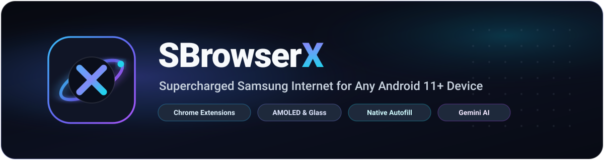

 

### The fastest, cleanest, and most capable Samsung Internet experience — on **any** Android 11+ phone.

**English** · [Русский](README.ru.md)

  
  

☕ <b>Support the Author</b> — Boosty · USDT (TRC20 / TON) · Bitcoin (BTC)

 

| Method | Address / Link |
| :--- | :--- |
| **Boosty (Card / PayPal / SBP)** | [boosty.to/vortexnode/donate](https://boosty.to/vortexnode/donate) |
| **USDT (TRC20)** | `TL1dvN9DLJMgo1zoKQ682BoUNr2wVYB6rW` |
| **USDT (TON)** | `UQBy-hdr5yjVBPV8W4cz-stesuYvvHRghALfqltCEyagM-8N` |
| **Bitcoin (BTC)** | `17tzAY6JXuy6KzfZcDmb22DiHsxDKiNpx1` |

 

  
  
  
  
  
  
  

  <a href="#-highlights">Highlights</a> ·
  <a href="#-screenshots">Screenshots</a> ·
  <a href="#-sbrowserx-vs-stock-samsung-internet">Comparison</a> ·
  <a href="#-complete-patch-catalog">Patches</a> ·
  <a href="#-how-to-install">Install</a> ·
  <a href="#-faq">FAQ</a> ·
  <a href="#-support-the-author">Support</a>

---

**SBrowserX** is a curated Morphe patch suite for **Samsung Internet Browser** (`31.0.2.41`). It unlocks full Chrome Web Store extensions on any Android phone, brings true `#000000` AMOLED Black & frosted-glass styling, enables out-of-the-box Bitwarden/Gboard autofill without Samsung Pass, replaces locked Samsung cloud AI with open Gemini & 5-engine page translation, adds a customizable Start Page, and strips out telemetry, ads, and bloat — all **without root** and **100% standalone** alongside (or even without) stock Samsung Internet.

---

## ✨ Highlights

- 🧩 **Full Chrome Web Store & Extensions on Any Android** — Install **uBlock Origin Lite**, **SponsorBlock**, **Voice Over Translation (VOT)**, **All Fingerprint Defender**, **AdGuard**, **Bitwarden**, **Mate Translate**, or any `.crx` / `.zip` extension directly on Samsung, Pixel, Xiaomi, OnePlus, and other Android 11+ devices — with built-in Manifest V2 protection.
- 🤖 **5-Engine Built-in Translator & Gemini AI Summaries** — Translate entire pages (including complex news sites like Google News, Reuters, Le Monde, and GSMArena) with **Bing** (default), **Yandex**, **Google Translate**, **DeepL API**, or **Gemini 3.5 Flash-Lite (AI)**, and summarize any article into crisp bullet points in one tap with your free Gemini API key.
- 🏠 **Clean SBrowserX Start Page** — Replaces Samsung's ad-heavy New Tab with an ultra-clean canvas, **4 or 5-column shortcut grid**, **edge-to-edge Quetta-style icon tiles**, AMOLED / local photo / daily HD wallpapers with live refresh, and an optional Open-Meteo weather widget.
- 🖤 **True AMOLED Black & Frosted Glass UI** — Pure `#000000` dark theme for both browser surfaces and websites, smart icon & logo protection (no inverted avatars or site logos), plus independent transparency and blur sliders for the bottom bar, address bar, compact bar, More menu, and Add-ons popup.
- ⚙️ **Redesigned Settings, 20 Languages & Smart Highlights** — Unified One UI `SBrowserX settings` top card with blue accent summaries, Morphe-style teal dots that clear automatically once seen, frosted-glass **What's New** dialog, full **Android Per-App Language** support, and localization across **20 world languages**.
- 🔑 **Out-of-the-Box Password Manager Autofill** — Native inline suggestions right inside your keyboard (Gboard, Samsung Keyboard) for **Bitwarden**, **1Password**, **KeePassDX**, and any system autofill provider. Samsung Pass nags are removed and local payment cards work without Knox.
- 🛡️ **Private, Fast & Bloat-Free** — Strips analytics, shopping/coupon banners, Samsung homepage promos, promotional badges, and store update prompts; blocks third-party cookies by default; adds WebRTC IP leak protection and anti-fingerprinting.
- ⚡ **Power-User Browsing** — **Long-press Home** (`~500 ms`) to close all background tabs and jump to the Start Page, Opera-style automatic text reflow when zooming, up to **9,999 open tabs** (instead of 99), an extra *"After 1 day"* auto-close option, and the unlocked **Compact** floating toolbar.
- 📥 **External Download Manager Support** — Hand off files, videos, and optionally images straight to **AB Download Manager**, **Seal**, **1DM**, or any downloader installed on your phone.
- ☁️ **Complete Backup v2 (Local + Google Drive) & Standalone Clone** — Export and restore all SBrowserX settings **plus** all stock Samsung Internet preferences, bookmarks (HTML/JSON), shortcuts, and local wallpaper; choose between the SBrowserX X icon or original icon; runs 100% independently even if stock Samsung Internet is uninstalled.

---

## 📸 Screenshots

<table>
  <tr>
    <td align="center" width="33%">
      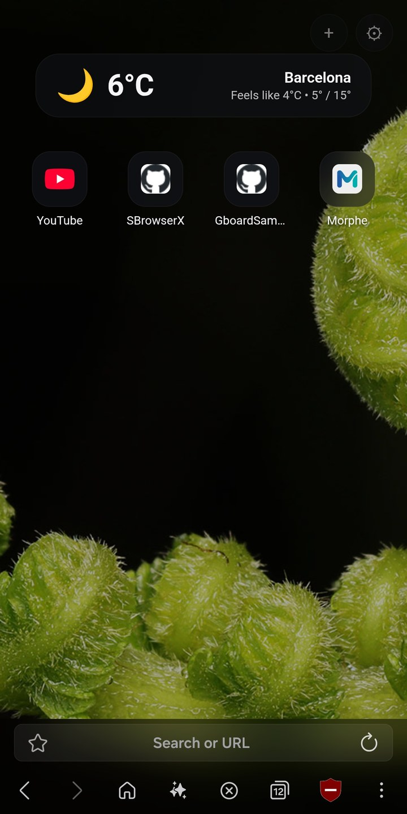 
      <b>SBrowserX Start Page &amp; Glass Bars</b>
    </td>
    <td align="center" width="33%">
      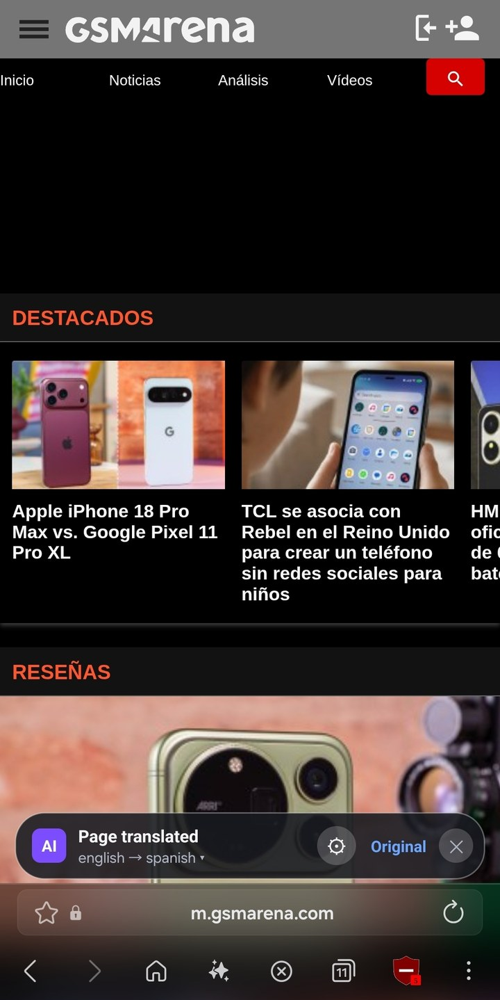 
      <b>5-Engine &amp; Gemini AI Translator</b>
    </td>
    <td align="center" width="33%">
       
      <b>Chrome Extensions &amp; Glass Popup</b>
    </td>
  </tr>
  <tr>
    <td align="center" width="33%">
      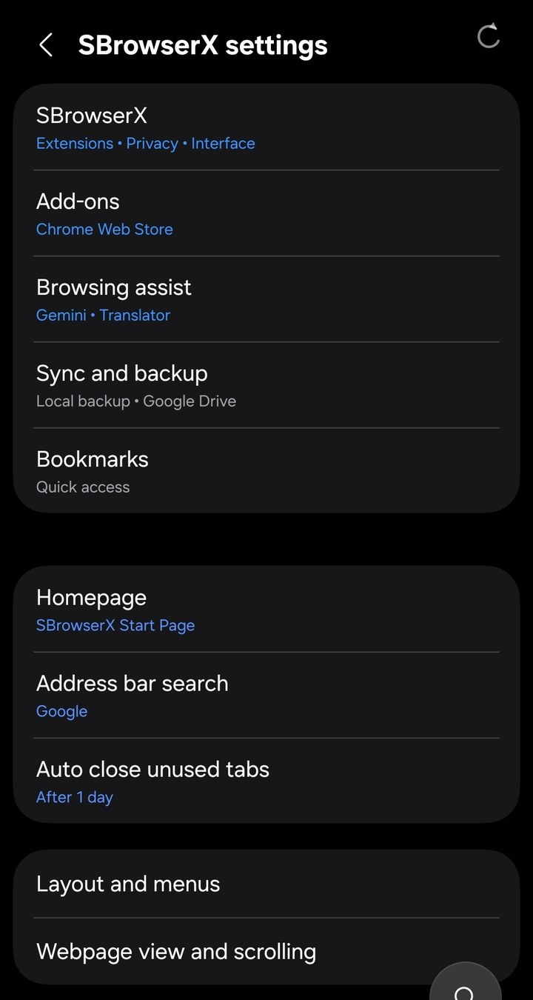 
      <b>Redesigned SBrowserX Settings</b>
    </td>
    <td align="center" width="33%">
      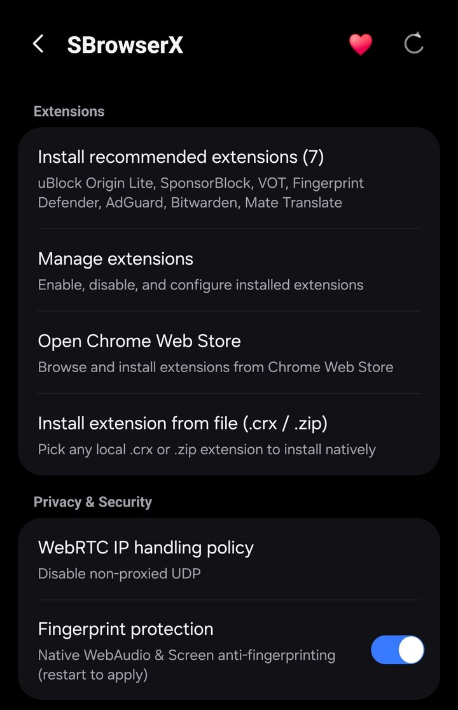 
      <b>SBrowserX Settings Hub</b>
    </td>
    <td align="center" width="33%">
      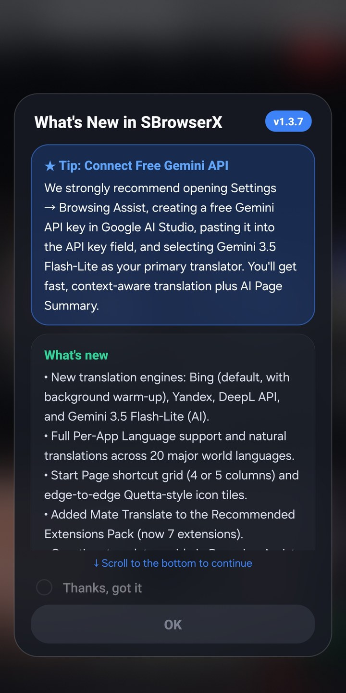 
      <b>One UI Frosted-Glass What's New</b>
    </td>
  </tr>
</table>

---

## ⚖️ SBrowserX vs Stock Samsung Internet

| Stock Samsung Internet | SBrowserX |
| :--- | :--- |
| ❌ Extensions locked to Galaxy Store & Samsung devices | ✅ **Full Chrome Web Store** + local `.crx`/`.zip` on **any** Android 11+ |
| ❌ Gray dark mode & inverted icons/logos on many sites | ✅ **True `#000000` AMOLED Black** + smart icon & logo protection |
| ❌ Opaque toolbars & milky Add-ons popup | ✅ **Adjustable frosted-glass blur & transparency** across all bars & popups |
| ❌ Ad-heavy New Tab with limited customization | ✅ **Clean Start Page** with wallpapers, weather, 4/5-col grid & full-bleed tiles |
| ❌ Pushes Samsung Pass; blocks Bitwarden inline autofill | ✅ **Native Bitwarden / 1Password / Gboard inline autofill** out of the box |
| ❌ Galaxy AI Summarize locked to flagship Samsung phones | ✅ **Gemini AI Summary** on any device (free API key) |
| ❌ Samsung-only cloud translator | ✅ **Bing, Yandex, Google, DeepL & Gemini 3.5 Flash-Lite** built-in |
| ❌ Telemetry, shopping promos, update nags & badge dots | ✅ **100% clean** — zero analytics, ads, promos, or update prompts |
| ❌ Hard 99-tab limit | ✅ **Up to 9,999 tabs**, *"After 1 day"* auto-close & **Long-press Home** tab cleaner |
| ❌ Built-in downloader only | ✅ **External downloaders** (AB DM, Seal, 1DM, etc.) |
| ❌ No automatic text reflow when pinching to zoom | ✅ **Opera-style text reflow on zoom** |
| ❌ Replaces your main browser | ✅ **100% standalone install** with custom icon & full settings backup v2 |

---

## 📦 Complete Patch Catalog

Every patch is modular and selectable inside **Morphe Manager**. Tap any category below to see what each patch does — along with live screenshots.

<b>🧩 Extensions &amp; Chrome Web Store</b> — Full desktop-grade extensions on mobile

 

- **Unlock Chrome Web Store & Extensions** — Unlocks the Chrome Web Store, toolbar extension pinning, and third-party `.crx` / `.zip` installation on both Samsung and non-Samsung Android phones, prevents installed extensions from being removed automatically, and safely blocks incompatible Manifest V2 files with a clear One UI dialog.
- **One-Tap Recommended Pack (7 Extensions) & Native Manager** — Includes quick links to install **uBlock Origin Lite**, **SponsorBlock**, **VOT**, **All Fingerprint Defender**, **AdGuard**, **Bitwarden**, and **Mate Translate**, plus a clean AMOLED manager right inside Settings.

<table>
  <tr>
    <td align="center" width="33%">
       
      <b>Add-ons Glass Popup</b>
    </td>
    <td align="center" width="33%">
      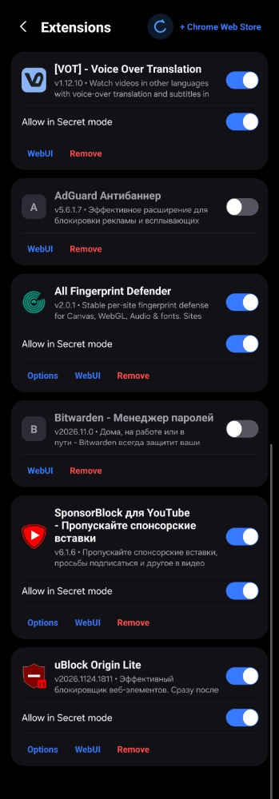 
      <b>Native Extensions Manager</b>
    </td>
    <td align="center" width="33%">
       
      <b>Recommended Pack (7) &amp; .crx/.zip</b>
    </td>
  </tr>
</table>

<b>🏠 SBrowserX Start Page</b> — Wallpapers, Open-Meteo weather &amp; customizable shortcut grid

 

- **Clean Canvas & Live Wallpapers** — Choose pure AMOLED black, a photo from your gallery, or daily online HD wallpapers with adjustable dimming — updates apply live without restarting.
- **Customizable Shortcuts & Weather** — Switch between a **4-column** or **5-column** shortcut grid, toggle **Fill tile with icon** (edge-to-edge Quetta-style tiles), and optionally enable the free **Open-Meteo** weather widget with auto-detected or custom city and `°C / °F` units.

<table>
  <tr>
    <td align="center" width="50%">
       
      <b>SBrowserX Start Page</b>
    </td>
    <td align="center" width="50%">
      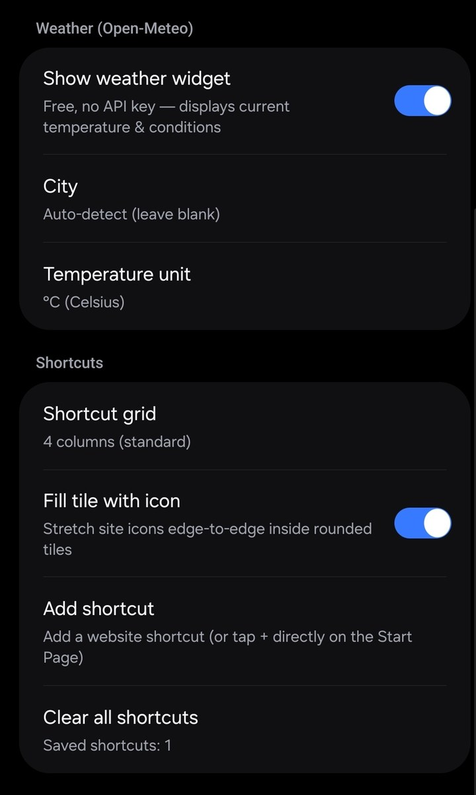 
      <b>Weather, Grid &amp; Tile Fill Settings</b>
    </td>
  </tr>
</table>

<b>🎨 Appearance, AMOLED Black &amp; Glass UI</b> — Pure black &amp; adjustable frosted glass

 

- **AMOLED Black & Bottom Bar Transparency** — Turns dark mode surfaces pure `#000000` AMOLED black, adds adjustable blur and translucency sliders for the bottom bar, address bar, and compact bar, and syncs both the **More** menu and **Add-ons** popup to the exact same glass style.
- **Unified Dark Mode & True AMOLED Websites** — Keeps website dark mode synced with your browser theme, removes muddy dim overlays, and applies true AMOLED black backgrounds when enabled.
- **Dark Mode: Preserve Icons & Logos** — Prevents small icons, site logos, badges, and user avatars from getting weirdly color-inverted in Dark Mode.
- **Unlock Compact Layout** — Unlocks the floating Compact bottom pill layout with smooth scrolling, clean wallpaper edge-to-edge rendering, and a customizable extra toolbar button.

<table>
  <tr>
    <td align="center" width="25%">
      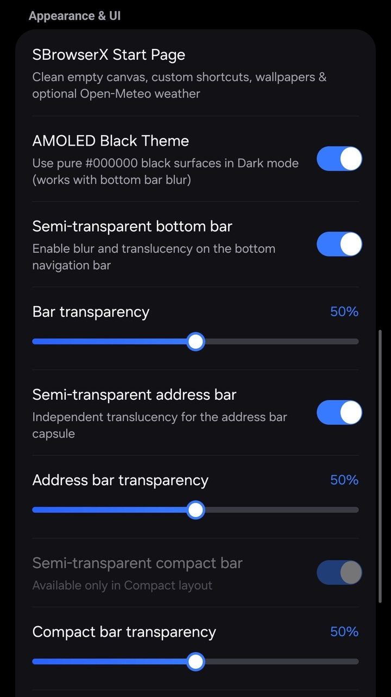 
      <b>Transparency &amp; Blur Sliders</b>
    </td>
    <td align="center" width="25%">
       
      <b>True AMOLED Dark Mode</b>
    </td>
    <td align="center" width="25%">
       
      <b>Compact / Bottom Layouts</b>
    </td>
    <td align="center" width="25%">
      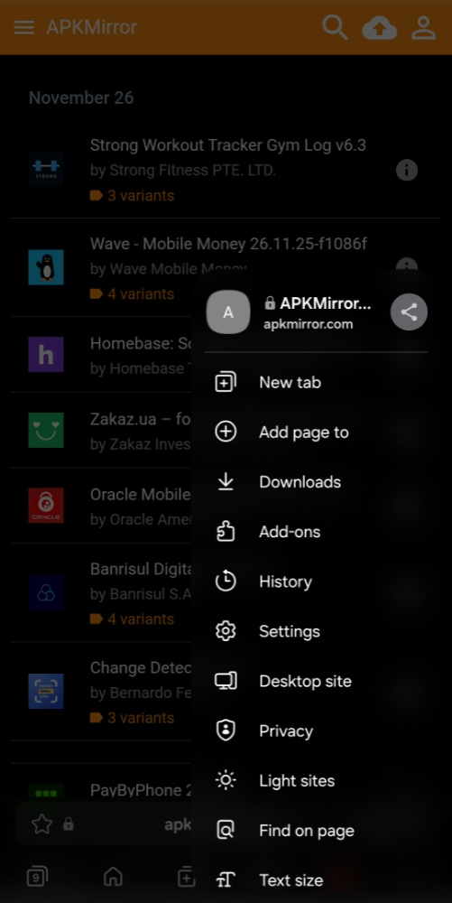 
      <b>Frosted Glass Menu</b>
    </td>
  </tr>
</table>

<b>🤖 AI Browsing Assist &amp; Built-in Translator</b> — 5 translation engines &amp; Gemini AI summaries

 

- **Built-in 5-Engine Translator** — Replaces the restricted stock translator with instant page translation powered by **Bing** (default), **Yandex**, **Google Translate**, **DeepL API**, or **Gemini 3.5 Flash-Lite (AI)** — with improved compatibility across sites like Google News, Reuters, Le Monde, and GSMArena, refined floating translation bar, Dark Mode toolbar icon fix, and a quick setup guide in Browsing Assist.
- **Gemini AI Page Summary** — Replaces locked Samsung Galaxy AI Browsing Assist with fast bullet-point webpage summaries using your own free Google AI Studio key.

<table>
  <tr>
    <td align="center" width="33%">
       
      <b>Instant Page Translation (AI Bar)</b>
    </td>
    <td align="center" width="33%">
      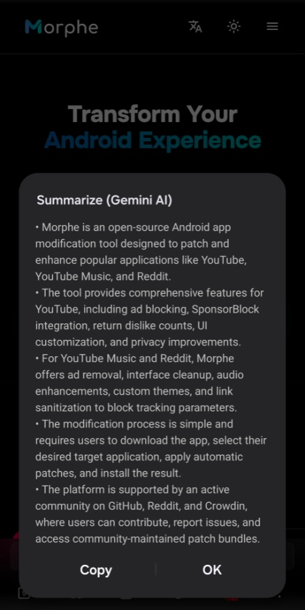 
      <b>One-Tap Webpage Summary</b>
    </td>
    <td align="center" width="33%">
       
      <b>Browsing Assist &amp; Translate</b>
    </td>
  </tr>
</table>

<b>🛡️ Privacy, Autofill &amp; Clean Settings</b> — Zero bloat, redesigned One UI settings &amp; native password managers

 

- **Redesigned SBrowserX Settings** — Clean `SBrowserX settings` header, unified top card with One UI blue accent summaries, hidden unused stock menus and Samsung homepage promo banner, plus a bottom About & Support card.
- **Third-Party Autofill Support** — Unlocks native Android Autofill so **Bitwarden**, **1Password**, **KeePassDX**, and other password managers appear directly inside your keyboard suggestion strip. Removes Samsung Pass prompts and unlocks local credit/debit cards without Knox.
- **Remove Telemetry, Promotions & Updates** — Removes built-in analytics, shopping/coupon banners, marketing pushes, and background store update checks while keeping regular website notifications working.
- **Disable Update Prompts & Badges** — Hides store update popups, banners, and persistent orange notification dots on the menu button.
- **Block Third-Party Cookies by Default** — Protects your privacy out of the box across all websites (can be adjusted anytime in Settings).
- **WebRTC IP Leak & Fingerprint Protection** — Built-in toggles in the SBrowserX hub to disable non-proxied UDP WebRTC leaks and enable native anti-fingerprinting.

<table>
  <tr>
    <td align="center" width="33%">
       
      <b>Unified Settings Top Card</b>
    </td>
    <td align="center" width="33%">
      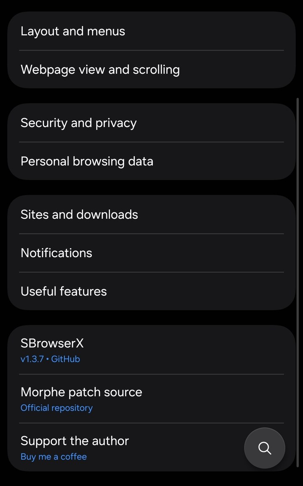 
      <b>About, Morphe &amp; Support Card</b>
    </td>
    <td align="center" width="33%">
       
      <b>WebRTC &amp; Anti-Fingerprinting</b>
    </td>
  </tr>
</table>

<b>⚡ Downloads, Tabs, Reading &amp; Utilities</b> — Built for daily power users

 

- **External Downloader Support** — Route file, video, link, and (optionally) image downloads directly to **AB Download Manager**, **Seal**, **1DM**, or any downloader app you choose.
- **Long-Press Home Button** — Hold the Home icon (`~500 ms`) to close all background tabs and open or reload the Start Page from anywhere.
- **Remove 99-Tab Limit & Auto-Close After 1 Day** — Raises the open tab cap from 99 to **9,999** tabs and adds an *"After 1 day"* auto-close option.
- **Opera-Style Text Reflow on Zoom** — Automatically re-wraps text to fit your screen width after pinch-to-zoom so you never have to scroll sideways.
- **Full Backup v2, 20 Languages & Smart Highlights** — Export/restore all SBrowserX and stock Samsung Internet settings, bookmarks, shortcuts, and local wallpaper (local + Google Drive); full **Per-App Language** support across **20 languages**; Morphe-style teal new-feature dots that clear once viewed; frosted-glass **What's New** sheet; one-tap **Restart** button.
- **Standalone Package, App Name & Icon Choice** — Installs cleanly side-by-side (and runs with zero crash even if stock Samsung Internet is uninstalled), with your choice of the SBrowserX **X** launcher icon or the original icon.

<table>
  <tr>
    <td align="center" width="20%">
      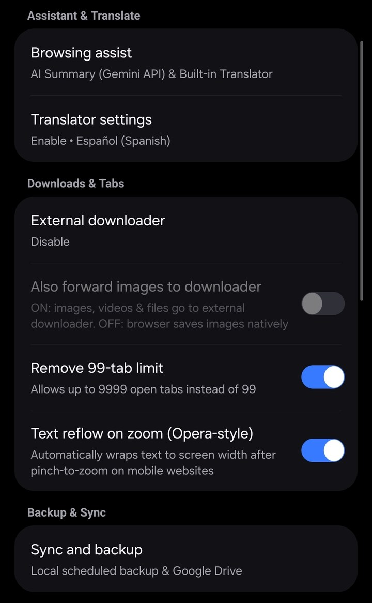 
      <b>Tabs, Reflow &amp; Backup</b>
    </td>
    <td align="center" width="20%">
      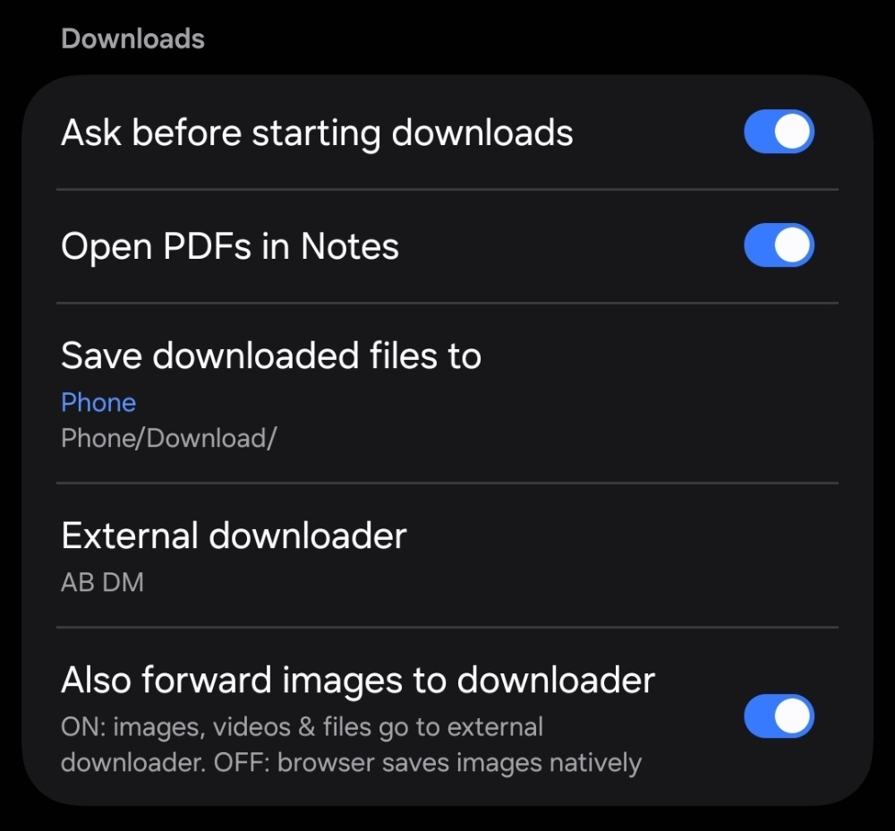 
      <b>Downloads Integration</b>
    </td>
    <td align="center" width="20%">
      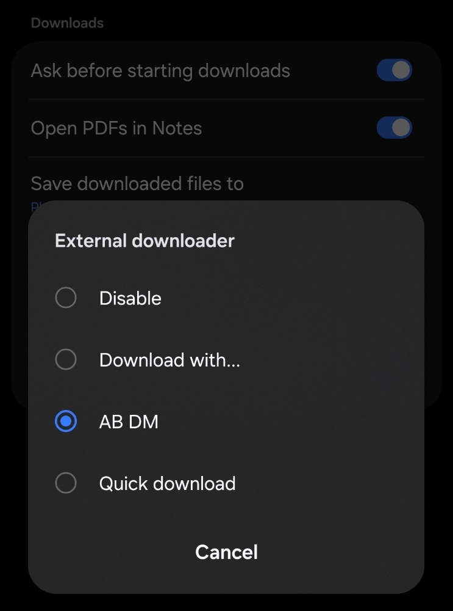 
      <b>Downloader Picker</b>
    </td>
    <td align="center" width="20%">
      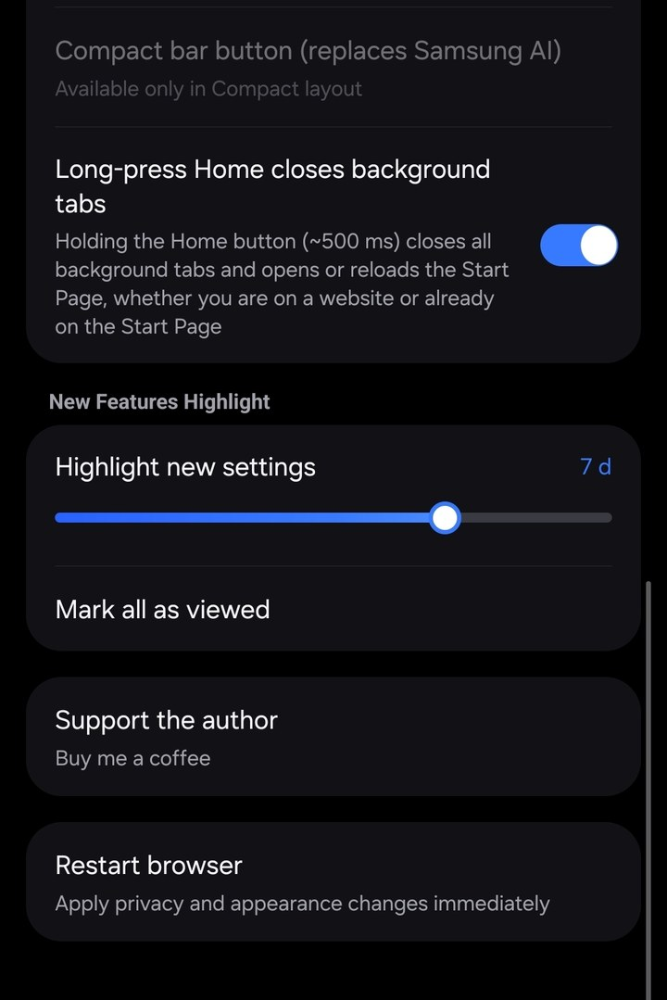 
      <b>Home Gesture &amp; Restart</b>
    </td>
    <td align="center" width="20%">
       
      <b>What's New Sheet</b>
    </td>
  </tr>
</table>

---

## 🚀 How to Install

Works on **any Android 11+ device** (Samsung Galaxy, Google Pixel, Xiaomi, OnePlus, Nothing, etc.) — **no root required**.

1. **Install [Morphe Manager](https://morphe.software/)** on your Android device.
2. **Add SBrowserX in 1 tap**:

   

   *(Or add manually in Morphe Manager via `Settings → Patch sources → Add source`: `https://github.com/vortexnode/SBrowserX`)*
3. **Download the base APK**: get **Samsung Internet Browser `31.0.2.41`** (`arm64-v8a`, `nodpi`) from [APKMirror](https://www.apkmirror.com/apk/samsung-electronics-co-ltd/samsung-internet-for-android/).
4. **Patch & Install**: pick the downloaded APK in Morphe Manager, keep the default patches selected (or customize them to your liking), tap **Patch**, and install **SBrowserX**.

> [!TIP]
> **First-time setup (30 seconds):** Open **Settings → SBrowserX** to enable **AMOLED Black**, install your favorite extensions (**uBlock Origin Lite**, **SponsorBlock**, **Mate Translate**, etc.) in one tap, and add your free **Gemini API key** in **Browsing assist** to unlock **Gemini 3.5 Flash-Lite** translation and AI Page Summaries.

---

## ❓ FAQ

<b>Does SBrowserX work on non-Samsung phones (Pixel, Xiaomi, OnePlus, etc.)?</b>

 
Yes! SBrowserX works on any <code>arm64-v8a</code> Android 11+ phone — including Chrome Web Store extensions, AMOLED Black theme, native Bitwarden autofill, Gemini AI summaries, and 5-engine page translation. Samsung-exclusive hardware blur gracefully falls back to clean translucent surfaces on non-One UI ROMs.

<b>Will installing SBrowserX overwrite my stock Samsung Internet?</b>

 
No. By default, SBrowserX uses its own package name and app name, so it installs cleanly side-by-side without touching your stock browser, bookmarks, or data — and it also works 100% independently even if stock Samsung Internet is uninstalled.

<b>How do I use Bitwarden (or another password manager) with inline keyboard autofill?</b>

 
1. Make sure your password manager is selected in Android <b>Settings → Passwords &amp; autofill</b>. 
2. In <b>Bitwarden → Settings → Auto-fill</b>, enable <b>Auto-fill services</b> and <b>Use inline autofill</b>. 
3. If your password manager asks to trust custom browsers, add <b>SBrowserX</b> (<code>sbrowserx.com.sec.android.app.sbrowser</code>) to its trusted/privileged browsers list. 
Tap any login field and suggestions will appear right in your keyboard bar.

<b>Are the Gemini AI Page Summary and Gemini Translator free?</b>

 
Yes. Open <b>Settings → SBrowserX → Browsing assist</b>, tap the link to create a free API key in <b>Google AI Studio</b>, and paste it in. Your key is stored locally on your device and never sent anywhere else.

<b>Does it require Root?</b>

 
No root is required. Everything installs as a regular Android app patched via Morphe Manager.

---

## ☕ Support the Author

SBrowserX is developed and maintained as a free open-source project. If SBrowserX makes your daily browsing better, you can buy me a coffee:

  

| Method | Address / Link |
| :--- | :--- |
| **Boosty (Card / PayPal / SBP)** | [boosty.to/vortexnode/donate](https://boosty.to/vortexnode/donate) |
| **USDT (TRC20)** | `TL1dvN9DLJMgo1zoKQ682BoUNr2wVYB6rW` |
| **USDT (TON)** | `UQBy-hdr5yjVBPV8W4cz-stesuYvvHRghALfqltCEyagM-8N` |
| **Bitcoin (BTC)** | `17tzAY6JXuy6KzfZcDmb22DiHsxDKiNpx1` |

---

## 📄 License

Licensed under the [GNU General Public License v3.0](LICENSE).  
Samsung Internet is a trademark of Samsung Electronics Co., Ltd. SBrowserX is an independent open-source patch project and is not affiliated with Samsung Electronics.
