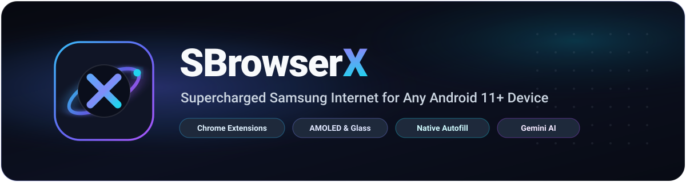
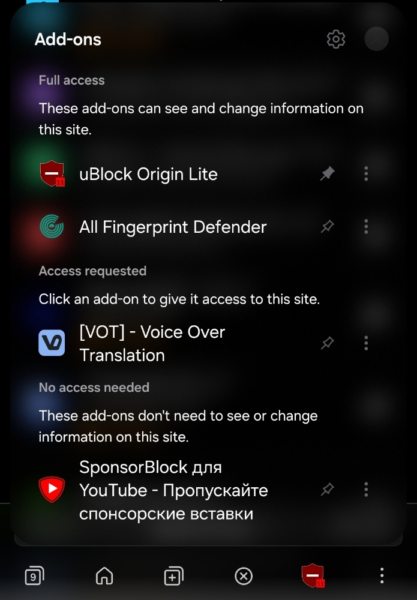
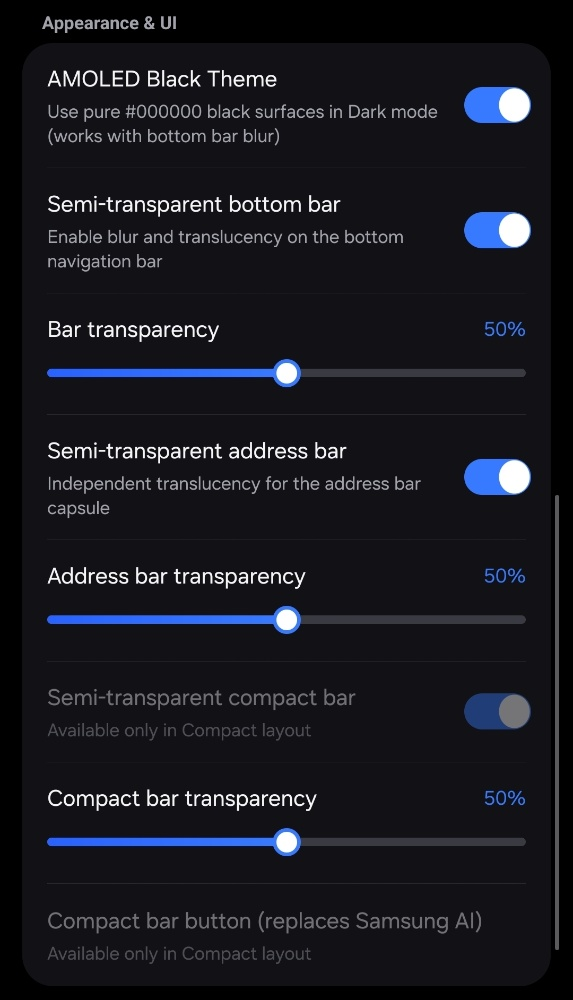
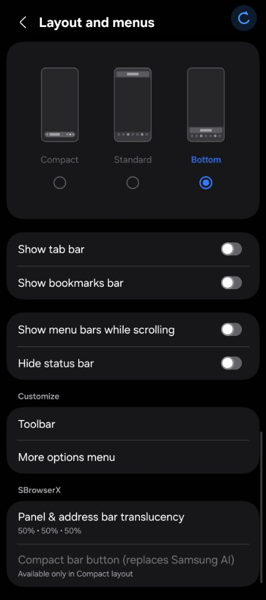
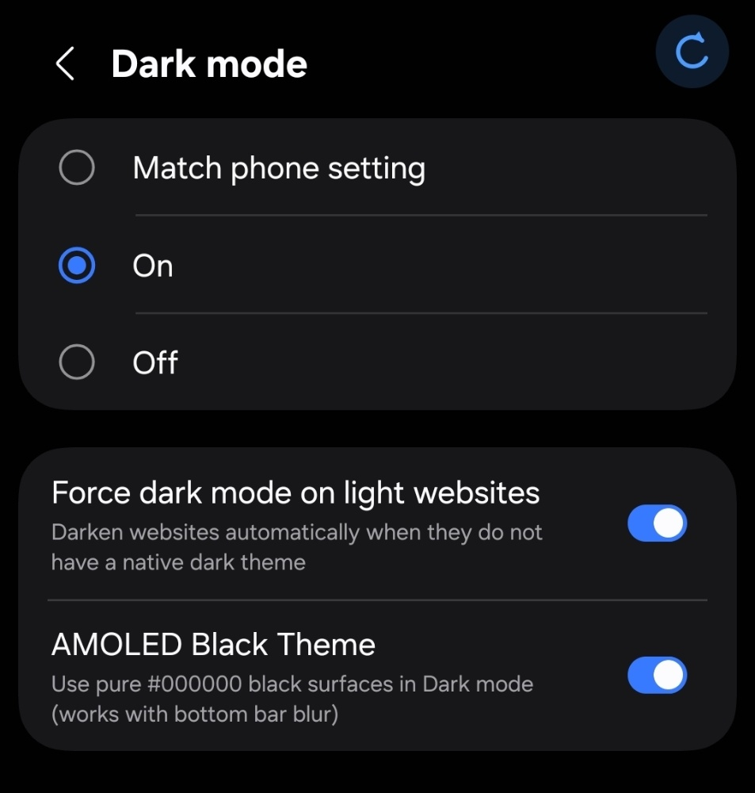
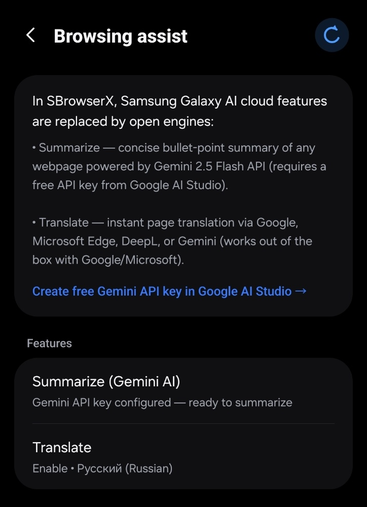
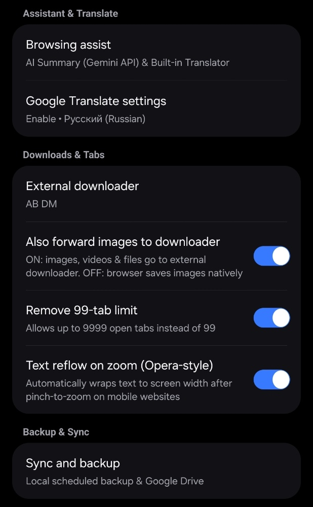
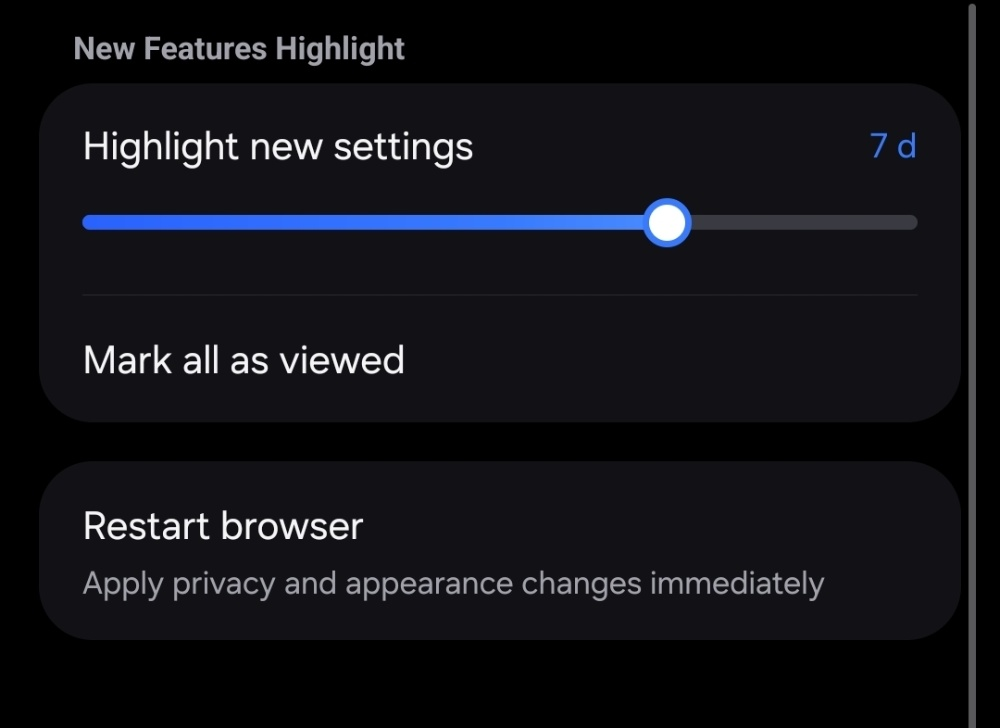

 

### Максимально быстрый, чистый и функциональный Samsung Internet — на **любом** смартфоне Android 11+.

[English](README.md) · **Русский**

  

  
  
  
  
  
  

  <a href="#-главные-возможности">Возможности</a> ·
  <a href="#-скриншоты">Скриншоты</a> ·
  <a href="#-sbrowserx-против-стокового-samsung-internet">Сравнение</a> ·
  <a href="#-полный-каталог-патчей">Патчи</a> ·
  <a href="#-как-установить">Установка</a> ·
  <a href="#-частые-вопросы">FAQ</a>

---

**SBrowserX** — набор патчей Morphe для **Samsung Internet Browser** (`31.0.2.41`). Он открывает полноценный Chrome Web Store на любом Android-смартфоне, добавляет настоящий чёрный `#000000` AMOLED и настраиваемый стеклянный блюр, включает автозаполнение Bitwarden/Gboard прямо из коробки без Samsung Pass, заменяет закрытый ИИ Samsung на открытые движки Gemini и Google Переводчик, а также вырезает всю телеметрию, рекламу и мусор — **без Root-прав** и с установкой **рядом со стоковым браузером**.

---

## ✨ Главные возможности

- 🧩 **Полноценный Chrome Web Store на любом Android** — ставьте **uBlock Origin Lite**, **SponsorBlock**, **Voice Over Translation (VOT)**, **All Fingerprint Defender**, **AdGuard**, **Bitwarden** или любые локальные `.crx` / `.zip` расширения на Samsung, Pixel, Xiaomi, OnePlus и других смартфонах Android 11+.
- 🖤 **Настоящий AMOLED Black и стеклянный блюр** — чистый чёрный `#000000` для интерфейса и сайтов, умная защита иконок и логотипов (без уродливой инверсии аватарок), плюс отдельные ползунки прозрачности и размытия для нижней панели, адресной строки, компактной панели, меню «Ещё» и окна «Дополнения».
- 🔑 **Автозаполнение из коробки (Bitwarden, 1Password, KeePassDX)** — нативные подсказки логинов и паролей прямо в строке клавиатуры (Gboard, Samsung Keyboard). Навязчивый Samsung Pass убран, а локальные банковские карты работают без Knox.
- 🤖 **Сводка страниц через Gemini AI и встроенный переводчик** — краткая выжимка любой статьи по пунктам в один тап через бесплатный ключ Gemini API, а также мгновенный перевод страниц через **Google Translate**, **Microsoft Edge**, **DeepL** или **Gemini**.
- 🛡️ **Приватность, скорость и ноль мусора** — вырезаны аналитика, рекламные баннеры, купоны, назойливые точки обновлений и всплывающие окна магазинов; сторонние cookies заблокированы по умолчанию; добавлена защита от утечек WebRTC и фингерпринтинга.
- ⚡ **Удобство для ежедневного сёрфинга** — автоперенос текста при масштабировании как в Opera, до **9 999 открытых вкладок** (вместо 99), опция автозакрытия вкладок *«Через 1 день»* и разблокированный **Компактный** режим панели с настраиваемой кнопкой.
- 🏠 **Чистая стартовая страница SBrowserX** — замена перегруженной вкладки Samsung на пустой минималистичный экран, свои ярлыки, обои AMOLED / с телефона / ежедневные онлайн-обои HD с затемнением и опциональный виджет погоды Open-Meteo (по умолчанию выключен).
- 📥 **Поддержка внешних загрузчиков** — отправка файлов, видео и (по желанию) картинок напрямую в **AB Download Manager**, **Seal**, **1DM** или любой другой менеджер загрузок.
- ☁️ **Бэкап настроек и универсальный экспорт/импорт закладок** — локальное и Google Drive сохранение настроек, плюс отдельный **экспорт/импорт закладок** (HTML/JSON для Chrome, Firefox, Edge, Brave, Opera, Safari) без дублей и с поддержкой автобэкапа.

---

## 📸 Скриншоты

<table>
  <tr>
    <td align="center" width="33%">
       
      <b>Расширения Chrome и стеклянное меню</b>
    </td>
    <td align="center" width="33%">
       
      <b>Меню «Ещё» в стиле AMOLED Glass</b>
    </td>
    <td align="center" width="33%">
       
      <b>Сводка страницы (Gemini AI)</b>
    </td>
  </tr>
  <tr>
    <td align="center" width="33%">
       
      <b>Центр настроек SBrowserX</b>
    </td>
    <td align="center" width="33%">
       
      <b>Ползунки прозрачности и размытия</b>
    </td>
    <td align="center" width="33%">
       
      <b>Компактный, стандартный и нижний макеты</b>
    </td>
  </tr>
</table>

---

## ⚖️ SBrowserX против стокового Samsung Internet

| Стоковый Samsung Internet | SBrowserX |
| :--- | :--- |
| ❌ Дополнения только из Galaxy Store и только на Samsung | ✅ **Полный Chrome Web Store** + `.crx`/`.zip` на **любом** Android 11+ |
| ❌ Серая тёмная тема и инверсия иконок/логотипов на сайтах | ✅ **Чистый `#000000` AMOLED** + защита иконок и логотипов |
| ❌ Непрозрачные панели и блёклое меню дополнений | ✅ **Настраиваемый стеклянный блюр и прозрачность** всех панелей и меню |
| ❌ Навязывает Samsung Pass; не даёт автозаполнение Bitwarden | ✅ **Нативное автозаполнение Bitwarden / 1Password / Gboard** из коробки |
| ❌ ИИ-сводка работает только на флагманах Samsung | ✅ **Сводка Gemini 2.5 Flash** на любом телефоне (бесплатный ключ) |
| ❌ Только облачный переводчик Samsung | ✅ **Google Translate, Microsoft Edge, DeepL и Gemini** внутри браузера |
| ❌ Телеметрия, рекламные баннеры, точки и запросы обновлений | ✅ **Полная чистота** — ноль аналитики, рекламы и лишних бейджей |
| ❌ Жёсткий лимит в 99 вкладок | ✅ **До 9 999 вкладок** + автозакрытие *«Через 1 день»* |
| ❌ Только встроенный загрузчик | ✅ **Внешние загрузчики** (AB DM, Seal, 1DM и др.) |
| ❌ Нет автопереноса текста при зуме | ✅ **Автоперенос текста при масштабировании** (как в Opera) |
| ❌ Заменяет основной браузер | ✅ **Отдельная установка рядом** со стоковым браузером |

---

## 📦 Полный каталог патчей

Каждый патч можно включить или отключить в **Morphe Manager**. Раскройте нужный раздел ниже, чтобы посмотреть описание и скриншоты.

<b>🧩 Расширения и Chrome Web Store</b> — полноценные десктопные дополнения на смартфоне

 

- **Unlock Chrome Web Store & Extensions** — открывает доступ к Chrome Web Store, закрепление иконок расширений на панели и установку локальных `.crx` / `.zip` дополнений на любых смартфонах (включая не-Samsung), а также защищает установленные расширения от автоматического удаления.
- **Быстрый набор и нативный менеджер** — в настройках SBrowserX собрана быстрая установка популярных расширений (**uBlock Origin Lite**, **SponsorBlock**, **VOT**, **All Fingerprint Defender**, **AdGuard**, **Bitwarden**) и удобный AMOLED-менеджер для управления ими.

<table>
  <tr>
    <td align="center" width="33%">
       
      <b>Стеклянное меню дополнений</b>
    </td>
    <td align="center" width="33%">
       
      <b>Нативный менеджер расширений</b>
    </td>
    <td align="center" width="33%">
       
      <b>Chrome Web Store и .crx / .zip</b>
    </td>
  </tr>
</table>

<b>🎨 Оформление, AMOLED Black и стеклянный UI</b> — чистый чёрный и гибкий блюр

 

- **AMOLED Black & Bottom Bar Transparency** — переводит тёмную тему интерфейса в чистый `#000000` AMOLED, добавляет ползунки прозрачности и размытия для нижней панели, адресной строки и компактной панели, а также синхронизирует оформление меню «Ещё» и окна «Дополнения».
- **Unified Dark Mode & True AMOLED Websites** — синхронизирует тёмную тему сайтов с темой браузера, убирает лишнее затемнение и применяет глубокий AMOLED-чёрный фон.
- **Dark Mode: Preserve Icons & Logos** — защищает мелкие иконки, логотипы сайтов, бейджи и аватарки от некорректной инверсии цветов в тёмном режиме.
- **Unlock Compact Layout** — открывает плавающую компактную панель снизу с плавной прокруткой, чистым фоном без лишних полос и возможностью переназначить дополнительную кнопку.

<table>
  <tr>
    <td align="center" width="25%">
       
      <b>Ползунки прозрачности</b>
    </td>
    <td align="center" width="25%">
       
      <b>Чистый AMOLED Black</b>
    </td>
    <td align="center" width="25%">
       
      <b>Выбор макета панелей</b>
    </td>
    <td align="center" width="25%">
       
      <b>Стеклянное меню «Ещё»</b>
    </td>
  </tr>
</table>

<b>🤖 ИИ-помощник и встроенный переводчик</b> — сводки статей и перевод страниц

 

- **Built-in Google Translate Engine** — заменяет ограниченный стоковый переводчик на мгновенный перевод страниц через **Google Translate**, **Microsoft Edge**, **DeepL** или **Gemini** с автопереводом и быстрым выбором языка.
- **Сводка страниц через Gemini AI** — заменяет закрытый Samsung Galaxy AI на быстрые конспекты любых статей по пунктам на базе **Gemini 2.5 Flash** (работает по бесплатному ключу Google AI Studio).

<table>
  <tr>
    <td align="center" width="50%">
       
      <b>Краткая сводка любой страницы</b>
    </td>
    <td align="center" width="50%">
       
      <b>Настройки ИИ-помощника и переводчика</b>
    </td>
  </tr>
</table>

<b>🛡️ Приватность, автозаполнение и чистота</b> — без телеметрии и навязывания Samsung Pass

 

- **Third-Party Autofill Support** — включает полноценное системное автозаполнение Android: **Bitwarden**, **1Password**, **KeePassDX** и другие менеджеры паролей предлагают логины прямо в клавиатуре. Убирает навязчивые баннеры Samsung Pass и разблокирует локальные карты без Knox.
- **Remove Telemetry, Promotions & Updates** — вырезает встроенную аналитику, рекламные и шопинг-блоки, маркетинговые пуши и фоновые проверки обновлений магазинов, сохраняя обычные уведомления от сайтов.
- **Disable Update Prompts & Badges** — скрывает назойливые предложения обновиться, баннеры и оранжевые точки-индикаторы на кнопке меню.
- **Block Third-Party Cookies by Default** — по умолчанию блокирует сторонние cookies на всех сайтах (при желании легко меняется в настройках).
- **Защита WebRTC и анти-фингерпринтинг** — встроенные переключатели для блокировки утечек реального IP через WebRTC и защиты от цифрового отпечатка.

<table>
  <tr>
    <td align="center">
       
      <b>Защита WebRTC и анти-фингерпринтинг</b>
    </td>
  </tr>
</table>

<b>⚡ Загрузки, вкладки, чтение и утилиты</b> — всё для комфортной работы каждый день

 

- **External Downloader Support** — перенаправляет скачивание файлов, видео, ссылок и (опционально) изображений в **AB Download Manager**, **Seal**, **1DM** или любой другой внешний загрузчик.
- **Remove 99-Tab Limit** — снимает ограничение в 99 вкладок и позволяет держать открытыми до **9 999** вкладок.
- **Auto-Close Unused Tabs: After 1 Day** — добавляет удобный вариант автозакрытия неиспользуемых вкладок *«Через 1 день»*.
- **Автоперенос текста при зуме (как в Opera)** — после приближения страницы текст автоматически подстраивается под ширину экрана, без горизонтальной прокрутки.
- **Центр настроек SBrowserX, бэкап и перезапуск** — все новые функции собраны в одном разделе (и продублированы в родных пунктах настроек браузера), есть локальный и Google Drive бэкап, подсветка новых настроек и кнопка быстрого перезапуска.
- **Change Package, App Name & Иконка SBrowserX** — устанавливает SBrowserX рядом со стоковым Samsung Internet с фирменной аккуратной иконкой **X** (включая поддержку тематических значков One UI).
- **Unlock Debug Settings Menu** — опциональный патч, открывающий скрытое меню отладки в настройках браузера.

<table>
  <tr>
    <td align="center" width="25%">
       
      <b>Вкладки, зум и бэкап</b>
    </td>
    <td align="center" width="25%">
       
      <b>Интеграция в Загрузки</b>
    </td>
    <td align="center" width="25%">
       
      <b>Выбор загрузчика</b>
    </td>
    <td align="center" width="25%">
       
      <b>Подсветка и перезапуск</b>
    </td>
  </tr>
</table>

---

## 🚀 Как установить

Работает на **любом смартфоне с Android 11+** (Samsung Galaxy, Google Pixel, Xiaomi, OnePlus, Nothing и др.) — **Root-права не нужны**.

1. **Установите [Morphe Manager](https://morphe.software/)** на смартфон.
2. **Добавьте SBrowserX в 1 тап**:

   

   *(Или добавьте вручную в Morphe Manager: `Настройки → Источники патчей → Добавить источник` → `https://github.com/vortexnode/SBrowserX`)*
3. **Скачайте базовый APK**: **Samsung Internet Browser `31.0.2.41`** (`arm64-v8a`, `nodpi`) с [APKMirror](https://www.apkmirror.com/apk/samsung-electronics-co-ltd/samsung-internet-for-android/).
4. **Пропатчите и установите**: выберите скачанный APK в Morphe Manager, оставьте рекомендуемые патчи (или выберите нужные вручную), нажмите **Патч** и установите **SBrowserX**.

> [!TIP]
> **Быстрая настройка после первого запуска (30 секунд):** откройте **Настройки → SBrowserX**, включите **AMOLED Black**, установите нужные расширения (**uBlock Origin Lite**, **SponsorBlock** и др.) в пару кликов и выберите внешний загрузчик или ключ Gemini API.

---

## ❓ Частые вопросы

<b>Будет ли SBrowserX работать на телефоне не от Samsung (Pixel, Xiaomi, OnePlus и т.д.)?</b>

 
Да! SBrowserX работает на любом смартфоне <code>arm64-v8a</code> с Android 11+ — включая расширения Chrome Web Store, AMOLED-тему, автозаполнение Bitwarden, сводки Gemini AI и Google Переводчик. Фирменное размытие One UI на других прошивках автоматически и аккуратно заменяется чистым полупрозрачным фоном.

<b>Заменит ли SBrowserX мой обычный Samsung Internet?</b>

 
Нет. По умолчанию SBrowserX ставится с собственным именем и пакетом рядом со стоковым браузером, не затрагивая ваши закладки, вкладки и данные.

<b>Как включить автозаполнение Bitwarden прямо в клавиатуре?</b>

 
1. В настройках Android откройте <b>Пароли и автозаполнение</b> и выберите Bitwarden (или ваш менеджер паролей). 
2. В самом <b>Bitwarden → Настройки → Автозаполнение</b> включите <b>Службы автозаполнения</b> и <b>Встроенное автозаполнение</b>. 
3. При необходимости добавьте <b>SBrowserX</b> (<code>sbrowserx.com.sec.android.app.sbrowser</code>) в список доверенных/привилегированных браузеров. 
После этого при нажатии на поле логина подсказка сразу появится в строке клавиатуры.

<b>Сводка страниц через Gemini AI бесплатная?</b>

 
Да. Откройте <b>Настройки → SBrowserX → Помощник при просмотре</b>, перейдите по ссылке для создания бесплатного API-ключа в <b>Google AI Studio</b> и вставьте его в поле. Ключ хранится только локально на вашем устройстве.

<b>Нужны ли Root-права?</b>

 
Нет, Root не требуется. Пропатченный APK устанавливается как обычное приложение Android.

---

## 📄 Лицензия

Проект распространяется под лицензией [GNU General Public License v3.0](LICENSE).  
Samsung Internet является товарным знаком Samsung Electronics Co., Ltd. SBrowserX — независимый открытый проект и не связан с Samsung Electronics.
