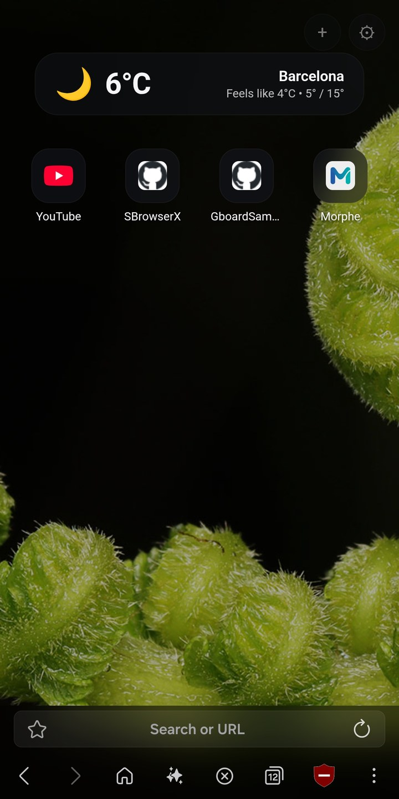
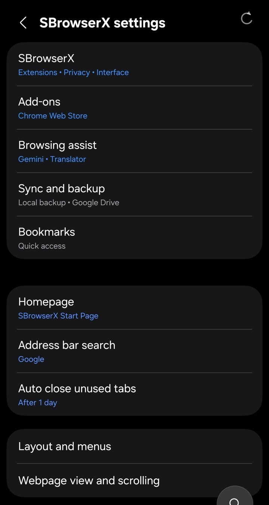
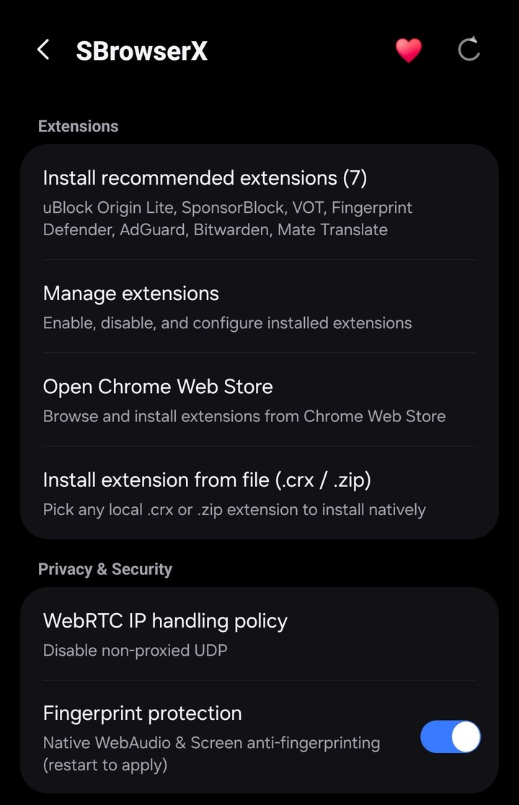
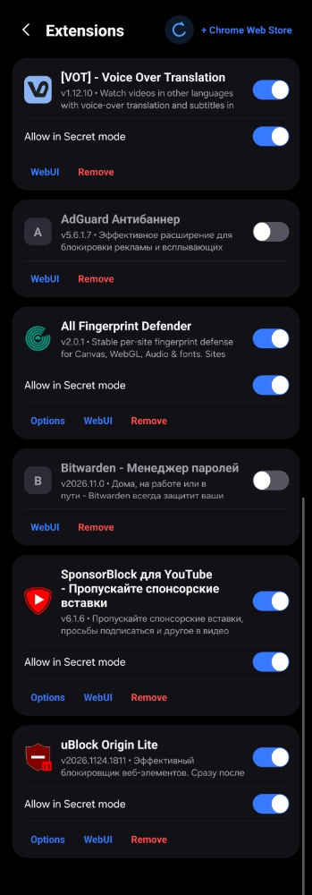
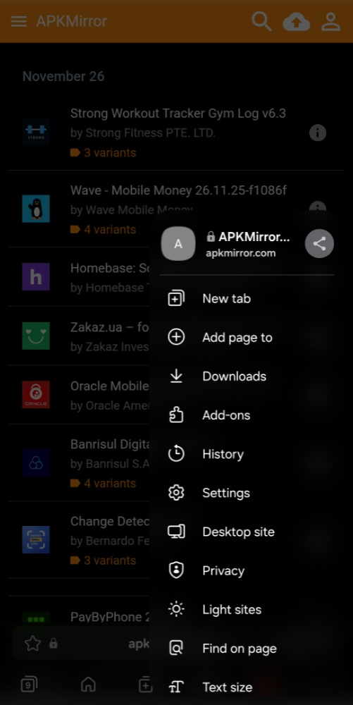
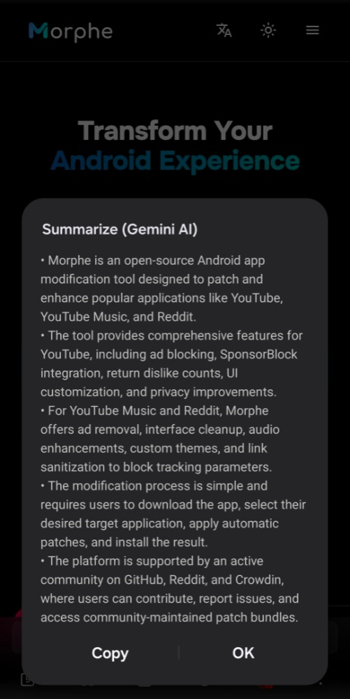
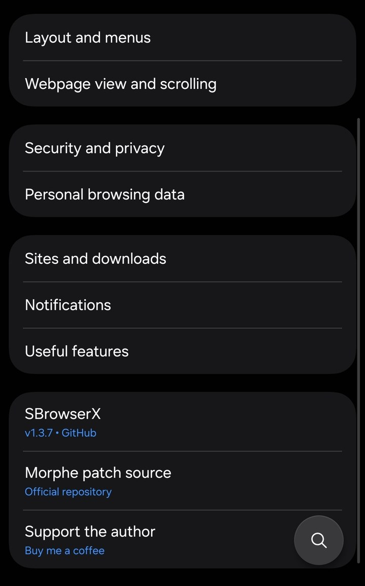
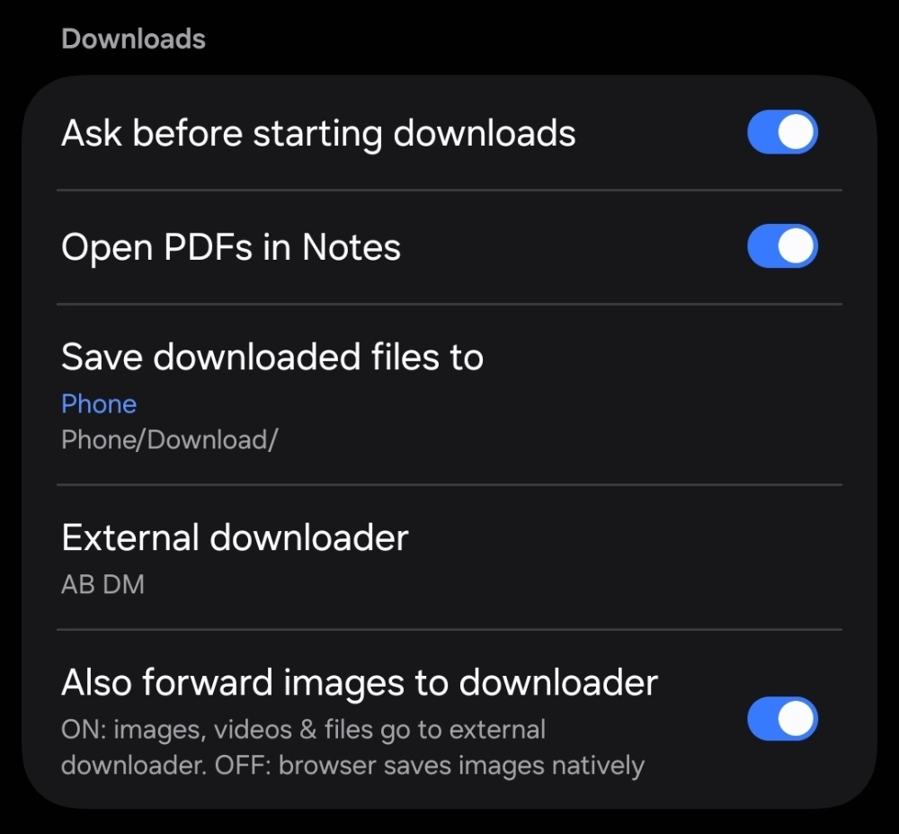
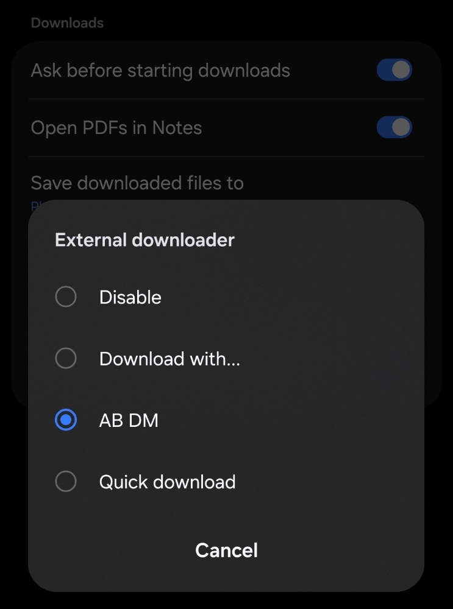

 

### Максимально быстрый, чистый и функциональный Samsung Internet — на **любом** смартфоне Android 11+.

[English](README.md) · **Русский**

  
  

☕ <b>Поддержать автора</b> — Boosty · USDT (TRC20 / TON) · Bitcoin (BTC)

 

| Способ | Адрес / Ссылка |
| :--- | :--- |
| **Boosty (Карты РФ / СБП / PayPal)** | [boosty.to/vortexnode/donate](https://boosty.to/vortexnode/donate) |
| **USDT (TRC20)** | `TL1dvN9DLJMgo1zoKQ682BoUNr2wVYB6rW` |
| **USDT (TON)** | `UQBy-hdr5yjVBPV8W4cz-stesuYvvHRghALfqltCEyagM-8N` |
| **Bitcoin (BTC)** | `17tzAY6JXuy6KzfZcDmb22DiHsxDKiNpx1` |

 

  
  
  
  
  
  
  

  <a href="#-главные-возможности">Возможности</a> ·
  <a href="#-скриншоты">Скриншоты</a> ·
  <a href="#-sbrowserx-против-стокового-samsung-internet">Сравнение</a> ·
  <a href="#-полный-каталог-патчей">Патчи</a> ·
  <a href="#-как-установить">Установка</a> ·
  <a href="#-частые-вопросы">FAQ</a> ·
  <a href="#-поддержать-автора">Поддержать</a>

---

**SBrowserX** — набор патчей Morphe для **Samsung Internet Browser** (`31.0.2.41`). Он открывает полноценный Chrome Web Store на любом Android-смартфоне, добавляет настоящий чёрный `#000000` AMOLED и настраиваемый стеклянный блюр, включает автозаполнение Bitwarden/Gboard прямо из коробки без Samsung Pass, заменяет закрытый ИИ Samsung на открытые движки Gemini и 5-движковый переводчик, добавляет чистую стартовую страницу и вырезает всю телеметрию, рекламу и мусор — **без Root-прав** и с полностью **автономной установкой** рядом со стоковым браузером (или вообще без него).

---

## ✨ Главные возможности

- 🧩 **Полноценный Chrome Web Store на любом Android** — ставьте **uBlock Origin Lite**, **SponsorBlock**, **Voice Over Translation (VOT)**, **All Fingerprint Defender**, **AdGuard**, **Bitwarden**, **Mate Translate** или любые локальные `.crx` / `.zip` расширения на Samsung, Pixel, Xiaomi, OnePlus и других смартфонах Android 11+ (со встроенной защитой от несовместимых файлов Manifest V2).
- 🤖 **Встроенный переводчик на 5 движках и сводки Gemini AI** — переводите любые страницы (включая сложные новостные сайты вроде Google News, Reuters, Le Monde и GSMArena) через **Bing** (по умолчанию), **Яндекс**, **Google Переводчик**, **DeepL API** или **Gemini 3.5 Flash-Lite (AI)**, а также получайте краткую выжимку любой статьи в один тап по бесплатному ключу Gemini API.
- 🏠 **Чистая стартовая страница SBrowserX** — замена перегруженной вкладки Samsung на минималистичный экран с **сеткой ярлыков на 4 или 5 колонок**, **заполнением плиток иконкой во всю площадь (в стиле Quetta)**, обоями AMOLED / с телефона / ежедневными онлайн-обоями HD с живым обновлением без перезапуска и опциональным виджетом погоды Open-Meteo.
- 🖤 **Настоящий AMOLED Black и стеклянный блюр** — чистый чёрный `#000000` для интерфейса и сайтов, умная защита иконок и логотипов (без уродливой инверсии аватарок), плюс отдельные ползунки прозрачности и размытия для нижней панели, адресной строки, компактной панели, меню «Ещё» и окна «Дополнения».
- ⚙️ **Обновлённые настройки, 20 языков и умные индикаторы** — единая верхняя карточка `Настройки SBrowserX` с синими акцентами One UI, бирюзовые точки новинок в стиле Morphe (автоматически исчезают после просмотра), матовое окно **«Что нового»**, полная поддержка **языка приложения (Per-App Language)** и перевод на **20 языков мира**.
- 🔑 **Автозаполнение из коробки (Bitwarden, 1Password, KeePassDX)** — нативные подсказки логинов и паролей прямо в строке клавиатуры (Gboard, Samsung Keyboard). Навязчивый Samsung Pass убран, а локальные банковские карты работают без Knox.
- 🛡️ **Приватность, скорость и ноль мусора** — вырезаны аналитика, рекламные баннеры, промо-карточка домашней страницы Samsung, купоны, назойливые точки обновлений и всплывающие окна магазинов; сторонние cookies заблокированы по умолчанию; добавлена защита от утечек WebRTC и фингерпринтинга.
- ⚡ **Удобство для ежедневного сёрфинга** — **долгий тап по кнопке «Домой»** (`~500 мс`) закрывает все фоновые вкладки и открывает стартовую страницу; автоперенос текста при масштабировании как в Opera; до **9 999 открытых вкладок** (вместо 99); опция автозакрытия вкладок *«Через 1 день»*; разблокированный **Компактный** режим панели.
- 📥 **Поддержка внешних загрузчиков** — отправка файлов, видео и (по желанию) картинок напрямую в **AB Download Manager**, **Seal**, **1DM** или любой другой менеджер загрузок.
- ☁️ **Полный бэкап v2 (локально + Google Drive) и автономный клон** — сохранение и восстановление всех настроек SBrowserX **и** всех штатных настроек Samsung Internet, закладок (HTML/JSON), ярлыков и локальных обоев; выбор иконки приложения (логотип SBrowserX X или оригинальная); 100% автономная работа даже при удалённом стоковом Samsung Internet.

---

## 📸 Скриншоты

<table>
  <tr>
    <td align="center" width="33%">
       
      <b>Стартовая страница и стеклянные панели</b>
    </td>
    <td align="center" width="33%">
       
      <b>Переводчик на 5 движках и Gemini AI</b>
    </td>
    <td align="center" width="33%">
       
      <b>Расширения Chrome и стеклянное меню</b>
    </td>
  </tr>
  <tr>
    <td align="center" width="33%">
       
      <b>Обновлённые настройки SBrowserX</b>
    </td>
    <td align="center" width="33%">
       
      <b>Центр настроек SBrowserX</b>
    </td>
    <td align="center" width="33%">
       
      <b>Матовое окно «Что нового»</b>
    </td>
  </tr>
</table>

---

## ⚖️ SBrowserX против стокового Samsung Internet

| Стоковый Samsung Internet | SBrowserX |
| :--- | :--- |
| ❌ Дополнения только из Galaxy Store и только на Samsung | ✅ **Полный Chrome Web Store** + `.crx`/`.zip` на **любом** Android 11+ |
| ❌ Серая тёмная тема и инверсия иконок/логотипов на сайтах | ✅ **Чистый `#000000` AMOLED** + защита иконок и логотипов |
| ❌ Непрозрачные панели и блёклое меню дополнений | ✅ **Настраиваемый стеклянный блюр и прозрачность** всех панелей и меню |
| ❌ Перегруженная стартовая страница с минимумом настроек | ✅ **Чистая Start Page** с обоями, погодой, сеткой 4/5 и плитками во всю площадь |
| ❌ Навязывает Samsung Pass; не даёт автозаполнение Bitwarden | ✅ **Нативное автозаполнение Bitwarden / 1Password / Gboard** из коробки |
| ❌ ИИ-сводка работает только на флагманах Samsung | ✅ **Сводка Gemini AI** на любом телефоне (бесплатный ключ) |
| ❌ Только облачный переводчик Samsung | ✅ **Bing, Яндекс, Google, DeepL и Gemini 3.5 Flash-Lite** внутри браузера |
| ❌ Телеметрия, рекламные баннеры, точки и запросы обновлений | ✅ **Полная чистота** — ноль аналитики, рекламы, промо и лишних бейджей |
| ❌ Жёсткий лимит в 99 вкладок | ✅ **До 9 999 вкладок**, *«Через 1 день»* и **долгий тап «Домой»** для очистки вкладок |
| ❌ Только встроенный загрузчик | ✅ **Внешние загрузчики** (AB DM, Seal, 1DM и др.) |
| ❌ Нет автопереноса текста при зуме | ✅ **Автоперенос текста при масштабировании** (как в Opera) |
| ❌ Заменяет основной браузер | ✅ **100% автономная установка** с выбором иконки и полным бэкапом v2 |

---

## 📦 Полный каталог патчей

Каждый патч можно включить или отключить в **Morphe Manager**. Раскройте нужный раздел ниже, чтобы посмотреть описание и скриншоты.

<b>🧩 Расширения и Chrome Web Store</b> — полноценные десктопные дополнения на смартфоне

 

- **Unlock Chrome Web Store & Extensions** — открывает доступ к Chrome Web Store, закрепление иконок расширений на панели и установку локальных `.crx` / `.zip` дополнений на любых смартфонах (включая не-Samsung), защищает установленные расширения от автоматического удаления и выводит понятное предупреждение при попытке установить несовместимые файлы Manifest V2.
- **Быстрый набор (7 расширений) и нативный менеджер** — быстрая установка **uBlock Origin Lite**, **SponsorBlock**, **VOT**, **All Fingerprint Defender**, **AdGuard**, **Bitwarden** и **Mate Translate**, а также удобный AMOLED-менеджер прямо в настройках.

<table>
  <tr>
    <td align="center" width="33%">
       
      <b>Стеклянное меню дополнений</b>
    </td>
    <td align="center" width="33%">
       
      <b>Нативный менеджер расширений</b>
    </td>
    <td align="center" width="33%">
       
      <b>Набор из 7 расширений и .crx / .zip</b>
    </td>
  </tr>
</table>

<b>🏠 Стартовая страница SBrowserX</b> — обои, погода Open-Meteo и настраиваемая сетка ярлыков

 

- **Чистый экран и живые обои** — выбор между чистым чёрным AMOLED, фото из галереи или ежедневными онлайн-обоями HD с регулировкой затемнения; все изменения применяются мгновенно без перезапуска.
- **Гибкие ярлыки и погода** — выбор сетки **4 или 5 колонок**, тумблер **Заполнять плитку иконкой** (в стиле Quetta) и опциональный бесплатный виджет погоды **Open-Meteo** с автоопределением города и выбором `°C / °F`.

<table>
  <tr>
    <td align="center" width="50%">
       
      <b>Стартовая страница SBrowserX</b>
    </td>
    <td align="center" width="50%">
       
      <b>Погода, сетка 4/5 и стиль плиток</b>
    </td>
  </tr>
</table>

<b>🎨 Оформление, AMOLED Black и стеклянный UI</b> — чистый чёрный и гибкий блюр

 

- **AMOLED Black & Bottom Bar Transparency** — переводит тёмную тему интерфейса в чистый `#000000` AMOLED, добавляет ползунки прозрачности и размытия для нижней панели, адресной строки и компактной панели, а также синхронизирует оформление меню «Ещё» и окна «Дополнения».
- **Unified Dark Mode & True AMOLED Websites** — синхронизирует тёмную тему сайтов с темой браузера, убирает лишнее затемнение и применяет глубокий AMOLED-чёрный фон.
- **Dark Mode: Preserve Icons & Logos** — защищает мелкие иконки, логотипы сайтов, бейджи и аватарки от некорректной инверсии цветов в тёмном режиме.
- **Unlock Compact Layout** — открывает плавающую компактную панель снизу с плавной прокруткой, чистым фоном без лишних полос и возможностью переназначить дополнительную кнопку.

<table>
  <tr>
    <td align="center" width="25%">
       
      <b>Ползунки прозрачности и блюра</b>
    </td>
    <td align="center" width="25%">
       
      <b>Чистый AMOLED Black</b>
    </td>
    <td align="center" width="25%">
       
      <b>Выбор макета панелей</b>
    </td>
    <td align="center" width="25%">
       
      <b>Стеклянное меню «Ещё»</b>
    </td>
  </tr>
</table>

<b>🤖 ИИ-помощник и встроенный переводчик</b> — 5 движков перевода и сводки Gemini AI

 

- **Встроенный переводчик на 5 движках** — заменяет ограниченный стоковый переводчик на мгновенный перевод страниц через **Bing** (по умолчанию), **Яндекс**, **Google Переводчик**, **DeepL API** или **Gemini 3.5 Flash-Lite (AI)** — с улучшенным переводом на таких сайтах, как Google News, Reuters, Le Monde и GSMArena, доработанной плавающей панелью, исправленной иконкой в тёмной теме и краткой справкой в «Помощь при просмотре».
- **Сводка страниц через Gemini AI** — заменяет закрытый Samsung Galaxy AI на быстрые конспекты любых статей по пунктам по бесплатному ключу Google AI Studio.

<table>
  <tr>
    <td align="center" width="33%">
       
      <b>Мгновенный перевод (AI-панель)</b>
    </td>
    <td align="center" width="33%">
       
      <b>Краткая сводка любой страницы</b>
    </td>
    <td align="center" width="33%">
       
      <b>Настройки ИИ-помощника и переводчика</b>
    </td>
  </tr>
</table>

<b>🛡️ Приватность, автозаполнение и чистые настройки</b> — без телеметрии, промо и навязывания Samsung Pass

 

- **Редизайн настроек SBrowserX** — аккуратный заголовок `Настройки SBrowserX`, единая верхняя карточка с синими подписями One UI, скрыты лишние стоковые пункты и промо-баннер Samsung, добавлена нижняя карточка «О SBrowserX» и «Поддержать автора».
- **Third-Party Autofill Support** — включает полноценное системное автозаполнение Android: **Bitwarden**, **1Password**, **KeePassDX** и другие менеджеры паролей предлагают логины прямо в клавиатуре. Убирает навязчивые баннеры Samsung Pass и разблокирует локальные карты без Knox.
- **Remove Telemetry, Promotions & Updates** — вырезает встроенную аналитику, рекламные и шопинг-блоки, маркетинговые пуши и фоновые проверки обновлений магазинов, сохраняя обычные уведомления от сайтов.
- **Disable Update Prompts & Badges** — скрывает назойливые предложения обновиться, баннеры и оранжевые точки-индикаторы на кнопке меню.
- **Block Third-Party Cookies by Default** — по умолчанию блокирует сторонние cookies на всех сайтах (при желании легко меняется в настройках).
- **Защита WebRTC и анти-фингерпринтинг** — встроенные переключатели для блокировки утечек реального IP через WebRTC и защиты от цифрового отпечатка.

<table>
  <tr>
    <td align="center" width="33%">
       
      <b>Единая верхняя карточка</b>
    </td>
    <td align="center" width="33%">
       
      <b>О проекте, Morphe и поддержка</b>
    </td>
    <td align="center" width="33%">
       
      <b>Защита WebRTC и фингерпринтинга</b>
    </td>
  </tr>
</table>

<b>⚡ Загрузки, вкладки, чтение и утилиты</b> — всё для комфортной работы каждый день

 

- **External Downloader Support** — перенаправляет скачивание файлов, видео, ссылок и (опционально) изображений в **AB Download Manager**, **Seal**, **1DM** или любой другой внешний загрузчик.
- **Долгий тап по кнопке «Домой»** — удержание значка «Домой» (`~500 мс`) закрывает все фоновые вкладки и открывает или перезагружает стартовую страницу с любого экрана.
- **Снятие лимита в 99 вкладок и автозакрытие «Через 1 день»** — позволяет держать открытыми до **9 999** вкладок и автоматически чистить старые.
- **Автоперенос текста при зуме (как в Opera)** — после приближения страницы текст автоматически подстраивается под ширину экрана, без горизонтальной прокрутки.
- **Полный бэкап v2, 20 языков и умные индикаторы** — локальный и Google Drive бэкап всех настроек SBrowserX и Samsung Internet, закладок, ярлыков и обоев; полная поддержка **Per-App Language** и **20 языков**; бирюзовые точки новинок в стиле Morphe; матовое окно **«Что нового»** и кнопка быстрого перезапуска.
- **Автономный пакет, имя и выбор иконки** — ставится рядом со стоковым Samsung Internet (и работает без вылетов даже если стоковый браузер удалён), с выбором между фирменной иконкой **SBrowserX (X)** и оригинальной.

<table>
  <tr>
    <td align="center" width="20%">
       
      <b>Вкладки, зум и бэкап</b>
    </td>
    <td align="center" width="20%">
       
      <b>Интеграция в Загрузки</b>
    </td>
    <td align="center" width="20%">
       
      <b>Выбор загрузчика</b>
    </td>
    <td align="center" width="20%">
       
      <b>Жест «Домой» и рестарт</b>
    </td>
    <td align="center" width="20%">
       
      <b>Окно «Что нового»</b>
    </td>
  </tr>
</table>

---

## 🚀 Как установить

Работает на **любом смартфоне с Android 11+** (Samsung Galaxy, Google Pixel, Xiaomi, OnePlus, Nothing и др.) — **Root-права не нужны**.

1. **Установите [Morphe Manager](https://morphe.software/)** на смартфон.
2. **Добавьте SBrowserX в 1 тап**:

   

   *(Или добавьте вручную в Morphe Manager: `Настройки → Источники патчей → Добавить источник` → `https://github.com/vortexnode/SBrowserX`)*
3. **Скачайте базовый APK**: **Samsung Internet Browser `31.0.2.41`** (`arm64-v8a`, `nodpi`) с [APKMirror](https://www.apkmirror.com/apk/samsung-electronics-co-ltd/samsung-internet-for-android/).
4. **Пропатчите и установите**: выберите скачанный APK в Morphe Manager, оставьте рекомендуемые патчи (или выберите нужные вручную), нажмите **Патч** и установите **SBrowserX**.

> [!TIP]
> **Быстрая настройка после первого запуска (30 секунд):** откройте **Настройки → SBrowserX**, включите **AMOLED Black**, установите нужные расширения (**uBlock Origin Lite**, **SponsorBlock**, **Mate Translate** и др.) в пару кликов и добавьте бесплатный **ключ Gemini API** в **Помощнике при просмотре**, чтобы включить перевод через **Gemini 3.5 Flash-Lite** и ИИ-сводки страниц.

---

## ❓ Частые вопросы

<b>Будет ли SBrowserX работать на телефоне не от Samsung (Pixel, Xiaomi, OnePlus и т.д.)?</b>

 
Да! SBrowserX работает на любом смартфоне <code>arm64-v8a</code> с Android 11+ — включая расширения Chrome Web Store, AMOLED-тему, автозаполнение Bitwarden, сводки Gemini AI и переводчик на 5 движках. Фирменное размытие One UI на других прошивках автоматически и аккуратно заменяется чистым полупрозрачным фоном.

<b>Заменит ли SBrowserX мой обычный Samsung Internet?</b>

 
Нет. По умолчанию SBrowserX ставится с собственным именем и пакетом рядом со стоковым браузером, не затрагивая ваши закладки, вкладки и данные — и при этом полностью независим, даже если удалить стоковый Samsung Internet.

<b>Как включить автозаполнение Bitwarden прямо в клавиатуре?</b>

 
1. В настройках Android откройте <b>Пароли и автозаполнение</b> и выберите Bitwarden (или ваш менеджер паролей). 
2. В самом <b>Bitwarden → Настройки → Автозаполнение</b> включите <b>Службы автозаполнения</b> и <b>Встроенное автозаполнение</b>. 
3. При необходимости добавьте <b>SBrowserX</b> (<code>sbrowserx.com.sec.android.app.sbrowser</code>) в список доверенных/привилегированных браузеров. 
После этого при нажатии на поле логина подсказка сразу появится в строке клавиатуры.

<b>Сводка страниц и перевод через Gemini AI бесплатные?</b>

 
Да. Откройте <b>Настройки → SBrowserX → Помощник при просмотре</b>, перейдите по ссылке для создания бесплатного API-ключа в <b>Google AI Studio</b> и вставьте его в поле. Ключ хранится только локально на вашем устройстве.

<b>Нужны ли Root-права?</b>

 
Нет, Root не требуется. Пропатченный APK устанавливается как обычное приложение Android.

---

## ☕ Поддержать автора

SBrowserX развивается как бесплатный открытый проект. Если браузер экономит вам время и радует каждый день, вы можете угостить автора чашечкой кофе:

  

| Способ | Адрес / Ссылка |
| :--- | :--- |
| **Boosty (Карты РФ / СБП / PayPal)** | [boosty.to/vortexnode/donate](https://boosty.to/vortexnode/donate) |
| **USDT (TRC20)** | `TL1dvN9DLJMgo1zoKQ682BoUNr2wVYB6rW` |
| **USDT (TON)** | `UQBy-hdr5yjVBPV8W4cz-stesuYvvHRghALfqltCEyagM-8N` |
| **Bitcoin (BTC)** | `17tzAY6JXuy6KzfZcDmb22DiHsxDKiNpx1` |

---

## 📄 Лицензия

Проект распространяется под лицензией [GNU General Public License v3.0](LICENSE).  
Samsung Internet является товарным знаком Samsung Electronics Co., Ltd. SBrowserX — независимый открытый проект и не связан с Samsung Electronics.
