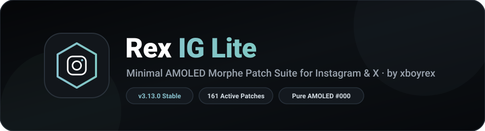

  

  &nbsp;&nbsp;&nbsp;
  

  

  
  
  

Minimal, high-control [Rex IG Lite](https://github.com/xboyrex/rex-ig-lite) Morphe patch bundle (`161` patches) for Instagram (`453.0.0.57.79`, `452.1.0.53.64`, and universal builds) and X, maintained by [xboyrex](https://github.com/xboyrex).

---

### Quick Setup in Morphe Manager

1. **One-Tap Source Add**: Tap [**Add to Morphe Manager**](https://morphe.software/add-source?github=xboyrex/rex-ig-lite) above, or paste `https://github.com/xboyrex/rex-ig-lite` into **Morphe Manager → Sources → Add patch source**.
2. **Automatic Updates**: Every push or tag release automatically compiles `patches-<version>.mpp`, updates [`patches-bundle.json`](patches-bundle.json) and [`patches-list.json`](patches-list.json), and publishes the latest GitHub Release so Morphe Manager updates in one tap.
3. **Quick Access Gesture**: Long-press the **Home button** in the bottom navigation bar (or long-press the top-left Instagram logo / tap `⬡`) to open the **Quick Access** sheet with tactile haptics.

---

### Core Highlights

| Module | Key Capabilities |
| :--- | :--- |
| **Ghost Mode** | Hide DM seen receipts, auto mark as read after reply, hide typing indicator, hide story views, hide live presence, view-once bypass, unlimited replays, secret voice notes, and screenshot detection block |
| **Downloads & Media** | Zero-prompt direct MediaStore download, 4K/1080p DASH video + AAC muxing, MP3 audio extraction, HD profile picture download, and 1-tap Carousel Download All |
| **Quick Access & More Options** | Hold Home tab for Quick Access (`SETTINGS` & `FEATURES`), smart Profile & Post sheets with OCR, bio/caption translation, clean link copy/share, and local vaults |
| **AMOLED UI & Gestures** | Pure `#000000` AMOLED theme, connected dark cards with crisp `1dp` borders, distinct vector iconography, tactile haptics across all controls, custom fonts, and double-tap/swipe guards |
| **Distraction-Free & Privacy** | Ad & sponsored pod blocker, tracking link sanitizer, timed Focus Lock, Inbox biometric/PIN lock, Hidden Chats vault, and Deleted Messages database |

---

### Official Channels & Links

- **Developer**: [xboyrex (Mayank)](https://github.com/xboyrex)
- **Telegram**: [@MayankDroid7](https://t.me/MayankDroid7) · [@OnyxHub7](https://t.me/OnyxHub7)
- **YouTube**: [@mayankdroid](https://youtube.com/@mayankdroid) · [@onyxdroid89](https://youtube.com/@onyxdroid89)
- **Instagram**: [@mayank.zx7](https://www.instagram.com/mayank.zx7)

---

### License

Licensed under [GPL-3.0-or-later](LICENSE) with the additional attribution terms in [NOTICE](NOTICE).
