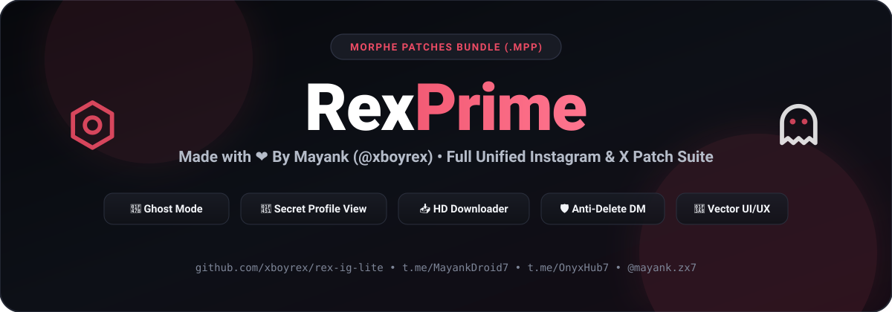

 

# xboyrex (`rex-ig-lite`)

**The Complete Unified Morphe Patch Suite for Instagram & X (Twitter)**  
*Crafted with ❤️ by **Mayank** ([@xboyrex](https://github.com/xboyrex)) • Zero Bloat • Custom Vector UI/UX • Self-Contained `.mpp` Build*

 

  

[**➕ Add xboyrex to Morphe Manager**](https://morphe.software/add-source?github=xboyrex/rex-ig-lite)

---

## 🕹️ Quick Setup in Morphe Manager

1. Tap [**➕ Add xboyrex to Morphe Manager**](https://morphe.software/add-source?github=xboyrex/rex-ig-lite) above (or in Morphe Manager go to **Sources → `+` → Remote** and paste `https://github.com/xboyrex/rex-ig-lite` or `https://raw.githubusercontent.com/xboyrex/rex-ig-lite/main/patches-bundle.json`).
2. Or download `patches-3.11.0.mpp` from [**Releases**](https://github.com/xboyrex/rex-ig-lite/releases/latest) and add it under **Sources → `+` → Local**.
3. Select **Instagram** or **X (Twitter)** in Morphe Manager, patch the original APK/APKM from APKMirror, and install.

---

## ✨ Highlights & xboyrex UI/UX Architecture

- **Two-Tone `xboyrex` Hero Header**: Clean dark header with white `Rex` + coral-pink `Prime` (`#EB4B64`), `Made with ❤️ By Mayank (@xboyrex)` subtitle, centered screen titles, and top-right instant Translator (`文A`) selector.
- **60+ Custom Android Vector Outline Icons (`RexVectorIcons`)**: Crisp 24×24 anti-aliased vector icons rendered natively on every settings category, toggle row, popup item, and action bar button.
- **Floating Quick Action Menu**: Tap the top-right Hexagon Nut icon (`rex_ic_settings`) on the feed or profile to open the floating Quick Action Menu (*xboyrex Settings*, *Ghost Mode*, *Long Video Splitter*, *Dark Mode*, *Developer Options*, *Restart App*, *DND Mode*, *Watch History*, *Saved Profiles*, and *Deleted Messages*).
- **12 Organized xboyrex Categories + Info**:
  1. **Premium**: Lifetime xboyrex status, Plus benefits unlock, and quick links to pro tools.
  2. **View Blocked Profiles Secretly 👑**: Anonymously inspect accounts that blocked you.
  3. **Ghost Mode**: Hide Story View, Hide Live View, Hide Screenshot Taken, Hide Typing Status, Hide Message Seen, Mark Chat as Read, Hide Story Replies, Hide Call Buttons, Ghost Instants, Unlimited Replays on Ephemeral Media, and Inbox Lock.
  4. **Notification**: Save Deleted Messages (Realtime Anti-Revoke DB Vault), Deleted Messages Viewer, Clear Saved Messages, and Share/Screenshot/Story Download alerts.
  5. **Privacy**: Disable Ads (Feed, Stories, Reels, Explore), Hide Suggested Content, Open Links Externally, Sanitize Share Links, Custom Sharing Domain, and Disable Analytics.
  6. **Gestures**: Disable Double-Tap Like (Post, Reel, Comment, Message), Swipe Camera Gesture toggle, Reels Tap & Hold 2x Speed, Reels Lock Controls, Story Auto-Pause, Long-Press Fast-Forward, Swipe Navigation, Volume Key Scroll, Triple-Tap Download, Shake to Clear Cache, and Double-Tap Profile Picture to Copy Bio.
  7. **Feed and Stories**: Follow Back Indicator, Colored Follow Indicator, Non-Follower Badge in Lists, Disable Video Autoplay, Disable Story Auto-Flip, Force High Quality Images (4096px), View Story Mentions, Story Timestamp Format, Loop Stories, Story Ring Scale, Force HD Stories, Max Upload Quality, Reel Ring Captions, Sound Button Overlay, and Show Exact Follower Count.
  8. **UI Tweaks**: Pure Black AMOLED & Material You themes, Navigation Bar Reorder/Hide, Action Bar Buttons, Custom Font & System Emoji manager, Like Animation previewer, Extended Post Options, and button visibility toggles.
  9. **Focus Mode**: Focus Lock with countdown timer & enforced distraction locks, Story Content Filters, Disable Stories/Explore/Comments/Highlights/Reels Scrolling/Swipe to Camera.
  10. **Miscellaneous**: Local vaults for *Saved Bios*, *Saved Captions*, *Saved Profiles*, and *Watch History*, plus *Message Translator*, *Voice Message Speed Control*, *Split Video for Stories*, *WhatsApp Share Integration*, and *Screenshot Blocker*.
  11. **Downloads**: In-feed, Reel, Story, and Instant download buttons, Direct Download, Split by Username subfolders, Embed Metadata, Custom Filename Template builder, and External Downloader integration.
  12. **Developer Options**: Protected by a safety warning modal; unlocks MetaConfig, Employee Options, User SSL/TLS Certificates, Recommended Flags, Experiment Decompiler, and ID Mappings.

---

## ⚙️ Patch Details

<!-- PATCHES_START -->
> **[v3.12.0](https://github.com/xboyrex/rex-ig-lite/releases/tag/v3.12.0)**&nbsp;&nbsp;•&nbsp;&nbsp;`main`&nbsp;&nbsp;•&nbsp;&nbsp;138 patches total

📦 Twitter&nbsp;&nbsp;•&nbsp;&nbsp;75 patches

 

**🎯 Supported versions:**

| 12.19.1-release.0 |
| :---: |

| 💊&nbsp;Patch | 📜&nbsp;Description | ⚙️&nbsp;Options |
|----------|----------------|-----------|
| [Add ability to copy media link](#add-ability-to-copy-media-link) |  |  |
| [Block redirecting to X Lite](#block-redirecting-to-x-lite) | Blocks redirecting to the new X Android UI on launch |  |
| [Block update screen](#block-update-screen) | Blocks the 'This app is out of date' update screen from being shown on launch |  |
| [Bring back twitter](#bring-back-twitter) | Bring back old twitter logo and name |  |
| [Change app icon](#change-app-icon) |  |  |
| [Change version code](#change-version-code) | Changes the version code of the app. This will turn off app store updates and allows downgrading an existing app install to an older app version. | • Version code |
| [Clear tracking params](#clear-tracking-params) | Removes tracking parameters when sharing links |  |
| [Control video auto scroll](#control-video-auto-scroll) | Control video auto scroll in immersive view |  |
| [Custom download folder](#custom-download-folder) | Change the download directory for video downloads |  |
| [Custom emoji font](#custom-emoji-font) | Customise emoji font style |  |
| [Custom font](#custom-font) | Customise font style |  |
| [Custom share menu](#custom-share-menu) | Overrides existing share menu and adds a new one |  |
| [Custom sharing domain](#custom-sharing-domain) | Allows for using domains like fxtwitter when sharing tweets/posts. |  |
| [Customise post font size](#customise-post-font-size) |  |  |
| [Customize Inline action Bar items](#customize-inline-action-bar-items) |  |  |
| [Customize Navigation Bar items](#customize-navigation-bar-items) |  |  |
| [Customize default reply sorting](#customize-default-reply-sorting) |  |  |
| [Customize explore tabs](#customize-explore-tabs) |  |  |
| [Customize notification tabs](#customize-notification-tabs) |  |  |
| [Customize profile tabs](#customize-profile-tabs) |  |  |
| [Customize search suggestions](#customize-search-suggestions) |  |  |
| [Customize search tab items](#customize-search-tab-items) |  |  |
| [Customize side bar items](#customize-side-bar-items) |  |  |
| [Customize timeline top bar](#customize-timeline-top-bar) |  |  |
| [Delete from database](#delete-from-database) | Delete entries from database(cache) |  |
| [Disable auto timeline scroll on launch](#disable-auto-timeline-scroll-on-launch) |  |  |
| [Disable chirp font](#disable-chirp-font) |  |  |
| [Download patch](#download-patch) | Unlocks the ability to download videos and gifs from Twitter/X |  |
| [Dynamic color](#dynamic-color) | Replaces the default Twitter Blue with the user's Material You palette. |  |
| [Enable PiP mode automatically](#enable-pip-mode-automatically) | Enables PiP mode when you close the app |  |
| [Enable Undo Posts](#enable-undo-posts) | Enables ability to undo posts before posting |  |
| [Enable debug menu for posts](#enable-debug-menu-for-posts) |  |  |
| [Enable force HD videos](#enable-force-hd-videos) | Videos will be played in highest quality always |  |
| [Export all activities](#export-all-activities) | Makes all app activities exportable. |  |
| [Force enable translate](#force-enable-translate) | Get translate option for all posts |  |
| [Handle custom twitter links](#handle-custom-twitter-links) | Adds support for opening custom twitter links such as vxtwitter, fxtwitter, and fixupx within the app. These will have to be manually enabled under the "Open by default" section in the app info! | • Custom sharing domains • Include unofficial vxtwitter/fxtwitter instance links |
| [Hide Banner](#hide-banner) | Hide new post banner |  |
| [Hide Community Notes](#hide-community-notes) |  |  |
| [Hide FAB](#hide-fab) | Adds an option to hide Floating action button |  |
| [Hide FAB Menu Buttons](#hide-fab-menu-buttons) |  |  |
| [Hide Live Threads](#hide-live-threads) |  |  |
| [Hide Recommended Users](#hide-recommended-users) | Hide recommended users that pops up when you follow someone |  |
| [Hide badges from navigation bar icons](#hide-badges-from-navigation-bar-icons) | Hides notification nudges & counts from navigation bar icons |  |
| [Hide bookmark icon in timeline](#hide-bookmark-icon-in-timeline) |  |  |
| [Hide community badges](#hide-community-badges) |  |  |
| [Hide followed by context](#hide-followed-by-context) | Hides followed by context under profile |  |
| [Hide hidden replies](#hide-hidden-replies) |  |  |
| [Hide immersive player](#hide-immersive-player) | Removes swipe up for more videos in video player |  |
| [Hide nudge button](#hide-nudge-button) | Hides follow/subscribe/follow back buttons on posts |  |
| [Hide post metrics](#hide-post-metrics) | Hides like, reposts etc counts. |  |
| [Hide promote button](#hide-promote-button) | Hides promote button under self posts |  |
| [Hide recommendation items](#hide-recommendation-items) | Adds options to hide recommendation items such as "Who to follow" and "Today's news" in timeline, search, and replies. |  |
| [Hook feature flag](#hook-feature-flag) |  |  |
| [Import/Export login token](#import-export-login-token) | Adds an feature to export and import the token of accounts. This is useful when logging in on your second device or when re-installing rex. |  |
| [Legacy share links](#legacy-share-links) | Brings back username on post share links. Works post 11.4x.xx |  |
| [Log server response](#log-server-response) | Log json responses received from server |  |
| [More information on profile](#more-information-on-profile) | Adds more details on the profile page |  |
| [Native downloader](#native-downloader) | Requires X 11.0.0-release.0 or higher. |  |
| [Native reader mode](#native-reader-mode) | Requires X 11.0.0-release.0 or higher. |  |
| [Native translator](#native-translator) | Requires X 11.0.0-release.0 or higher. |  |
| [No shortened URL](#no-shortened-url) | Get rid of t.co short urls. |  |
| [Pause search suggestions](#pause-search-suggestions) | Search suggestions will not be saved locally |  |
| [Remove Ads](#remove-ads) | Removed promoted posts, trends and google ads |  |
| [Remove premium upsell](#remove-premium-upsell) | Removes premium upsells |  |
| [Remove search suggestions](#remove-search-suggestions) | Hide/Remove search suggestion in explore section |  |
| [Remove view count](#remove-view-count) | Removes the view count from the bottom of tweets |  |
| [Restore legacy follower lists](#restore-legacy-follower-lists) | Restores the legacy follower and following list screen. |  |
| [Round off numbers](#round-off-numbers) | Enable or disable rounding off numbers |  |
| [Selectable Text](#selectable-text) | Makes bio and username selectable |  |
| [Share Tweet as Image](#share-tweet-as-image) | Share tweets as rendered image. Requires X 11.0.0-release.0 or higher. |  |
| [Show changelogs](#show-changelogs) | Shows changelogs when new a patch is installed. |  |
| [Show poll results](#show-poll-results) | Adds an option to show poll results without voting |  |
| [Show post source label](#show-post-source-label) | Source label will be shown only on public posts |  |
| [Show sensitive media](#show-sensitive-media) |  |  |
| [Support external downloader](#support-external-downloader) |  |  |

📦 Instagram&nbsp;&nbsp;•&nbsp;&nbsp;63 patches

 

**🎯 Supported versions:**

| 453.0.0.57.79 | 451.0.0.53.80 | 447.0.0.55.81 |
| :---: | :---: | :---: |

| 💊&nbsp;Patch | 📜&nbsp;Description | ⚙️&nbsp;Options |
|----------|----------------|-----------|
| [Add settings](#add-settings) | Adds settings to control preferences are patching |  |
| [Allow user network certificate](#allow-user-network-certificate) | Allows user network certificate for whitehat testing |  |
| [Change like animation](#change-like-animation) | Change the animation to one from existing Rings like animations |  |
| [Change version code](#change-version-code) | Changes the version code of the app. This will turn off app store updates and allows downgrading an existing app install to an older app version. | • Version code |
| [Clone](#clone) | Changes the package name and the app name. This allows you to install the patched app alongside the original Instagram app. Caution: Do not select the official Morphe's "Change package name" universal patch. | • Package name • App name |
| [Copy comment](#copy-comment) | Adds a button to copy comments on posts and reels. |  |
| [Custom font](#custom-font) | Adds an option to replace the app font with a font file from the device storage. |  |
| [Custom sharing domain](#custom-sharing-domain) | Allows for using custom domains when sharing posts, reels and stories. |  |
| [Customise story ring size](#customise-story-ring-size) |  |  |
| [Customise story timestamp](#customise-story-timestamp) | Customise the timestamp that shows when the story was posted |  |
| [Customize navigation bar](#customize-navigation-bar) | Choose which tabs appear in the bottom navigation bar and reorder them |  |
| [Disable Reels scrolling](#disable-reels-scrolling) | Disables the endless scrolling behavior in Instagram Reels, preventing swiping to the next Reel. Note: On a clean install, the 'Tip' animation may appear but will stop on its own after a few seconds. |  |
| [Disable ads](#disable-ads) |  |  |
| [Disable analytics](#disable-analytics) | Block analytics that are sent to Instagram/Facebook servers. |  |
| [Disable comments](#disable-comments) | Disables comments and hides comment buttons and counts on posts and reels. |  |
| [Disable discover people](#disable-discover-people) | Hides suggested accounts |  |
| [Disable double tap like](#disable-double-tap-like) | Disable double tap like on post, reel, comment and message |  |
| [Disable explore](#disable-explore) |  |  |
| [Disable highlights](#disable-highlights) |  |  |
| [Disable screenshot detection](#disable-screenshot-detection) | Disables screenshots detection in DM |  |
| [Disable stories](#disable-stories) |  |  |
| [Disable story flipping](#disable-story-flipping) | Disable automatic flipping/moving to next story |  |
| [Disable swipe to create](#disable-swipe-to-create) | Prevents opening the creation screen by swiping right on the home tab. |  |
| [Disable typing status](#disable-typing-status) |  |  |
| [Disable video autoplay](#disable-video-autoplay) |  |  |
| [Download media](#download-media) | Adds ability to download posts, reels, stories and highlights |  |
| [Download voice message](#download-voice-message) | Enables ability to download voice messages |  |
| [External downloader](#external-downloader) | Adds support to share post links directly to external downloader |  |
| [Filter stories](#filter-stories) | Filter stories to hide based on different categories |  |
| [Focus Lock](#focus-lock) | Commitment mode for cutting down on Instagram. Pick what to block (Reels, Explore) and a duration; once locked those protections are forced on and cannot be switched off. Reels shared with you still open. Unlocking early requires a 24 hour cooling-off period, and resetting or importing settings is blocked while locked. |  |
| [Friendship status indicator](#friendship-status-indicator) | Adds a follows you back status label on the profile page andshows a detailed friendship status breakdown on click |  |
| [Hide Instants view](#hide-instants-view) | Stops Instagram from marking Instants you watch as seen. |  |
| [Hide Reels follow button](#hide-reels-follow-button) | Removes the follow button from Reels. |  |
| [Hide group creation button on sharesheet](#hide-group-creation-button-on-sharesheet) |  |  |
| [Hide notes tray](#hide-notes-tray) | Hides notes tray in DM section |  |
| [Hide reshare button](#hide-reshare-button) | Hides the reshare button from both posts and reels. |  |
| [Hide save buttons](#hide-save-buttons) | Hides save buttons on posts and reels |  |
| [Hide share button](#hide-share-button) | Hides the share button on posts and reels |  |
| [Hide stories tray](#hide-stories-tray) | Hides stories tray from main feed. |  |
| [Hide suggested content](#hide-suggested-content) | Hides suggested stories, reels, threads (Suggested posts will still be shown). |  |
| [Improve image viewing](#improve-image-viewing) | Fetches max resolution images from server. |  |
| [Inbox lock](#inbox-lock) | Asks for your fingerprint, face or screen lock before the inbox is shown. |  |
| [Limit feed to following profiles](#limit-feed-to-following-profiles) | Filters the home feed to display only content from profiles you follow. |  |
| [Loop story](#loop-story) | Replay the current story when it ends |  |
| [Make ephemeral media permanent](#make-ephemeral-media-permanent) | Changes unexpired view once, view twice media to permanent view. |  |
| [Mark chat as read manually](#mark-chat-as-read-manually) | Adds option to mark a thread aka message as read manually |  |
| [More options on post](#more-options-on-post) | Adds an overflow menu button to get more options on post/reels, like copy description, copy username etc |  |
| [More options on profile](#more-options-on-profile) | Adds a new button to handle user related data like copy handle, download profile picture etc |  |
| [Open links externally](#open-links-externally) | Changes links to always open in your external browser, instead of the in-app browser. |  |
| [Recommended flags](#recommended-flags) | Developer flags suggested by the community |  |
| [Remove empty bottom space](#remove-empty-bottom-space) | Removes empty space below bottom navigation bar |  |
| [Sanitize share links](#sanitize-share-links) |  |  |
| [Save Instants](#save-instants) | Captures view-once Instants as you view them so you can re-view and download them later. |  |
| [Save deleted messages](#save-deleted-messages) | Captures incoming DMs locally as they arrive from the server and marks them when the sender deletes them. |  |
| [Save media comment](#save-media-comment) | Adds a button to save media comments on posts and reels. |  |
| [Theme](#theme) | Adds Material You and AMOLED controls to xboyrex settings on Android 12 and later. On Android 8–11, it applies a fixed Material You-style theme or an optional AMOLED theme. | • Pure-black AMOLED theme for Android 8–11 |
| [Unlock Plus benefits](#unlock-plus-benefits) | Unlocks 'Plus' subscription benefits that are checked locally. USE IT AT YOUR OWN RISK |  |
| [Unlock developer options](#unlock-developer-options) | Unlocks developer option by long pressing home icon |  |
| [Unlock employee options](#unlock-employee-options) | Unlocks all options using by employee for debugging |  |
| [View DMs anonymously](#view-dms-anonymously) |  |  |
| [View live anonymously](#view-live-anonymously) |  |  |
| [View stories anonymously](#view-stories-anonymously) |  |  |
| [View story mentions](#view-story-mentions) | Add option to view visible and hidden story mentions. |  |

<!-- PATCHES_END -->

---

## 🌐 Connect with Mayank (`@xboyrex`)

- **GitHub**: [@xboyrex](https://github.com/xboyrex)
- **Instagram**: [@mayank.zx7](https://www.instagram.com/mayank.zx7)
- **YouTube**: [@mayankdroid](https://youtube.com/@mayankdroid?si=slX8DDU0dpLSIYyY) • [@onyxdroid89](https://youtube.com/@onyxdroid89?si=9gxpZfa3bpI9PKku)
- **Telegram Channel**: [t.me/MayankDroid7](https://t.me/MayankDroid7)
- **Telegram Discussion Group**: [t.me/OnyxHub7](https://t.me/OnyxHub7)
- **Email**: [xboyrex496@gmail.com](mailto:xboyrex496@gmail.com)

---

## 📄 License

Licensed under the **GNU General Public License v3.0 (GPLv3)**. See [LICENSE](LICENSE) and [NOTICE](NOTICE) for details.
