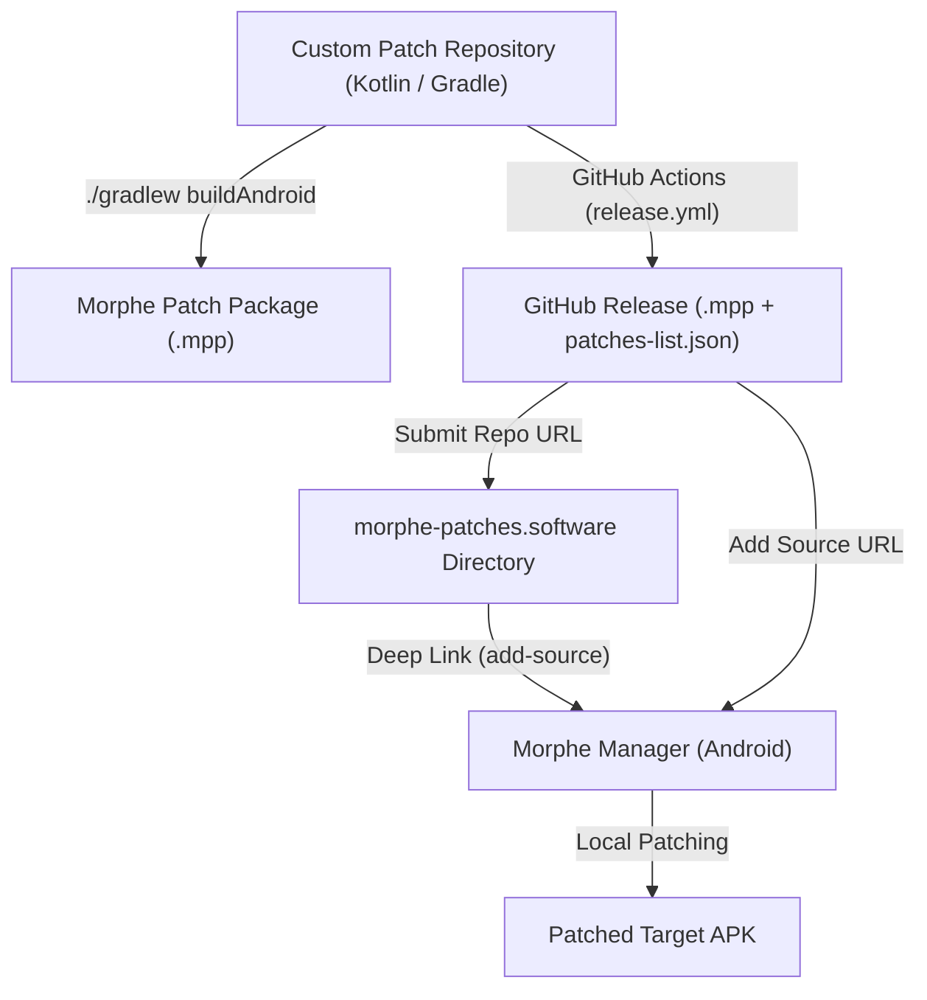

# Morphe Patches Architecture & Contribution Guide

This document summarizes the research, architecture, repository setup, and publishing workflow for developing and releasing custom patch bundles compatible with the **Morphe** ecosystem and getting indexed on **morphe-patches.software**.

---

## 1. Overview of the Morphe Ecosystem

| Component | Repository / URL | Role |
| :--- | :--- | :--- |
| **Morphe Manager** | [`MorpheApp/morphe-manager`](https://github.com/MorpheApp/morphe-manager) | Android application used by end-users to apply patches directly on device. Supports Simple Mode (curated defaults) and Expert Mode (granular patch selection). |
| **Morphe Desktop** | [`MorpheApp/morphe-desktop`](https://github.com/MorpheApp/morphe-desktop) | Desktop CLI/GUI for local compilation and patching of APKs. |
| **Morphe Patcher** | [`MorpheApp/morphe-patcher`](https://github.com/MorpheApp/morphe-patcher) | Core library (Kotlin/Java) providing Dalvik bytecode disassembling/assembling (via dexlib2), resource handling (via ARSCLib), and patch execution APIs. |
| **Patches Template** | [`MorpheApp/morphe-patches-template`](https://github.com/MorpheApp/morphe-patches-template) | Official starter template for building custom, standalone patch repositories. |
| **Community Directory** | [morphe-patches.software](https://morphe-patches.software) | Public index for community-created patch bundles. Allows users to browse bundles and add them via deep links directly into Morphe Manager. |

---

## 2. Morphe Patch Architecture

Morphe decouples patch definitions from the core manager, allowing independent publishers to host and distribute their own bundles.



### Core Patch Types
1. **`bytecodePatch`**:
   - Modifies Dalvik Executable (DEX) bytecode instructions.
   - Operates using fingerprints (method signatures, strings, opcode sequences) to avoid breaking across app updates and obfuscation.
2. **`resourcePatch`**:
   - Modifies compiled Android resources (`resources.arsc`, XML layouts, drawables, strings).
3. **`rawPatch`**:
   - Performs direct manipulation of arbitrary files inside the APK container.

### Patch Declaration Structure (Kotlin DSL)
Each patch declares its metadata and target package compatibility:

```kotlin
val customAppPatch = bytecodePatch(
    name = "Feature Name",
    description = "Description of the modification or feature.",
    default = true
) {
    compatibleWith(
        Compatibility(
            name = "Target App Name",
            packageName = "com.example.targetapp",
            apkFileType = ApkFileType.APK,
            targets = listOf(AppTarget(version = "1.0.0")) // Optional version lock
        )
    )

    execute {
        // Fingerprinting and instruction replacement logic
    }
}
```

---

## 3. Repository Structure & Configuration

When developing a patch bundle, structure the repository using `MorpheApp/morphe-patches-template`:

```
my-morphe-patches/
├── .github/
│   └── workflows/
│       ├── build.yml         # PR and CI verification
│       └── release.yml       # Semantic-release pipeline
├── patches/
│   ├── build.gradle.kts      # Patch metadata and dependencies
│   └── src/
│       └── main/
│           ├── kotlin/       # Kotlin patch definitions
│           └── resources/    # Additional assets/smali if needed
├── gradle/
├── build.gradle.kts
├── settings.gradle.kts
└── .releaserc                # Semantic-release configuration
```

### Key Gradle Configuration (`patches/build.gradle.kts`)
- Define your group, version, and dependencies on `app.morphe:morphe-patcher`.
- Set repository metadata (author, website, source URL) so Morphe Manager displays author attribution properly.

---

## 4. CI/CD and Automated Release Workflow

Morphe relies strictly on **automated semantic releases** via GitHub Actions:

### Release Rules:
* **Conventional Commits**:
  * `feat: add new patch` $\rightarrow$ Triggers a minor version release (`v1.1.0`).
  * `fix: resolve fingerprint match failure` $\rightarrow$ Triggers a patch release (`v1.0.1`).
  * `chore: update dependencies` $\rightarrow$ Does not trigger a release.
* **Automated Artifacts**:
  * `patches-<version>.mpp`: Compiled patch bundle containing DEX code and patch descriptors.
  * `patches-list.json`: Manifest listing all patches, descriptions, compatibility, and options.
  * `CHANGELOG.md`: Generated changelog.
* **Important Guidelines**:
  * **Never create GitHub releases manually**: The release action handles GPG signing and JSON metadata generation.
  * **Never edit `patches-list.json` manually**: It is automatically generated during the build task.

### Signing Keys Setup:
Generate a signing key for the repository to allow Morphe Manager to verify patch bundle integrity:
```bash
./gradlew generateSigningKey
```
Store the generated private key in your repository secrets (`MORPHE_SIGNING_KEY` / GPG secrets as specified in `.github/workflows/release.yml`).

---

## 5. Publishing on `morphe-patches.software`

Once your repository has at least one valid GitHub Release containing the `.mpp` bundle and `patches-list.json`:

1. **Submit the Bundle**:
   - Visit [https://morphe-patches.software](https://morphe-patches.software).
   - Click on **"Submit a bundle"**.
   - Provide your public GitHub repository URL (e.g., `https://github.com/<username>/<repo>`).
   - Add contact email and release notes (optional).
2. **Direct Import Link**:
   - Users can import your repository directly into Morphe Manager using the URL scheme:
     ```
     https://morphe.software/add-source?github=<username>/<repo>
     ```
3. **Manual Import**:
   - In Morphe Manager: Go to **Settings** $\rightarrow$ **Sources** $\rightarrow$ **Add Custom Source** $\rightarrow$ Paste your GitHub repository URL.

---

## 6. Target Application Notes: Zank Remote (`zank.remote`)

- **Package Name**: `zank.remote`
- **Application Type**: Android & Android TV remote controller.
- **Target Components for Customization**:
  - Remote layout controls and interface tweaks.
  - Ad display containers and network handlers.
  - Pro status verification hooks and state handlers.
