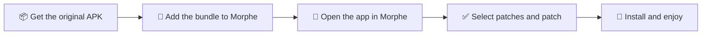
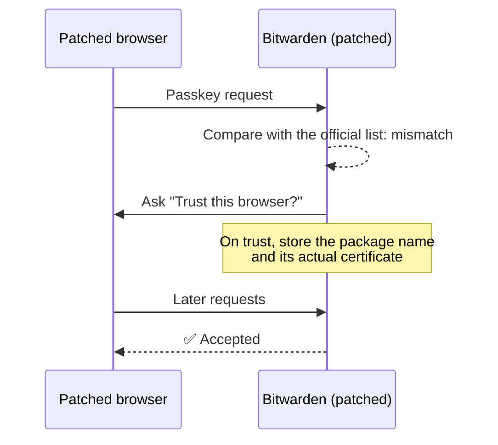

<div align="center">

# Kanye's Patches

**Custom fonts for browsers and note apps, plus small fixes for things that get in the way. Patches for use with Morphe.**

[](LICENSE)


<a href="https://morphe.software/add-source?github=zimza1abim/kanye-morphe-patches">
  
</a>

[Supported apps](#-supported-apps) · [Features](#-features) · [Getting started](#-getting-started) · [Supported versions](#-supported-versions) · [FAQ](#-faq)

</div>

> [!TIP]
> **Add to Morphe:** tap the button above, or Sources → **+** → Remote → `github.com/zimza1abim/kanye-morphe-patches`
>
> Each `.mpp` on [Releases](../../releases) is built by GitHub Actions from the source in this repository and signed. Morphe checks the signature before installing an update. Development happens elsewhere and is synced here on every release.

---

## 📱 Supported apps

| | App | Package | Highlights |
|:---:|---|---|---|
| 🦁 | **Brave Browser** | `com.brave.browser` | Custom webpage fonts · Auto-hiding address bar |
| 🌐 | **Bare Browser** | `org.barebrowser` | Custom webpage fonts · Auto-hiding address and bottom bars · Skip welcome screens |
| 🛰️ | **Titanium Browser** | `io.github.jqssun.helium` | Custom webpage fonts · Auto-hiding address bar · No tab-close undo bar |
| 📓 | **Notesnook** | `com.streetwriters.notesnook` | App-wide custom font |
| 🗒️ | **Joplin** | `net.cozic.joplin` | Flash-free custom font · Blush Pink theme |
| 🧩 | **Anytype** | `io.anytype.app` | App-wide custom font |
| 🔐 | **Bitwarden** | `com.x8bit.bitwarden` | Passphrase length · Custom special characters · Passkeys in patched browsers |

Get the original APKs from each app's official GitHub releases.

| App | Where | File |
|---|---|---|
| Brave | [brave/brave-browser](https://github.com/brave/brave-browser/releases) (`Release v…`) | `Bravearm64Universal.apk` |
| Bare | [BareBrowser/bare-browser](https://github.com/BareBrowser/bare-browser/releases) | `Bare-<version>-arm64-v8a.apk` |
| Titanium | [jqssun/android-titanium-browser](https://github.com/jqssun/android-titanium-browser/releases) | `…-arm64-v8a.apk` |
| Notesnook | [streetwriters/notesnook](https://github.com/streetwriters/notesnook/releases) (`Notesnook Android v…`) | `notesnook-arm64-v8a.apk` |
| Joplin | [laurent22/joplin-android](https://github.com/laurent22/joplin-android/releases) | `joplin-v<version>.apk` |
| Anytype | [anyproto/anytype-kotlin](https://github.com/anyproto/anytype-kotlin/releases) | `anytype-<version>-arm64-v8a.apk` |
| Bitwarden | [bitwarden/android](https://github.com/bitwarden/android/releases) (`Password Manager …`) | `com.x8bit.bitwarden.apk` |

> [!IMPORTANT]
> Always start from the **original, unpatched APK**. Patching an APK that was already patched can fail or misbehave.

---

## ✨ Features

### 🔤 Fonts

<table>
<tr>
<th width="33%">🌍 Browsers (Brave · Bare · Titanium)</th>
<th width="33%">📝 Notes (Notesnook · Joplin)</th>
<th width="33%">🧩 Anytype</th>
</tr>
<tr valign="top">
<td>

- Applies your font to **webpages**
- Web icons, emoji and glyphs your font lacks keep their original fonts
- Use an installed **font APK** (such as Samsung FlipFont fonts) or a **TTF, OTF or TTC file**
- Picker with search and previews

</td>
<td>

- Covers the **whole app**: UI, note list, editor and reader
- Applied before the first frame is drawn, so **text never flashes** in the old font
- Icon fonts, emoji and math (KaTeX) keep their own fonts

</td>
<td>

- Adds a **Font** row to the settings
- Pick a TTF or OTF file to use across the app
- The file is validated and copied into the app's private storage

</td>
</tr>
</table>

### 🧭 Browser tweaks

| Feature | Apps | What it does |
|---|---|---|
| Auto-hiding address bar | Brave · Bare · Titanium | The address bar hides while scrolling **even when an accessibility service that performs gestures is enabled**. Bare hides its bottom bar too. It still stays put on `chrome://` pages, while an input is focused, and on error pages. |
| Skip welcome screens | Bare | Stops the welcome and setup pages from appearing at startup. Existing settings are kept. |
| No tab-close undo bar | Titanium | Removes the "Closed tab / Undo" bar shown after closing tabs. Closed tabs remain available in **Recent tabs**. |

### 🔐 Bitwarden

| Feature | What it does |
|---|---|
| Passphrase total length | Shows the **total character count** (words, separators and number) above a generated passphrase. |
| Custom special characters | Adds a button beside the generator's special characters toggle to choose which characters are used. Leave it empty to restore the default `!@#$%^&*`. |
| Passkeys in patched browsers | Lets browsers patched with Morphe use Bitwarden passkeys. [Details ↓](#-bitwarden-passkeys-in-patched-browsers) |

---

## 🚀 Getting started



1. Download the **original APK** from the table above.
2. In Morphe, **add the repository** above as a remote source, or download the `.mpp` from [Releases](../../releases).
3. Choose the app, select the patches you want, and patch.
4. Install the result and turn the feature on from the location below.

### 📍 Where to find the font settings

| App | Location | Notes |
|---|---|---|
| Brave · Bare · Titanium | <kbd>Settings</kbd> → <kbd>Appearance</kbd> → <kbd>Custom font</kbd> | **Fully restart** the browser after changing fonts |
| Notesnook | <kbd>Settings</kbd> → <kbd>Customization</kbd> → <kbd>Appearance</kbd> → <kbd>Font</kbd><br>or long-press the app icon → <kbd>Font</kbd> | Tap <kbd>Restart</kbd> to redraw open screens |
| Joplin | <kbd>Settings</kbd> → <kbd>Appearance</kbd> → <kbd>Custom font</kbd> | Blush Pink is in the theme list |
| Anytype | <kbd>Settings</kbd> → <kbd>Application</kbd> → <kbd>Font</kbd> → <kbd>Choose custom font…</kbd> | TTF or OTF files |

> [!TIP]
> To go back to the original font, pick the default option on the same screen (Joplin: <kbd>Turn off custom font</kbd>).

### 🔑 Bitwarden passkeys in patched browsers

Morphe re-signs every app it patches. Bitwarden checks well-known browsers such as Brave against their **official signing certificates**, so a patched Brave normally fails with *"browser signature does not match"* and cannot use passkeys.

With **Bitwarden trust re-signed browsers for passkeys** applied:



- The package name is stored **together with the actual certificate**, so another app with the same package name is still rejected.
- Trusted browsers can be managed from the privileged apps list in Bitwarden's autofill settings.

> [!WARNING]
> A patched Bitwarden is re-signed as well, so **syncing with the Bitwarden Authenticator app does not work**. Authenticator only accepts a password manager signed with Bitwarden's official certificate.

---

## 📋 Supported versions

Each listed version passed patching and verification. Other versions may fail to patch or may not work.

<!-- VERSIONS_START -->
| App | Package | Supported versions |
|---|---|---|
| Anytype | `io.anytype.app` | `0.48.10` `0.49.0` `0.50.4` |
| Titanium Browser | `io.github.jqssun.helium` | `155.0.8059.79` `156.0.8078.47` `156.0.8078.73` `156.0.8078.79` `157.0.8103.38` `157.0.8103.50` `157.0.8103.78` |
| Bare Browser | `org.barebrowser` | `1.0.0` `1.0.1` `2.0.2` `2.0.3` |
| Bitwarden | `com.x8bit.bitwarden` | `2026.10.1` |
| Brave Browser | `com.brave.browser` | `1.97.57` `1.98.58` `1.98.59` `1.98.60` `1.98.62` `1.98.63` `1.99.55` |
| Joplin | `net.cozic.joplin` | `3.7.8` `3.7.10` `3.7.11` |
| Notesnook | `com.streetwriters.notesnook` | `3.4.14` `3.4.15` |
<!-- VERSIONS_END -->

> [!NOTE]
> New releases are **checked automatically every day** in the development repository. Each new APK is patched and its rewritten dex is verified. For browsers, the check also confirms that the font engine can locate the code it hooks. Only versions that pass are added here.

## 🩹 Patches

<!-- PATCHES_START -->
> **[v0.0.9](../../releases/tag/v0.0.9)**&nbsp;&nbsp;•&nbsp;&nbsp;17 patches total
<details>
<summary>📦 Anytype&nbsp;&nbsp;•&nbsp;&nbsp;1 patch</summary>
<br>

**🎯 Supported versions:**

| 0.48.10 | 0.49.0 | 0.50.4 |
| :---: | :---: | :---: |

| 💊&nbsp;Patch | 📜&nbsp;Description | ⚙️&nbsp;Options |
|----------|----------------|-----------|
| [Anytype custom font](#anytype-custom-font) | Use a TTF or OTF font across Anytype. Settings > Application > Font. |  |

</details>

<details>
<summary>📦 Titanium Browser&nbsp;&nbsp;•&nbsp;&nbsp;4 patches</summary>
<br>

**🎯 Supported versions:**

| 155.0.8059.79 | 156.0.8078.47 | 156.0.8078.73 | 156.0.8078.79 | 157.0.8103.38 | 157.0.8103.50 | 157.0.8103.78 |
| :---: | :---: | :---: | :---: | :---: | :---: | :---: |

| 💊&nbsp;Patch | 📜&nbsp;Description | ⚙️&nbsp;Options |
|----------|----------------|-----------|
| [Auto-hide toolbar with accessibility services](#auto-hide-toolbar-with-accessibility-services) | Lets the address bar auto-hide while an accessibility service is on. |  |
| [Hide tab close undo snackbar](#hide-tab-close-undo-snackbar) | Hides the Undo bar after closing a tab. Closed tabs stay in Recent tabs. |  |
| [Titanium custom webpage fonts](#titanium-custom-webpage-fonts) | Renders webpages in your chosen font. Icons and emoji keep theirs. Restart the browser after changing. |  |
| [Titanium font picker in settings](#titanium-font-picker-in-settings) | Adds Settings > Appearance > Custom font. Use a font APK or a TTF, OTF or TTC file. |  |

</details>

<details>
<summary>📦 Bare Browser&nbsp;&nbsp;•&nbsp;&nbsp;4 patches</summary>
<br>

**🎯 Supported versions:**

| 1.0.0 | 1.0.1 | 2.0.2 | 2.0.3 |
| :---: | :---: | :---: | :---: |

| 💊&nbsp;Patch | 📜&nbsp;Description | ⚙️&nbsp;Options |
|----------|----------------|-----------|
| [Bare auto-hide toolbar with accessibility services](#bare-auto-hide-toolbar-with-accessibility-services) | Lets the address bar auto-hide while an accessibility service is on. |  |
| [Bare custom webpage fonts](#bare-custom-webpage-fonts) | Renders webpages in your chosen font. Icons and emoji keep theirs. Restart the browser after changing. |  |
| [Bare font picker in settings](#bare-font-picker-in-settings) | Adds Settings > Appearance > Custom font. Use a font APK or a TTF, OTF or TTC file. |  |
| [Skip Bare welcome screens](#skip-bare-welcome-screens) | Skips the welcome and setup pages at startup. |  |

</details>

<details>
<summary>📦 Bitwarden&nbsp;&nbsp;•&nbsp;&nbsp;3 patches</summary>
<br>

**🎯 Supported versions:**

| 2026.10.1 |
| :---: |

| 💊&nbsp;Patch | 📜&nbsp;Description | ⚙️&nbsp;Options |
|----------|----------------|-----------|
| [Bitwarden custom special characters](#bitwarden-custom-special-characters) | Choose which special characters the password generator uses. |  |
| [Bitwarden passphrase total length](#bitwarden-passphrase-total-length) | Shows the total character count above a generated passphrase. |  |
| [Bitwarden trust re-signed browsers for passkeys](#bitwarden-trust-re-signed-browsers-for-passkeys) | Lets you trust Morphe-patched browsers for passkeys instead of failing the signature check. |  |

</details>

<details>
<summary>📦 Brave Browser&nbsp;&nbsp;•&nbsp;&nbsp;3 patches</summary>
<br>

**🎯 Supported versions:**

| 1.97.57 | 1.98.58 | 1.98.59 | 1.98.60 | 1.98.62 | 1.98.63 | 1.99.55 |
| :---: | :---: | :---: | :---: | :---: | :---: | :---: |

| 💊&nbsp;Patch | 📜&nbsp;Description | ⚙️&nbsp;Options |
|----------|----------------|-----------|
| [Brave auto-hide toolbar with accessibility services](#brave-auto-hide-toolbar-with-accessibility-services) | Lets the address bar auto-hide while an accessibility service is on. |  |
| [Brave custom webpage fonts](#brave-custom-webpage-fonts) | Renders webpages in your chosen font. Icons and emoji keep theirs. Restart the browser after changing. |  |
| [Brave font picker in settings](#brave-font-picker-in-settings) | Adds Settings > Appearance > Custom font. Use a font APK or a TTF, OTF or TTC file. |  |

</details>

<details>
<summary>📦 Joplin&nbsp;&nbsp;•&nbsp;&nbsp;1 patch</summary>
<br>

**🎯 Supported versions:**

| 3.7.8 | 3.7.10 | 3.7.11 |
| :---: | :---: | :---: |

| 💊&nbsp;Patch | 📜&nbsp;Description | ⚙️&nbsp;Options |
|----------|----------------|-----------|
| [Joplin zero-flash custom font](#joplin-zero-flash-custom-font) | Flash-free custom font for all Joplin text, plus the Blush Pink theme. |  |

</details>

<details>
<summary>📦 Notesnook&nbsp;&nbsp;•&nbsp;&nbsp;1 patch</summary>
<br>

**🎯 Supported versions:**

| 3.4.14 | 3.4.15 |
| :---: | :---: |

| 💊&nbsp;Patch | 📜&nbsp;Description | ⚙️&nbsp;Options |
|----------|----------------|-----------|
| [Notesnook custom font](#notesnook-custom-font) | Use a device font or a TTF, OTF or TTC file across Notesnook. Icons, emoji and math keep theirs. |  |

</details>

<!-- PATCHES_END -->

---

## 🛠️ Building from source

<details>
<summary><b>Requirements and build command</b></summary>
<br>

| Requirement | Version |
|---|---|
| JDK | 21 |
| Android SDK | 36 (`sdk.dir` in `local.properties`, or `ANDROID_HOME`) |
| GitHub token | `read:packages`, set as `gpr.user` and `gpr.key` in `~/.gradle/gradle.properties` (Morphe libraries come from GitHub Packages) |

```shell
git clone <this repository>
cd <repository folder>
./gradlew buildAndroid
```

The bundle is written to `patches/build/libs/patches-<version>.mpp`.

The browser font engines (`.so`) are committed prebuilt, so no NDK is needed. To rebuild an engine yourself, see `native/brave/font/build-arm64.sh`.

> [!CAUTION]
> `./gradlew :patches:build` produces a bundle without `classes.dex`. Always use `buildAndroid`.

</details>

---

## ❓ FAQ

<details>
<summary><b>Can I update a patched app from the store?</b></summary>
<br>

No. A patched app has a different signature, so the original app's updates cannot install over it. When a new version comes out, patch that version's original APK and install it. Patching with the same Morphe signing key keeps your app data.

</details>

<details>
<summary><b>Will switching from the original app to the patched one erase my data?</b></summary>
<br>

The first time, yes. The original app has to be uninstalled before the patched one can be installed, which removes its local data. Sync or back up first if the app supports it.

</details>

<details>
<summary><b>Why are the browser fonts ARM64 only?</b></summary>
<br>

Webpage fonts are applied by hooking the browser's native rendering code (`libchrome.so`), and the engine that does this is built for ARM64 only. Almost all modern Android devices are ARM64.

</details>

<details>
<summary><b>I changed the font, but only some text changed.</b></summary>
<br>

- Browsers apply the new font only after they are **fully closed and reopened**.
- Icons, emoji and characters missing from your font intentionally keep their original fonts, so that no text turns into empty boxes (□).

</details>

<details>
<summary><b>Is my font or any usage data sent anywhere?</b></summary>
<br>

No. The patch code makes no network requests. The font you choose is stored only in the app's private storage.

</details>

---

## 🧾 Third-party

| Component | License | Where |
|---|---|---|
| [ShadowHook](https://github.com/bytedance/android-inline-hook) (ByteDance) | MIT | `libshadowhook.so`, `native/brave/font/include/shadowhook.h` |
| [Joplin](https://github.com/laurent22/joplin) | AGPL-3.0 | `patches/src/main/resources/joplin/` bundles, built from the official `android-v<version>` tags with `scripts/joplin/` |
| [Notesnook](https://github.com/streetwriters/notesnook) | GPL-3.0 | `patches/src/main/resources/notesnook/` bundles, built from the official `<version>-android` tags with `scripts/notesnook/` |

---

## 📄 License

Released under [GPLv3](LICENSE).

This is a collection of patches for use with [Morphe](https://github.com/MorpheApp). It is not made or endorsed by the Morphe project. App names and trademarks belong to their respective owners.
